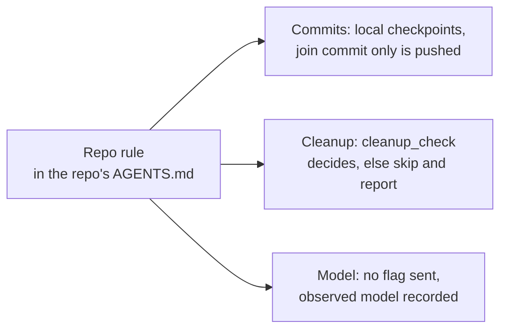
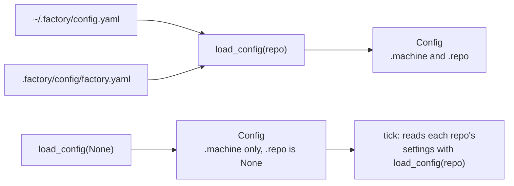

# 3. Module: kit and configuration

Part of the [phase 1 design](../phase-1.md#module-map). Build wave: 1. Contracts and acceptance criteria are in this file; shared types are in [section 18](../shared/18-shared-contracts.md). Terms such as run, stage, task, attempt and rework are defined in the [glossary](../phase-1.md#2-glossary).

The kit lives in `factory/` and is replaced whole on update. Local settings live in `.factory/config/` and are committed. All run state lives outside the repo, in the machine's factory home (`~/.factory`), so a moved or deleted repo never loses its runs.

```text
factory/                    the kit: replaced whole on update, never edited
  AGENTS.md                 shared rules, read by every harness
  workflows/                bug-fix, feature, new-app, chore, research
  stages.map.yaml           stage name to skill reference
  skills.lock               pinned upstream skills and allowlist
  requirements.lock         pinned Python dependencies of the engine
  skills/own/               original skills: verify, critique, gates
  schemas/                  request, run, task, usage, event, decision, feedback, triage, plugin, packet,
                            stage-report, test-report, source-notes, review-findings,
                            factory-config (factory.yaml), merge-policy
                            (12 are written in wave 0. `stage-report`, `test-report`, `source-notes` and `review-findings` had no fields in the
                            spec; the owner accepted the wave 3 drafts as the phase 1 schemas, see
                            [module 5](05-workflows-and-plugins.md#report-schemas)). `merge` is checked by `factory/schemas/merge.schema.json`, written by hand because module 13 builds the file from a dict; its tests are in `tests/delivery/test_delivery.py`)
  engine/                   Python engine and the factory CLI (copied by init and upgrade without its tests/ folder, so each snapshot carries it)
  adapters/tracker/         file, github
  adapters/worker/          claude, command, fake
  dashboard/                the dashboard page (plain HTML in 1a, prebuilt React bundle in 1b), served by the launcher
  shims/                    generators for .claude skill links (generated into each worktree as `factory-<skill>` folders, git-excluded)

.factory/config/            in the repo, committed: local settings that survive updates
  factory.yaml              base branch, repo key override, notify, retention
  merge-policy.yaml         auto-merge rules
  workflows/                repo copies that win over factory/workflows
  plugins/                  plugin manifests
  overrides/                skill overrides and stages.map additions

.factory/                   in the repo, git-ignored except config/
  .gitignore                "*", "!config/", "!config/**", "!.gitignore"
  inbox/                    markdown requests waiting for intake

~/.factory/                 the factory home ($FACTORY_HOME), one per machine user
  config.yaml               machine settings: harnesses, repos, worktree root, tick
  env                       values for ${...}, readable only by you
  runs/<repo key>/<run id>/ all run state, for every repo on the machine
  worktrees/                default worktree root
  archive/<repo key>/       zipped finished runs
  history.jsonl             one line per finished run
  tick.json                 last tick time and result
  sync/<repo key>.json      last_sync cursor for each repo
  slots/                    `0` to `max_workers - 1`: one lock file for each slot, held by the engine whose worker uses it
  slots/repo/<repo key>/    `0` to `concurrency - 1`: the same for one repo's cap (the repo key has `/` written as `__`)
  venvs/<lock hash>/        Python environment for each distinct requirements.lock (phase 1b; not built in 1a)
  kits/<kit hash>/          snapshot of factory/ and .factory/config/ taken when a run is created
  plugin-hashes.json        reviewed plugin hashes per repo key, never stored in a repo
  logs/                     tick and dashboard logs
```

`.factory/.gitignore` ignores everything except `config/`, so the factory never edits the repo's own `.gitignore`. It needs `!config/**` as well as `!config/`: `*` also matches the files inside `config/`, and `!config/` alone re-includes only the folder, so git tracked none of its files (found in wave 1, 2026-11-14, with `git add --dry-run`).

**YAML is read with YAML 1.2 booleans** (found in wave 0, 2026-11-14). A plain `yaml.safe_load` reads `off`, `on`, `yes` and `no` as booleans, so `helpers: {mode: off}` becomes `False` and a plugin hook key `on:` becomes `True`. Both appear in the spec's own examples ([module 5](05-workflows-and-plugins.md)). Every YAML file the factory reads (config, workflows, plugins, decision files) goes through one safe loader in `config.py` that treats only `true` and `false` as booleans. The loader is a subclass of `SafeLoader` and never runs code. Test: the spec's own examples load with `mode == "off"`.

**Settings**

```yaml
# .factory/config/factory.yaml   (in the repo, committed)
base_branch: main
tracker: github                  # file | github
harness: claude                  # claude or codex (owner decision 2026-11-24); codex needs harnesses.codex in the machine file
concurrency: 4                   # parallel workers for this repo, across all its runs; the machine-wide cap is max_workers in the machine file
repo_key: null                   # override, such as github.com/acme/report
notify: {github_mention: author, desktop: true, webhook: null, remind_after_hours: 24}
retention: {archive_after_days: 7, delete_archive_after_days: 90, keep_failed_days: 14,
             worker_log_max_mb: 50, auto_gc: false}   # auto_gc is read by no code yet; housekeeping runs only by `factory gc` (module 17)
infra_wait_hours: 6              # how long a run waits for GitHub or the network before it is blocked
serialize_overlapping_runs: false   # true: a run whose files overlap an active run waits at its next stage (module 7)
cleanup_check: ["scripts/compare-worktree"]   # optional, a command the repo provides (example name): run in a worktree that is not clean before removing it; exit 0 = safe to remove

# ~/.factory/config.yaml   (factory home, per machine)
repos: [/work/report, /work/payments-api]
worktree_root: /home/me/dev/worktree     # default: ~/.factory/worktrees
worktree_path: "{root}/{repo}/{run_id}"
dashboard_url: http://127.0.0.1:8765
max_workers: 6                   # machine-wide cap on running workers, shared by every engine process through slots/
```

**Repo rules.** Some repos have their own rules about what an agent may do. The engine meets three of them without a switch, except `cleanup_check`:

| Repo rule | How the engine meets it |
| --- | --- |
| "No commit without a request" | Checkpoint commits stay on a local task branch that is never pushed, and only the join commit is pushed ([module 7](07-git-and-github-operations.md)). The owner accepts this by running `factory init` in the repo; the decision is P1, in [module 7](07-git-and-github-operations.md). |
| "Remove a worktree only after comparing its files" | `cleanup_check` names the comparison. Unset: a worktree that is not clean is skipped and reported. Set: its exit code decides ([module 17](17-housekeeping.md)). |
| "No model override" | The engine sends no model flag unless a model is set in config, and records the model the harness reports ([module 9](09-worker-adapters-and-governed-helpers.md), [module 14](14-token-tracking.md)). |



Machine settings (worktree root, tool paths) come from the per-machine file. Notification settings (`notify`, including desktop) come from `factory.yaml`. Repo settings come from `factory.yaml`. The one environment override built is `FACTORY_WORKTREE_ROOT`, which replaces `worktree_root`. No CLI flag changes config yet, and no other key has an environment override (owner decision D6, 2026-11-22: the broad precedence of flag, then environment variable, then file is not built, and a later request adds an override where one is needed).

**Defaults.** These are the values a key takes when its file does not set it. Machine: `max_workers: 6`. Repo: `concurrency: 4`, `infra_wait_hours: 6`, `serialize_overlapping_runs: false`. Any other key has no default and is off until its module reads it.

**`max_workers` and `concurrency`.** Both caps are slots, and a slot is an OS lock on a file (`factory_engine/slots.py`). Before it starts a worker the engine takes slots from the repo's pool (`slots/repo/<repo key>/`, `concurrency` of them) and from the machine pool (`slots/`, `max_workers` of them), all of them or none, and holds them until that worker has ended. So two runs of one repo share `concurrency`, and every run on the machine shares `max_workers`, whichever engine process drives them: the tick starts one engine process for each run, so a count in one process could not cap them. A task that reserves helper slots (module 6) takes all of them at once, and never more than a pool holds. A task with no free slot waits and tries again on the next poll. A crashed engine frees its slots when the kernel closes its files, so no count goes stale and no engine needs to know of another. Changing a limit takes effect on the next slot taken; workers already running keep theirs. A limit below 1 starts no worker at all, so a `max_workers: 0` or `concurrency: 0` line stalls runs rather than removing the cap.

**Missing files.** A missing `~/.factory/config.yaml` is the defaults above, not an error. A missing `.factory/config/factory.yaml` is a repo with no config: `load_config` still loads, with only the repo defaults, and `doctor` reports `repo-config` failed with the fix `factory init`.

**One `Config`.** `load_config` returns one `Config` type ([section 18](../shared/18-shared-contracts.md)) with two parts. `.machine` holds the keys of the per-machine file, and `.repo` holds the keys of `factory.yaml`. With `repo=None`, `.repo` is `None` and only machine keys are available. `factory tick` and the other machine commands load it that way ([module 16](16-drivers.md)). There is no separate machine configuration type, loader or schema, so the precedence rule below applies in one place.



Harness, model and API key settings are described in [module 9](09-worker-adapters-and-governed-helpers.md). The `harnesses` entry that a repo's `harness` names is read at startup: `default_workers` builds the Codex adapter only after `resolve_harness` accepts that entry, and for `codex` that is its only use in this build. The engine starts each worker with an empty `HarnessConfig` (`engine.py`, `_start_task`), so the command, model and env in the entry do not reach a worker for either harness yet. A Codex worker runs `codex` from `PATH` and takes its key from the scheduler's environment. Passing the resolved entry to workers is open. Run state, worktrees, archives and logs live in the factory home, described next.

**Factory home**

`$FACTORY_HOME` (default `~/.factory`) holds everything the factory writes on a machine. `factory config init` creates it, readable only by the current user.

- **Repo key.** Runs are grouped by the repo's origin remote, without the scheme or `.git`, such as `github.com/acme/report`. Two repos with the same folder name never collide, and a re-cloned repo keeps its history. A repo with no remote uses `local/<folder name>`. `repo_key` in `factory.yaml` overrides it, for example after a remote is renamed.
- **Repo path.** `run.json` records where the repo is (`repo_path`) and the hash of its kit snapshot (`kit_hash`). The run needs the repo to continue, because its worktrees and branches belong to the repo.
- **Repo missing.** If `repo_path` no longer exists, the run stays readable on the dashboard as "repo missing". It cannot be resumed, and housekeeping archives it.
- **One user.** The scheduler, engines and dashboard must run as the same user, because the home belongs to that user. The home must be on a local disk, because OS file locks are not reliable on network shares.

**Links between a run and its folders**

Every run is linked both ways, so you can go from the dashboard to the folders and from any folder back to the run. Housekeeping and troubleshooting both use these links.

| From | To | How |
| --- | --- | --- |
| Run folder | Repo, run worktree, task worktrees, branch, source | The `paths` block in `run.json` |
| Run worktree or task worktree | Run folder | `.factory-run.json` at the worktree root, git-excluded: run id, repo key, run folder path |
| Repo | Its runs | `factory status` in the repo lists every run with that repo key |

```json
"paths": {
  "run_dir": "/home/me/.factory/runs/github.com/acme/report/new-color-q1w2e",
  "repo": "/work/report",
  "worktree": "/home/me/dev/worktree/report/new-color-q1w2e",
  "branch": "new-color-q1w2e",
  "tasks": {"backend": "/home/me/dev/worktree/report/new-color-q1w2e--backend"},
  "source": "https://github.com/acme/report/issues/42"
}
```

- **`factory where <run>`** prints every path. Run with no argument inside a worktree, it reads `.factory-run.json`, so you can find the state of whatever you are looking at. `--json` gives the same for scripts.
- **Dashboard:** the run detail shows each path with a Copy button. `factory open <run> --folder worktree` opens it in the file manager.
- **Housekeeping** removes only paths recorded in `paths`, never a path it has to guess.
- **Orphan check:** `factory gc` also reports orphans both ways:
  - a worktree under the worktree root, or in `git worktree list`, whose `.factory-run.json` points to no run
  - a run whose recorded worktree or repo no longer exists

**One source of truth.** Run state is never written into a worktree. A worktree holds only:

- product code
- the git-excluded skill shims
- `.factory-run.json`

The engine never reads `.factory-run.json` to decide anything. It is a signpost for people and for `factory gc`'s orphan report, so a worker editing it changes nothing.

**Troubleshooting from inside a worktree**

| Command | Shows |
| --- | --- |
| `factory status --here` | The run this worktree belongs to: stage, task statuses, attempts, last gate result, attention item |
| `factory where` | Every path of that run: run folder, repo, worktrees, branch, source |
| `factory logs <task> [--follow]` | The task's `worker.log`, read from the run folder |
| `factory events [--tail 50]` | The run's recent events |

Each command reads `.factory-run.json` to find the run, then reads the run folder in the factory home, so you see exactly what the dashboard sees. With a run id instead of `--here`, the same commands work from any folder.

**Worktree location**

- `worktree_path` is a template with `{root}`, `{repo}`, `{owner}`, `{run_id}` and `{task}`. The default root is `$FACTORY_HOME/worktrees`.
- Example: repo `report`, run `new-color-q1w2e` gives `/home/me/dev/worktree/report/new-color-q1w2e`. Its tasks get `/home/me/dev/worktree/report/new-color-q1w2e--backend`.
- The engine expands `~`, resolves an absolute path and stores it in `run.json` and every usage record.
- It refuses a path inside the repo's working tree (other than `.factory/worktrees`) or a path that already exists. If two repos share a folder name, it stops and suggests `{owner}-{repo}`.

**Run snapshot**

When a run is created, the factory copies `factory/` and `.factory/config/` from the base branch's committed content (`git archive`) into `$FACTORY_HOME/kits/<kit hash>/`. The hash covers the copied files, so runs created from the same content share one folder. From then on the run uses only its snapshot:

- the engine, workflows, plugins, schemas, languages and `requirements.lock` all come from the snapshot, never from the repo's working tree, so a branch switch, a pull or an edit in the main checkout cannot change a running run;
- the launcher finds a run's engine from `kit_hash` in `run.json`, and starts it from the snapshot with the virtual environment for that snapshot's `requirements.lock`. **Phase 1a (owner decision, 2026-11-21, which engine serves each repo):** the launcher starts the snapshot's engine, `kits/<kit hash>/factory/engine`, by setting `PYTHONPATH` to it, and runs it with the launcher's own Python. The venv for `requirements.lock` is phase 1b, so until then PyYAML and jsonschema come from the launcher's environment and repos on different kits do share packages;
- plugin hashes are checked against `plugin-hashes.json` when the snapshot is made, so a plugin edited later never changes a run that already started;
- commands that create runs (`add`, `sync`, and the sync step of `tick`) use the repo's committed kit; every later command uses the run's snapshot;
- `factory run --kit working-tree` uses the working tree instead, for developing the kit itself, and records that in `run.json`.

Housekeeping deletes a snapshot when no unarchived run uses it.

**Upgrade**

`factory upgrade <version>` replaces `factory/` and validates `.factory/config/` against the new schemas. It does not need to wait for active runs: they keep their own snapshots, and new runs use the upgraded kit. It generates no shims: the engine generates them in each worktree when a run starts ([module 10](10-skills.md)).

How it fails:

- **The copy fails** (a full disk, a permission error): the new kit is built in `factory.new/` beside `factory/`, and `factory/` is swapped only after the copy is whole. On a failure `factory/` is exactly as it was, `factory.new/` is removed, and `upgrade` fails with `config.invalid`, naming the folder and the cause. Run it again after fixing the cause. A leftover `factory.new/` or `factory.old/` from a process that died is removed at the start of the next run.
- **The kit source is the folder being replaced** (`factory/` of this repo, which is the kit's own source): `upgrade` refuses with `config.invalid` and changes nothing.
- **The config fails the new schema:** the kit is already replaced. `upgrade` leaves `.factory/config/` as it was and exits with `config.invalid`, naming each file and the fix. The fix is to edit the config and run `upgrade` again; running it again is safe, because a second run replaces the same kit.
- **Not initialised:** a repo with no `factory/` folder fails with `config.invalid` and the hint to run `factory init`.

**OS rules**

Phase 1 supports macOS and Linux. Windows (Task Scheduler install, `.bat` and `.ps1` handling, retrying atomic replaces, Windows path rules) is phase 2. The code already uses `pathlib` and argument lists, so nothing blocks it.

Python 3.10 or later, `pathlib` for paths, `subprocess` with argument lists, and no shell scripts in the kit's engine. Commands that workflows call, such as `scripts/repro-fails.sh`, belong to the repo; a repo on Windows supplies its own. The external tools are `git`, `gh` when the tracker is GitHub, and `srt` (`@anthropic-ai/sandbox-runtime`, which needs Node 22.12 or later; the factory itself runs on Node 26, tested on 26.13.0) for the sandbox around commands ([module 9](09-worker-adapters-and-governed-helpers.md)). `factory doctor` checks `git` and `gh` itself and the rest through the driver (see Module contract). Python dependencies (PyYAML, jsonschema) are pinned in `factory/requirements.lock`. The launcher builds one virtual environment per distinct lock hash under `$FACTORY_HOME/venvs/` on first use and runs the repo's engine from it, so repos on different kit versions never share packages. *Phase 1b: in phase 1a the launcher builds no venv and the kit has no `requirements.lock`; see the run snapshot rules in the Layout section.*

Phase 1 logs in to Claude with an API key or a gateway token. An OAuth login is out of scope. `factory doctor` starts a probe worker with CLI flags that keep your own plugins, hooks and MCP servers out, and fails if one appears ([module 9](09-worker-adapters-and-governed-helpers.md)). Before the phase 1a pilot, `factory doctor` must pass its canary on Linux.

**Module contract: 3 Kit and configuration**

- **Depends on:** 18 (shared types and schemas). `doctor` here checks only what this module owns: `git`, `gh`, credentials, `factory.yaml` and that the repo's `factory/` matches the installed kit. The checks of 9 (harness binaries, the sandbox canary, the probe worker), 10 (the skills lock and pack size) and 17A (toolchains) are added by the driver's `api.doctor` ([module 16](16-drivers.md)), because those modules depend on 3 and 3 may not import them. Today `api.doctor` adds the 10 checks (`skills-lock`, `practice-packs`) and the 17A checks; the 9 checks (canary, probe, harness binaries) are not wired in yet, and their criteria stay unticked.
- **Writes:** `factory/`, `.factory/config/*`, `.factory/.gitignore`, `~/.factory/config.yaml`, the env file.
- **CLI it backs:** `init`, `upgrade`, `doctor`, `config init`.

```python
# loadcfg.py, validate.py, redact.py
def load_config(repo: Path | None, *, env: Mapping[str, str] = os.environ) -> Config
    """Merge defaults, machine file and repo file; machine keys from the machine file,
    repo keys from the repo file; the one environment override built is FACTORY_WORKTREE_ROOT. Validates against schema.
    Returns Config(machine=..., repo=...); repo is None when the repo argument is None."""
def resolve_harness(cfg: Config, harness: str, *, env: Mapping[str, str] = os.environ, stage_model: str | None = None,
                    task_model: str | None = None) -> HarnessConfig   # HarnessConfig is defined in module 9
    """command, model (None when unset), args and the minimal env with ${...} resolved at call time.
    The model is task_model, then stage_model (the stage routing), then the harness default, then None."""
def validate(obj: dict, schema: str, *, file: str = "<input>") -> None   # raises FactoryError("config.invalid") naming `file` and the failing path
def mask(text: str, secrets: Iterable[str]) -> str
# paths.py: the `worktree_path` setting (a template) is rendered here; gitops's private `_worktree_for` reads the setting and calls this
def render(template: str, *, root: Path, repo: str, owner: str, run_id: str, task: str | None) -> Path
    """Fill {root}, {repo}, {owner}, {run_id} and {task}; a task adds `--<task>` when the template has no {task}."""
# kit.py
def init_repo(repo: Path) -> InitReport                  # labels are added by drivers (16)
# InitReport: created: list[Path] (files written), unchanged: list[Path] (files that already existed and were left alone)
# UpgradeReport: replaced: Path | None (the kit folder swapped in), config_untouched: bool, problems: list[str]
def upgrade(repo: Path, version: str) -> UpgradeReport   # fails with config.invalid and the old factory/ intact; see Upgrade
def doctor(repo: Path | None, *, as_scheduler: bool = False) -> list[CheckResult]   # git, gh, credentials, repo-config, kit-current only
```

- **Run and test:** `pytest factory/engine/tests/config factory/engine/tests/kit`; `factory doctor --json`.
- **Errors:** invalid YAML, unknown schema version, unset `${VAR:?}`, a literal secret in committed config, or an unsafe worktree path. All fail fast with file, line and fix.
- **A `codex` repo with no `harnesses.codex` entry.** `harness: codex` in `factory.yaml` with no `harnesses.codex` in `~/.factory/config.yaml`, or with an unset `${VAR:?}` in that entry, fails before any worker starts with `config.invalid`, naming the entry and the fix (`resolve_harness`).
- **A literal secret in the machine file.** A literal value under `harnesses.<name>.env` in `~/.factory/config.yaml` loads. When group or other can read the file, `load_config` issues one Python `UserWarning` naming the file and the fix (`chmod 600`, or move the value to `${NAME}` with the secret in the `env` file). A `${...}` reference never warns, and a missing file is not read.
- **A bad `merge-policy.yaml`.** `load_config` checks it against the `merge-policy` schema as it checks `factory.yaml`, and fails with `config.invalid`, the file and the fix, before any run starts.
- **Snapshot copy interrupted.** `snapshot_kit` copies into `kits/<hash>.tmp` and renames it to `kits/<hash>` only when the copy is whole. A copy that dies leaves the `.tmp` folder, which the next snapshot removes first, and no `kits/<hash>` folder, so no run can start from half a kit.
- **`cleanup_check` hangs.** It runs with a 300-second timeout. A timeout, a missing command or a command that cannot start is reported as "not safe to remove", and the worktree is kept.
- **`kit-current`.** `doctor` compares the repo's `factory/` with the kit this engine ships (the same file set `init` and `upgrade` copy, so the engine's tests and caches are left out) and fails when any file differs, naming up to five and the `factory upgrade` command. A run uses the kit committed on its base branch, so a repo that has not upgraded runs older code than the one that installed it (found in the first live run, 2026-11-22). A repo that edited its kit on purpose also fails this check and exits 1: `CheckResult` has no warning level, and adding one changes a shared contract. A repo with no `factory/` folder gets no `kit-current` line, because `repo-config` already says to run `init`.
- **`doctor` exit.** It exits 0 when every check passes and 1 when any fails, and lists each check with its detail and fix. `--no-repo` runs the machine checks only.

Acceptance criteria:

- [x] `${VAR}`, `${VAR:-default}` and `${VAR:?message}` resolve; an unset `:?` variable fails with the message. (test: factory/engine/tests/config/test_config.py::test_plain_reference_resolves, ::test_default_used_when_unset_or_empty, ::test_required_unset_fails_with_the_message)
- [x] A literal value under `env` in `.factory/config/` is refused; in the machine file it warns when readable by others. (test: factory/engine/tests/config/test_config.py::test_literal_env_value_in_repo_config_is_refused, ::test_a_machine_file_with_a_literal_env_value_readable_by_others_warns, ::test_a_machine_file_readable_only_by_its_owner_does_not_warn, ::test_a_machine_file_with_no_literal_env_value_does_not_warn_even_when_open; the warning reads the real file mode)
- [x] A setting comes from its file, or from its default when the file does not set it. `FACTORY_WORKTREE_ROOT` replaces `worktree_root` and is the only environment override; no flag changes a setting. (test: factory/engine/tests/config/test_config.py::test_factory_worktree_root_replaces_the_machine_worktree_root, ::test_a_missing_machine_file_and_a_missing_repo_file_load_with_the_defaults)
- [x] `load_config(None)` returns a `Config` whose `.repo` is `None` and whose `.machine` keys are set; `load_config(repo)` sets both parts. (test: factory/engine/tests/config/test_config.py::test_load_config_none_has_machine_only, ::test_load_config_repo_sets_both_parts)
- [x] Every YAML file is read by one safe loader that treats only `true` and `false` as booleans: `helpers: {mode: off}` loads as the string `off`, and a hook key `on:` loads as the string `on`. (test: factory/engine/tests/config/test_config.py::test_spec_examples_keep_off_and_on_as_strings)
- [x] `factory.yaml` and `merge-policy.yaml` are each validated against a schema in `factory/schemas/` at load (`factory-config` and `merge-policy`); a file that fails fails fast with `config.invalid`, the file and the fix. (test: factory/engine/tests/config/test_config.py::test_load_config_refuses_a_bad_repo_file, ::test_load_config_refuses_a_bad_merge_policy_naming_the_file_and_the_fix, ::test_load_config_accepts_a_valid_merge_policy)
- [x] `worktree_path` renders the template and refuses a path inside the repo (except `.factory/worktrees`) or an existing path. (test: factory/engine/tests/config/test_config.py::test_worktree_path_renders_the_example_in_module_3, ::test_worktree_inside_the_repo_is_refused, ::test_worktree_under_dot_factory_worktrees_is_allowed, ::test_existing_worktree_path_is_refused; factory/engine/tests/gitops/test_gitops.py::test_worktree_outside_the_repo_or_already_present_is_refused, ::test_a_worktree_root_inside_the_repo_is_refused_when_a_worktree_is_created)
- [x] `init_repo` creates the layout and `.factory/.gitignore`, never edits the root `.gitignore`, and a second run changes nothing. (test: factory/engine/tests/kit/test_kit.py::test_init_creates_the_layout, ::test_init_never_edits_the_root_gitignore, ::test_a_second_init_changes_nothing)
- [x] `upgrade` never touches `.factory/config/`, and a run created before it keeps using its own kit snapshot. (test: factory/engine/tests/kit/test_kit.py::test_upgrade_replaces_the_kit_and_never_touches_config, ::test_upgrade_leaves_a_runs_kit_snapshot_and_its_kit_hash_alone)
- [x] A run's snapshot is made from the base branch's committed content, shared by runs with the same content, and unchanged when `factory/workflows/` or `.factory/config/` is edited in the main checkout afterwards. (test: factory/engine/tests/gitops/test_gitops.py::test_snapshot_is_made_from_committed_content_and_shared_by_equal_content, ::test_snapshot_is_unchanged_when_the_main_checkout_is_edited_afterwards)
- [x] `doctor --as-scheduler` runs every check in an empty environment. (test: factory/engine/tests/kit/test_kit.py::test_doctor_as_scheduler_runs_every_check_the_normal_run_runs, ::test_doctor_as_scheduler_runs_in_an_empty_environment)
- [x] `doctor` in module 3 imports no module that depends on 3, and reports only `git`, `gh`, `credentials`, `repo-config` and `kit-current`; the driver's `api.doctor` adds the 17A toolchain checks. (test: factory/engine/tests/kit/test_kit.py::test_modules_3_doctor_reports_only_its_own_checks, ::test_the_driver_adds_the_toolchain_checks_to_modules_3s_doctor)
- [x] `doctor` fails with `kit-current` when the repo's `factory/` differs from the installed kit, names the differing files and the upgrade command, passes when it matches, ignores the engine's tests and caches, and says nothing when the repo has no `factory/`. (test: factory/engine/tests/kit/test_kit.py::test_doctor_is_quiet_about_a_kit_that_matches_the_installed_one, ::test_doctor_names_the_files_that_differ_and_the_upgrade_command_when_the_repo_kit_is_older, ::test_a_repo_that_edited_its_own_kit_is_reported_as_differing_not_as_an_error, ::test_doctor_ignores_engine_tests_and_caches_when_it_compares_kits, ::test_doctor_says_nothing_about_the_kit_when_the_repo_has_none)
- [x] A copy that fails halfway leaves the old `factory/` whole and no scratch folder, and fails with `config.invalid` and a hint. (test: factory/engine/tests/kit/test_kit.py::test_a_failed_copy_leaves_the_old_kit_whole_and_no_scratch_folder, ::test_a_scratch_folder_left_by_a_dead_process_is_cleared_by_the_next_upgrade; the first fails on the old rmtree-then-copy code)
- [x] `upgrade` refuses to replace the folder it copies from and changes nothing. (test: factory/engine/tests/kit/test_kit.py::test_upgrade_refuses_to_replace_the_folder_it_copies_from; fails on the old code)
- [x] A config the new schema refuses is reported after the kit is replaced, and `.factory/config/` is untouched. (test: factory/engine/tests/kit/test_kit.py::test_a_config_the_new_schema_refuses_is_reported_after_the_kit_is_replaced, ::test_upgrade_reports_a_config_the_new_schema_refuses)
- [x] `cleanup_check` must be a list of strings, never a shell string; anything else fails with `config.invalid` and the fix. (test: factory/engine/tests/config/test_config.py::test_cleanup_check_must_be_a_list_of_strings, ::test_load_config_refuses_a_bad_repo_file)
- [x] A process that dies between moving `factory/` aside and putting the new kit in place leaves no `factory/`; the next `upgrade` installs the new kit and removes `factory.old/`, and does not report "run factory init first". (test: factory/engine/tests/kit/test_kit.py::test_upgrade_after_a_crash_between_the_swap_steps_installs_the_new_kit_and_keeps_the_old_one_until_then)
- [x] A repo with no `factory.yaml` loads with the repo defaults, and no `~/.factory/config.yaml` loads with the machine defaults. (test: factory/engine/tests/config/test_config.py::test_a_missing_machine_file_and_a_missing_repo_file_load_with_the_defaults)
- [x] `FACTORY_WORKTREE_ROOT` replaces `worktree_root` from the machine file. (test: factory/engine/tests/config/test_config.py::test_factory_worktree_root_replaces_the_machine_worktree_root)
- [x] An interrupted snapshot copy leaves no `kits/<hash>` folder, and the next snapshot removes the leftover `.tmp` and succeeds. (test: factory/engine/tests/gitops/test_gitops.py::test_an_interrupted_snapshot_copy_leaves_no_kit_folder_and_the_next_one_succeeds)
- [x] `doctor` exits 1 when any check fails and 0 when all pass. (test: factory/engine/tests/kit/test_kit.py::test_doctor_in_the_cli_exits_1_when_a_check_fails_and_0_when_all_pass)
- [x] A repo file with no `cleanup_check` and no model loads, and `resolve_harness` returns no model. (test: factory/engine/tests/config/test_config.py::test_repo_without_cleanup_check_or_model_loads_and_resolves_no_model)
- [x] `harness` is `claude` or `codex`; `codex` validates and gets the Codex adapter, and any other value fails with `config.invalid` naming both. (test: factory/engine/tests/config/test_config.py::test_a_repo_config_with_harness_codex_validates, ::test_a_repo_config_with_an_unknown_harness_names_both_accepted_ones; factory/engine/tests/workers/test_default_workers.py::test_a_repo_that_chooses_codex_gets_the_codex_adapter, ::test_a_repo_that_chooses_codex_without_a_codex_machine_entry_is_refused_with_the_resolve_message)

## Decisions

A row changes only through a new `proposed` ADR in `docs/adr/`. To read a folded ADR in full, see `docs/adr/README.md`; the Id cell is the file name without `.md`.

| Rule | Why | Not chosen | Id |
| --- | --- | --- | --- |
| One `Config` type with a machine part and a repo part. `tick` takes a `Config` loaded with `repo=None`. | No new type or loader. Precedence stays in one place. Matches module 3 as written. | A separate `MachineConfig` with its own loader and schema. | 2026-11-14-one-config-type (R2) |
| CLI flags keep your plugins, hooks and MCP servers out of workers. A `doctor` probe worker checks it. | Flags are lighter: they keep the owner's login and need no second config. If flags prove leaky, the fallback is a factory-owned config folder. | A factory-owned config directory per harness (`CLAUDE_CONFIG_DIR`, `CODEX_HOME`). It needs its own login or API keys, and is another folder to manage. | 2026-11-14-personal-setup-kept-out-by-cli-flags (D8) |
| Snapshot `factory/` and `.factory/config/` from the base branch when the run is created. | The engine ran from the repo's checkout, so a branch switch, pull or edit in the main checkout could change engine code or `cmd:` lines under a running run. A snapshot makes a run reproducible and also fixes plugin trust. Accepted cost: a disk copy per kit version, and upgrades do not touch existing runs. | Record the kit commit in `run.json` and refuse to continue if the checkout moved. Runs would stall whenever the owner switches branches. | 2026-11-14-snapshot-the-kit-per-run (D11) |
| The factory's Node version is 26, tested on 26.13.0. The floor for `srt` stays at Node 22.12. Node 25 is not used. | `srt` ran on Node 26.13.0 with a settings file that validates. | Node 25. | 2026-11-14-node-26-is-the-factory-node |
| macOS and Linux in phase 1. Windows in phase 2. | The core loop is unproven, and Windows adds retrying atomic replaces, Task Scheduler install, `.bat` and `.sh` scripts and path rules. Fewer acceptance tests and a faster first release. The owner works on macOS. | All three OSes from the start (the largest test matrix before the core loop is proven). | 2026-11-14-macos-and-linux-in-phase-1 (D6) |
| OAuth login is out of scope; phase 1 uses a key or gateway token. `factory doctor` must pass the canary on Linux before the phase 1a pilot. | `doctor` makes an untested machine fail closed, so waiting costs nothing, and wave 0 needs neither. | Test both before wave 0. Declare phase 1a macOS only. | 2026-11-14-linux-and-oauth-testing (Q5) |
| A setting comes from its file, then its default. `FACTORY_WORKTREE_ROOT` is the only environment override and no flag changes a setting. The unused `pick` helper is deleted. | Nothing needs the broad order, and a variable or flag name is a promise for as long as the factory lasts. A later request adds an override where one is needed. | Build a flag, then environment variable, then file order for every key. | 2026-11-22-owner-calls D6 shrink-to-built |
| A repo may choose Codex as its harness (`harness: codex`). Built: the `harness` schema accepts `claude` and `codex`, and `api.default_workers` builds `CodexAdapter` for `codex` (test: factory/engine/tests/workers/test_default_workers.py, factory/engine/tests/config/test_config.py::test_a_repo_config_with_harness_codex_validates). It replaces the phase 2 row `2026-11-14-codex-moves-to-phase-2`. Owner decision, 2026-11-24. | The owner chose it, and the Codex adapter is merged and tested against a stub; `loadcfg.resolve_harness` already accepts it. The same gate evidence on both harnesses, a live Codex smoke run, MCP isolation for Codex and the router skill from Codex stay unproven, so they stay unticked in `phase-2.md` P2-1. | Keep Codex refused with "Codex is phase 2" (the recommendation: nothing unproven is reachable). Allow it only in the machine file (the schema and the machine check would keep disagreeing). | 2026-11-24-a-repo-may-choose-codex (D3 of the page "Owner decisions, 2026-11-24 (backlog review)", owner decision, not the recommendation) |
| Section 18 names module 3's files as the code has them: `config.py` (the `Config` type), `loadcfg.py`, `validate.py`, `redact.py`, `paths.py` and `kit.py`. Nothing moves in the code. Owner decision, 2026-11-24, option `spec-follows-code`. | The spec drifted from tested, working code. `loadcfg.py` imports `Config` from `config.py`, so moving the functions into `config.py` would make that import circular. Changing text carries less risk than changing code. | Move the functions back into `config.py` and `kit.py` and change every importer (circular import, and the `stage_model` and `task_model` parameters that tests pass would go). | 2026-11-24-section-18-follows-the-code-for-config-and-kit |
