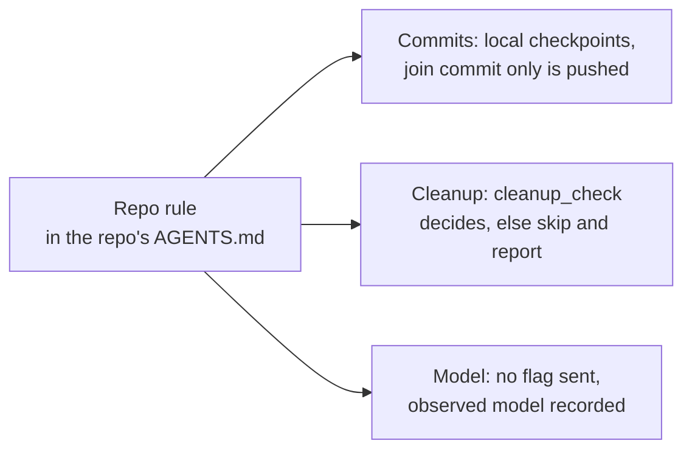
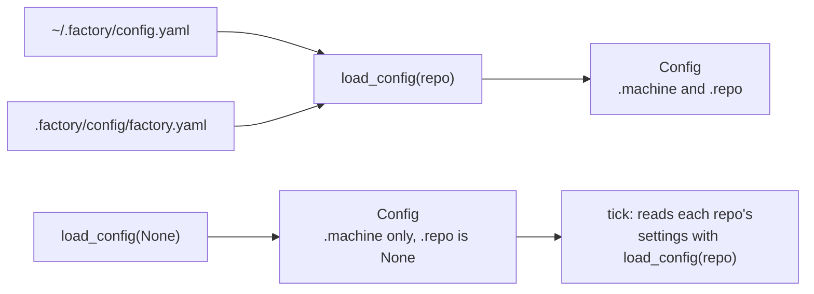

# 3. Module: kit and configuration

Part of the [phase 1 design](../phase-1.md#module-map). Build wave: 1. Contracts and acceptance criteria are in this file; shared types are in [section 18](../shared/18-shared-contracts.md). Terms such as run, stage, task, attempt and rework are defined in the [glossary](../phase-1.md#2-glossary).

The kit lives in `factory/` and is replaced whole on update. Local settings live in `.factory/config/` and are committed. All run state lives outside the repo, in the machine's factory home (`~/.factory`), so a moved or deleted repo never loses its runs.

```text
factory/                    the kit: replaced whole on update, never edited
  AGENTS.md                 shared rules, read by every harness
  workflows/                bug-fix, feature, new-app, chore, research
  stages.map.yaml           stage name to skill reference
  skills.lock               pinned upstream skills and allowlist
  requirements.lock         pinned Python dependencies of the engine
  skills/own/               original skills: verify, critique, gates
  schemas/                  request, run, task, usage, event, decision, feedback, merge, triage, plugin, packet,
                            stage-report, test-report, source-notes, review-findings,
                            factory-config (factory.yaml), merge-policy
                            (12 are written in wave 0; `merge`, `stage-report`, `test-report`, `source-notes` and
                            `review-findings` have no fields in the spec yet, so the module that produces each defines it:
                            13 for `merge`, 5 and 10 for the four reports)
  policies/                 default scope and protected-path rules
  engine/                   Python engine and the factory CLI
  adapters/tracker/         file, github
  adapters/worker/          claude, command, fake
  dashboard/                prebuilt React bundle, served by the launcher
  shims/                    generators for .claude skill links (generated into each worktree as `factory-<skill>` folders, git-excluded)

.factory/config/            in the repo, committed: local settings that survive updates
  factory.yaml              base branch, repo key override, notify, retention
  merge-policy.yaml         auto-merge rules
  workflows/                repo copies that win over factory/workflows
  plugins/                  plugin manifests
  overrides/                skill overrides and stages.map additions

.factory/                   in the repo, git-ignored except config/
  .gitignore                "*", "!config/", "!config/**", "!.gitignore"
  inbox/                    markdown requests waiting for intake

~/.factory/                 the factory home ($FACTORY_HOME), one per machine user
  config.yaml               machine settings: harnesses, repos, worktree root, tick
  env                       values for ${...}, readable only by you
  runs/<repo key>/<run id>/ all run state, for every repo on the machine
  worktrees/                default worktree root
  archive/<repo key>/       zipped finished runs
  history.jsonl             one line per finished run
  tick.json                 last tick time and result
  sync/<repo key>.json      last_sync cursor for each repo
  slots/                    one file per running worker, for the machine-wide worker cap
  venvs/<lock hash>/        Python environment for each distinct requirements.lock
  kits/<kit hash>/          snapshot of factory/ and .factory/config/ taken when a run is created
  plugin-hashes.json        reviewed plugin hashes per repo key, never stored in a repo
  logs/                     tick and dashboard logs
```

`.factory/.gitignore` ignores everything except `config/`, so the factory never edits the repo's own `.gitignore`. It needs `!config/**` as well as `!config/`: `*` also matches the files inside `config/`, and `!config/` alone re-includes only the folder, so git tracked none of its files (found in wave 1, 2026-11-14, with `git add --dry-run`).

**YAML is read with YAML 1.2 booleans** (found in wave 0, 2026-11-14). A plain `yaml.safe_load` reads `off`, `on`, `yes` and `no` as booleans, so `helpers: {mode: off}` becomes `False` and a plugin hook key `on:` becomes `True`. Both appear in the spec's own examples ([module 5](05-workflows-and-plugins.md)). Every YAML file the factory reads (config, workflows, plugins, decision files) goes through one safe loader in `config.py` that treats only `true` and `false` as booleans. The loader is a subclass of `SafeLoader` and never runs code. Test: the spec's own examples load with `mode == "off"`.

**Settings**

```yaml
# .factory/config/factory.yaml   (in the repo, committed)
base_branch: main
tracker: github                  # file | github
harness: claude                  # phase 1 accepts only claude; others fail fast (Codex is phase 2)
concurrency: 4                   # parallel workers for this repo; the machine-wide cap is max_workers in the machine file
repo_key: null                   # override, such as github.com/acme/report
notify: {github_mention: author, desktop: true, webhook: null, remind_after_hours: 24}
retention: {archive_after_days: 7, delete_archive_after_days: 90, keep_failed_days: 14,
             worker_log_max_mb: 50, auto_gc: false}   # auto_gc: run the gc plan when an engine starts
infra_wait_hours: 6              # how long a run waits for GitHub or the network before it is blocked
serialize_overlapping_runs: false   # true: a run whose files overlap an active run waits at its next stage (module 7)
cleanup_check: ["scripts/compare-worktree"]   # optional, a command the repo provides (example name): run in a worktree that is not clean before removing it; exit 0 = safe to remove

# ~/.factory/config.yaml   (factory home, per machine)
repos: [/work/report, /work/payments-api]
worktree_root: /home/me/dev/worktree     # default: ~/.factory/worktrees
worktree_path: "{root}/{repo}/{run_id}"
dashboard_url: http://127.0.0.1:8765
max_workers: 6                   # machine-wide cap on running workers, shared by every engine through slots/
```

**Repo rules.** Some repos have their own rules about what an agent may do. The engine meets three of them without a switch, except `cleanup_check`:

| Repo rule | How the engine meets it |
| --- | --- |
| "No commit without a request" | Checkpoint commits stay on a local task branch that is never pushed, and only the join commit is pushed ([module 7](07-git-and-github-operations.md)). The owner accepts this by running `factory init` in the repo; the decision is in [phase 1 decisions](../../reviews/phase-1-decisions.md#pilot-repo-decisions-p1-to-p4). |
| "Remove a worktree only after comparing its files" | `cleanup_check` names the comparison. Unset: a worktree that is not clean is skipped and reported. Set: its exit code decides ([module 17](17-housekeeping.md)). |
| "No model override" | The engine sends no model flag unless a model is set in config, and records the model the harness reports ([module 9](09-worker-adapters-and-governed-helpers.md), [module 14](14-token-tracking.md)). |



Machine settings (worktree root, tool paths, desktop notifications) come from the per-machine file. Repo settings come from `factory.yaml`. Environment variables (`FACTORY_WORKTREE_ROOT`) and CLI flags override both.

**One `Config`.** `load_config` returns one `Config` type ([section 18](../shared/18-shared-contracts.md)) with two parts. `.machine` holds the keys of the per-machine file, and `.repo` holds the keys of `factory.yaml`. With `repo=None`, `.repo` is `None` and only machine keys are available. `factory tick` and the other machine commands load it that way ([module 16](16-drivers.md)). There is no separate machine configuration type, loader or schema, so the precedence rule below applies in one place.



Harness, model and API key settings are described in [module 9](09-worker-adapters-and-governed-helpers.md). Run state, worktrees, archives and logs live in the factory home, described next.

**Factory home**

`$FACTORY_HOME` (default `~/.factory`) holds everything the factory writes on a machine. `factory config init` creates it, readable only by the current user.

- **Repo key.** Runs are grouped by the repo's origin remote, without the scheme or `.git`, such as `github.com/acme/report`. Two repos with the same folder name never collide, and a re-cloned repo keeps its history. A repo with no remote uses `local/<folder name>`. `repo_key` in `factory.yaml` overrides it, for example after a remote is renamed.
- **Repo path.** `run.json` records where the repo is (`repo_path`) and the hash of its kit snapshot (`kit_hash`). The run needs the repo to continue, because its worktrees and branches belong to the repo.
- **Repo missing.** If `repo_path` no longer exists, the run stays readable on the dashboard as "repo missing". It cannot be resumed, and housekeeping archives it.
- **One user.** The scheduler, engines and dashboard must run as the same user, because the home belongs to that user. The home must be on a local disk, because OS file locks are not reliable on network shares.

**Links between a run and its folders**

Every run is linked both ways, so you can go from the dashboard to the folders and from any folder back to the run. Housekeeping and troubleshooting both use these links.

| From | To | How |
| --- | --- | --- |
| Run folder | Repo, run worktree, task worktrees, branch, source | The `paths` block in `run.json` |
| Run worktree or task worktree | Run folder | `.factory-run.json` at the worktree root, git-excluded: run id, repo key, run folder path |
| Repo | Its runs | `factory status` in the repo lists every run with that repo key |

```json
"paths": {
  "run_dir": "/home/me/.factory/runs/github.com/acme/report/new-color-q1w2e",
  "repo": "/work/report",
  "worktree": "/home/me/dev/worktree/report/new-color-q1w2e",
  "branch": "new-color-q1w2e",
  "tasks": {"backend": "/home/me/dev/worktree/report/new-color-q1w2e--backend"},
  "source": "https://github.com/acme/report/issues/42"
}
```

- **`factory where <run>`** prints every path. Run with no argument inside a worktree, it reads `.factory-run.json`, so you can find the state of whatever you are looking at. `--json` gives the same for scripts.
- **Dashboard:** the run detail shows each path with a Copy button. `factory open <run> --folder worktree` opens it in the file manager.
- **Housekeeping** removes only paths recorded in `paths`, never a path it has to guess.
- **Orphan check:** `factory gc` also reports orphans both ways:
  - a worktree under the worktree root, or in `git worktree list`, whose `.factory-run.json` points to no run
  - a run whose recorded worktree or repo no longer exists

**One source of truth.** Run state is never written into a worktree. A worktree holds only:

- product code
- the git-excluded skill shims
- `.factory-run.json`

The engine never reads `.factory-run.json` to decide anything. It is a signpost for people and for `factory gc`'s orphan report, so a worker editing it changes nothing.

**Troubleshooting from inside a worktree**

| Command | Shows |
| --- | --- |
| `factory status --here` | The run this worktree belongs to: stage, task statuses, attempts, last gate result, attention item |
| `factory where` | Every path of that run: run folder, repo, worktrees, branch, source |
| `factory logs <task> [--follow]` | The task's `worker.log`, read from the run folder |
| `factory events [--tail 50]` | The run's recent events |

Each command reads `.factory-run.json` to find the run, then reads the run folder in the factory home, so you see exactly what the dashboard sees. With a run id instead of `--here`, the same commands work from any folder.

**Worktree location**

- `worktree_path` is a template with `{root}`, `{repo}`, `{owner}`, `{run_id}` and `{task}`. The default root is `$FACTORY_HOME/worktrees`.
- Example: repo `report`, run `new-color-q1w2e` gives `/home/me/dev/worktree/report/new-color-q1w2e`. Its tasks get `/home/me/dev/worktree/report/new-color-q1w2e--backend`.
- The engine expands `~`, resolves an absolute path and stores it in `run.json` and every usage record.
- It refuses a path inside the repo's working tree (other than `.factory/worktrees`) or a path that already exists. If two repos share a folder name, it stops and suggests `{owner}-{repo}`.

**Run snapshot**

When a run is created, the factory copies `factory/` and `.factory/config/` from the base branch's committed content (`git archive`) into `$FACTORY_HOME/kits/<kit hash>/`. The hash covers the copied files, so runs created from the same content share one folder. From then on the run uses only its snapshot:

- the engine, workflows, plugins, schemas, languages and `requirements.lock` all come from the snapshot, never from the repo's working tree, so a branch switch, a pull or an edit in the main checkout cannot change a running run;
- the launcher finds a run's engine from `kit_hash` in `run.json`, and starts it from the snapshot with the virtual environment for that snapshot's `requirements.lock`;
- plugin hashes are checked against `plugin-hashes.json` when the snapshot is made, so a plugin edited later never changes a run that already started;
- commands that create runs (`add`, `sync`, and the sync step of `tick`) use the repo's committed kit; every later command uses the run's snapshot;
- `factory run --kit working-tree` uses the working tree instead, for developing the kit itself, and records that in `run.json`.

Housekeeping deletes a snapshot when no unarchived run uses it.

**Upgrade**

`factory upgrade <version>` replaces `factory/`, regenerates the skill shims and validates `.factory/config/` against the new schemas. It does not need to wait for active runs: they keep their own snapshots, and new runs use the upgraded kit.

**OS rules**

Phase 1 supports macOS and Linux. Windows (Task Scheduler install, `.bat` and `.ps1` handling, retrying atomic replaces, Windows path rules) is phase 2. The code already uses `pathlib` and argument lists, so nothing blocks it.

Python 3.10 or later, `pathlib` for paths, `subprocess` with argument lists, and no shell scripts in the kit's engine. Commands that workflows call, such as `scripts/repro-fails.sh`, belong to the repo; a repo on Windows supplies its own. The external tools are `git`, `gh` when the tracker is GitHub, and `srt` (`@anthropic-ai/sandbox-runtime`, which needs Node 22.12 or later) for the sandbox around commands ([module 9](09-worker-adapters-and-governed-helpers.md)). `factory doctor` checks each. Python dependencies (PyYAML, jsonschema) are pinned in `factory/requirements.lock`. The launcher builds one virtual environment per distinct lock hash under `$FACTORY_HOME/venvs/` on first use and runs the repo's engine from it, so repos on different kit versions never share packages.

**Module contract: 3 Kit and configuration**

- **Depends on:** nothing (foundation).
- **Writes:** `factory/`, `.factory/config/*`, `.factory/.gitignore`, `~/.factory/config.yaml`, the env file.
- **CLI it backs:** `init`, `upgrade`, `doctor`, `config init`.

```python
# config.py
def load_config(repo: Path | None, *, env: Mapping[str, str] = os.environ) -> Config
    """Merge defaults, machine file and repo file; machine keys from the machine file,
    repo keys from the repo file; env vars and flags override. Validates against schema.
    Returns Config(machine=..., repo=...); repo is None when the repo argument is None."""
def resolve_harness(cfg: Config, harness: str, *, env: Mapping[str, str] = os.environ) -> HarnessConfig
    """command, model (None when unset), args and the minimal env with ${...} resolved at call time."""
def worktree_path(cfg: Config, repo: Path, run_id: str, task: str | None = None) -> Path
def validate(obj: dict, schema: str) -> None            # raises FactoryError("schema.invalid")
def mask(text: str, secrets: Iterable[str]) -> str
# kit.py
def init_repo(repo: Path) -> InitReport                  # labels are added by drivers (16)
def upgrade(repo: Path, version: str) -> UpgradeReport
def doctor(repo: Path | None, *, as_scheduler: bool = False) -> list[CheckResult]
```

- **Run and test:** `pytest factory/engine/tests/config factory/engine/tests/kit`; `factory doctor --json`.
- **Errors:** invalid YAML, unknown schema version, unset `${VAR:?}`, a literal secret in committed config, or an unsafe worktree path. All fail fast with file, line and fix.

Acceptance criteria:

- [ ] `${VAR}`, `${VAR:-default}` and `${VAR:?message}` resolve; an unset `:?` variable fails with the message.
- [ ] A literal value under `env` in `.factory/config/` is refused; in the machine file it warns when readable by others.
- [ ] Precedence: flag > env var > machine file (machine keys) or repo file (repo keys) > default.
- [ ] `load_config(None)` returns a `Config` whose `.repo` is `None` and whose `.machine` keys are set; `load_config(repo)` sets both parts.
- [ ] Every YAML file is read by one safe loader that treats only `true` and `false` as booleans: `helpers: {mode: off}` loads as the string `off`, and a hook key `on:` loads as the string `on`.
- [ ] `factory.yaml` and `merge-policy.yaml` are each validated against a schema in `factory/schemas/` at load (`factory-config` and `merge-policy`); a file that fails fails fast with `config.invalid`, the file and the fix.
- [ ] `worktree_path` renders the template and refuses a path inside the repo (except `.factory/worktrees`) or an existing path.
- [ ] `init_repo` creates the layout and `.factory/.gitignore`, never edits the root `.gitignore`, and a second run changes nothing.
- [ ] `upgrade` never touches `.factory/config/`, and a run created before it keeps using its own kit snapshot.
- [ ] A run's snapshot is made from the base branch's committed content, shared by runs with the same content, and unchanged when `factory/workflows/` or `.factory/config/` is edited in the main checkout afterwards.
- [ ] `doctor --as-scheduler` runs every check in an empty environment.
- [ ] `cleanup_check` must be a list of strings, never a shell string; anything else fails with `config.invalid` and the fix.
- [ ] A repo file with no `cleanup_check` and no model loads, and `resolve_harness` returns no model.
