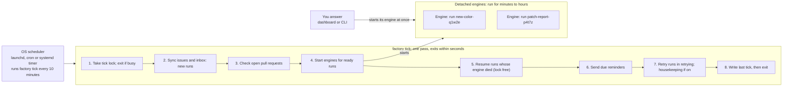
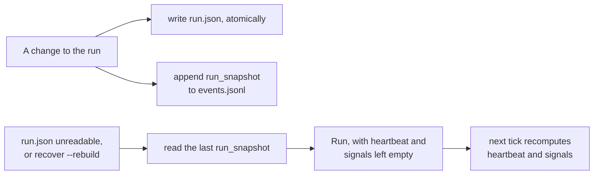

# 6. Module: engine core

Part of the [phase 1 design](../phase-1.md#module-map). Build wave: 1 (6A), 3 (6B). Contracts and acceptance criteria are in this file; shared types are in [section 18](../shared/18-shared-contracts.md). Terms such as run, stage, task, attempt and rework are defined in the [glossary](../phase-1.md#2-glossary).

The engine owns the run lifecycle, the state files, the scheduler, the lock on each run and crash recovery. Nothing in it calls an LLM.

**Boundary.** This file gives the scheduler pass ("What one tick does", below) for context. The `factory tick` command that runs it is built in [module 16](16-drivers.md), which also writes `tick.json`. The word *tick* has two meanings: the **scheduler tick** is the machine-wide pass of `factory tick` that starts engines; `Engine.tick(run_id)` is one pass of one run's engine. Only the second writes a run's state.

**Run lifecycle**

1. `factory add` or `factory sync` creates the run: run id, branch, worktree, `request.json`, `run.json`, event `run_created`.
2. `factory run` starts an engine process. It takes the lock on each run it drives, schedules tasks, runs gates, joins and moves stages.
3. At a human stop, the run waits as `awaiting_approval` or `blocked`; while GitHub or the network is down it waits as `retrying`. When every run it drives is done or waiting on a human, the engine process exits.
4. An answer (dashboard, CLI, chat or file edit) restarts an engine on that run, which continues where it stopped ([module 11](11-human-stops.md)).
5. Delivery opens the pull request or writes the sink and writes `summary.md`. A run with a pull request then waits as `awaiting_approval` at its merge review, and ends `done` when GitHub merges the pull request or `aborted` when it is closed; red CI sends it back through the last stage's `on_fail` edge, with the failing check output as feedback. Red CI pushes the fix to the open pull request; it opens no second pull request. A run with any other sink ends `done` at once. A run can also end `failed`.

**Scheduled ticks**

A scheduler such as cron calls one command, `factory tick`, every N minutes. The command does a short pass that is safe to repeat, then exits. Long work happens in detached engine processes, so a two-hour task never holds up the next tick.

*Diagram: Schedule: one short tick per interval, engines in the background*



The OS scheduler only wakes the factory. Each tick takes seconds and starts one detached engine per run that can move. Those engines do the hours of work and exit when their run is done or waiting for you. An answer from you starts its engine at once, so the interval only sets how long a new issue waits.

```text
# crontab: one entry per machine, every 10 minutes
*/10 * * * *  /usr/local/bin/factory tick --all-repos --env-file ~/.factory/env >> ~/.factory/logs/tick.log 2>&1
```

```yaml
# ~/.factory/config.yaml
repos: [/work/report, /work/payments-api]
tick: {every_minutes: 10, stale_after_ticks: 3}
```

What one tick does, in order:

1. Takes a machine-wide tick lock. If the previous tick is still running, it exits at once and logs `tick_skipped`.
2. For each repo in `repos`, it syncs tagged GitHub issues and the markdown inbox, creating runs for new requests. A `last_sync` cursor in `$FACTORY_HOME/sync/<repo key>.json` limits the GitHub query to recently updated issues.
3. It checks the open pull requests of runs waiting on merge (`watch_pr`). The tick only reads them and starts an engine, because only the engine that holds a run's lock writes its state (see the table below):
   - merged: the engine finishes the run and cleans up
   - closed: the engine aborts the run
   - red CI: the engine routes the run back to fix
4. It starts a detached engine for every run that can proceed and has no live lock, including runs whose decision was answered while no engine was running.
5. It resumes runs whose engine has died: status running and no process holding the lock. A sleeping laptop is not a death; its engine still holds the lock and carries on when it wakes.
6. It sends due reminders for open attention items.
7. It runs the housekeeping plan when `retention.auto_gc` is on.
8. It writes `last_tick` and its result to tick.json in the factory home and exits, normally within seconds. `tick.json` is `{"last_tick": <ISO time>, "result": {started, resumed, skipped, repo_missing: [run id], synced: {repo key: [run id]}, errors: [text], skipped_tick: bool}}`, written by replacing a temporary file.

The per-repo sync cursor in step 2 (`$FACTORY_HOME/sync/<repo key>.json`) is specified but not built: no code writes or reads it yet, so every sync queries all tagged issues. Its shape is not fixed until it is built.

**How a tick finds and judges runs**

A tick keeps no state of its own. It lists every `run.json` under `$FACTORY_HOME/runs/`, the single source of truth for every repo on the machine; `repos` is used only to look for new requests. For each run it reads three things:

- the status in `run.json`
- the `lock` file, through `lock_status`: free, live or stale
- for a waiting run, its decision file or pull request

It then takes one action per run:

| Run status | Lock | What the tick does |
| --- | --- | --- |
| any, but `repo_path` is gone | any | Marks it repo missing and starts no engine |
| pending | free | Starts an engine |
| running | live | Nothing: an engine is working on it, even if the machine slept and the heartbeat is old |
| running | stale (no process holds the lock) | Resumes it: ends any worker left over, closes open attempts as interrupted, starts an engine |
| awaiting\_approval, decision now answered | free | Starts an engine, as a safety net if the answer did not already start one |
| awaiting\_approval, still unanswered | free | Sends a reminder if one is due |
| awaiting\_approval, merge review | free | Reads the pull request (`watch_pr`) and writes nothing; starts an engine when it is merged, closed or red, or when its checks turn green and the merge rules have not been checked with green CI yet; that engine ends the run, routes it, or checks the merge rules again (module 13) |
| retrying | free | Starts an engine that repeats the failed operation; blocks the run once `infra_wait_hours` have passed |
| blocked | free | Reminder only; it waits for you |
| done, failed or aborted | free | Housekeeping candidate |

Individual tasks are not the tick's concern. The engine that holds a run's lock tracks its tasks in `task.json`. Whether the engine is alive is answered by the OS lock, not by a timestamp.

**Rules**

- A tick never runs a worker itself; it only starts engines.
- Repeating a tick is safe: two ticks with nothing new do nothing, and locks plus dedupe rule out double runs.
- A decision answered on the dashboard or CLI still starts an engine immediately. The tick is the safety net, so the interval only bounds how long a new issue waits.
- `factory watch --every 10m` stays as a foreground loop that calls the same tick, for development or machines without a scheduler.

**The scheduler's environment**

Cron starts with almost no environment: a short PATH, no shell profile and often no access to the desktop keychain. That is the most common way scheduled runs fail.

- Use absolute paths in `harnesses.*.command`.
- Put the `${...}` variables in the `--env-file`, readable only by you.
- Authenticate without a desktop session: `GH_TOKEN` for `gh`, and an API key or a gateway token for Claude (a login session is not supported in phase 1).
- Check all of this with `factory doctor --as-scheduler`, which runs the checks in an empty, cron-like environment.

| OS | Scheduler | Note |
| --- | --- | --- |
| Linux | cron or a systemd timer | A systemd timer prevents overlapping runs by itself |
| macOS | launchd (`StartInterval`) | Catches up after sleep more reliably than cron |
| Windows (phase 2) | Task Scheduler | Set "Do not start a new instance" |

`factory schedule install --every 10m` writes the right entry for the OS, and `factory schedule remove` deletes it.

The dashboard shows scheduler health, such as "last tick 3 min ago, 2 runs started". It warns when no tick has run for `stale_after_ticks` intervals.

**Statuses**

| Status | Applies to | Meaning |
| --- | --- | --- |
| pending | run, stage, task | Not started |
| waiting | task | Waiting on a `needs` dependency or a free slot |
| running | run, stage, task | In progress |
| restarting | task | Stopped at a checkpoint to deliver a note |
| interrupted | task | Its attempt was cut off by a crash; it resumes as a new attempt |
| awaiting\_approval | run, stage | At a human stop |
| retrying | run | An infrastructure call failed three times; each tick tries it again until `infra_wait_hours` pass, then the run is blocked. No human needed yet |
| blocked | run | Retries or rework loops ran out, or an outage lasted past `infra_wait_hours`; needs a human |
| done | run, stage, task | Finished and gates passed |
| failed | run, task | Finished without success and not recoverable |
| aborted | run | Stopped by a human or a reject answer |

The dashboard derives one more, `stale`, when a run's status is `running` but no process holds its lock.

**Run folder**

```text
~/.factory/runs/github.com/acme/report/new-color-q1w2e/
  request.json     the normalized request (JSON)
  run.json         current state (JSON), with the paths block, rewritten atomically
  events.jsonl     append-only history (JSON Lines), including a run_snapshot event after each change [snapshot-event]
  lock             owner, pid and heartbeat of the owning engine
  decisions/       <stage>.<n>.yaml decision file and <stage>.<n>.html decision page, one pair per visit to a stage
  merge.json       result of the merge policy
  summary.md       the final run summary
  tasks/backend/   engine-owned: the worker never writes here
    task.json      task state (JSON)
    usage.jsonl    one record per attempt
    notes.jsonl    queued and delivered steering notes
    feedback/      failure records sent back to this task
    worker.log     raw worker output (plain text, not state)
    work/          $FACTORY_TASK_DIR: the only folder outside the worktree the worker may write
      artifact, progress.md, helpers ledger
```

**State file rules**

- Every state file has a JSON Schema in `factory/schemas/` and a `schema_version`. The engine validates before each write; readers reject a file that fails or has an unknown major version.
- `run.json` and `task.json` are rewritten through a temporary file in the same folder, then renamed, so a reader never sees half a file.
- `.jsonl` files get one line per write. A reader ignores a cut-off last line.
- Windows (phase 2): an atomic replace fails while another process has the file open. The writer retries the replace for a few seconds before it raises, and readers open files with sharing allowed.
- Only the engine writes state. Workers write only their artifact, `progress.md` and the helpers ledger.
- `worker.log` is raw text. The engine never reads it to make a decision.

```json
{
  "schema_version": 1,
  "run_id": "new-color-q1w2e",
  "repo": "payments-api",
  "repo_key": "github.com/acme/payments-api",
  "repo_path": "/home/me/dev/payments-api",
  "request": {
    "request_id": "gh-42",
    "source": {"type": "github", "ref": "owner/payments-api#42", "title": "Login fails on expired token",
               "body": "Steps to reproduce...", "labels": ["bug"], "author": "alice", "files": []},
    "body_sha": "c91e07", "repo": "payments-api", "title": "Login fails on expired token",
    "type": "bug", "type_source": "label", "priority": "high",
    "acceptance": ["Expired token returns 401 with a refresh hint"]
  },
  "workflow": "bug-fix",
  "branch": "new-color-q1w2e",
  "worktree": "/home/me/dev/worktree/payments-api/new-color-q1w2e",
  "status": "running",
  "stage": "fix",
  "stages": [
    {"id": "propose", "visit": 1, "status": "done", "tasks": ["plan"], "started": "2026-11-14T10:02:00+08:00", "ended": "2026-11-14T10:09:00+08:00"},
    {"id": "fix", "visit": 1, "status": "running", "tasks": ["backend", "frontend"], "started": "2026-11-14T10:10:00+08:00", "ended": null},
    {"id": "verify", "visit": 1, "status": "pending", "tasks": [], "started": null, "ended": null}
  ],
  "loops": {"verify->fix": 1},
  "attention": null,
  "pr": null,
  "signals": null,
  "heartbeat": "2026-11-14T10:20:12+08:00",
  "kit_hash": "ab12cd",
  "infra_wait": null,
  "paths": {"run_dir": "/home/me/.factory/runs/github.com/acme/payments-api/new-color-q1w2e", "repo": "/home/me/dev/payments-api", "worktree": "/home/me/dev/worktree/payments-api/new-color-q1w2e"}
}
```

The example above is the frozen `Run` type of [section 18](../shared/18-shared-contracts.md) written to `run.json`. Per-task detail (attempts, helpers used, `needs`) is not in `run.json`: it is in each `task.json` and in `usage.jsonl`, so the run file stays one shape. The earlier example of this file nested task detail under each stage and used a short `request` object; section 18 supersedes it (decision R1).

**Scheduler**

- Starts tasks whose `needs` are done, up to `concurrency`. A task with a helper maximum of 2 reserves 3 slots.
- Kills a task at its timeout and records the cause. Restarts a task at a checkpoint when a note is queued, up to `max_restarts`. The new attempt gets `progress.md`; resuming the harness's own session is not used in phase 1.

**Lock and recovery**

- One engine owns a run at a time. It takes a non-blocking OS file lock on the run's `lock` file (`flock` on macOS and Linux; on Windows `msvcrt.locking` on one byte past the heartbeat, so the file stays readable) and holds it until the process exits. `lock` also records its owner, its pid and its heartbeat, refreshed every 10 seconds, for display.
- Another engine, or a `resume`, that cannot take the lock refuses the run. A crash releases the lock at once; a sleeping or paused process keeps it, so no second engine can start on a run whose first engine is only asleep. `factory resume` continues a run whose lock is free.
- Each worker runs in its own process group, recorded in `task.json`. Before a new attempt starts, any recorded group that is still alive is killed, so a worker left over from a crashed engine cannot keep editing the worktree.
- Write-ahead: an attempt's usage record is written before the worker starts. On takeover, open attempts are closed as `interrupted` and their tasks resume from the last checkpoint as new attempts. Before a new attempt after a crash, timeout or kill, the engine resets the task worktree to the last checkpoint commit (`git reset --hard`, then `git clean -fd` that leaves the git-excluded shims alone), so no half-written edit survives. Edits since the checkpoint are lost, at most `checkpoint_every_minutes` of work; the engine first saves the discarded diff as `tasks/<task>/discarded-<n>.patch` for troubleshooting.

**Run rebuild**

Decision E1, option `[snapshot-event]` (the event catalogue named no fields, so a run could not be rebuilt from it).

- After each change to a run, the engine writes one `run_snapshot` event to `events.jsonl`. It carries the whole run.
- `recover --rebuild`, and the read of an unreadable `run.json`, replay only the last `run_snapshot`. They do not read the other events to rebuild.
- Heartbeat and conflict signals are not part of a rebuild. They are recomputed on the next tick.
- The other events are unchanged: each still records what happened, for the dashboard and for audit.



**What the code does** (`write_run`, `rebuild_run` and `read_events` in `state.py`; tests in `tests/state/test_state.py`): the `run_snapshot` event holds the whole run document under the key `run`, inline in the event, and is appended after `run.json` is written. A rebuild with no `run_snapshot` in `events.jsonl` fails with `config.invalid`. `read_events` returns snapshots with the other events, so a reader that wants one kind of event filters by type, as the dashboard and `summary.py` do. `events.jsonl` has no size limit: across 16 local runs a snapshot averaged 1,440 bytes (largest 2,431) and the largest log was 32,720 bytes.

**Event catalogue** (`events.jsonl`)

| Group | Events |
| --- | --- |
| Run | `run_created`, `request_invalid`, `request_duplicate`, `run_done`, `run_failed`, `run_aborted`, `run_blocked`, `run_resumed`, `request_changed`, `infra_waiting`, `infra_recovered` |
| Stage and task | `stage_started`, `stage_done`, `task_created`, `attempt_started`, `attempt_ended`, `checkpoint`, `task_interrupted`, `usage_unreadable` |
| Gates and rework | `gate_passed`, `gate_failed`, `gate_skipped`, `routed_back`, `run_retried`, `run_routed`, `merge_conflict` |
| Human stops | `attention_requested`, `attention_cleared`, `decision_requested`, `decision_recorded`, `decision_approved`, `decision_rejected`, `decision_invalidated`, `decision_reopened` |
| Steering | `note_queued`, `note_delivered`, `worker_restarted`, `triage_answered` |
| Delivery and cleanup | `pr_opened`, `merge_evaluated`, `merge_blocked`, `merged`, `sink_written`, `archived` |
| Snapshot | `run_snapshot` [snapshot-event] |

`run_snapshot` is written after each change to a run and carries the whole run. It is the only event that does: the other events record what happened, and a rebuild uses the last `run_snapshot`, not the other events. Its payload is the whole run document under the key `run`; see **Run rebuild** above.

Module 6 is built as two parts with separate contracts. 6A, the state store, is a foundation every module uses. 6B, the engine loop, is the integrator that composes the others.

**Module contract: 6A State store**

- **Depends on:** 3: `load_config`, `validate`.
- **Writes:** everything under `$FACTORY_HOME/runs/<repo key>/<run id>/` (`run.json`, `task.json`, `events.jsonl`, `lock`), and `history.jsonl`.
- **CLI it backs:** `recover --rebuild`; reads for `status` and the dashboard.

```python
# state.py
def factory_home(env: Mapping[str, str] = os.environ) -> Path      # $FACTORY_HOME or ~/.factory
def repo_key(repo: Path, cfg: Config) -> str                       # override, origin remote, or local/<folder>
def run_dir(home: Path, key: str, run_id: str) -> Path             # <home>/runs/<key>/<run id>
def new_run_id(title: str, exists: Callable[[str], bool]) -> str   # '<slug>-<5 chars>', unique in the whole home
def init_run(home: Path, repo: Path, key: str, run_id: str, request: Request, *,
             branch: str | None, worktree: Path, kit_hash: str) -> RunRef   # records repo_path and kit_hash
def read_run(run_dir: Path) -> Run
def write_run(run_dir: Path, run: Run, *, lock: Lock) -> None      # atomic, schema-checked; re-reads the lock and refuses if another process now owns it
def read_task(run_dir: Path, task_id: str) -> TaskState
def write_task(run_dir: Path, task: TaskState, *, lock: Lock) -> None
def task_dir(run_dir: Path, task_id: str) -> Path                  # engine-owned; its work/ subfolder is $FACTORY_TASK_DIR
def append_event(run_dir: Path, event: str, **fields) -> None      # any process, short file lock
def read_events(run_dir: Path, *, since: int = 0) -> list[Event]
def acquire_lock(run_dir: Path, owner: str) -> Lock                # non-blocking OS file lock; raises state.locked
def heartbeat(lock: Lock) -> None                                  # display only
def release(lock: Lock) -> None
def lock_status(run_dir: Path) -> LockState                        # live: lock held; free: not held; stale: not held while run.json says running
def rebuild_run(run_dir: Path) -> Run                              # the last run_snapshot in events.jsonl [snapshot-event]; heartbeat and signals left empty
def find_by_source(home: Path, key: str, ref: str, body_sha: str) -> str | None
def find_run(home: Path, run_id: str) -> RunRef | None             # any repo; used by the launcher
def list_runs(home: Path, *, key: str | None = None) -> list[RunRef]

class RunScanner:                                                  # change-aware polling, used by 15 and 16
    def __init__(self, home: Path): ...
    def scan(self) -> ScanResult
        """Runs added, changed and removed since the last scan, judged by file time and size.
        Runs whose repo_path no longer exists are flagged repo_missing."""

@dataclass
class ScanResult:
    added: list[str]           # run ids new since the last scan
    changed: list[str]         # run ids whose files changed
    removed: list[str]         # run ids that are gone
    repo_missing: list[str]    # run ids whose repo_path no longer exists
    reread: int                # how many run folders this scan read; the 500-run criterion counts it

def history_append(home: Path, record: HistoryRecord) -> None

@dataclass
class Lock:                                   # returned by acquire_lock; pass it to write_run, write_task, heartbeat, release
    path: Path                                # <run dir>/lock
    fd: int                                   # the open descriptor that holds the OS lock; closing it releases the lock
    owner: str                                # who took it, as given to acquire_lock
    pid: int                                  # os.getpid() of the holder

@dataclass
class HistoryRecord:                          # one line of <home>/history.jsonl per archived run, written by gc (17); history_append adds schema_version
    run_id: str; repo_key: str
    status: str                               # the run's final status
    ended: str                                # ISO time the run ended; "" when unknown
```

- **Run and test:** `pytest factory/engine/tests/state`, including a multiprocess test with two writers on events and a scanner test over 500 fixture runs.
- **Errors:** lock held raises `state.locked` (exit 5). A failed write keeps the last good file. An unreadable `run.json` is rebuilt from the last `run_snapshot` in `events.jsonl` [snapshot-event]. A missing `repo_path` is reported as a flag, never an error.

Acceptance criteria:

- [x] A crash during `write_run` leaves either the old or the new file, never half of one. (test: factory/engine/tests/state/test_state.py::test_a_process_killed_inside_write_run_leaves_the_old_or_the_new_run_json[before], ::test_a_process_killed_inside_write_run_leaves_the_old_or_the_new_run_json[after]; a child process is SIGKILLed right before and right after the rename that publishes run.json)
- [x] A cut-off last line in a `.jsonl` file is ignored on read. (test: factory/engine/tests/state/test_state.py::test_a_cut_off_last_jsonl_line_is_ignored)
- [ ] Two processes appending events at once produce whole lines only, on Linux and macOS. (not ticked: test_two_processes_appending_events_get_whole_lines_only runs on this macOS host only; the repo has no Linux CI run, so the Linux half is unverified)
- [x] `acquire_lock` refuses while another process holds the lock, whatever its heartbeat says, and succeeds right after that process is killed. (test: factory/engine/tests/state/test_state.py::test_acquire_refuses_while_another_process_holds_the_lock, ::test_acquire_succeeds_right_after_the_holder_is_killed, ::test_a_held_lock_with_a_stale_heartbeat_still_refuses, ::test_a_killed_holder_with_a_stale_heartbeat_releases_the_lock_at_once)
- [ ] A process stopped with SIGSTOP for longer than the old 60-second limit keeps its lock; `lock_status` reports `live`, and a tick starts no second engine. (not ticked: test_a_stopped_process_keeps_its_lock_past_the_old_limit checks the lock right after SIGSTOP, not past 60 seconds; a tick starting no second engine is module 16 and needs 6B)
- [x] A `run_snapshot` event is written after each change to a run and carries the whole run [snapshot-event]. Creating a run is a change, so `init_run` writes one too; a run whose `run.json` is lost before its first engine change rebuilds (test: factory/engine/tests/state/test_state.py::test_a_run_that_was_never_changed_after_creation_still_rebuilds, which fails without the creation snapshot). The whole-run check is by the rebuild tests: test_every_change_writes_a_run_snapshot counts one snapshot per write, and the rebuild tests compare the rebuilt run to the written one.
- [x] `rebuild_run` replays only the last `run_snapshot` in `events.jsonl` and gives the same status, stage, stage states (each with its task ids), loop counters and attention item as the engine wrote. Task states are not part of the rebuild: they live in each `task.json`. Heartbeat and conflict signals are not part of the rebuild; they are recomputed on the next tick. (test: factory/engine/tests/state/test_state.py::test_rebuild_gives_the_same_state_the_engine_wrote, ::test_rebuild_replays_only_the_last_snapshot)
- [x] With every other event removed from `events.jsonl` and one `run_snapshot` left, `rebuild_run` gives the same run. A rebuild never reads the other events. (test: factory/engine/tests/state/test_state.py::test_a_rebuild_from_one_snapshot_gives_the_whole_run_without_heartbeat_or_signals, ::test_rebuild_reads_no_other_events)
- [x] `repo_key` gives `github.com/acme/report` for both SSH and HTTPS remotes, `local/<folder>` with no remote, and the override when set. (test: factory/engine/tests/state/test_state.py::test_repo_key_from_ssh_and_https_and_override_and_no_remote)
- [x] Run ids are unique across the whole factory home, not only within one repo. (test: factory/engine/tests/intake/test_intake.py::test_a_run_id_taken_under_another_repo_key_is_avoided; factory/engine/tests/state/test_state.py::test_run_ids_are_unique_across_repos_in_the_home)
- [x] With 500 runs, `RunScanner.scan` re-reads only files whose time or size changed, and flags a deleted repo as `repo_missing`. (test: factory/engine/tests/state/test_state.py::test_a_500_run_scan_parses_only_the_runs_that_changed; a no-change scan over 500 runs parses 0 files, where the old scan parsed all 500 and reported 0 re-reads; the test fails on the old scan)

**Module contract: 6B Engine loop**

- **Depends on:**
  - 4: `triage_candidates` (the triage stop)
  - 5: `load_workflow`, `expand_tasks_from`, `expand_helpers`
  - 6A: all of it
  - 7: `create_run_worktree` (after triage), `create_task_worktree`, `checkpoint`, `join`, `sync_base`, `conflict_signals`
  - 8: `run_gates`, `classify`, `route`, `build_feedback`, `with_backoff`
  - 9: `WorkerAdapter`, `build_prompt`
  - 10: `generate_shims`, `practice_packs`
  - 11: `request`, `evaluate`, `attention_for`, `notify`
  - 12: `pending_notes`, `delivered_notes`, `mark_delivered`
  - 13: `render_summary`, `write_adr`, `open_pr`, `evaluate_merge`, `merge_or_request_review`, `watch_pr`, `write_sink`
  - 14: `start_attempt`, `finish_attempt`, `close_open_attempts`, `summarize`
  - 17: `cleanup_after_join`, `cleanup_after_merge`
  - 17A: `detect`, `run_step` (format once, after a task's worker has stopped)
- **Writes:** run and task state through 6A; every event in the catalogue above.
- **CLI it backs:** `run`, `resume`, `stop`.

```python
# engine.py
class Engine:
    def __init__(self, repo: Path, cfg: Config, *, workers: dict[str, WorkerAdapter],
                 tracker: TrackerAdapter, prs: PullRequests, command: WorkerAdapter | None = None,
                 clock: Clock = SystemClock(), owner: str | None = None): ...
        # `command` runs every `cmd`, `script` and `python` task; `None` means a CommandAdapter (module 9). `workers` runs the skill tasks.
    def run(self, run_ids: list[str] | None = None, *, poll_seconds: int = 5) -> EngineResult:
        """Drive runs until each is done, failed, aborted, blocked or awaiting a human. Holds each run's lock."""
    def tick(self, run_id: str) -> TickResult:
        """One pass: start ready tasks, collect results, checkpoint, deliver notes, join, gate,
        route or advance, raise attention, deliver. Deterministic given the same inputs."""
    def resume(self, run_id: str, *, force: bool = False) -> None
    def stop(self, run_id: str, *, reason: str) -> None

@dataclass
class EngineResult: runs: dict[str, RunStatus]; exit_code: int
@dataclass
class TickResult:   started: list[str]; finished: list[str]; gates: list[GateResult]
                    routed_to: str | None; attention: AttentionItem | None
```

`EngineResult.exit_code` is one code for every run the call drove, the first of these that holds: 4 if any run is blocked, 3 if any waits on a human, 1 if any failed, else 0 (the codes are in [section 18](../shared/18-shared-contracts.md)). A failed run next to a waiting one gives 3, so a script that must see every failure reads `runs` (owner decision D7, 2026-11-22).

All collaborators are injected, so 6B is tested end to end with `FakeWorkerAdapter`, `FakeTracker`, `FakePullRequests` and `FakeClock` before the real adapters exist. The engine never spawns itself; drivers (16) start detached engines.

- **Decisions taken while building (wave 3).** The spec did not settle these, so they are recorded here and are open to change by a new ADR.
  - **A failed gate undoes the join.** The pass order is join, then gate. When a gate fails, the run branch is reset to its pre-join commit, so the rework starts clean and a scope violation cannot stay in history. Only that stage's join is undone; stages that already passed keep their commits (module 8, step 3). (test: factory/engine/tests/engine/test_engine.py::test_a_failed_gate_resets_the_run_branch_to_its_pre_join_commit; checked to fail with the reset removed)
  - **An answer is read when an engine starts on the run.** A run parked as `awaiting_approval` is re-checked at the start of each pass: if its open decision has an answer, the run moves out of the parked state and continues, and if not it stays parked and nothing is written. An approval answer goes through the stage's human stop (approve continues, rework follows `on_reject`, reject aborts). A triage answer is a workflow id from the packet; the engine writes it into `triage.json` with `type_source: explicit` and logs `triage_answered`, so the `type-resolved` gate passes on it. A `blocked` or `retrying` run is not re-checked here; module 16's `retry` and the infra tick own those. Starting the engine after an answer is module 16's `spawn_engine`. (test: factory/engine/tests/engine/test_engine.py::test_an_answered_approval_stop_lets_a_new_engine_continue_the_run_to_done, ::test_an_unanswered_approval_stop_stays_parked_when_an_engine_starts, ::test_an_answered_triage_stop_continues_with_the_chosen_workflow; checked to fail with the handling removed)
  - **Workers are supervised in threads.** `WorkerAdapter.wait` kills the worker at its timeout, so it cannot be polled. The engine runs each `wait` in a thread. Its main thread holds the lock and makes every state write, wakes to checkpoint, and calls `stop` to restart a worker when a note is queued. Threads only call `wait`.
  - **Gates run once for each task.** A stage's gate list runs once per task, with that task's scope, deny paths (including note deny paths and the workflow's `deny_paths`), base and artifact, because the checks read those fields.
  - **A triage stop offers only workflows that load.** The engine calls module 4's `triage_candidates` with a `loads` check over module 5's `load_workflow` (module 4 may not import module 5). With two to four candidates the run waits as `awaiting_approval` with a triage decision. With fewer than two there is nothing to choose, so the run is blocked and the attention item says how many load and to set the request type. In phase 1a the kit ships `bug-fix` and `chore` only, so those are the two options. (test: factory/engine/tests/engine/test_engine.py::test_a_triage_stop_offers_only_workflows_that_load, ::test_a_triage_stop_with_fewer_than_two_loading_workflows_blocks_with_the_reason)
  - **The discarded diff includes new files.** `git diff` ignores a file a worker just created, so recovery marks new files with intent-to-add before it saves `discarded-<n>.patch`.

- **Run and test:** `pytest factory/engine/tests/engine` with the fakes; `factory run <run> --json` on a seeded repo.
- **Errors:** worker results are classified by 8. Infrastructure calls go through `with_backoff`. A failed state write stops the engine, and tasks resume as interrupted.

Acceptance criteria:

- [x] A run starts with `_triage`, then appends the chosen workflow's stages. (test: factory/engine/tests/engine/test_engine.py::test_a_run_starts_with_triage_then_appends_the_chosen_workflows_stages)
- [x] Tasks with no `needs` start together, up to `concurrency`; a helper maximum of 2 reserves 3 slots. A task starts as soon as its `needs` are done and a slot is free, even while a slower task of the same stage still runs. (test: factory/engine/tests/engine/test_engine.py::test_tasks_with_no_needs_start_together_up_to_the_concurrency_limit, ::test_a_task_with_a_helper_maximum_of_two_reserves_three_slots, ::test_a_task_starts_when_its_needs_are_done_while_a_slower_task_is_still_running)
- [x] A task over its timeout is killed and recorded; a worker error starts a new attempt from the last checkpoint. (test: factory/engine/tests/engine/test_engine.py::test_the_engine_gives_each_worker_its_tasks_own_timeout, ::test_a_task_over_its_timeout_is_recorded_and_a_worker_error_starts_a_new_attempt, ::test_a_task_that_runs_out_of_retries_blocks_the_run (the engine hands each worker its task's timeout and records and retries the timeout result; the kill is the adapter's, module 9 tests it))
- [x] Every attempt has a usage record written before the worker starts. (test: factory/engine/tests/engine/test_engine.py::test_every_attempt_has_a_usage_record_written_before_the_worker_starts)
- [x] A queued note causes a restart at the next checkpoint and is marked delivered; restarts stop at `max_restarts`. (test: factory/engine/tests/engine/test_engine.py::test_a_queued_note_restarts_the_worker_and_is_marked_delivered, ::test_restarts_stop_at_max_restarts_and_the_note_stays_queued)
- [x] A failed gate routes back with a feedback record; at the loop maximum the run is blocked with an attention item. (test: factory/engine/tests/engine/test_engine.py::test_a_failed_gate_routes_back_with_a_feedback_record_and_blocks_at_the_loop_maximum)
- [x] At a human stop the engine releases the lock and exits when no other run can proceed. (test: factory/engine/tests/engine/test_engine.py::test_at_a_human_stop_the_engine_releases_the_lock_and_exits)
- [x] After a person answers a human stop, a new engine continues the run where it stopped; with no answer it stays parked. (test: factory/engine/tests/engine/test_engine.py::test_an_answered_approval_stop_lets_a_new_engine_continue_the_run_to_done, ::test_an_unanswered_approval_stop_stays_parked_when_an_engine_starts, ::test_an_answered_triage_stop_continues_with_the_chosen_workflow)
- [x] Kill the engine mid-task, then `resume`: only unfinished tasks run, the cut-off attempt is `interrupted`, and the task worktree is back at its last checkpoint with the discarded diff saved. (test: factory/engine/tests/engine/test_engine.py::test_kill_the_engine_mid_task_then_resume)
- [x] After each join, conflict signals are written to `run.json`. (test: factory/engine/tests/engine/test_engine.py::test_after_each_join_conflict_signals_are_written_to_run_json)
- [x] One command that drives several runs exits 4 if any is blocked, else 3 if any waits on a human, else 1 if any failed, else 0. (test: factory/engine/tests/engine/test_engine.py::test_the_exit_code_for_several_runs_is_blocked_then_waiting_then_failed_then_success)

## Decisions

A row changes only through a new `proposed` ADR in `docs/adr/`. To read a folded ADR in full, see `docs/adr/README.md`; the Id cell is the file name without `.md`.

| Rule | Why | Not chosen | Id |
| --- | --- | --- | --- |
| Reset the task worktree to the last checkpoint after a crash. The discarded diff is saved first. | Deterministic, with no half-written files. Shorter checkpoint intervals limit the loss of up to one interval of work. | Keep the worktree as it is and tell the worker through `progress.md`. The worker may build on a half-finished edit. | 2026-11-14-crash-recovery-resets-to-last-checkpoint (D12) |
| The run lock is an OS file lock held for the process lifetime. The heartbeat is for display only. Leftover worker process groups are killed before a new attempt. | A crash releases an OS lock and a sleeping process keeps it, so a laptop that sleeps is not taken for a dead engine. Takeover is atomic. The lock removes the race instead of detecting it. | Keep heartbeat locks and add a fencing token checked on every write. The old engine's workers would still edit the worktree, and every write path gets more logic. | 2026-11-14-run-lock-is-an-os-file-lock (D1) |
| The engine writes a `run_snapshot` event after each change. A rebuild replays only the last one. | One snapshot event is the smallest change that meets 6A as written, and it was measured at 1.8 KB per snapshot, about 356 KiB for 200 changes. No size limit is set. | Fields on every event. A `run.json.bak` copy. | 2026-11-15-rebuild-run-from-last-snapshot (E1) |
| After the pull request opens, the run waits as `awaiting_approval` at a merge review. It ends `done` only when GitHub merges it. Closed aborts it. Red CI routes it back and pushes the fix to the same pull request, opening no second one. | Keeps every status write in the engine, under the lock. | Done at open, with `tick` polling. `tick` acting on the run. | 2026-11-20-run-state-while-the-pull-request-is-open (D1) |
| Restart with `progress.md`. Harness session resume is not used in phase 1. | It is the same path as crash recovery and works on any harness, so phase 1 keeps one recovery path. Accepted cost: the worker's session context is lost. | Resume the harness session with the note appended. It differs per harness, and helper sessions and sandboxes complicate it. | 2026-11-14-restart-from-progress-md (D14) |
| An engine call that drives several runs exits 4 if any is blocked, else 3 if any waits on a human, else 1 if any failed, else 0. | It is what the code does, so scripts that read it keep working, and a person waiting to approve is what can be acted on soonest. A failure behind a waiting run shows in the printed list. | Failures first, so a failed run always gives 1 (changes behavior scheduled runs may read, and a person waiting to approve would get exit 1). | 2026-11-22-owner-calls D7 document-as-built |
