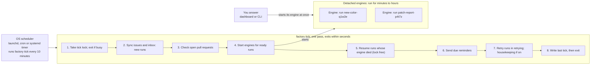

# 6. Module: engine core

Part of the [phase 1 design](../phase-1.md#module-map). Build wave: 1 (6A), 3 (6B). Contracts and acceptance criteria are in this file; shared types are in [section 18](../shared/18-shared-contracts.md). Terms such as run, stage, task, attempt and rework are defined in the [glossary](../phase-1.md#2-glossary).

The engine owns the run lifecycle, the state files, the scheduler, the lock on each run and crash recovery. Nothing in it calls an LLM.

**Run lifecycle**

1. `factory add` or `factory sync` creates the run: run id, branch, worktree, `request.json`, `run.json`, event `run_created`.
2. `factory run` starts an engine process. It takes the lock on each run it drives, schedules tasks, runs gates, joins and moves stages.
3. At a human stop, the run waits as `awaiting_approval` or `blocked`; while GitHub or the network is down it waits as `retrying`. When every run it drives is done or waiting on a human, the engine process exits.
4. An answer (dashboard, CLI, chat or file edit) restarts an engine on that run, which continues where it stopped ([module 11](11-human-stops.md)).
5. Delivery opens the pull request or writes the sink. The run ends `done`, `failed` or `aborted`, and writes `summary.md`.

**Scheduled ticks**

A scheduler such as cron calls one command, `factory tick`, every N minutes. The command does a short pass that is safe to repeat, then exits. Long work happens in detached engine processes, so a two-hour task never holds up the next tick.

*Diagram: Schedule: one short tick per interval, engines in the background*



The OS scheduler only wakes the factory. Each tick takes seconds and starts one detached engine per run that can move. Those engines do the hours of work and exit when their run is done or waiting for you. An answer from you starts its engine at once, so the interval only sets how long a new issue waits.

```text
# crontab: one entry per machine, every 10 minutes
*/10 * * * *  /usr/local/bin/factory tick --all-repos --env-file ~/.factory/env >> ~/.factory/logs/tick.log 2>&1
```

```yaml
# ~/.factory/config.yaml
repos: [/work/report, /work/payments-api]
tick: {every_minutes: 10, stale_after_ticks: 3}
```

What one tick does, in order:

1. Takes a machine-wide tick lock. If the previous tick is still running, it exits at once and logs `tick_skipped`.
2. For each repo in `repos`, it syncs tagged GitHub issues and the markdown inbox, creating runs for new requests. A `last_sync` cursor in `$FACTORY_HOME/sync/<repo key>.json` limits the GitHub query to recently updated issues.
3. It checks the open pull requests of runs waiting on merge (`watch_pr`):
   - merged: finishes the run and cleans up
   - closed: aborts the run
   - red CI: routes the run back to fix
4. It starts a detached engine for every run that can proceed and has no live lock, including runs whose decision was answered while no engine was running.
5. It resumes runs whose engine has died: status running and no process holding the lock. A sleeping laptop is not a death; its engine still holds the lock and carries on when it wakes.
6. It sends due reminders for open attention items.
7. It runs the housekeeping plan when `retention.auto_gc` is on.
8. It writes `last_tick` and its result to tick.json in the factory home and exits, normally within seconds.

**How a tick finds and judges runs**

A tick keeps no state of its own. It lists every `run.json` under `$FACTORY_HOME/runs/`, the single source of truth for every repo on the machine; `repos` is used only to look for new requests. For each run it reads three things:

- the status in `run.json`
- the `lock` file, through `lock_status`: free, live or stale
- for a waiting run, its decision file or pull request

It then takes one action per run:

| Run status | Lock | What the tick does |
| --- | --- | --- |
| any, but `repo_path` is gone | any | Marks it repo missing and starts no engine |
| pending | free | Starts an engine |
| running | live | Nothing: an engine is working on it, even if the machine slept and the heartbeat is old |
| running | stale (no process holds the lock) | Resumes it: ends any worker left over, closes open attempts as interrupted, starts an engine |
| awaiting\_approval, decision now answered | free | Starts an engine, as a safety net if the answer did not already start one |
| awaiting\_approval, still unanswered | free | Sends a reminder if one is due |
| awaiting\_approval, merge review | free | Checks the pull request: merged, closed or red CI |
| retrying | free | Starts an engine that repeats the failed operation; blocks the run once `infra_wait_hours` have passed |
| blocked | free | Reminder only; it waits for you |
| done, failed or aborted | free | Housekeeping candidate |

Individual tasks are not the tick's concern. The engine that holds a run's lock tracks its tasks in `task.json`. Whether the engine is alive is answered by the OS lock, not by a timestamp.

**Rules**

- A tick never runs a worker itself; it only starts engines.
- Repeating a tick is safe: two ticks with nothing new do nothing, and locks plus dedupe rule out double runs.
- A decision answered on the dashboard or CLI still starts an engine immediately. The tick is the safety net, so the interval only bounds how long a new issue waits.
- `factory watch --every 10m` stays as a foreground loop that calls the same tick, for development or machines without a scheduler.

**The scheduler's environment**

Cron starts with almost no environment: a short PATH, no shell profile and often no access to the desktop keychain. That is the most common way scheduled runs fail.

- Use absolute paths in `harnesses.*.command`.
- Put the `${...}` variables in the `--env-file`, readable only by you.
- Authenticate without a desktop session: `GH_TOKEN` for `gh`, and an API key or a gateway token for Claude (a login session is not supported in phase 1).
- Check all of this with `factory doctor --as-scheduler`, which runs the checks in an empty, cron-like environment.

| OS | Scheduler | Note |
| --- | --- | --- |
| Linux | cron or a systemd timer | A systemd timer prevents overlapping runs by itself |
| macOS | launchd (`StartInterval`) | Catches up after sleep more reliably than cron |
| Windows (phase 2) | Task Scheduler | Set "Do not start a new instance" |

`factory schedule install --every 10m` writes the right entry for the OS, and `factory schedule remove` deletes it.

The dashboard shows scheduler health, such as "last tick 3 min ago, 2 runs started". It warns when no tick has run for `stale_after_ticks` intervals.

**Statuses**

| Status | Applies to | Meaning |
| --- | --- | --- |
| pending | run, stage, task | Not started |
| waiting | task | Waiting on a `needs` dependency or a free slot |
| running | run, stage, task | In progress |
| restarting | task | Stopped at a checkpoint to deliver a note |
| interrupted | task | Its attempt was cut off by a crash; it resumes as a new attempt |
| awaiting\_approval | run, stage | At a human stop |
| retrying | run | An infrastructure call failed three times; each tick tries it again until `infra_wait_hours` pass, then the run is blocked. No human needed yet |
| blocked | run | Retries or rework loops ran out, or an outage lasted past `infra_wait_hours`; needs a human |
| done | run, stage, task | Finished and gates passed |
| failed | run, task | Finished without success and not recoverable |
| aborted | run | Stopped by a human or a reject answer |

The dashboard derives one more, `stale`, when a run's status is `running` but no process holds its lock.

**Run folder**

```text
~/.factory/runs/github.com/acme/report/new-color-q1w2e/
  request.json     the normalized request (JSON)
  run.json         current state (JSON), with the paths block, rewritten atomically
  events.jsonl     append-only history (JSON Lines)
  lock             pid, host and heartbeat of the owning engine
  decisions/       <stage>.<n>.yaml decision file and <stage>.<n>.html decision page, one pair per visit to a stage
  merge.json       result of the merge policy
  summary.md       the final run summary
  tasks/backend/   engine-owned: the worker never writes here
    task.json      task state (JSON)
    usage.jsonl    one record per attempt
    notes.jsonl    queued and delivered steering notes
    feedback/      failure records sent back to this task
    worker.log     raw worker output (plain text, not state)
    work/          $FACTORY_TASK_DIR: the only folder outside the worktree the worker may write
      artifact, progress.md, helpers ledger
```

**State file rules**

- Every state file has a JSON Schema in `factory/schemas/` and a `schema_version`. The engine validates before each write; readers reject a file that fails or has an unknown major version.
- `run.json` and `task.json` are rewritten through a temporary file in the same folder, then renamed, so a reader never sees half a file.
- `.jsonl` files get one line per write. A reader ignores a cut-off last line.
- Windows (phase 2): an atomic replace fails while another process has the file open. The writer retries the replace for a few seconds before it raises, and readers open files with sharing allowed.
- Only the engine writes state. Workers write only their artifact, `progress.md` and the helpers ledger.
- `worker.log` is raw text. The engine never reads it to make a decision.

```json
{
  "schema_version": 1,
  "run_id": "new-color-q1w2e",
  "repo": "payments-api",
  "request": {"id": "gh-42", "source": "github", "title": "Login fails on expired token"},
  "workflow": "bug-fix",
  "branch": "new-color-q1w2e",
  "worktree": "/home/me/dev/worktree/payments-api/new-color-q1w2e",
  "status": "running",
  "stage": "fix",
  "loops": {"verify->fix": 1},
  "stages": [
    {"id": "propose", "status": "done", "approval": "approved"},
    {"id": "fix", "status": "running", "tasks": [
      {"id": "backend", "status": "running", "attempts": 2, "helpers": {"used": 2, "max": 2}},
      {"id": "frontend", "status": "waiting", "needs": ["backend"]}]},
    {"id": "verify", "status": "pending"}
  ],
  "attention": null,
  "heartbeat": "2026-11-14T10:20:12+08:00"
}
```

**Scheduler**

- Starts tasks whose `needs` are done, up to `concurrency`. A task with a helper maximum of 2 reserves 3 slots.
- Kills a task at its timeout and records the cause. Restarts a task at a checkpoint when a note is queued, up to `max_restarts`.

**Lock and recovery**

- One engine owns a run at a time. It takes a non-blocking OS file lock on the run's `lock` file (`flock` on macOS and Linux) and holds it until the process exits. `lock` also records its pid and host, and its heartbeat, refreshed every 10 seconds, for display.
- Another engine, or a `resume`, that cannot take the lock refuses the run. A crash releases the lock at once; a sleeping or paused process keeps it, so no second engine can start on a run whose first engine is only asleep. `factory resume` continues a run whose lock is free.
- Each worker runs in its own process group, recorded in `task.json`. Before a new attempt starts, any recorded group that is still alive is killed, so a worker left over from a crashed engine cannot keep editing the worktree.
- Write-ahead: an attempt's usage record is written before the worker starts. On takeover, open attempts are closed as `interrupted` and their tasks resume from the last checkpoint as new attempts. Before a new attempt after a crash, timeout or kill, the engine resets the task worktree to the last checkpoint commit (`git reset --hard`, then `git clean -fd` that leaves the git-excluded shims alone), so no half-written edit survives. Edits since the checkpoint are lost, at most `checkpoint_every_minutes` of work; the engine first saves the discarded diff as `tasks/<task>/discarded-<n>.patch` for troubleshooting.

**Event catalogue** (`events.jsonl`)

| Group | Events |
| --- | --- |
| Run | `run_created`, `request_invalid`, `request_duplicate`, `run_done`, `run_failed`, `run_aborted`, `run_blocked`, `run_resumed`, `request_changed`, `infra_waiting`, `infra_recovered` |
| Stage and task | `stage_started`, `stage_done`, `task_created`, `attempt_started`, `attempt_ended`, `checkpoint`, `task_interrupted` |
| Gates and rework | `gate_passed`, `gate_failed`, `routed_back`, `merge_conflict` |
| Human stops | `attention_requested`, `attention_cleared`, `decision_requested`, `decision_recorded`, `decision_approved`, `decision_rejected`, `decision_invalidated`, `decision_reopened` |
| Steering | `note_queued`, `note_delivered`, `worker_restarted` |
| Delivery and cleanup | `pr_opened`, `merge_evaluated`, `merged`, `sink_written`, `archived` |

Module 6 is built as two parts with separate contracts. 6A, the state store, is a foundation every module uses. 6B, the engine loop, is the integrator that composes the others.

**Module contract: 6A State store**

- **Depends on:** 3: `load_config`, `validate`.
- **Writes:** everything under `$FACTORY_HOME/runs/<repo key>/<run id>/` (`run.json`, `task.json`, `events.jsonl`, `lock`), and `history.jsonl`.
- **CLI it backs:** `recover --rebuild`; reads for `status` and the dashboard.

```python
# state.py
def factory_home(env: Mapping[str, str] = os.environ) -> Path      # $FACTORY_HOME or ~/.factory
def repo_key(repo: Path, cfg: Config) -> str                       # override, origin remote, or local/<folder>
def run_dir(home: Path, key: str, run_id: str) -> Path             # <home>/runs/<key>/<run id>
def new_run_id(title: str, exists: Callable[[str], bool]) -> str   # '<slug>-<5 chars>', unique in the whole home
def init_run(home: Path, repo: Path, key: str, run_id: str, request: Request, *,
             branch: str | None, worktree: Path, kit_hash: str) -> RunRef   # records repo_path and kit_hash
def read_run(run_dir: Path) -> Run
def write_run(run_dir: Path, run: Run, *, lock: Lock) -> None      # atomic, schema-checked; re-reads the lock and refuses if another process now owns it
def read_task(run_dir: Path, task_id: str) -> TaskState
def write_task(run_dir: Path, task: TaskState, *, lock: Lock) -> None
def task_dir(run_dir: Path, task_id: str) -> Path                  # engine-owned; its work/ subfolder is $FACTORY_TASK_DIR
def append_event(run_dir: Path, event: str, **fields) -> None      # any process, short file lock
def read_events(run_dir: Path, *, since: int = 0) -> list[Event]
def acquire_lock(run_dir: Path, owner: str) -> Lock                # non-blocking OS file lock; raises state.locked
def heartbeat(lock: Lock) -> None                                  # display only
def release(lock: Lock) -> None
def lock_status(run_dir: Path) -> LockState                        # live: lock held; free: not held; stale: not held while run.json says running
def rebuild_run(run_dir: Path) -> Run                              # replay events.jsonl; heartbeat and signals left empty
def find_by_source(home: Path, key: str, ref: str, body_sha: str) -> str | None
def find_run(home: Path, run_id: str) -> RunRef | None             # any repo; used by the launcher
def list_runs(home: Path, *, key: str | None = None) -> list[RunRef]

class RunScanner:                                                  # change-aware polling, used by 15 and 16
    def __init__(self, home: Path): ...
    def scan(self) -> ScanResult
        """Runs added, changed and removed since the last scan, judged by file time and size.
        Runs whose repo_path no longer exists are flagged repo_missing."""

def history_append(home: Path, record: HistoryRecord) -> None
```

- **Run and test:** `pytest factory/engine/tests/state`, including a multiprocess test with two writers on events and a scanner test over 500 fixture runs.
- **Errors:** lock held raises `state.locked` (exit 5). A failed write keeps the last good file. An unreadable `run.json` is rebuilt from events. A missing `repo_path` is reported as a flag, never an error.

Acceptance criteria:

- [ ] A crash during `write_run` leaves either the old or the new file, never half of one.
- [ ] A cut-off last line in a `.jsonl` file is ignored on read.
- [ ] Two processes appending events at once produce whole lines only, on Linux and macOS.
- [ ] `acquire_lock` refuses while another process holds the lock, whatever its heartbeat says, and succeeds right after that process is killed.
- [ ] A process stopped with SIGSTOP for longer than the old 60-second limit keeps its lock; `lock_status` reports `live`, and a tick starts no second engine.
- [ ] `rebuild_run` from events gives the same status, stage, stage and task states, loop counters and attention item as the engine wrote. Heartbeat and conflict signals are not events; they are recomputed on the next tick.
- [ ] `repo_key` gives `github.com/acme/report` for both SSH and HTTPS remotes, `local/<folder>` with no remote, and the override when set.
- [ ] Run ids are unique across the whole factory home, not only within one repo.
- [ ] With 500 runs, `RunScanner.scan` re-reads only files whose time or size changed, and flags a deleted repo as `repo_missing`.

**Module contract: 6B Engine loop**

- **Depends on:**
  - 5: `load_workflow`, `expand_tasks_from`, `expand_helpers`
  - 6A: all of it
  - 7: `create_run_worktree` (after triage), `create_task_worktree`, `checkpoint`, `join`, `sync_base`, `conflict_signals`
  - 8: `run_gates`, `classify`, `route`, `build_feedback`, `with_backoff`
  - 9: `WorkerAdapter`, `build_prompt`
  - 10: `generate_shims`, `practice_packs`
  - 11: `request`, `evaluate`, `attention_for`, `notify`
  - 12: `pending_notes`, `delivered_notes`, `mark_delivered`
  - 13: `render_summary`, `write_adr`, `open_pr`, `evaluate_merge`, `merge_or_request_review`, `watch_pr`, `write_sink`
  - 14: `start_attempt`, `finish_attempt`, `close_open_attempts`, `summarize`
  - 17: `cleanup_after_join`, `cleanup_after_merge`
  - 17A: `detect`, `run_step` (format once, after a task's worker has stopped)
- **Writes:** run and task state through 6A; every event in the catalogue above.
- **CLI it backs:** `run`, `resume`, `stop`.

```python
# engine.py
class Engine:
    def __init__(self, repo: Path, cfg: Config, *, workers: dict[str, WorkerAdapter],
                 tracker: TrackerAdapter, prs: PullRequests, clock: Clock = SystemClock(),
                 owner: str | None = None): ...
    def run(self, run_ids: list[str] | None = None, *, poll_seconds: int = 5) -> EngineResult:
        """Drive runs until each is done, failed, aborted, blocked or awaiting a human. Holds each run's lock."""
    def tick(self, run_id: str) -> TickResult:
        """One pass: start ready tasks, collect results, checkpoint, deliver notes, join, gate,
        route or advance, raise attention, deliver. Deterministic given the same inputs."""
    def resume(self, run_id: str, *, force: bool = False) -> None
    def stop(self, run_id: str, *, reason: str) -> None

@dataclass
class EngineResult: runs: dict[str, RunStatus]; exit_code: int
@dataclass
class TickResult:   started: list[str]; finished: list[str]; gates: list[GateResult]
                    routed_to: str | None; attention: AttentionItem | None
```

All collaborators are injected, so 6B is tested end to end with `FakeWorkerAdapter`, `FakeTracker`, `FakePullRequests` and `FakeClock` before the real adapters exist. The engine never spawns itself; drivers (16) start detached engines.

- **Run and test:** `pytest factory/engine/tests/engine` with the fakes; `factory run <run> --json` on a seeded repo.
- **Errors:** worker results are classified by 8. Infrastructure calls go through `with_backoff`. A failed state write stops the engine, and tasks resume as interrupted.

Acceptance criteria:

- [ ] A run starts with `_triage`, then appends the chosen workflow's stages.
- [ ] Tasks with no `needs` start together, up to `concurrency`; a helper maximum of 2 reserves 3 slots.
- [ ] A task over its timeout is killed and recorded; a worker error starts a new attempt from the last checkpoint.
- [ ] Every attempt has a usage record written before the worker starts.
- [ ] A queued note causes a restart at the next checkpoint and is marked delivered; restarts stop at `max_restarts`.
- [ ] A failed gate routes back with a feedback record; at the loop maximum the run is blocked with an attention item.
- [ ] At a human stop the engine releases the lock and exits when no other run can proceed.
- [ ] Kill the engine mid-task, then `resume`: only unfinished tasks run, the cut-off attempt is `interrupted`, and the task worktree is back at its last checkpoint with the discarded diff saved.
- [ ] After each join, conflict signals are written to `run.json`.
