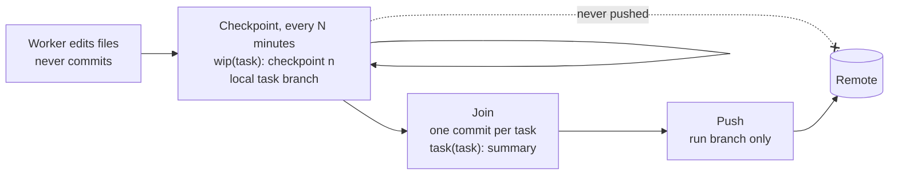

# 7. Module: git and GitHub operations

Part of the [phase 1 design](../phase-1.md#module-map). Build wave: 1. Contracts and acceptance criteria are in this file; shared types are in [section 18](../shared/18-shared-contracts.md). Terms such as run, stage, task, attempt and rework are defined in the [glossary](../phase-1.md#2-glossary).

Every git and GitHub action is run by the engine with `git` and `gh` as argument lists, with no LLM involved. Workers edit files only. They never commit, push, merge or touch issues.

| Operation | When | Command (simplified) |
| --- | --- | --- |
| Read GitHub requests | `factory sync`, or every `watch` interval | `gh issue list --label factory --state open --limit 200 --json number,title,body,labels,author,updatedAt`. `gh` returns 30 without `--limit`, so the limit is 200 (decision `issue-sync-limit-and-warning`). `list_new` returns a plain list and writes nothing. When the answer holds 200 issues, `intake.sync` writes a `sync_limit_reached` line to the intake log (`$FACTORY_HOME/intake/<repo key>/events.jsonl`, [module 4](04-intake-and-triage.md)), and the issues beyond 200 are not read this sync |
| Mark an issue picked up | Run created | `gh issue edit 42 --add-label factory:queued`, then `gh issue comment 42` with the run id and dashboard link |
| Read markdown requests | `factory sync` | Read `.factory/inbox/*.md`, parse front matter |
| Make the run id | Run created | Slug of the title plus 5 random characters, checked against existing branches and worktree paths |
| Create the run worktree and branch | Run created | `git fetch origin`, then `git worktree add -b <run> <path> origin/<base>` |
| Read-only run | `policy.write: false` | `git worktree add --detach <path> origin/<base>`; at delivery, if the doc sink is inside the repo: `git switch -c <run>`, commit the report, push, `gh pr create` |
| Create a task worktree | Task starts | `git worktree add -b <run>--<task> <path> <base>`, where `<base>` is the run branch for a task with no `needs`, the branch of its dependency when it has one, and for several dependencies the first one with the others merged in. The base is recorded in `task.json` as `task_base` |
| Checkpoint | Every `checkpoint_every_minutes`, and at task end | `git add -A`, `git commit -m "wip(<task>): checkpoint <n>"` in the task worktree |
| Scope check | Gate | `git diff --name-only <task-base>...HEAD`, compared with the task's scope and deny globs |
| Join | All tasks in a stage done | apply each task's own change, the diff from its `task_base` to its tip (`git apply --3way --index`), then `git commit`, into the run branch in `needs` order, one commit per task, so a chained task never re-applies its dependency's change; a conflict runs `git reset --hard HEAD` and routes the run |
| Test results | Gate | Parse JUnit XML into pass, fail and failing test names |
| Dependency check | Merge policy | Diff of manifests such as `package.json`, `pom.xml`, `requirements*.txt` |
| Push and open the pull request | Last stage done | `git push -u origin <run>`, then `gh pr create --base <base> --head <run> --body-file summary.md` |
| Status back to the issue | Each status change | `gh issue edit` labels; `gh issue comment` at start, human stops and end |
| Merge | Merge policy says auto | `gh pr merge <n> --auto --squash --delete-branch` |
| Watch the pull request | Until merged or closed | `gh pr view <n> --json state,mergeable,reviewDecision,statusCheckRollup` |
| Clean up | Task joined, run finished | `git worktree remove <path>`, `git branch -D <branch>` (after the join commit is recorded; a task branch is never an ancestor of the run branch, so `-d` always refuses it), `git worktree prune`. Removal of a worktree that is not clean goes through the repo's `cleanup_check` first, see [module 17](17-housekeeping.md) |

**What still uses an LLM**

Only skill tasks: reproduce, root cause, propose, fix, review, architecture packet, scope, gather, synthesize, critique. Also the triage fallback when rules cannot classify. The pull request body, issue comments and run summary are filled from a template using state and artifacts.

**Rules**

- The engine never force-pushes and never pushes to the base branch.
- **Commit authority.** Workers never commit. The engine commits in two places only: checkpoint commits on a task branch, which stay local and are never pushed, and one join commit per task on the run branch, which is the only history that is pushed. A repo whose own rules say "no commit without a request" (the pilot repo; decision P1) accepts these engine commits when its owner runs `factory init` there ([module 3](03-kit-and-configuration.md)). There is no switch to turn checkpoints off: crash recovery (D12), note delivery and the reset target all need them.



- GitHub calls retry with backoff on rate limits and network errors ([module 8](08-gates-error-handling-and-rework.md)).
- With `tracker: file`, every GitHub row is skipped and status goes to markdown front matter and the CLI. GitLab and other hosts are out of scope for phase 1.

**Avoiding merge conflicts**

The factory keeps its own files out of every branch it merges, and catches overlapping edits before a merge rather than during one.

| Artefact | Where it lives | Conflict risk | Rule |
| --- | --- | --- | --- |
| Run state, logs, summaries, decision files and pages | `$FACTORY_HOME/runs/<repo key>/<id>/`, outside every repo | None | Never inside a worktree, never committed |
| Task artifacts, `progress.md`, helpers ledger | The task's work/ folder in the factory home, passed to the worker as `$FACTORY_TASK_DIR` | High if written into the worktree: every task would write `progress.md` at the root | Workers write outside the worktree, so checkpoint commits contain product files only |
| WIP checkpoint commits | Task branch | Noisy history | Joined as one commit per task, `task(<task>): <summary>` |
| Skill shims (`.claude/skills/factory-*`) | Generated into each worktree | High if committed and regenerated on upgrade | Generated by the engine as `factory-<skill>` folders. Two patterns in the repo's `.git/info/exclude` (shared by every worktree) hide them; never committed |
| Lockfiles and generated code (`package-lock.json`, `poetry.lock`, codegen output) | Product repo | High when two tasks add dependencies | Listed in `regenerate_at_join`. Task edits to them are dropped and `join_cmd` rebuilds them once |
| Shared registries (route tables, changelog, migration numbers) | Product repo | Medium | Each is owned by one task in `shared_files`; other tasks run after it |
| ADRs | `docs/adr/<date>-<run id>.md` | High with sequence numbers | Named by date and run id, never by a counter |
| Research reports | `docs/research/<run id>.md`, or outside the repo | Low | Run id in the file name |
| `factory/`, `.factory/config/` | Committed | Medium | Default deny paths for every worker; changed only by a human |

```yaml
# workflow additions
regenerate_at_join: ["package-lock.json", "poetry.lock"]
join_cmd: [npm, install, --package-lock-only]
shared_files: {"web/src/routes.ts": frontend}   # file: owning task
stages:
  - id: verify
    sync_base: true                            # merge origin/<base> before this stage
```

1. **Disjoint scopes.** When a workflow loads, the engine checks that tasks able to run at the same time have non-overlapping write scopes. Overlap is an error unless one task `needs` the other or the file is in `shared_files`.
2. **Base sync.** At a stage with `sync_base: true` (verify by default), and again before the pull request, the engine merges `origin/<base>` into the run branch, so tests run on current code. A conflict routes the run to fix, with the conflicting files in the feedback record.
3. **Cross-run overlap.** After each join, the engine compares the changed files of every active run in the repo. An overlap raises a warning on both runs. With `serialize_overlapping_runs: true`, the later run waits at its next stage until the earlier one merges.
4. **Clean failure.** A join that conflicts resets the run worktree to its last good commit before routing, so the run branch never holds a half-finished merge.

Dashboard impact: the run detail shows conflict signals, such as "base: 14 commits behind" and "overlaps refund-endpoint-k3m9x on services/api/auth.py". The overview counts runs with warnings.

**Module contract: 7 Git and GitHub operations**

- **Depends on:** 3: `load_config` and `render` (in `paths.py`), which fills the template of the worktree path setting.
- **Writes:** git worktrees, branches and commits; GitHub labels, comments and pull requests.
- **CLI it backs:** none directly; it is used by 4, 6B, 13, 16 and 17.

```python
# gitops.py
def create_run_worktree(repo: Path, cfg: Config, run_id: str, *, base: str, detached: bool) -> Path
def create_task_worktree(repo: Path, cfg: Config, run_id: str, task_id: str, *,
                         base_branches: list[str] | None = None) -> Path   # branch <run>--<task>, from its dependencies' branches
def create_delivery_branch(worktree: Path, run_id: str) -> None                     # read-only runs
def checkpoint(worktree: Path, task_id: str, n: int) -> str | None   # sha, or None if no change; commits with --no-verify and never formats
def changed_files(worktree: Path, base_ref: str) -> list[str]
def join(run_worktree: Path, tasks: list[TaskBranch], *, regenerate: list[str],   # TaskBranch: branch, task_base, in needs order
         join_cmd: list[str] | None) -> JoinResult                 # ok, or conflict with files; worktree reset on conflict;
                                                            # repo hooks run on each task commit, failure -> hook_failed
def sync_base(run_worktree: Path, base: str) -> SyncResult  # ok, or conflict with files
def push(worktree: Path, branch: str) -> None                      # runs pre-push hooks; failure raises git.hook_failed
def snapshot_kit(repo: Path, base_ref: str, home: Path) -> str     # git archive of factory/ and .factory/config/ into kits/<hash>; returns the hash
def remove_worktree(path: Path, *, force: bool = False) -> None
def delete_branch(repo: Path, name: str, *, remote: bool = False) -> None
def conflict_signals(repo: Path, run: Run, others: list[Run], base: str) -> Signals   # behind_base, overlaps
def check_scope_diff(spec: GateSpec, ctx: GateContext) -> GateResult                 # used by 8
# adapters/tracker/base.py
class TrackerAdapter(Protocol):
    def list_new(self, since: str | None) -> list[Source]
    def fetch(self, ref: str) -> Source
    def set_status(self, ref: str, status: str, *, comment: str | None = None, link: str | None = None) -> None
    def ensure_labels(self, labels: list[str]) -> None
# prs.py
class PullRequests(Protocol):
    def create(self, worktree: Path, *, base: str, head: str, title: str, body_file: Path,
               labels: list[str]) -> PrRef
    def state(self, pr: PrRef) -> PrState            # open | merged | closed, ci: green | red | pending, checks output
    def merge(self, pr: PrRef, *, method: str = "squash", auto: bool = True, delete_branch: bool = True) -> None
    def request_reviewers(self, pr: PrRef, users: list[str]) -> None
    def comment(self, pr: PrRef, body: str) -> None    # a comment on the pull request (module 13, the verdict at green)
    def current_user(self) -> str                      # the login gh is signed in as: the account that opens pull requests (module 13 skips it as a reviewer)
```

Implementations: `FileTracker`, `GitHubTracker` (`gh`), `GitHubPullRequests` (`gh`), plus `FakeTracker` and `FakePullRequests` for other modules' tests.

- **Run and test:** `pytest factory/engine/tests/gitops` against temp repos with a local bare remote; GitHub adapters against a recorded `gh` stub.
- **Errors:** `index.lock` and network errors are transient. A rejected push gets a base sync and one retry, then needs a human. Expired auth needs a human, with `gh auth login` as the hint. An existing path fails fast. A conflict is returned, not raised. A repo pre-push hook that exits non-zero stops the push before any ref is sent; `push` raises `git.hook_failed` with the hook's output, and the engine routes it as rework through the last stage's `on_fail` edge (module 8). A refusal that names a ref (` ! [rejected]`) is `git.push_rejected`, not a hook failure. The join returns a failing task-commit hook as `hook_failed` in `JoinResult`, which carries no hook output (a shared contract, section 18, left for the owner). `gitops.reset_dependents` recreates task worktrees without the run marker, and no engine code calls it today.

Acceptance criteria:

- [x] Worktrees are created at `worktree_path`; read-only runs are detached and get a branch only through `create_delivery_branch`. (test: factory/engine/tests/gitops/test_gitops.py::test_run_worktree_is_created_at_worktree_path_on_a_run_branch, ::test_read_only_run_is_detached_and_gets_a_branch_only_at_delivery)
- [x] `checkpoint` commits product files only, never anything from `$FACTORY_TASK_DIR` or shims. (test: factory/engine/tests/gitops/test_gitops.py::test_checkpoint_commits_product_files_and_never_the_marker)
- [x] `join` commits each task's own change once, in `needs` order; two tasks adding dependencies end with one regenerated lockfile. (test: factory/engine/tests/gitops/test_gitops.py::test_join_commits_each_task_once_in_order, ::test_two_tasks_adding_dependencies_end_with_one_regenerated_lockfile)
- [x] A task with `needs` inside its stage starts from its dependency's branch and sees that dependency's changes; after the join the run branch holds one commit per task and no change twice. (test: factory/engine/tests/gitops/test_gitops.py::test_a_chained_task_never_reapplies_its_dependency_and_the_run_branch_holds_one_commit_per_task)
- [x] When a task is reworked, tasks that need it are reset and recreated from its new branch. (test: factory/engine/tests/gitops/test_gitops.py::test_a_reworked_task_resets_and_recreates_the_tasks_that_need_it, ::test_a_task_that_does_not_need_the_reworked_one_is_left_alone)
- [x] Chained task branches are deleted after the join, dependents first. (test: factory/engine/tests/gitops/test_gitops.py::test_chained_task_branches_are_deleted_after_the_join_dependents_first)
- [x] A conflicting join leaves the run branch at its last good commit and returns the files. (test: factory/engine/tests/gitops/test_gitops.py::test_a_conflicting_join_leaves_the_run_branch_at_its_last_good_commit)
- [x] The engine never force-pushes and never pushes to the base branch. (test: factory/engine/tests/gitops/test_gitops.py::test_the_engine_never_force_pushes, ::test_the_engine_refuses_to_push_the_base_branch)
- [x] `check_scope_diff` fails on any file outside scope or inside task-level deny paths, including deny paths added by notes. (test: factory/engine/tests/gitops/test_gitops.py::test_scope_gate_fails_outside_scope_and_inside_deny_and_passes_otherwise, ::test_deny_wins_over_scope_including_deny_added_later)
- [x] With the file tracker, no GitHub call is made. (test: factory/engine/tests/tracker/test_gh.py::test_the_file_tracker_reads_markdown_front_matter_and_makes_no_github_call)
- [ ] Every worktree it creates contains `.factory-run.json` pointing to the run folder, excluded from git, and no other factory file except the shims. (not ticked: the engine's run and task worktrees are tested (factory/engine/tests/engine/test_repo_hooks_route.py::test_every_worktree_the_engine_creates_has_the_run_marker_and_no_other_factory_file) and the marker is written and excluded (gitops/test_gitops.py::test_run_marker_is_written_and_excluded_from_git), but `gitops.reset_dependents` creates task worktrees with no marker; no engine code calls it today, and no test lists a worktree's factory files for it)
- [x] Checkpoint commits skip repo hooks; the task commits at join and the push run them. (test: factory/engine/tests/gitops/test_gitops.py::test_checkpoint_skips_repo_hooks, ::test_a_failing_repo_hook_on_a_task_commit_is_returned_as_hook_failed, ::test_the_engine_pushes_with_repo_hooks_and_a_failing_pre_push_hook_stops_the_push)
- [x] A hook that edits files is retried once with its changes staged; a second failure is returned as `hook_failed`. (test: factory/engine/tests/gitops/test_gitops.py::test_a_hook_that_edits_files_is_retried_once_with_its_changes_staged, ::test_a_second_hook_failure_is_returned_as_hook_failed)
- [x] Task branches are never pushed. (test: factory/engine/tests/gitops/test_gitops.py::test_push_sends_only_the_run_branch_with_join_commits_and_no_wip (a task branch exists locally and the remote ends with only main and run-1), ::test_checkpoints_stay_local_and_are_never_pushed)
- [x] After a run with several checkpoints per task, the pushed run branch holds only `task(<task>): ...` join commits: no `wip(...)` commit is reachable from it, and no ref on the remote except the run branch exists. (test: factory/engine/tests/gitops/test_gitops.py::test_push_sends_only_the_run_branch_with_join_commits_and_no_wip)
- [x] Checkpoints exist only on local task branches; after a run, `git ls-remote` shows no task branch. (test: factory/engine/tests/gitops/test_gitops.py::test_the_engine_pushes_only_the_run_branch_and_nothing_else_reaches_the_remote)
- [x] A worker that runs `git commit` or `git push` changes nothing the engine uses: the engine's checkpoint and join commits are the only ones counted. (test: factory/engine/tests/gitops/test_gitops.py::test_a_worker_that_commits_does_not_change_what_the_engine_counts, ::test_a_worker_that_pushes_changes_nothing_the_engine_counts)

## Decisions

A row changes only through a new `proposed` ADR in `docs/adr/`. To read a folded ADR in full, see `docs/adr/README.md`; the Id cell is the file name without `.md`.

| Rule | Why | Not chosen | Id |
| --- | --- | --- | --- |
| Checkpoints stay on a local task branch that is never pushed. Only the join commit is pushed. No switch turns checkpoints off. | Crash recovery, note delivery and the D12 reset target all need checkpoints. Removing them costs more than keeping them local. | `no-commits` (snapshot with a stash or patch file); `ask-once` (record the owner's request once in the repo config). | 2026-11-14-checkpoint-commits-stay-local (P1) |
| A task branches from its dependency's branch. The join applies each task's own diff in `needs` order. | Chaining keeps the stage as the unit of joining and rework, and adds no extra joins. Accepted cost: rework of a dependency invalidates the task that branched from it. | Join each task into the run branch as soon as it finishes (more commits on the run branch, and a later failing task leaves joined work behind). Forbid `needs` inside one stage (workflows get longer, and the parallel-then-dependent pattern is lost). | 2026-11-14-dependent-tasks-branch-from-their-dependency (D3) |
| The repo supplies the worktree comparison as a command and sets `cleanup_check`. The engine has no built-in comparison. | P2 made the repo's comparison the gate, so the repo should provide it. The rule lives with the repo that owns it. | `builtin-compare` (the engine decides what is safe to remove); `never-force` (a worktree that is not clean is always kept). | 2026-11-14-repo-supplies-worktree-comparison (R3) |
