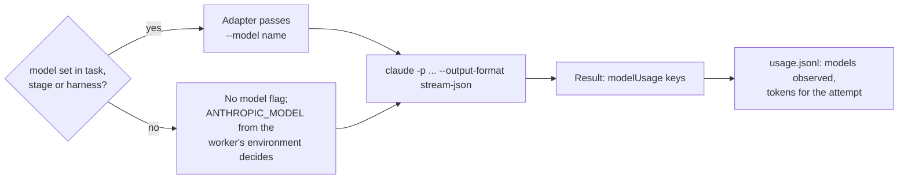
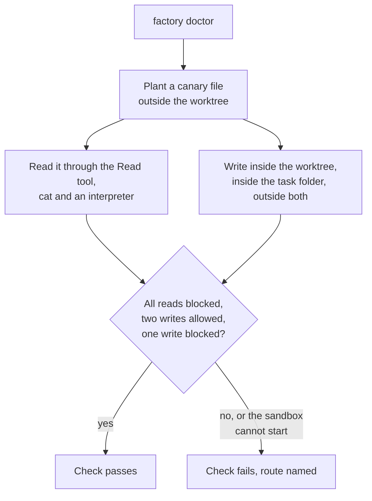

# 9. Module: worker adapters and governed helpers

Part of the [phase 1 design](../phase-1.md#module-map). Build wave: 2. Contracts and acceptance criteria are in this file; shared types are in [section 18](../shared/18-shared-contracts.md). Terms such as run, stage, task, attempt and rework are defined in the [glossary](../phase-1.md#2-glossary).

Every worker adapter implements one contract, so adding a harness changes no workflow file. Phase 1 ships the Claude adapter; the Codex adapter and its design are in `docs/design/phase-2.md`.

```text
run(task) -> {status, artifact_path, usage}
  input:  task id, skill reference, scope and deny paths, timeout, helper policy,
          worktree path, feedback records, delivered notes, progress (on resume)
  rules:  cwd is the task worktree; the engine owns timeout and kill;
          the worker writes its artifact, progress.md and the helpers ledger to
          $FACTORY_TASK_DIR, never into the worktree
capabilities: {subagents: native | none, usage: bool}
```

| Claude adapter | |
| --- | --- |
| Headless run | `claude -p` with the task prompt, JSON output |
| Skills location | `.claude/skills/factory-*`, generated by the shim |
| Rules file | `AGENTS.md`, imported by `CLAUDE.md` |
| Native helpers | Claude Code subagents |
| Usage data | From the `result` line of the event stream |
| Live log | Parsed into plain-text `worker.log` while the task runs (see Live log below) |

Check each CLI with `--help` on the installed version before relying on a flag, because options change between releases. The adapter is the only place that knows them.

**Connecting to the LLMs**

The factory never calls a model API itself. It launches the harness CLI, which authenticates with a key or a gateway token in its environment (a login session is not supported in phase 1; see Login below). The factory's job is to say which CLI, which model and which environment variables each worker gets.

```yaml
# ~/.factory/config.yaml   (per machine: secrets may be referenced here)
harnesses:
  claude:
    command: claude                         # or an absolute path
    # model: claude-opus-5-5              # optional; leave unset where the gateway picks the model
    args: []                                # the adapter sets --output-format stream-json --verbose itself
    env:
      ANTHROPIC_API_KEY: ${ANTHROPIC_API_KEY}             # or ANTHROPIC_AUTH_TOKEN: ${ANTHROPIC_AUTH_TOKEN} for a gateway
      ANTHROPIC_BASE_URL: ${ANTHROPIC_BASE_URL:-}         # the gateway's address; empty counts as unset
      ANTHROPIC_MODEL: ${ANTHROPIC_MODEL:-}               # the model when no `model` is set below; empty counts as unset

# .factory/config/factory.yaml   (committed: no secrets, only routing)
routing:
  default: claude
  stages:
    gather: {harness: claude}             # a stage may add model: <name> where the harness allows it
```

- **Interpolation** supports `${VAR}`, `${VAR:-default}`, and `${VAR:?message}`, which stops with that message when VAR is unset. Values are resolved when an attempt starts, so a rotated key is picked up without a restart.
- **No secrets in committed config.** A literal value under `env` in `.factory/config/` is refused at load, where a literal means anything that is not a `${...}` reference. In the per-machine file a literal is allowed, but the engine warns if the file can be read by other users.
- **Model choice,** first match wins:
  1. the task's `model`
  2. the stage routing entry
  3. the harness default
  4. none: the adapter sends no model flag, and the harness picks the model from `ANTHROPIC_MODEL` in the worker's environment (decision, 2026-11-14). The adapter passes `ANTHROPIC_MODEL` through from the machine's environment, as it does a key, because the scrubbed environment would otherwise drop it. An empty value counts as unset. With neither a flag nor the variable, the harness uses its own default, and a gateway can reject that: the check on 2026-11-14 got `400 E003: Model not available for Coding Agents`. A flag from steps 1 to 3 wins over the variable (tested both ways).
- **Observed model.** Whatever was chosen, the attempt records the model names the harness result reports. For Claude these are the keys of `modelUsage` in the `result` line of the `-p --output-format stream-json --verbose` stream (checked on Claude Code 2.1.325 with `json`, and on 2.1.330 with `stream-json`: the result has no top-level `model` key, and a gateway reported its own name, such as `claude-advantage-assist`). A run with subagents can report several. The record is a fact, not a setting, so a repo whose gateway forbids a model override sets no `model` anywhere and still gets accurate usage.


- **Worker environment:** each worker gets a minimal base (PATH, HOME, locale, `FACTORY_TASK_DIR`) plus only the variables declared for its harness, never the engine's whole environment. For Claude the declared variables are the key or token, `ANTHROPIC_BASE_URL` and `ANTHROPIC_MODEL`, all read from the machine's environment when the attempt starts (decision, 2026-11-14). Tested on Claude Code 2.1.325 with only PATH, HOME, the token and the model passed: a worker without `ANTHROPIC_BASE_URL`, or with it empty, ended with `Not logged in · Please run /login`, and with it passed the worker ran. A run that only has a token and no base URL is therefore a configuration error, not a login. Whether a token issued by Anthropic itself works without a base URL is Unspecified: only a gateway token was tested.
- **Live log:** while a worker runs, `wait` copies each complete new line of its output into `worker.log` about once a second, masked, using `LogTail` and `wait_tailing` in `runtime.py`. A partial last line waits for its newline, because `mask` cannot match a secret split across two chunks. The write at the end of the attempt replaces the file with the full log. Claude runs with `--output-format stream-json --verbose` (owner decision, 2026-11-21), so each assistant message, tool call and tool result is one event line that arrives as Claude sends it. The adapter turns each event into plain text (`plain_log` in `claude.py`): assistant text as it is, a Bash call as `$ <command>`, another tool call as `<tool>: <input>`, a tool result as its text, and an error result as `error: <text>`. Raw events never reach `worker.log`. A long tool call that prints nothing, such as a quiet test run, still adds no line until it ends.
- **Secret masking:** resolved secret values are masked as `***` in `worker.log`, `events.jsonl` and feedback records.
- **Other providers:** cloud setups such as Bedrock or Vertex are configured through the CLI's own environment variables, declared under `env` the same way. Confirm the variable names with each CLI's documentation.
- **`factory doctor`** checks each harness before a run: the binary exists, the version, the variables resolve, and the auth status. It also checks `git` and `gh auth status`, and runs the sandbox canary described under Threat model and isolation.

**MCP servers**

Workers can use MCP servers, such as Context7 for current library documentation and Tavily for web search. Servers are defined once per machine and allowed per stage, so each worker sees only the tools its task needs. Each enabled server adds its tool descriptions to the worker's context, which is the main reason not to enable everything everywhere.

```yaml
# ~/.factory/config.yaml   (machine: where each server is and its secrets)
mcp_servers:
  context7:
    url: https://mcp.context7.com/mcp
    headers: {CONTEXT7_API_KEY: ${CONTEXT7_API_KEY}}
    # local: {command: npx, args: [-y, "@upstash/context7-mcp"], env: {CONTEXT7_API_KEY: ${CONTEXT7_API_KEY}}}
  tavily:
    url: https://mcp.tavily.com/mcp/
    headers: {Authorization: "Bearer ${TAVILY_API_KEY}"}
    # local: {command: npx, args: [-y, tavily-mcp@latest], env: {TAVILY_API_KEY: ${TAVILY_API_KEY}}}

# .factory/config/factory.yaml   (repo, committed: which stages may use which server)
mcp:
  default: []
  stages:
    fix: [context7]
    implement: [context7]
    review-standards: [context7]
    scope: [tavily]
    gather: [tavily, context7]
```

- **Narrowing only.** A task may narrow its stage's list (`mcp: [context7]`) but never add a server its stage does not allow. Deterministic tasks never get MCP servers.
- **Per-attempt config.** At each attempt the adapter writes the selected servers into the harness's own format in a private folder outside the run folder (mode 0600, under `$FACTORY_HOME/tmp/`), deletes it when the attempt ends, and never archives it, because it holds resolved keys:
  - Claude gets a JSON MCP config.
  - Only that config is loaded, not your personal servers.
  - Confirm the option names for each installed CLI version.
- **Secrets.** Keys come from `${...}` in the machine file and are masked in logs.
- **Remote or local.** Remote URL servers are preferred because they need no local install. A local `npx` server needs Node.js 22.12 or later (the `srt` floor; tested on Node 26), which `factory doctor` checks along with whether each enabled server answers.
- **Cost.** Tool results count toward the attempt's tokens in the usage record. Tavily searches also use Tavily API credits, so the usage record lists which servers an attempt used.

**Prompt assembly** is a fixed template filled by code: the skill reference, a request summary, scope and deny paths, the helper policy in plain words, feedback records, delivered notes, `progress.md` and the required output schema. The output instruction gives the absolute path of the task folder for the artifact, `progress.md` and the ledger, because a worker with no shell cannot expand `$FACTORY_TASK_DIR` (ADR `2026-11-21-the-prompt-names-the-real-task-folder.md`). Stating the helper policy explicitly keeps delegation predictable, and is what a phase 2 harness that delegates only when asked will need.

**Governed helpers**

| Control | What it does | Enforced by |
| --- | --- | --- |
| 1. Declare | Each task sets mode (auto, native, off), a maximum count, split hints and a timeout | Workflow YAML, validated at load |
| 2. Ledger | The worker appends every helper it starts to a ledger file. The gate fails if files changed but the ledger is missing, or the count exceeds the maximum | Gate `helpers-ledger` |
| 3. Scope check | The engine diffs the task worktree against its scope, whoever wrote the change | Gate `scope-diff` |
| 4. Checkpoints | WIP commits and `progress.md` at intervals, so a restart resumes instead of starting over | Engine, at each interval |
| 5. Capability flag | Native harness: the worker may split. Harness without helpers, or `mode: off`: the engine expands split hints into sibling tasks | Adapter manifest plus scheduler |
| 6. Hard caps | Timeout kill; a helper maximum of 2 reserves 3 concurrency slots | Scheduler |

A workflow must pass with helpers off before native helpers are switched on, so sibling tasks are always the fallback.

Worked example, the backend task of the fix stage, with helpers set to auto, a maximum of 2, and split hints api-code and tests:

- **Claude:** the worker may start two helpers, logs both in the ledger and checkpoints at milestones.
- **Helpers off:** the engine runs two sibling tasks, backend-api-code and backend-tests, in their own worktrees.

The gate evidence has the same shape either way.

**Residual risk.** The ledger is self-reported, so the engine cannot prove what happened inside a session. It cross-checks the ledger against the diff, the timeout and reported token usage. A helper that changed no files could still go unseen.

**Module contract: 9 Worker adapters and governed helpers**

- **Depends on:**
  - 3: `resolve_harness`, `mask`
  - 10: `resolve_skill`, which supplies the skill reference in the prompt
  - 18: the shared types the contract uses (`CheckResult`, `HelperPolicy`, `McpServer`, `Request`, `RunSpec`) and the error catalogue
  - Outside tool: `srt` (module 3 pins and checks it), which `CommandAdapter` runs commands under
- **Writes:** `worker.log` only. Workers write their artifact, `progress.md` and the ledger into `$FACTORY_TASK_DIR`. The adapter returns token counts; 6B records them through 14.
- **CLI it backs:** the harness checks and the sandbox canary in `doctor`.

```python
# adapters/worker/base.py
class WorkerAdapter(Protocol):
    name: str                                     # "claude" | "command" | "fake"
    capabilities: Capabilities                    # subagents: native | none; usage: bool
    def check(self, conf: HarnessConfig) -> CheckResult           # binary, version, auth
    def start(self, ctx: TaskContext, conf: HarnessConfig, log: Path) -> WorkerHandle
    def wait(self, handle: WorkerHandle, timeout_s: int) -> AttemptResult
    def stop(self, handle: WorkerHandle) -> None

@dataclass
class Capabilities:
    subagents: Literal["native", "none"]          # native: the harness can start helpers; none: the engine expands split hints
    usage: bool                                   # True when the adapter reports token counts

@dataclass
class HarnessConfig:                              # what resolve_harness (3) returns
    command: str                                  # the binary to run
    model: str | None                             # None when unset: no model flag is sent
    args: list[str]                               # extra arguments, in order
    env: dict[str, str]                           # the minimal environment, ${...} resolved at call time

@dataclass
class WorkerHandle:                               # opaque to callers: pass it back to wait and stop
    task_id: str; attempt: int
    data: dict                                    # adapter state: a real adapter keeps its process group, the fake its script position

@dataclass
class TaskContext:
    run_id: str; task_id: str; stage: str; attempt: int
    skill: SkillRef; request: Request
    worktree: Path; task_dir: Path               # $FACTORY_TASK_DIR = tasks/<task>/work/
    scope: list[str]; deny: list[str]; helpers: HelperPolicy
    feedback: list[Path]                          # records from 8, newest last
    notes: list[str]                              # every delivered note from 12
    progress: Path | None                         # progress.md when resuming
    output_schema: str | None; model: str | None   # None: no model flag is sent
    mcp: list[McpServer]                          # stage list, narrowed by the task
    practices: list[SkillRef]                     # practice packs from 10, as pointers

@dataclass
class AttemptResult:
    exit: Literal["ok", "failed", "timeout", "killed"]; exit_code: int | None
    artifact: Path | None; input_tokens: int | None; output_tokens: int | None
    models_observed: list[str]                    # model names the harness reported; [] when it reported none
    error_kind: Literal["auth", "rate_limit", "binary_missing", "model_not_found", "crash"] | None

# prompt.py
def build_prompt(ctx: TaskContext) -> str             # fixed template, no LLM
def check_helpers_ledger(spec: GateSpec, ctx: GateContext) -> GateResult     # used by 8
# adapters/worker/claude.py, fake.py
class ClaudeAdapter(WorkerAdapter): ...
class FakeWorkerAdapter(WorkerAdapter):        # scripted results for other modules' tests
    def __init__(self, script: dict[str, list[AttemptResult]], *, writes: dict[str, dict[str, str]] = {}): ...
```

**Write boundary.** The adapter limits the worker's writes to its worktree and `$FACTORY_TASK_DIR` with Claude Code's sandbox (see Threat model and isolation below). The engine reads back only three things from `work/`: the artifact (schema-checked), `progress.md` and the helpers ledger. Everything else the worker writes there is ignored.

**Build caches (decision Q2, 2026-11-14).** Tools write caches under your home folder, and the sandbox denies those writes (a write to `~/.npm` failed with `Operation not permitted`). The adapter does not add a writable path. It sets each tool's cache variable to a folder under this task's `work/` folder before the command starts, so the boundary stays two paths and nothing a task caches outlives its run.

| Tool | Variable the adapter sets | Checked |
| --- | --- | --- |
| npm | `npm_config_cache` | Yes. `npm config get cache` returned the new path. The name `npm_cache` has no effect and must not be used. |
| Maven | `MAVEN_OPTS=-Dmaven.repo.local=<folder>` | Yes. `help:evaluate` returned the new path. |
| Go | `GOMODCACHE` and `GOCACHE` | Yes. `go env` returned both. |
| pip | `PIP_CACHE_DIR` | Yes. `pip cache dir` returned the new path. |
| Gradle | `GRADLE_USER_HOME` | **No.** Gradle is not installed on this machine. Verify it when the Java profile of [module 17A](17a-language-toolchains.md) is built. |
| NuGet, ruff | Not set | **No.** Neither tool is installed here. |

Each language profile in 17A names its own cache variable, so a new profile adds one row and no adapter code. The cost is that each task downloads its dependencies again, which needs its registry under `allowedDomains` for that stage.

**Threat model and isolation**

A worker reads text the factory does not control (issue bodies, repo files, web results) and has a shell. A prompt injection in that text could try to read your files or send them out. Phase 1 reduces this with Claude Code's own sandbox (decision D7, changed on 2026-11-14) and says plainly what remains.

- **Limited tools.** The adapter runs the harness headless with an explicit allowlist of tools and commands for the task and no interactive prompts, so anything outside the list is denied instead of waiting for an answer.
- **Claude Code's sandbox, on for every worker.** The adapter passes a per-attempt settings file with `--settings`, written next to the per-attempt MCP config and deleted with it. The file turns the sandbox on and fails the attempt when the sandbox cannot start:

  ```json
  {"sandbox": {"enabled": true, "failIfUnavailable": true, "allowUnsandboxedCommands": false,
               "filesystem": {"denyRead": ["<factory home>", "~/.ssh", "~/.aws", "~/.config/gh", "~/.claude", "~/.claude.json", "~/.codex"],
                              "allowRead": ["<this task's work/ folder>"],
                              "allowWrite": ["<task worktree>", "<this task's work/ folder>"]}}}
  ```

  - **Reads.** Every Bash command, including an interpreter such as `python3` or `node`, runs under the sandbox, so `denyRead` covers it as well as the Read tool. The adapter also adds a `Read(//<path>)` deny rule for the same paths, so the Read tool is denied even where the sandbox is not the layer that stops it. The earlier D7 note says an absolute path in a rule starts with `//`. A test on 2026-11-14 blocked the Read tool with both the `/` and the `//` form, so the adapter writes `//` and the `doctor` canary checks the result.
  - **The task's own folder.** The factory home is denied as a whole, so the adapter lists this task's `work/` folder under `allowRead`. Without it the worker could not read its own `progress.md` on a restart. Other runs' folders, `env`, `config.yaml`, `dashboard.json`, `tmp/` and `plugin-hashes.json` stay denied.
  - **Writes.** A write succeeds only inside the task worktree and this task's `work/` folder. The engine does every commit, so a worker never needs to write git metadata outside the worktree.
  - **Network.** A Bash command's outbound request to an unlisted domain is blocked, and one to a domain under `sandbox.network.allowedDomains` goes through (tested with `example.com` and `example.org`). A stage that needs a domain from Bash, such as an `npm install` from a registry, lists it. MCP servers are not Bash, and they work with the sandbox on: the real Tavily server (URL in the machine file, key from `TAVILY_API_KEY`) and a local stdio server both answered a tool call on 2026-11-14, and a worker's Bash could not read the file that holds the resolved key.
  - **Caches.** The sandbox denies a write to `~/.npm`, so the adapter points each tool's cache into this task's `work/` folder (decision Q2, see Build caches below).
  - **Setting names.** The names above were checked in Claude Code 2.1.325. They can change between releases, so the adapter reads them from one table in `adapters/worker/claude.py`, and `doctor` fails when the sandbox does not behave as described.
- **Bash is granted per task, by command.** A task gets `Bash(<command>:*)` rules for the commands its stage needs, and no interpreter unless its skill needs one. The sandbox now also confines an allowed interpreter, so granting one no longer opens the denied folders.
- **No GitHub or tracker credentials.** Workers get no `GH_TOKEN`. The engine does every GitHub call.
- **Scrubbed environment.** Described under worker environment above.
- **Residual risk.** The sandbox is Claude Code's for Claude workers and `srt` for commands. Neither is the factory's own. It does not stop a worker from reading files your user can read outside the denied list, and a worker with network access could send what it reads. A new Claude Code release can change a setting name or a default, which is why `doctor` proves the boundary on each machine. A second harness in phase 2 needs its own boundary, though `CommandAdapter`'s `srt` wrapper is harness-neutral; the Codex adapter's boundary, and the two risks it adds to D7, are in the next item. For repos that matter, use a separate machine or user account.
- **Residual risk accepted for Codex workers only (D7, owner decision, option `accept-both-codex-only`).** The phase 2 Codex adapter (P2-1) cannot meet D7 with Codex's own sandbox, so two changes are accepted. They apply to the Codex adapter and to no other worker. The Claude adapter, `CommandAdapter` and the helpers keep the sandbox described above, with no `allowMachLookup` and no disabled layer.
  - **One sandbox layer.** Codex runs with `-s danger-full-access`, so Codex's own sandbox is off and `srt` is the only layer. The reason, checked on codex-cli 0.164.0 and `srt` 0.0.83: with `-s workspace-write`, Codex runs each command under `sandbox-exec`, which fails inside `srt` (`sandbox_apply: Operation not permitted`, exit 71). Cost: if `srt` fails to apply or has a bug, nothing else stands behind it, where a Claude worker has Claude Code's sandbox and the Read deny rules. D7's deny-read and write rules hold for Codex only while `srt` wraps it, so the adapter must always run under `srt` and must fail the attempt when `srt` cannot start.
  - **A `trustd` Mach grant.** The `srt` settings for Codex add `network.allowMachLookup: ["com.apple.trustd.agent"]`, because Codex's TLS needs it: without it a Codex run through `srt` timed out (exit 124), and with it the run answered (exit 0). `srt`'s own README says this grant (its `enableWeakerNetworkIsolation` option allows the same lookup) opens a potential data exfiltration route through `trustd`. Cost: a Codex worker with network access has one more channel than a Claude worker. The grant is in the Codex settings only and nowhere else.
  - **What stays true.** A Codex worker still cannot read the factory home or `~/.codex` (PR #43 adds `~/.codex` to the shared `CREDENTIAL_PATHS`, because the gateway key was readable without it; the folder is then also denied to every other worker, which costs nothing), and still writes only inside its worktree and task folder, as long as `srt` is the layer. The `doctor` canary must prove this for Codex on each machine before a Codex run counts as meeting D7; that canary is not built yet (see the PR #43 open items).
  - **Reversible.** Either change can be withdrawn by a new decision; the adapter then fails closed (no Codex workers) until a stronger boundary exists. This record is the one place the two risks are written; do not restate them elsewhere without linking here.
- **What the 2026-11-14 tests showed (Claude Code 2.1.325, macOS, a gateway token).**
  - Without the sandbox, `python3` read a file that a Read deny rule named.
  - With it on, `python3` and the Read tool failed to read that file, and `cat` was refused by the permission layer before it ran. Writes succeeded only in the worktree and the task folder. `git status`, `git diff` and `git add` ran in a worktree. A child path under `allowRead` was readable while its denied parent was not. Bash network access was blocked.
  - On macOS, Claude Code runs each Bash command under `sandbox-exec`, which its man page marks DEPRECATED. A future macOS release can break it. Decided 2026-11-14: keep it. Both Claude's sandbox and `srt` use it, and no tested macOS mechanism gives the same boundary, so dropping it would drop D7. If a future macOS breaks it, `doctor` fails closed (see the criteria below), and the fix is a new decision.
  - Also tested: a worker's local and remote MCP servers work with the sandbox on, `allowedDomains` admits a listed domain, a command run under a sandbox that cannot be applied fails with `sandbox_apply: Operation not permitted` and exit 71 instead of running unsandboxed (checked by nesting `sandbox-exec`), and `cat` fails under the sandbox alone with `Operation not permitted`.
  - **Not tested:** Linux (the binary names `bwrap`). Phase 1 supports a key or gateway token only, so a login session is out of scope. See Login below.
- **Doctor.** `factory doctor` runs the canary each time it runs, on every machine. It plants a file outside the worktree and tries to read it through the Read tool, `cat` and an interpreter, then tries to write one file inside the worktree, one inside the task folder and one outside both. Each route must be blocked or allowed as the settings say. A route that is not blocked fails the check with the route named, and so does a sandbox that cannot start. `doctor --as-scheduler` runs it too, so the check covers the environment cron uses.



**Isolation from your own setup**

Your own CLAUDE.md, plugins, hooks and MCP servers must not leak into workers: in a personal setup they run session-start hooks and send notifications once per worker.

- The adapter starts each harness with flags that load only the factory's per-attempt MCP config, only project-level settings, and no user-level plugins or hooks. The repo's `AGENTS.md` is the only instruction file. Check the flag names with `--help` on the installed version. Verified on Claude Code 2.1.325: `--setting-sources <user,project,local>`, `--strict-mcp-config` with `--mcp-config`, `--no-session-persistence`, `--allowedTools`, `--disallowedTools`, `--tools` and `--permission-mode` all exist. A headless run with no flags received the global `CLAUDE.md` (it quoted the Telegram notify rule); a run with `--setting-sources project --strict-mcp-config --mcp-config '{"mcpServers":{}}'` did not.
- **Login: an API key or a gateway token only (decision, 2026-11-14).** Phase 1 supports `ANTHROPIC_API_KEY`, or `ANTHROPIC_AUTH_TOKEN` with `ANTHROPIC_BASE_URL` for a gateway. A login session (OAuth) is not supported and not tested: whether it carries over with `--setting-sources project` is Unspecified, and nothing in phase 1 depends on it. `factory doctor` fails with `config.no_credentials` when neither is set. `--bare` is not used, because its help says it reads only `ANTHROPIC_API_KEY` or `apiKeyHelper` and never OAuth or the keychain.
- **Linux is a pre-pilot check.** Claude Code's sandbox on Linux rests on `bwrap`, and `srt` on `bubblewrap`. Neither was run. Before the phase 1a pilot, run `factory doctor` on a Linux machine; it must pass the canary for Claude and for `srt`. D6 stands (macOS and Linux in phase 1), and an untested machine fails closed.
- `factory doctor` starts a probe worker that lists the plugins, MCP servers and hooks it loaded, and fails if any personal one appears. It cannot check instructions: the init event does not list the loaded `CLAUDE.md` (see Implementation notes, wave 2 build). If flags prove leaky, the fallback is a factory-owned config folder (`CLAUDE_CONFIG_DIR`) with its own API key or gateway token.

**Deterministic tasks** (`cmd`, `script`, `python`) use `CommandAdapter`, and a skill task uses the worker registered for its harness; the engine picks the adapter for each task. `CommandAdapter` implements the same `WorkerAdapter` interface with `capabilities: {subagents: none, usage: false}`. 6B therefore schedules, times out, logs and retries every task the same way. `CommandAdapter` writes no usage record, since no tokens are spent.

**Sandbox for commands (decision Q1, 2026-11-14).** Claude Code's sandbox covers only Claude workers. A `cmd` task, a gate command, a plugin script and a Python function would otherwise run with your full access, and a script planted in the repo could read the factory home. So `CommandAdapter` runs each of them, and the gate commands of module 8, under Anthropic's standalone `srt` (`@anthropic-ai/sandbox-runtime`, pinned at 0.0.83, which needs Node 22.12 or later; tested on Node 26.13.0, the factory's Node version, decided 2026-11-14). It uses the same read and write rules as a worker: the factory home and the credential folders denied, this task's `work/` folder readable, and writes only to the worktree and that folder. Network is denied unless the stage lists domains.

  - **Argument lists stay argument lists.** `srt -c` takes one shell string. The adapter joins the list with `shlex.quote` on each element, so spaces, `;`, `$(...)` and quotes in an element stay inert. The adapter never builds the string any other way.
  - **Exit codes pass through.** The check in the test showed 0, 3 and 127 (a missing binary) arrive unchanged, so the D2 rule (non-zero is a check failure, a missing binary is a task error) holds.
  - **Settings file.** The adapter writes one `srt` settings file per attempt next to the per-attempt MCP config, and deletes it with that config.
  - **`doctor`.** The canary under Threat model and isolation runs once for Claude and once for `srt`, and `doctor` fails when `srt` is missing, too old a Node, or does not block a route.
  - **Tested on macOS only** (`srt` 0.0.83): it denied a read, refused a write outside the worktree, allowed one inside, kept `allowRead` for a child of a denied folder, blocked network by default, and passed the environment through. Linux and the deprecated `sandbox-exec` caveat apply here as they do to Claude's sandbox.

```python
# adapters/worker/command.py
class CommandAdapter(WorkerAdapter):
    name = "command"
    def start(self, ctx: TaskContext, conf: HarnessConfig, log: Path) -> WorkerHandle
        """cmd: argument list; script: by extension and os rules; python: plugin_runner subprocess."""
# plugin_runner.py: `python -m factory_engine.plugin_runner <plugin dir> <module:function>`
def main() -> int     # JSON in on stdin, JSON out on stdout, exit codes 0, 1, 2
```

- **Run and test:** `pytest factory/engine/tests/workers`, with each real adapter tested against a stub binary that replays recorded JSON output; a live smoke test runs only when `FACTORY_LIVE=1`.
- **Errors:** a missing binary, failed auth or unknown model need a human at once. A rate limit is transient and does not count as a task retry. A timeout, crash or bad artifact is a task retry. A ledger violation is rework.

Acceptance criteria:

- [x] The Claude adapter runs headless in the task worktree, with only the declared environment plus `FACTORY_TASK_DIR`. (test: factory/engine/tests/workers/test_claude_adapter.py::test_the_worker_runs_headless_in_the_task_worktree, ::test_the_child_gets_only_the_declared_variables_and_the_task_dir)
- [x] The prompt contains the skill reference, scope and deny paths, the helper policy in plain words, feedback records, delivered notes and the output schema. (test: factory/engine/tests/workers/test_claude_adapter.py::test_the_prompt_carries_the_skill_scope_helpers_feedback_notes_and_schema, ::test_a_practice_pack_appears_as_a_path_and_one_line_never_its_text)
- [x] Token counts are parsed from each CLI's output, and are `null` when not reported. (test: factory/engine/tests/workers/test_claude_adapter.py::test_tokens_are_parsed_from_the_result, ::test_tokens_are_null_when_the_result_reports_none)
- [x] With no model in task, stage or harness config, the Claude command line has no `--model` flag, and `models_observed` holds the `modelUsage` keys of the recorded result. (test: factory/engine/tests/workers/test_claude_adapter.py::test_with_no_model_in_config_the_command_has_no_model_flag_and_models_come_from_modelusage)
- [x] With no model in config, a worker started from a scrubbed environment still receives `ANTHROPIC_MODEL` when the machine has it, and the same worker without it ends as `model_not_found` and needs a human. A test with the stub binary replays both. (test: factory/engine/tests/workers/test_claude_adapter.py::test_anthropic_model_from_the_machine_reaches_a_scrubbed_worker_with_no_flag, ::test_without_anthropic_model_the_worker_ends_as_model_not_found_and_needs_a_human (stub binary))
- [x] A `--model` flag wins over `ANTHROPIC_MODEL`, and an empty `ANTHROPIC_MODEL` is passed as unset. (test: factory/engine/tests/workers/test_claude_adapter.py::test_a_model_flag_from_the_task_wins_over_anthropic_model, ::test_an_empty_anthropic_model_is_passed_as_unset)
- [x] A worker started from a scrubbed environment receives `ANTHROPIC_BASE_URL` from the machine's environment, as it does the key or token and the model. With the variable missing or empty, the worker ends as `auth` (`Not logged in`) and needs a human. A test with the stub binary replays both. (test: factory/engine/tests/workers/test_claude_adapter.py::test_the_base_url_reaches_the_worker_from_the_machine_when_the_config_does_not_declare_it, ::test_a_missing_base_url_ends_as_auth_and_needs_a_human (stub binary))
- [x] A recorded result with two `modelUsage` keys gives both names in `models_observed`, and tokens summed across them. (test: factory/engine/tests/workers/test_claude_adapter.py::test_a_result_with_two_modelusage_keys_gives_both_names_and_summed_tokens)
- [x] `worker.log` has a running worker's output before the attempt ends, and a secret split across two writes is masked. (test: factory/engine/tests/workers/test_log_tail.py::test_a_secret_split_across_two_writes_is_never_in_the_log, ::test_wait_tailing_copies_output_while_the_process_is_still_running, and the three adapter tests named in module 12)
- [x] Secret values never appear in `worker.log`. (test: factory/engine/tests/workers/test_claude_adapter.py::test_secret_values_never_appear_in_the_worker_log)
- [x] A Claude worker runs with `--output-format stream-json --verbose`; `worker.log` shows each message, tool call and tool result as plain text while the worker runs, never a raw event; tokens and models still come from the stream's `result` line. (test: factory/engine/tests/workers/test_claude_adapter.py::test_the_worker_runs_with_the_streaming_output, ::test_a_streamed_result_gives_its_tokens_and_models, ::test_the_worker_log_shows_each_message_as_plain_text_not_raw_events, ::test_a_streamed_message_reaches_the_worker_log_while_the_worker_is_still_running; fixture `recorded/stream.jsonl`, recorded from Claude Code 2.1.330 on 2026-11-21)
- [x] `stop` ends the worker and any helper sessions it started. (test: factory/engine/tests/workers/test_claude_adapter.py::test_stop_ends_the_worker_and_its_helper_sessions)
- [x] The same request gives gate evidence of the same shape with helpers off and on. (test: factory/engine/tests/workers/test_prompt_and_ledger.py::test_the_same_request_gives_gate_evidence_of_the_same_shape_with_helpers_off_and_on, factory/engine/tests/workers/test_claude_adapter.py::test_helpers_on_and_off_give_attempt_evidence_of_the_same_shape)
- [x] `FakeWorkerAdapter` can script success, failure, timeout and artifact contents per task. (test: factory/engine/tests/workers/test_prompt_and_ledger.py::test_the_fake_scripts_success_failure_and_timeout_per_task, ::test_the_fake_writes_each_tasks_artifact_into_its_task_folder)
- [ ] A worker that tries to write `task.json`, `notes.jsonl` or anything in the run folder outside `work/` is blocked by the sandbox, and the engine never reads such a change. (not ticked: the srt half is proven by factory/engine/tests/workers/test_command_adapter.py::test_a_worker_cannot_write_engine_state_in_the_run_folder_outside_its_work_folder; the criterion says "a worker", and the Claude sandbox half has no test)
- [x] Every Claude attempt starts with a settings file that has `sandbox.enabled: true`, `failIfUnavailable: true`, `denyRead` for the factory home and the credential folders, `allowRead` for the task's own `work/` folder, and `allowWrite` for the worktree and that folder only. The file is deleted when the attempt ends. (test: factory/engine/tests/workers/test_claude_adapter.py::test_every_attempt_has_a_settings_file_with_the_required_sandbox_rules, ::test_the_settings_file_and_mcp_config_are_deleted_when_the_attempt_ends)
- [ ] With the sandbox on, an interpreter, `cat` and the Read tool each fail to read a canary file in the factory home, the worker still reads its own `progress.md`, and `git status`, `git diff` and `git add` work in the task worktree. (not ticked: needs the real sandbox with a canary file; the srt tests skip without srt 0.0.83 and Node 22.12+, and the Claude sandbox has no test at all)
- [ ] A write succeeds inside the worktree and the task folder, and fails outside both. (not ticked: the srt and Codex halves are proven by factory/engine/tests/workers/test_command_adapter.py::test_a_command_can_write_inside_the_worktree_and_task_folder_but_not_outside_both and test_codex_adapter.py::test_the_worker_is_confined_by_srt_and_cannot_write_outside_its_folders; the Claude sandbox has no write test)
- [x] When the sandbox cannot start, the attempt fails and the worker does not run unsandboxed. The stub binary in the adapter tests replays this case. Each failure type has its own code in the [error-code catalogue](../shared/18-shared-contracts.md#18-shared-contracts) (the `sandbox.*` rows). Tested on 2026-11-14 on Claude Code 2.1.325: a sandbox the OS refuses to start fails the command with `sandbox_apply: Operation not permitted`, exit 71 (`sandbox.unavailable`). A settings field with a wrong type exits 1 with "sandbox required but unavailable... failed validation" (`sandbox.settings_invalid`). A missing file exits 1 with "Settings file not found" (`sandbox.settings_unreadable`). A file that is not JSON at all exits 0 and **runs with no sandbox** (a `cat` of a denied file succeeded), so the adapter parses the file before it starts the worker and raises `sandbox.settings_unparseable`. An unknown key is accepted and ignored, so a misspelled key does not fail. Not shown by the tests: what `failIfUnavailable` changes on a machine whose sandbox cannot start, because with the flag off the same command also failed. (test: factory/engine/tests/workers/test_claude_adapter.py::test_a_sandbox_that_cannot_start_fails_the_attempt_and_is_not_run_unsandboxed, ::test_a_settings_field_refused_by_claude_is_sandbox_settings_invalid, ::test_a_missing_settings_file_reported_by_claude_is_sandbox_settings_unreadable)
- [x] A worker starts with exactly the MCP servers its stage and task allow, and none of the user's personal servers. (test: factory/engine/tests/workers/test_claude_adapter.py::test_the_mcp_config_holds_only_the_servers_the_task_is_given, ::test_a_task_with_no_mcp_gets_an_empty_server_list, ::test_the_isolation_flags_are_passed)
- [x] The prompt lists practice packs as paths with one-line descriptions, never their full text. (test: factory/engine/tests/workers/test_claude_adapter.py::test_a_practice_pack_appears_as_a_path_and_one_line_never_its_text)
- [x] The prompt's output instruction names the absolute path of the artifact, `progress.md` and the ledger, not only `$FACTORY_TASK_DIR`. (test: factory/engine/tests/workers/test_prompt_and_ledger.py::test_the_prompt_gives_the_real_task_folder_path_not_only_the_variable, factory/engine/tests/workers/test_own_skills_against_fake.py::test_each_own_skill_resolves_and_its_prompt_names_the_skill_and_artifact; real run 2026-11-21: the chore `change` task wrote `change.json` on its first attempt, where it had failed three times before)
- [ ] Every `cmd` task, gate command, plugin script and Python function runs under `srt` with the worker's read and write rules. An argument such as `c;touch X` or `$(touch Y)` reaches the program as one argument and creates no file. Exit codes 0, 3 and 127 arrive unchanged. (not ticked: no test runs a cmd through srt for the c;touch argument check (test_shell_syntax_in_an_argument_creates_no_file skips without srt); only the argv wrapping is tested)
- [ ] A task that runs `npm`, `mvn`, `go` or `pip` writes its cache under its own `work/` folder and nowhere else, and a write to `~/.npm` still fails. (not ticked: only npm is run, by factory/engine/tests/workers/test_command_adapter.py::test_real_npm_reports_its_cache_under_the_task_folder; mvn, go and pip are not run, and the criterion names them)
- [ ] `factory doctor` fails when `srt` is missing, when Node is older than 22.12, or when the canary finds an open route under `srt`. (not ticked: test_doctor_fails_when_srt_is_missing and test_doctor_fails_when_node_is_older_than_22_12 cover two of the three checks; the canary-finds-an-open-route case (test_the_srt_canary_names_an_open_route_when_the_settings_leave_one) skips without srt)
- [x] The adapter parses each per-attempt settings file before it starts the worker. A file that is not JSON fails the attempt with `sandbox.settings_unparseable` and the worker does not start. Checked by a test with `{not json`, which Claude alone would run with no sandbox. (test: factory/engine/tests/workers/test_claude_adapter.py::test_a_settings_file_that_is_not_json_stops_the_attempt_before_the_worker_starts, ::test_start_stops_before_the_worker_runs_when_the_settings_file_is_not_json (start() raises sandbox.settings_unparseable, the stub claude never runs, and the attempt folder is removed))
- [x] `factory doctor` fails with `config.no_credentials` and a hint when neither `ANTHROPIC_API_KEY` nor `ANTHROPIC_AUTH_TOKEN` is set for a Claude harness. (test: factory/engine/tests/workers/test_claude_adapter.py::test_doctor_fails_with_no_credentials_and_names_the_variables)
- [ ] A worker gets no `GH_TOKEN`. `factory doctor` runs the sandbox canary on every run of `doctor`, fails with the route named when a read route or the outside write is not blocked, and fails when the sandbox cannot start. (not ticked: the no-GH_TOKEN half is tested (tests/workers/test_claude_adapter.py::test_the_child_gets_only_the_declared_variables_and_the_task_dir, ::test_a_harness_config_cannot_hand_a_worker_a_github_token); the doctor canary half needs srt, and test_the_srt_canary_passes_on_the_real_sandbox skips here)
- [ ] The `doctor` probe worker loads none of your personal instructions, plugins, hooks or MCP servers, and the check fails when one appears. (not ticked: plugins, MCP servers and hooks are asserted (tests/workers/test_claude_adapter.py::test_the_probe_fails_when_a_personal_plugin_or_mcp_server_reaches_the_worker, ::test_the_probe_fails_when_a_hook_runs_in_the_worker, ::test_the_probe_passes_when_only_builtin_plugins_are_loaded); personal instructions are not: the init event does not list them, so probe_isolation cannot see a personal CLAUDE.md)
- [x] `CommandAdapter` runs a command, a script and a plugin Python function and kills each at its timeout. For a command, exit 0 is passed, any other exit is check failed, and a missing binary is a task error. For a script or function, exit 0, 1 and 2 map to passed, check failed and task error. Each kill is checked by the child's PID being gone after the timeout. (test: factory/engine/tests/workers/test_command_adapter.py::test_a_command_is_killed_at_its_timeout, ::test_a_plugin_script_is_killed_at_its_timeout, ::test_a_plugin_function_is_killed_at_its_timeout, ::test_an_exit_code_arrives_unchanged_through_srt, ::test_a_missing_binary_is_reported_as_binary_missing_not_a_check_failure, ::test_a_plugin_script_exit_1_is_a_check_failure_and_exit_2_a_task_error, ::test_for_a_cmd_zero_passes_and_any_other_exit_fails_the_check)

**Implementation notes (wave 2 build, 2026-11-15).** These record what the code does where this file is silent or differs from what the first build assumed.

- `TaskContext` in code has the 18 fields of the block above, all required, and six more with defaults: `artifact_name` (the file the task's `out` names), `bash` (the commands a stage grants), `cmd`, `run`, `plugin_dir` (for deterministic tasks) and `question`. The block above does not list these six, and `CommandAdapter` needs them.
- `TaskContext.skill` is `None` for a deterministic task. The spec types it as a skill reference only.
- `AttemptResult.error_kind` carries `binary_missing` for a missing `cmd` or `claude` binary. It is in the `error_kind` list above, so no code is missing from the spec.
- A sandbox refusal Claude reports on stderr raises `sandbox.*` as a `FactoryError` from `wait`, since no attempt ran. Only stderr is checked, so a worker that quotes the phrase is not mistaken for a sandbox failure.
- `CommandAdapter` writes its captured output to the task's `work/` folder, not the attempt folder. `srt` confines a sandboxed child's writes to the worktree and `work/`, so a capture file under the denied factory home is refused and the output is lost (observed with a Python child, 2026-11-15).
- The Claude adapter resolves `${...}` values against the machine environment when an attempt starts, so a literal reference never reaches the child. The stub-tested config may carry references; the adapter resolves them at that point.
- `doctor` for Claude spends one short model call per run: a canary that asks the worker to try six routes and reads the verdicts from the filesystem and the tool-call record, not from the model's report. The isolation probe spends one more call and reads the init event.
- Worker isolation checks plugins, MCP servers and hooks. It does not check instructions: the init event does not list the loaded `CLAUDE.md`. Whether a personal `CLAUDE.md` reaches a worker under `--setting-sources project` is Unspecified; the 2026-11-14 test is the only evidence and was run without the flags.
- The worktree is listed in `allowRead` as well as `allowWrite`, and the factory home's children on the way to it are denied one by one. The default worktree root is `~/.factory/worktrees`, inside the denied home, so a whole-folder deny would also hide the worker's own worktree.
- The helpers ledger is requested in every helper mode, so the gate can check that a helper-off task wrote none. With no file changed, the gate passes without a ledger.
- The `helpers-ledger` gate reads the ledger from the task's `work/` folder, which the spec does not name for `GateContext.task_dir`.
- `plugin_runner.main()` takes no arguments and reads `sys.argv`, to match the spec's `main() -> int`.

- `CodexAdapter` (phase 2, P2-1, checked on codex-cli 0.164.0 and `srt` 0.0.83) runs `codex exec --json --ephemeral --ignore-user-config --skip-git-repo-check` with the prompt on stdin, always wrapped in `srt`.
  - **One sandbox layer.** The adapter passes `-s danger-full-access`, so `srt` is the only layer (Codex's own `-s workspace-write` fails inside `srt` with exit 71). The risk and the owner's acceptance are in the D7 record under "Threat model and isolation" above; they are not restated here.
  - **Provider.** `--ignore-user-config` drops the provider from `config.toml`, so the adapter sets it with per-key `-c` overrides (`model_provider`, and `base_url`, `env_key`, `wire_api` under `model_providers.custom`). A `-c` value written as an inline table does not parse. The base URL is `OPENAI_BASE_URL` from the machine. With none set the adapter sends `https://api.openai.com/v1`, which is **not tested**: every live run used the IBM gateway.
  - **Key.** The key is `OPENAI_API_KEY` in the child's environment and is never written to a file. `CODEX_HOME` is an empty folder at `<work>/codex-home`, so a login under `~/.codex` does not reach the worker, and `~/.codex` is in the shared deny-read list.
  - **Settings.** The `srt` file lists the gateway host under `allowedDomains` and adds `allowMachLookup: ["com.apple.trustd.agent"]` under `network`, which Codex's TLS needs. At the top level of the file the key is silently ignored. Only the Codex adapter's file carries it, not the shared rules.
  - **Output.** The adapter writes the event stream and stderr to the task's `work/` folder, because `srt` confines a child's writes, and deletes both after it reads them. `worker.log` holds agent messages, commands with their output and errors as plain text, with the key masked.
  - **Usage.** Tokens come from the last `turn.completed.usage` (`input_tokens`, `output_tokens`) and are `null` when no such event arrives or a count is missing. `models_observed` is always `[]`, because the event stream names no model.
  - **Helpers.** `multi_agent` is on by default. The adapter passes `--disable multi_agent` when the helper policy is off or its maximum is 0.
  - **Missing binary.** `srt` reports an absent program as exit 127 from its shell, so the adapter looks the binary up first and returns `binary_missing` itself.
  - **Errors.** The kind comes from error events and failed turns, not from agent messages: 401 or Unauthorized is `auth`, a 403 that says the model is not available or invalid is `model_not_found`, 429 is `rate_limit`, and any other failure is `crash`.

**Verified live (Claude Code 2.1.325, gateway token, 2026-11-15).** The optional smoke runs one attempt through the adapter and checks the real result shape. The canary passes with the verdicts the settings require: the Read tool, `cat` and an interpreter are blocked from the factory home, the worktree and task-folder writes are allowed, and the write outside both is blocked. The isolation probe loads no personal plugin, MCP server or hook. `git status`, `git add` and `git diff` work in the worktree under `srt`, `progress.md` is readable, and the factory home's `config.yaml` is refused.

**Not verified here.** Linux (`bwrap`), the rule that a worker cannot write `task.json` or `notes.jsonl` through Claude's own sandbox (the same rule holds for `srt` and is tested there), and what `failIfUnavailable` changes on a machine whose sandbox cannot start. These stay as the spec says.

## Decisions

A row changes only through a new `proposed` ADR in `docs/adr/`. To read a folded ADR in full, see `docs/adr/README.md`; the Id cell is the file name without `.md`.

| Rule | Why | Not chosen | Id |
| --- | --- | --- | --- |
| Claude Code's own sandbox is on for every Claude worker. A second harness in phase 2 needs its own boundary. Reads of secrets are denied. Writes go only to the worktree and `$FACTORY_TASK_DIR`. `doctor` runs the canary each time. | It is the only tested option that closes the interpreter-read gap without engine code. Both sandbox options rest on the same macOS mechanism, so the choice is who maintains it. | `own-sandbox` (the factory wraps each worker with `sandbox-exec` and `bubblewrap`); `keep-d7` (allowlist and scrubbed environment only). | 2026-11-14-claude-sandbox-for-workers (D7) |
| Keep macOS `sandbox-exec` under the worker sandbox. If a future macOS breaks it, `doctor` fails closed and the fix is a new decision. | The owner's condition for dropping it was not met. No tested alternative gives the same boundary, and the boundary is a project requirement under D7. | Dropping `sandbox-exec`. Docker, Colima, Lima and OrbStack are not installed. Podman was not tested. | 2026-11-14-keep-sandbox-exec-on-macos (owner condition, 2026-11-14) |
| Every `cmd` task and gate command runs under `srt` with the workers' read and write rules. The kit installs `srt` pinned at 0.0.83, and `doctor` checks it. | `srt` is the same mechanism Claude uses and it passed the same canary. It closes the one path D7 left open. | `leave-open` (cmd tasks and gates unsandboxed); `own-wrapper` (a factory-written wrapper, the option D7 declined). | 2026-11-14-gate-commands-run-under-srt (Q1) |
| The adapter points each tool's cache into the task's `work/` folder. The write boundary stays two paths. | It keeps the D7 two-path rule, and nothing a worker writes outlives the run. Speed can be bought back later with a read-only shared cache. | `shared-cache-dir` (one writable factory cache); `allow-home-caches` (`~/.npm`, `~/.m2`, `~/.gradle` writable). | 2026-11-14-build-caches-in-task-dir (Q2) |
| For Codex workers only, Codex runs with its own sandbox off (`-s danger-full-access`) so `srt` is the only layer, and the settings add a `trustd` Mach grant. Both are recorded in D7 as residual risk. | Both changes were shown to be required. They apply to Codex only, and writing the risk into D7 keeps it visible and reversible. | `reject-keep-codex-out` (no Codex workers); `accept-sandbox-only-probe-trustd` (hold the grant until a probe runs, which blocks Codex on macOS). | 2026-11-15-codex-sandbox-residual-risk-accepted (D1) |
| A Claude worker runs with `--output-format stream-json --verbose`. The adapter writes each event to `worker.log` as plain text. Raw events never reach the log. | Most of a run is Claude tasks. Tokens and models still come from the stream's `result` line. The cost is a bigger capture file and one text renderer. | `keep-final-only` (`--output-format json`): a hung task looks the same as a working one until its time limit. | 2026-11-21-a-running-claude-task-streams-its-log (owner decision D3, 2026-11-21) |
| While a worker runs, the wait loop copies each complete new line of its output into `worker.log` about once a second, masked. The end-of-attempt write stays. | A person could not tell a working task from a stuck one, and the live view was empty. A partial line is held back because `mask` cannot match a split secret. | `command-adapter-only` (leaves the longest, model-driven workers empty); `leave-as-is-and-fix-the-spec` (the log appears only at the end). | 2026-11-17-worker-log-is-written-while-the-task-runs (owner decision 2026-11-18) |
| A `cmd`, `script` or `python` task runs through `CommandAdapter` under `srt`. A skill task runs through the worker for its harness. The engine picks the adapter per task. | Before this, every task went to the one registered worker, so `rules` and the verify `cmd` tasks went to Claude. Module 9 already said deterministic tasks use `CommandAdapter`. | Send every task to the registered worker (the old behavior). | 2026-11-17-cmd-tasks-run-through-command-adapter (owner decision 2026-11-17) |
| The prompt's output instruction gives the absolute path of the task folder for the artifact, `progress.md` and the ledger. It still says the folder is `$FACTORY_TASK_DIR`. | A worker with no Bash cannot expand `$FACTORY_TASK_DIR`, so it never wrote its artifact and the run blocked. A real call with the absolute path wrote its file. | `engine-runs-the-tests` (the engine writes the artifact); `grant-bash` (widens the sandbox). | 2026-11-21-the-prompt-names-the-real-task-folder (owner decision, option 1, 2026-11-21) |
