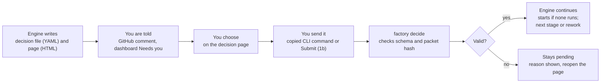

# 11. Module: human stops

Part of the [phase 1 design](../phase-1.md#module-map). Build wave: 2. Contracts and acceptance criteria are in this file; shared types are in [section 18](../shared/18-shared-contracts.md). Terms such as run, stage, task, attempt and rework are defined in the [glossary](../phase-1.md#2-glossary).

Every point where a run waits for you works the same way. The engine writes a YAML decision file, raises one attention item, and notifies you through the request's source and the dashboard. Today a real blocked stop raises the attention item but writes no decision file (see the blocked-run answer below). Your answer, from any route, goes through one check, and the run resumes where it stopped.

**Kinds of human stop**

| Kind | Packet written by | Options |
| --- | --- | --- |
| Approval (propose, review, research scope) | Engine, from a template | approve, rework, reject |
| Architecture decision | Architect skill, schema-checked | One set of options per gated choice |
| Triage confirm | Engine | The candidate workflows |
| Blocked run | Engine, from a template (a real block does not write it yet) | retry, goto a stage, skip a skippable gate, abort |
| Merge review | GitHub pull request review | Approve or request changes on GitHub; the engine watches the result |

The architecture stage runs after triage and before plan. It always runs in new-app, and in feature only when a rule fires: an architecture label, a new language, framework, datastore or service, or more than a set number of modules touched. Gated choices are language and framework per tier, datastore, hosting, authentication and any major new dependency. A worker may recommend, but only an approved decision unlocks the next stage. After approval, an ADR is written to `docs/adr/` as part of the pull request, named \<date>-\<run id>.md so parallel runs never collide on a number, and a build-file gate checks `pom.xml` or `package.json` against the chosen stack.

**The decision file** (`decisions/<stage>.<n>.yaml`), shaped to match the decision-picker format

```yaml
packet:                               # written by the engine or skill, hashed
  stage: architecture
  decisions:
    - id: D1
      title: Frontend stack
      question: Which frontend stack should the reports app use?
      context:
        what: The request asks for an internal reports UI with filters and charts.
        example: Finance filters 12 months of patch data by environment.
        terms: {SPA: "single-page app rendered in the browser"}
      compare: {a: opt-a, b: opt-b, rows: [["Interactivity", "High", "Low"]],
                choose_a_if: "Users filter and drill down", choose_b_if: "Mostly static tables"}
      recommend: opt-a
      why: Matches the filter-heavy use and the team's React skills.
      options:
        - id: opt-a
          name: React + Vite
          flow: ["human:Request", "llm:Plan", "code:Build", "artifact:SPA bundle"]
          pros: [Team knows it, Rich filtering]
          cons: [Build tooling to maintain]
        - id: opt-b
          name: Server-rendered pages
          flow: ["human:Request", "code:Render on server", "artifact:HTML pages"]
          pros: [Simple to run]
          cons: [Less interactive]
  sha: 661cb74d
decision:                             # written by you, through any route
  status: pending                     # pending | question | approved
  choices: {}                         # D1: opt-a
  questions: {}                       # D1: "Can option B add charts later?"
  notes: ""
  by: null
  channel: null                       # dashboard | cli | chat | file
  at: null
```

| Picker element | YAML field |
| --- | --- |
| Context: problem, example, terms | `packet.decisions[].context` |
| Often confused pair and comparison | `packet.decisions[].compare` |
| Option card with flow, pros and cons | `packet.decisions[].options[]` |
| Recommended badge and reason | `recommend`, `why` |
| Chosen option | `decision.choices` |
| Not sure plus a question | `decision.questions` |
| Notes | `decision.notes` |
| Review and submit | `decision.status`, `by`, `channel`, `at` |

The packet schema requires every field the picker shows, so an architect skill that leaves out context or flows fails its gate. Engine-written approvals use a short template packet with three options.

**Four ways to answer, one check**

1. **Dashboard:** the Needs you item opens the decision page (below). Opened through the dashboard it can submit; opened as a file it gives you the CLI command.
2. **CLI:** `factory decide <run> D1=opt-a --notes "..."`.
3. **Chat:** the router skill `/factory decide <run>` reads the file, shows the picker in the chat and calls `factory decide`. It never writes the file itself.
4. **Editor:** fill in the `decision` block by hand.

*Diagram: Human stop: from decision file to the engine continuing*



Whichever way you answer, the answer goes through `factory decide`. A valid answer starts or wakes the engine; an invalid or stale one stays pending with the reason.

**Decision page (HTML)**

For every human stop, the engine renders `decisions/<stage>.<n>.html` next to the YAML file. It fills a fixed template with the packet, with no LLM involved. The page follows the decision-picker layout:

- context
- the often-confused pair
- option cards with flows, pros and cons
- the recommendation preselected
- Not sure, with a question box
- a review step
- **The command to run.** The review step shows the exact command, with a Copy button, built from your picks:

```text
factory decide new-color-q1w2e --packet 661cb74d D1=opt-a D2=opt-b --notes "Keep it simple"
factory decide new-color-q1w2e --packet 661cb74d --question D2="Can option B add charts later?"
```

- **Stale pages are refused.** `--packet` carries the hash of the packet the page was built from. If the packet has changed since, the command is refused and tells you to reopen the page, so an old page can never answer new options.
- **File or dashboard.** Opened from the dashboard, the page also has a Submit button that posts the same answer. Opened straight from disk, it shows only the command, because no server is there.
- **Opens anywhere.** The page is self-contained, with inline CSS and script and no network calls, so it opens from disk on any OS. `factory open <run>` opens it in the default browser.
- **Always current.** It is regenerated whenever the packet hash changes, and archived with the run.
- **Safe to render.** All packet text is HTML-escaped and the page sets a strict content security policy. Packet text comes from an LLM, and the dashboard it runs beside accepts only requests that carry its session token and a matching Origin.
- **Where to find it:**
  - the dashboard Needs you item, with Open page and Copy path buttons
  - GitHub comments and markdown front matter, which carry both the dashboard link and the file path
  - `factory inbox`, which prints the path

Every route ends in the engine's `evaluate()`:

- It loads the file with the factory's safe YAML loader ([module 3](03-kit-and-configuration.md), YAML 1.2 booleans), validates the schema and checks the packet hash.
- It checks that every decision has a valid choice.
- It logs the outcome once per distinct file content.

The hash covers only the packet, so your answers never break it. An approved decision is locked until `factory reopen`. A run routed back to a stage starts a new visit with a new file, so earlier answers stay as history and no unlock is needed. The latest visit is the open one, and `--stage` on `decide`, `open` and `check` defaults to it.

**Not sure**

Submitting with `status: question` routes the run back to the packet task with your questions as feedback. The skill answers them in the packet, so the hash changes and `decision_requested` fires again. You are notified with the revised options.

**A blocked run's answer**

A blocked packet offers retry, goto, skip and abort. A goto answer also carries `D1.target` (the stage to send the run to) and a skip answer carries `D1.gate` (the gate to pass); `record` refuses either without its second key. The engine reads the answer in `Engine.tick`, `Engine.run` and `Engine.tick_answered_blocked`, under the run lock it already holds (or takes, when called alone), and calls the routine the command line uses: `retry` (the notes go to the stage as feedback), `goto`, `skip` (the notes are the reason) or `stop` (the notes are the reason). Each answer is applied once, by the hash of the file. A pending file, a run that is not blocked, or a blocked run with no decision file does nothing. A routine that refuses the answer (an unknown stage, a gate that is not skippable, a note for a finished task) logs `blocked_answer_refused` and reopens the file, so a pass never raises and the same answer is not read again. Two limits today: a real block writes no decision file (so only a hand-written or tested file is answered), and the launcher's `factory tick` starts an engine only for an answered `awaiting_approval` run. A crash inside a routine is not guarded. Retry re-queues notes and goto resets tasks before the run is unblocked, so a crash there leaves the run blocked and the next pass applies the answer again. A skip logs `gate_skipped` before it unblocks, so a crash between the two logs the skip twice. The fix is not built: log the skip after the unblock, or make each routine's writes idempotent.

| Event | When |
| --- | --- |
| `decision_requested` | A packet is written |
| `decision_recorded` | An answer is written by any route |
| `decision_approved` | All checks pass; the run can continue |
| `decision_rejected` | A check fails: bad YAML, schema, edited packet, missing or unknown choice |
| `decision_invalidated` | The packet changed after an answer was recorded |
| `decision_reopened` | You unlocked an approved decision |
| `blocked_answer_applied` | A blocked run's answer in its decision file was read and its routine (retry, goto, skip, abort) ran |
| `blocked_answer_refused` | That routine refused the answer (for example an unknown stage); the file is reopened for a new answer |

**Resume**

- If an engine is still alive for other runs, it re-checks its waiting runs every 5 seconds and continues on its own. An engine whose runs are all done or waiting has already exited, so it never polls.
- If no engine holds the lock, `factory decide` and the dashboard's Submit start one in the background (`factory run <run> --detach`). The same applies to `retry`, `goto` and `skip`.
- The engine continues from the waiting stage. Approve moves on, rework follows `on_reject`, and reject aborts. Finished tasks never run again.

**Notifications**

| Request source | Where you are told | How you answer |
| --- | --- | --- |
| GitHub issue | The status label at every change (below). At a stop, a comment mentioning the author or assignee and the label `factory:needs-human` (`factory:blocked` for a blocked run), with the dashboard link and the CLI command | Dashboard, CLI or chat. Answering by issue comment is phase 2 |
| Markdown file | Front matter `factory_status: needs-human` and `factory_attention: <summary>` | Dashboard, CLI, chat, or edit the decision file |
| CLI | The foreground command prints it and exits with code 3; optional desktop notification | Dashboard, CLI or chat |
| Any source | Dashboard Needs you list and a count in the tab title; optional webhook such as Slack or Teams |  |

- **One place to check:** the dashboard's Needs you list holds every attention item across all repos, oldest first, each with one action button. Every other channel links to it.
- **Terminal:** `factory inbox` prints the same list.
- **What the source is told:** the status label at every change, and a comment at a stop and at the end.

  | Run state | Label | Comment |
  | --- | --- | --- |
  | Queued (intake, module 4) | `factory:queued` | `Run <id> is queued.` |
  | Working, and again after an answer | `factory:running` | None |
  | Waiting for an answer or a merge review | `factory:needs-human` | The attention comment: summary, dashboard link, command |
  | Blocked | `factory:blocked` | The same comment, with the retry command |
  | Pull request merged | `factory:done` | The pull request number and link |
  | Pull request closed unmerged, or aborted | `factory:failed` | The reason |

  A markdown request gets `factory_status` in its front matter, and `factory_attention` while the run waits. A CLI request has no source to tell; its stops reach the desktop and the webhook only.
- **Once per stop:** the engine tells the source after each pass, and a `source_told` event keyed by the kind, stage and `since` of the stop means a pass that finds the same stop says nothing. Checking a parked run again never repeats a comment.
- **Reminders:** a run that waits for you is reminded when `remind_after_hours` (default 24, 0 turns them off) have passed since the last notice, so a run left for a week gets one comment a day. The tick sends them (module 6, step 6), because no engine runs while a run waits.
- **Merge reviews:** these also appear on GitHub as a review request.

**Module contract: 11 Human stops**

- **Depends on:**
  - 3: `load_config` (notify, `dashboard_url`), `validate`
  - 6A: `append_event`, `read_run`
  - 7: `TrackerAdapter.set_status`
- **Writes:** `decisions/<stage>.<n>.yaml` and `.html`; events `decision_*`, `attention_requested`, `attention_cleared`, `attention_notified` (one per notification pass, with the channels that sent and failed, read by `due_reminders`) and `source_told` (the key of the last change the source was told). It returns an `Outcome`; 6B decides the routing through 8, so this module never routes or starts an engine.
- **CLI it backs:** `decide`, `check`, `reopen`, `open`, `inbox`.

```python
# decisions.py
def request(run_dir: Path, stage: str, visit: int, *, kind: StopKind, packet: Packet | None = None) -> str
    """Write the decision file (template packet for approval, triage and blocked kinds); return packet sha."""
def record(run_dir: Path, stage: str, visit: int, *, packet_sha: str, choices: dict[str, str] | None = None,
           questions: dict[str, str] | None = None, notes: str = "", by: str, channel: Channel) -> Outcome
def evaluate(run_dir: Path, stage: str, visit: int) -> Outcome
    """approved | rework | reject | question | pending | rejected(code); logs once per file content."""
def reopen(run_dir: Path, stage: str, visit: int, *, by: str) -> None
def check_approved(spec: GateSpec, ctx: GateContext) -> GateResult        # used by 8
def check_packet_hash(spec: GateSpec, ctx: GateContext) -> GateResult     # used by 8
def check_build_stack(spec: GateSpec, ctx: GateContext) -> GateResult     # used by 8: pom.xml or package.json match the approved stack
# page.py
def render_page(run_dir: Path, stage: str, visit: int, *, cli: str = "factory", submit_url: str | None = None) -> Path
# notify.py
def attention_for(run: Run, *, now: str) -> AttentionItem | None
def notify(item: AttentionItem, cfg: Config, tracker: TrackerAdapter, *, reminder: bool = False) -> NotifyReport   # retries, never raises
def remind(run_dir: Path, cfg: Config, tracker: TrackerAdapter, *, now: str) -> NotifyReport | None   # NotifyReport: sent (channel names), failed (channel name -> error text)
    """Notify a parked run again when its reminder is due; None when nothing is due. The tick calls it."""
def due_reminders(items: list[AttentionItem], cfg: Config, *, now: str) -> list[AttentionItem]

@dataclass
class Outcome: status: str; choices: dict[str, str]; questions: dict[str, str]; notes: str
               code: str | None; message: str | None
```

- **Run and test:** `pytest factory/engine/tests/decisions`, with packet fixtures that include HTML in option text; a browser test opens the page from disk and checks the copied command.
- **Errors:** invalid YAML, a stale `--packet` or an unknown choice give `decision_rejected` with the reason, and the stop stays pending. A failed render leaves the YAML usable. Failed notifications retry and never block the run.

Acceptance criteria:

- [x] A blocked run whose decision file is answered applies the answer under the run lock: retry, goto (`D1.target`), skip (`D1.gate`) or abort, and a pending file does nothing. (test: factory/engine/tests/engine/test_blocked_file_answer.py::test_a_goto_answer_sends_the_run_to_the_stage_it_names, ::test_a_retry_answer_runs_the_blocked_stage_again, ::test_a_skip_answer_passes_the_gate_it_names_with_its_reason, ::test_an_abort_answer_ends_the_run_with_its_notes_as_the_reason, ::test_a_pending_file_does_nothing; `Engine.run` and `Engine.tick` apply it: ::test_run_applies_a_blocked_answer_and_reports_the_new_status, ::test_tick_applies_a_blocked_answer. Not built: `factory tick` (launcher `tick.decide`) starts no engine for an answered blocked run; it does for an answered awaiting_approval run only)
- [ ] Every stop kind writes a valid decision file; approval packets have approve, rework and reject. (not ticked: a run the engine really blocks sets its attention item and writes no `decisions/` file, while module 8 says the blocked file offers retry, goto, skip and abort; the strict xfail `factory/engine/tests/engine/test_blocked_run_writes_a_decision_file.py::test_a_run_the_engine_blocks_writes_a_decision_file_with_the_four_blocked_options` records it, and tasks.md item 47 builds the fix. Only the engine template for the blocked kind writes a valid file, and no real block calls it (`tests/decisions/test_decisions.py::test_engine_template_stops_write_a_valid_decision_file`). Triage, approval and the skill packet are tested to write a valid file (`::test_triage_stop_offers_the_candidate_workflows`, `::test_architecture_stop_writes_the_skills_packet`). Merge review writes no decision file by design, answered on GitHub, and request_changed raises an attention item only, so neither has one)
>- [x] An architect packet missing context, options, flows or a recommendation fails `validate`. (test: factory/engine/tests/decisions/test_decisions.py::test_an_architect_packet_missing_a_picker_field_fails_validate, ::test_an_option_with_no_flow_fails_validate, ::test_a_recommendation_that_is_not_an_option_is_refused)
- [x] `record` with a stale packet sha is refused with a reopen hint. (test: factory/engine/tests/decisions/test_decisions.py::test_record_with_a_stale_packet_sha_is_refused_with_a_reopen_hint)
- [x] Editing the packet after an answer gives `decision_invalidated`. (test: factory/engine/tests/decisions/test_decisions.py::test_editing_the_packet_after_an_answer_gives_decision_invalidated)
- [x] When fix routes back to root-cause, propose gets a new `propose.2.yaml` that needs a fresh approval, and `propose.1.yaml` is unchanged. (test: factory/engine/tests/engine/test_fix_routes_back_to_root_cause.py::test_a_fix_failure_routed_to_root_cause_asks_again_and_leaves_the_first_file_alone, a real engine run where the fix gate fails once and `on_fail` goes to root-cause; the file side alone is `factory/engine/tests/decisions/test_decisions.py::test_a_second_visit_gets_its_own_file_and_leaves_the_first_alone`)
- [x] The page renders all picker parts, escapes all packet text, works offline, and its copied command matches its picks. (test: factory/engine/tests/decisions/test_page.py::test_the_page_renders_every_picker_part, ::test_all_packet_text_is_escaped, ::test_the_page_loads_nothing_from_the_network, ::test_the_page_opens_from_disk_and_its_command_matches_the_picks (real Chrome, run on this machine))
- [x] A `question` answer returns `Outcome(status="question")` with the questions. (test: factory/engine/tests/decisions/test_decisions.py::test_a_question_answer_returns_the_questions)
- [x] GitHub requests get the `factory:needs-human` label and a comment with the dashboard link and file path; markdown requests get `factory_status` and `factory_attention`. (test: factory/engine/tests/decisions/test_notify.py::test_a_github_request_gets_the_needs_human_label_and_a_comment_with_link_and_path, ::test_a_markdown_request_gets_factory_status_and_attention_in_front_matter)
- [x] Reminders fire after `remind_after_hours`, and a failed webhook never stops the run. (test: factory/engine/tests/decisions/test_notify.py::test_reminders_fire_after_remind_after_hours, ::test_a_failed_webhook_retries_then_reports_and_the_run_is_untouched)
- [x] The issue's label follows the run, a stop is told once, and a CLI request is never sent to the tracker. (test: factory/engine/tests/engine/test_tells_the_source.py, five tests)
- [x] A parked run is reminded once a day by the tick, in the words of a reminder, and the tick starts no engine for it. (test: factory/engine/tests/decisions/test_notify.py::test_a_reminder_is_worded_as_one_and_reaches_the_source_and_the_webhook, ::test_remind_notifies_only_a_parked_run_whose_reminder_is_due; factory/launcher/tests/test_tick.py::test_a_tick_sends_one_reminder_a_day_while_a_run_waits_and_starts_no_engine, ::test_a_run_that_is_not_waiting_gets_no_reminder, ::test_reminders_off_and_a_failed_tracker_are_both_quiet_for_the_tick)

## Decisions

A row changes only through a new `proposed` ADR in `docs/adr/`. To read a folded ADR in full, see `docs/adr/README.md`; the Id cell is the file name without `.md`.

| Rule | Why | Not chosen | Id |
| --- | --- | --- | --- |
| There is one decision file per stage and visit: `decisions/<stage>.<n>.yaml`. | An approved decision file is locked, and a loop back needs a fresh approval. One file per visit keeps the full history with no unlock rule. The audit trail matters more than short paths. | Rework resets the stage and reopens its decision automatically. It overwrites the earlier answer, so history would live only in events. | 2026-11-14-one-decision-file-per-stage-and-visit (D4) |
| The source's status label follows the run at every change (queued, running, needs-human, blocked, done, failed), with a comment only at a stop and at the end. | Intake and the operator walkthrough already promise a label at every change and `factory:done` after a merge, and a merged issue that still says queued reads as broken. | `stops-only` (a label only when the run needs you, so a merged issue keeps its old label); `stops-and-end` (no `factory:running`, so a working run looks unstarted). | 2026-11-22-tell-the-source-at-every-change (owner decision 2026-11-22, D1) |
| A stop is told to the source once, and a run that keeps waiting gets one reminder after each `remind_after_hours` (default 24). | A test that told the source on every check posted the same comment, mentioning the author, three times. The reminder is the one the spec already promised, and it was built and unused. | `once-only` (a forgotten run waits in silence, and the built reminder goes unused). | 2026-11-22-a-stop-is-told-once-then-reminded-daily (owner decision 2026-11-22, D2) |
