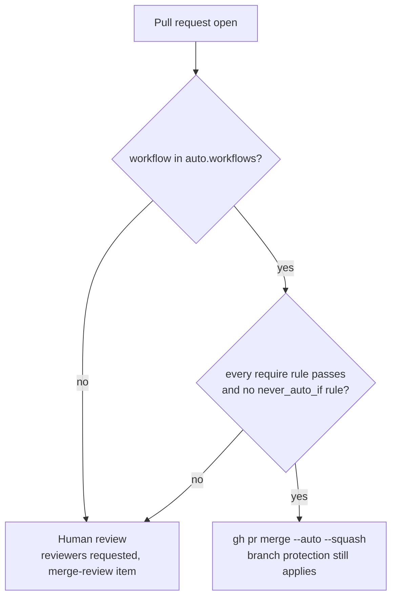

# 13. Module: delivery

Part of the [phase 1 design](../phase-1.md#module-map). Build wave: 3. Contracts and acceptance criteria are in this file; shared types are in [section 18](../shared/18-shared-contracts.md). Terms such as run, stage, task, attempt and rework are defined in the [glossary](../phase-1.md#2-glossary).

A run delivers through its sink. Code runs open a pull request, and the merge policy decides deterministically whether it can be auto-merged or needs a human. Every run ends with a run summary.

**Two kinds of merge**

- **Task branches into the run branch, at each join:** always automatic. A conflict routes the run back ([module 8](08-gates-error-handling-and-rework.md)) and is never resolved silently.
- **The run branch into the base branch, through the pull request:** decided by `merge-policy.yaml`.

```yaml
# .factory/config/merge-policy.yaml
default: human                      # every PR needs a human unless all auto rules pass
auto:
  workflows: [chore]       # phase 1: only small chores
  type_source: [explicit, label, front_matter]   # never a type guessed by the triage LLM
  require:
    gates: all_passed               # none skipped
    ci: green                       # GitHub checks on the PR
    max_files: 10
    max_lines: 300
never_auto_if:
  paths: ["**/migrations/**", "auth/**", "infra/**", ".github/**", "factory/**", ".factory/config/**"]
  dependency_manifests_changed: true
  architecture_decision: true
  review_findings_at_or_above: medium
  notes_used: true                  # a human steered the run
  rework_loops_used_at_least: 2
```

- The engine checks every rule and writes `merge.json` with each rule's result. It posts the outcome on the pull request, such as "Auto-merge: no, touched auth/\*\*", and shows it on the dashboard.
- **Auto:** `gh pr merge --auto --squash --delete-branch`. GitHub branch protection and required checks still apply, and the factory never bypasses them.
- **Human:** the engine requests reviewers (CODEOWNERS or configured) and raises a merge-review attention item. It watches the pull request until it is merged (run done) or closed (run aborted).
- Phase 1 start: small chores whose type was set explicitly auto-merge when every rule passes, and every other workflow needs human review. Add more workflows to `auto` once their history in `history.jsonl` shows they can be trusted.
- **A repo where the owner approves every task** sets `auto.workflows: []` in its own `merge-policy.yaml`. Every pull request then needs human review, chores included. The pilot repo starts this way.



- **CI red on the pull request:** treated as a gate failure. The run is routed back to fix with the failing check output as feedback, up to the fix stage's loop maximum.

**Sinks**

| Sink | Used by | Result |
| --- | --- | --- |
| `pull_request` | bug-fix, feature, new-app, chore | Pull request with `summary.md` as its body; `Closes #42` for GitHub requests |
| `doc` | research | `report.md` written to a configured path, such as `docs/research/<run id>.md` through a pull request, or a folder outside the repo |
| `comment` | small answers | Posted on the source issue; markdown requests get it in the file |

**The run summary**

Every run writes `summary.md` from a template, filled by code from state and artifacts. It is the pull request body, the final issue comment and the record kept in the archive.

```markdown
# new-color-q1w2e: Login fails on expired token
Request: payments-api#42 · Workflow: bug-fix · Result: done · PR #118

## What changed
services/api/auth.py, services/api/tests/test_auth.py (2 files, +48 -6)

## Stages
reproduce done · root-cause done · propose approved by you · fix done (1 rework from verify) · verify done · review done

## Evidence
Tests 214 passed, 0 failed · Scope check passed · Review findings: 0 blocking, 2 low

## Decisions and notes
None

## Usage
claude-opus-5-5: 6 attempts, 412,880 tokens, 38 min

## Merge
Human review: bug-fix is not in the auto workflows
```

**Module contract: 13 Delivery**

- **Depends on:**
  - 3: `load_config` (merge policy, sinks)
  - 6A: `read_run`, `append_event`, `history_append`
  - 7: `push`, `create_delivery_branch`, `PullRequests`, `TrackerAdapter`
  - 14: `summarize`
- **Writes:** `summary.md`, `merge.json`, the ADR and report files in the worktree; events `pr_opened`, `merge_evaluated`, `merged`, `sink_written`. It returns the pull request's state; 6B routes on red CI through 8, and the merge-review attention item is raised by 6B through 11.
- **CLI it backs:** none directly; used by 6B and by `tick` to watch open pull requests.

```python
# summary.py
def render_summary(run_dir: Path, usage: UsageReport) -> Path
# delivery.py
def write_adr(run_dir: Path, worktree: Path) -> Path | None        # docs/adr/<date>-<run id>.md
def open_pr(run_dir: Path, cfg: Config, prs: PullRequests) -> PrRef
def evaluate_merge(run_dir: Path, cfg: Config, *, changed: list[str], ci: str) -> MergeDecision
    """Every rule with its result; auto only when all pass. Writes merge.json."""
def merge_or_request_review(pr: PrRef, decision: MergeDecision, prs: PullRequests,
                            reviewers: list[str]) -> None
def watch_pr(run_dir: Path, prs: PullRequests) -> PrState         # open | merged | closed, ci, checks output
def write_sink(run_dir: Path, cfg: Config, *, tracker: TrackerAdapter, prs: PullRequests) -> SinkResult

@dataclass
class MergeDecision: auto: bool; rules: list[RuleResult]; reason: str
```

- **Run and test:** `pytest factory/engine/tests/delivery` with `FakePullRequests` and policy fixtures.
- **Errors:** a failed PR creation is transient. Red CI is returned for rework. A merge blocked by branch protection needs a human. A closed PR aborts the run.

Acceptance criteria:

- [ ] The summary contains request, stages, evidence, decisions, notes, usage and merge result, all from state.
- [ ] A small chore with an explicit type and green CI gives `auto: true`; the same change typed by the triage LLM gives `auto: false`.
- [ ] Any protected path, dependency change, used note, architecture decision or skipped gate gives `auto: false` with that rule named.
- [ ] Auto-merge uses GitHub's auto-merge, so branch protection still applies.
- [ ] With `auto.workflows: []`, a small chore with an explicit type and green CI gives `auto: false` with the reason "chore is not in the auto workflows".
- [ ] A read-only run with an in-repo doc sink creates its branch only at delivery and opens a PR.
- [ ] ADR and report names contain the run id, never a counter.
