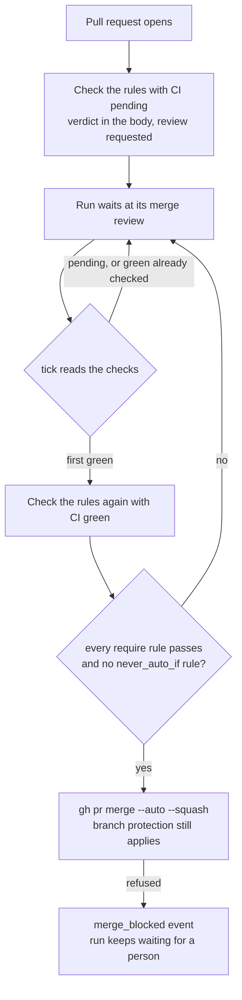

# 13. Module: delivery

Part of the [phase 1 design](../phase-1.md#module-map). Build wave: 3. Contracts and acceptance criteria are in this file; shared types are in [section 18](../shared/18-shared-contracts.md). Terms such as run, stage, task, attempt and rework are defined in the [glossary](../phase-1.md#2-glossary).

A run delivers through its sink. Code runs open a pull request, and the merge policy decides deterministically whether it can be auto-merged or needs a human. Every run ends with a run summary.

**Two kinds of merge**

- **Task branches into the run branch, at each join:** always automatic. A conflict routes the run back ([module 8](08-gates-error-handling-and-rework.md)) and is never resolved silently.
- **The run branch into the base branch, through the pull request:** decided by `merge-policy.yaml`.

```yaml
# .factory/config/merge-policy.yaml
default: human                      # every PR needs a human unless all auto rules pass
auto:
  workflows: [chore]       # phase 1: only small chores
  type_source: [explicit, label, front_matter]   # never a type guessed by the triage LLM
  require:
    gates: all_passed               # none skipped
    ci: green                       # GitHub checks on the PR
    max_files: 10
    max_lines: 300
never_auto_if:
  paths: ["**/migrations/**", "auth/**", "infra/**", ".github/**", "factory/**", ".factory/config/**"]
  dependency_manifests_changed: true
  architecture_decision: true
  review_findings_at_or_above: medium
  notes_used: true                  # a human steered the run
  rework_loops_used_at_least: 2
```

- **When the rules are checked** (owner decision, 2026-11-21, [ADR](../../adr/2026-11-21-auto-merge-is-checked-at-open-and-at-green.md)). The engine checks every rule twice and writes `merge.json`, with each rule's result and the CI state it saw:
  1. **At open.** Before the pull request opens, with CI `pending`. The verdict is in the pull request body's Merge line from the start, such as "Human review: chore is not in the auto workflows; CI is pending". The engine asks for a review at the same time.
  2. **At the first green read.** When `tick` sees the pull request's checks green, it starts the engine, which checks the rules again with CI `green`. Only this check can say auto. The engine posts its verdict as a comment on the pull request, such as "Merge check with CI green: Human review: chore is not in the auto workflows"; the body keeps the verdict it opened with. It runs once per pull request: a later green read changes nothing.
- **Auto:** `gh pr merge --auto --squash --delete-branch`. GitHub branch protection and required checks still apply, and the factory never bypasses them. A merge that branch protection refuses is logged as `merge_blocked`, and the run keeps waiting for a person.
- **Human:** the engine asks the person working on the request to review: the issue author of a GitHub request. A CLI or markdown request has no GitHub login, so nobody is asked. Either way the engine raises a merge-review attention item. The run waits as `awaiting_approval` at its merge review and watches the pull request until it is merged (run done) or closed (run aborted).
- A pull request in a repo with no checks never turns green, so it never auto-merges: the verdict at open is the only one, and a person merges it.
- Phase 1 start: small chores whose type was set explicitly auto-merge when every rule passes, and every other workflow needs human review. Add more workflows to `auto` once their history in `history.jsonl` shows they can be trusted.
- **A repo where the owner approves every task** sets `auto.workflows: []` in its own `merge-policy.yaml`. Every pull request then needs human review, chores included. The pilot repo starts this way.



- **CI red on the pull request:** treated as a gate failure. The run is routed back to fix with the failing check output as feedback, up to the fix stage's loop maximum.

**Sinks**

| Sink | Used by | Result |
| --- | --- | --- |
| `pull_request` | bug-fix, feature, new-app, chore | Pull request with `summary.md` as its body; `Closes #42` for GitHub requests |
| `doc` | research | `report.md` written to a configured path, such as `docs/research/<run id>.md` through a pull request, or a folder outside the repo |
| `comment` | small answers | Posted on the source issue; markdown requests get it in the file |

**The run summary**

Every run writes `summary.md` from a template, filled by code from state and artifacts. It is the pull request body, the final issue comment and the record kept in the archive.

```markdown
# new-color-q1w2e: Login fails on expired token
Request: payments-api#42 · Workflow: bug-fix · Result: done · PR #118

## What changed
services/api/auth.py, services/api/tests/test_auth.py (2 files, +48 -6)

## Stages
reproduce done · root-cause done · propose approved by you · fix done (1 rework from verify) · verify done · review done

## Evidence
Tests 214 passed, 0 failed · Scope check passed · Review findings: 0 blocking, 2 low

## Decisions and notes
None

## Usage
claude-opus-5-5: 6 attempts, 412,880 tokens, 38 min

## Merge
Human review: bug-fix is not in the auto workflows
```

**Module contract: 13 Delivery**

- **Depends on:**
  - 3: `load_config` (merge policy, sinks)
  - 6A: `read_run`, `append_event`, `history_append`
  - 7: `push`, `create_delivery_branch`, `PullRequests`, `TrackerAdapter`
  - 14: `summarize`
- **Writes:** `summary.md`, `merge.json`, the ADR and report files in the worktree; events `pr_opened`, `merge_evaluated` (with the CI state it saw), `merge_blocked`, `merged`, `sink_written`. It returns the pull request's state; 6B routes on red CI through 8, and the merge-review attention item is raised by 6B through 11.
- **CLI it backs:** none directly; used by 6B and by `tick` to watch open pull requests.

```python
# summary.py
def render_summary(run_dir: Path, usage: UsageReport) -> Path
# delivery.py
def write_adr(run_dir: Path, worktree: Path) -> Path | None        # docs/adr/<date>-<run id>.md
def open_pr(run_dir: Path, cfg: Config, prs: PullRequests) -> PrRef
def evaluate_merge(run_dir: Path, cfg: Config, *, changed: list[str], ci: str) -> MergeDecision
    """Every rule with its result; auto only when all pass. Writes merge.json."""
def merge_or_request_review(pr: PrRef, decision: MergeDecision, prs: PullRequests,
                            reviewers: list[str]) -> None
def changed_since_base(run: Run, cfg: Config) -> list[str]       # the files the run branch changes, for the rules
def reviewers_for(run: Run) -> list[str]                          # the GitHub issue author, or nobody
def green_check_done(run_dir: Path) -> bool                       # the rules were already checked with CI green
def watch_pr(run_dir: Path, prs: PullRequests) -> PrState         # open | merged | closed, ci, checks output
def write_sink(run_dir: Path, cfg: Config, *, tracker: TrackerAdapter, prs: PullRequests) -> SinkResult

@dataclass
class MergeDecision: auto: bool; rules: list[RuleResult]; reason: str
```

- **Run and test:** `pytest factory/engine/tests/delivery` with `FakePullRequests` and policy fixtures.
- **Errors:** a failed PR creation is transient. Red CI is returned for rework. A merge blocked by branch protection needs a human. A closed PR aborts the run.

Acceptance criteria:

- [x] The summary contains request, stages, evidence, decisions, notes, usage and merge result, all from state. (test: factory/engine/tests/delivery/test_delivery.py::test_the_summary_has_request_stages_evidence_decisions_notes_usage_and_merge_result_from_state)
- [x] A small chore with an explicit type and green CI gives `auto: true`; the same change typed by the triage LLM gives `auto: false`. (test: factory/engine/tests/delivery/test_delivery.py::test_a_small_explicit_chore_with_green_ci_is_auto_and_the_same_change_typed_by_llm_is_not)
- [x] Any protected path, dependency change, used note, architecture decision or skipped gate gives `auto: false` with that rule named. (test: factory/engine/tests/delivery/test_delivery.py::test_any_protected_path_dependency_change_used_note_architecture_decision_or_skipped_gate_gives_auto_false_with_that_rule_named)
- [ ] Auto-merge uses GitHub's auto-merge, so branch protection still applies. (not ticked: the test checks that merge is called with auto=True and squash, the request the factory makes; branch protection is enforced by GitHub, which a fake cannot model)
- [x] With `auto.workflows: []`, a small chore with an explicit type and green CI gives `auto: false` with the reason "chore is not in the auto workflows". (test: factory/engine/tests/delivery/test_delivery.py::test_with_no_auto_workflows_a_small_chore_is_not_auto_with_the_reason_named)
- [x] The rules are checked when the pull request opens, so its body has the verdict, and the issue author is asked to review; they are checked again once, at the first green read, and that verdict is posted as a comment; only then can GitHub be asked to merge; a merge refused by branch protection leaves the run waiting for a person. (test: factory/engine/tests/engine/test_merge_review.py::test_the_pull_request_body_carries_the_merge_verdict_from_the_moment_it_opens, ::test_the_person_who_raised_the_request_is_asked_to_review_when_it_opens, ::test_a_request_from_the_cli_asks_nobody_and_still_waits_for_review, ::test_green_ci_runs_the_merge_check_again_once_and_records_it, ::test_green_ci_with_every_rule_passing_asks_github_to_merge, ::test_a_merge_refused_by_branch_protection_leaves_the_run_waiting_for_a_person, ::test_the_verdict_at_green_is_posted_on_the_pull_request_as_a_comment; factory/engine/tests/tracker/test_gh.py::test_comment_posts_the_body_on_the_pull_request; factory/launcher/tests/test_tick.py::test_the_first_green_ci_starts_an_engine_so_it_can_check_the_merge_rules_again, ::test_green_ci_already_checked_starts_no_engine. Against FakePullRequests only; no real GitHub run)
- [x] A read-only run with an in-repo doc sink creates its branch only at delivery and opens a PR. (test: factory/engine/tests/delivery/test_delivery.py::test_a_read_only_run_with_an_in_repo_doc_sink_creates_its_branch_only_at_delivery_and_opens_a_pr)
- [x] ADR and report names contain the run id, never a counter. (test: factory/engine/tests/delivery/test_delivery.py::test_adr_and_report_names_contain_the_run_id_never_a_counter, ::test_the_research_report_name_is_the_run_id)
- [x] An ADR starts with YAML front matter (`scope`, `repo`, `topic`, `status`, `supersedes`); `status` is `accepted` and `supersedes` is empty. (test: factory/engine/tests/delivery/test_delivery.py::test_an_adr_starts_with_front_matter_naming_its_scope_status_and_supersedes)
