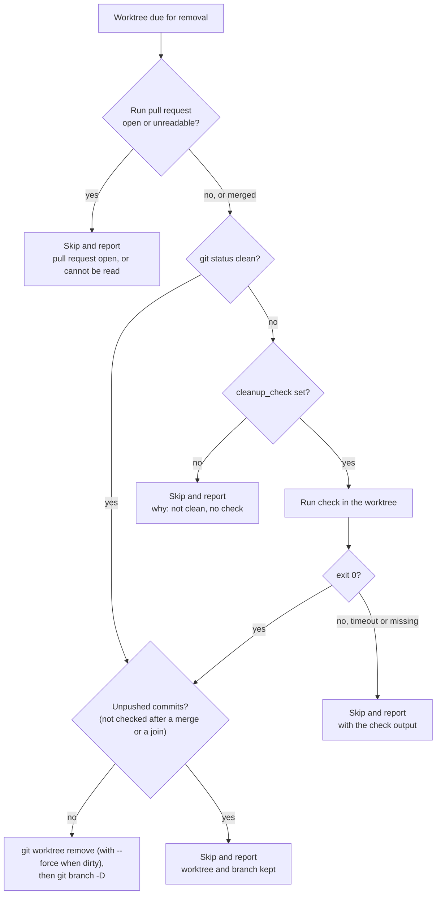

# 17. Module: housekeeping

Part of the [phase 1 design](../phase-1.md#module-map). Build wave: 2. Contracts and acceptance criteria are in this file; shared types are in [section 18](../shared/18-shared-contracts.md). Terms such as run, stage, task, attempt and rework are defined in the [glossary](../phase-1.md#2-glossary).

Everything the factory creates has a defined end of life. `factory gc` shows the plan and `--apply` carries it out. It is meant to delete only inside the factory home and the worktree root, and only for runs that have ended. The code checks the second rule but not the first (see the contract's Writes line). A run has ended when its `status` in `run.json` is `done`, `failed` or `aborted`. `pending`, `running`, `retrying`, `awaiting_approval` and `blocked` runs have not ended.

| Item | Removed when | How |
| --- | --- | --- |
| Task worktrees and task branches | Right after the join merges them, if clean or the repo's `cleanup_check` passes (safety rules below) | `git worktree remove`, `git branch -D` (a task branch never counts as merged, because the join applies its diff) |
| Run worktree and local run branch | Pull request merged (`cleanup_after_merge`); aborted or failed runs after `keep_failed_days`; a `done` run at `archive_after_days`. Never while the run's pull request is open or its state cannot be read. A closed pull request ends the run as `aborted`, so the worktree waits `keep_failed_days` (see choices). The branch is kept when it has commits that no remote has (rule below) | `git worktree remove`, then `git branch -D` when the branch has no unpushed commits; the remote branch is deleted by `--delete-branch` |
| Kit snapshot `$FACTORY_HOME/kits/<hash>/` | No unarchived run uses it | Deleted |
| Run folder `$FACTORY_HOME/runs/<repo key>/<id>/` | `archive_after_days` after the run ends | Zipped to `$FACTORY_HOME/archive/<repo key>/<yyyy-mm>/<id>.zip` (Python `zipfile`) |
| Archive zip | `delete_archive_after_days` | Deleted by `factory gc --apply` |
| `history.jsonl` line | Never; one small line per run | No action |
| Processed markdown requests | At intake | Moved to `.factory/inbox/processed/`, archived with the run. The code does not move requests yet (see choices) |
| `worker.log` | Over `worker_log_max_mb`, for a run that has ended and is not yet due for archive | Oldest bytes cut so the newest `worker_log_max_mb` remain. The table said the archive keeps the log whole; the code keeps whatever copy existed at archive time (see choices) |
| Runs whose repo is missing, and orphan worktrees | After `keep_failed_days`; orphans are only reported | Archived like any ended run; orphans listed by `factory gc` for you to remove. The CLI does not print orphans yet (see choices) |

**Safety rules**

- **Clean worktrees** are removed as the table says.
- **A worktree that is not clean** (uncommitted, untracked or ignored files) is removed only when the repo's `cleanup_check` ([module 3](03-kit-and-configuration.md)) exits 0, run in that worktree. With no `cleanup_check`, or when it exits non-zero, times out or is missing, the worktree stays and `gc` reports it with the check's output. The engine never uses `--force` without a passing check.



A skipped worktree is not an error: its run is still archived, the run's `worktree` field keeps the path, and the next `gc` tries again.

- **Unpushed commits.** `gc` deletes a run's branch only when it has no unpushed commits. A commit is unpushed when no remote-tracking ref has it and it is not on the base branch. `gc` counts it with `git rev-list --count <branch> --not --remotes <base>`, where `<base>` is the repo's `base_branch` when that local branch exists. The count is taken before the worktree is removed, because a branch that a worktree has checked out cannot be deleted. When the count is above 0, or git cannot give one, `gc` keeps the worktree and the branch and reports a skip. The reason names the branch and the count, for example `branch run-7 has 2 unpushed commits, on no remote; worktree and branch kept`. A later `gc` reports it again, until the commits reach a remote or you delete the branch by hand.
  - A task branch is never pushed, so it has no remote. Its delivery is the join. When the join has applied it, the join commit `task(<id>): joined from <branch>` is on a local branch, and `gc` deletes the task branch whatever commits it holds. A task branch that the join did not apply has no such commit, so the unpushed rule applies to it, and `gc` keeps it.
  - `cleanup_after_join` deletes a joined task branch right after the join, with the same exemption, and it does not run the unpushed count.
  - `cleanup_after_merge` runs after the pull request merged. A squash merge leaves the run branch's own commits on no remote, so the merge is the evidence that they were delivered, and the branch is not counted. `gc` does the same for a run whose pull request it reads as merged.
- **The run's pull request.** When the run has a pull request (the `pr` field of `run.json`), `gc` reads its state with `PullRequests.state` ([module 7](07-git-and-github-operations.md)), through a `prs` argument that its caller passes to `plan`, as the engine passes it to module 13's `watch_pr`. The run is still archived whatever the state is. Its own worktree and its branch are then handled as follows. A task worktree does not wait for the pull request.
  - The pull request is open: the worktree and the branch are kept, and `gc` reports a skip with the reason `pull request open`.
  - The pull request is merged: the worktree and the branch are removed, and the unpushed count is not taken, because the merge delivered the commits.
  - The pull request is closed: the worktree and the branch are removed as the unpushed rule says.
  - The state cannot be read, because the call raised an error or `plan` was given no `prs`: the worktree and the branch are kept, and the skip says `pull request cannot be read` and why, with the error text.
  - The run has no pull request: nothing is held.
  A later `gc` reads the pull request again for an archived run whose worktree is still there, because the archive keeps the run's `pr` field.
- An active or blocked run is never touched. The code checks this at plan time and again in `apply`, before it removes a worktree or cuts a log: a run that was resumed after `plan` is skipped (see choices).
- `git worktree prune` clears worktree records whose folders are already gone.
- `retention.auto_gc` (default off) would run the plan when an engine starts, but the code does not implement it: no code reads the setting, and no plan runs at engine start.

**What ends up in the repo**

Only the deliverables, through the pull request: product code, tests, ADRs in `docs/adr/`, and research reports when the doc sink points inside the repo. Run state, logs and summaries stay in the factory home, and `history.jsonl` keeps one line per run: its id, repo key, final status and end time (`HistoryRecord`, [module 6](06-engine-core.md)). The request, pull request and tokens stay in the run's own files or its archive.

**Module contract: 17 Housekeeping**

- **Depends on:**
  - 3: `load_config` (the repo settings retention and cleanup_check)
  - 6A: `list_runs`, `history_append`, `lock_status`, `acquire_lock`, `release`, `append_event`
  - 7: `remove_worktree`, `delete_branch`, `PullRequests` (its `state` is read through a prs argument)
- **Writes:** archives in `$FACTORY_HOME/archive/`; events `archived`. It deletes only: the worktrees named by a run's `worktree` field (in `run.json`) and by each task's `worktree` field (in `task.json`); a kit snapshot that no run folder left on disk uses; a run folder once it is archived; an archive zip past `delete_archive_after_days`; and the oldest part of a `worker.log`. The `paths` block is written when the run is created, and gc does not read it. The code does not yet check that a worktree path is inside the worktree root or `$FACTORY_HOME`, so a path recorded outside them is removed.
- **CLI it backs:** `gc`.

```python
# housekeeping.py
def plan(home: Path, cfg: Config, *, now: datetime, prs: PullRequests | None = None) -> GcPlan   # items, reasons, skipped with why
def apply(plan: GcPlan) -> GcReport                                     # archive, delete
def cleanup_after_join(repo: Path, cfg: Config, run: Run, task_ids: list[str]) -> None   # called by 6B
def cleanup_after_merge(repo: Path, cfg: Config, run: Run) -> None                       # called by 6B or tick
```

Types that `plan` and `apply` take and return. Section 18 does not list them, so `housekeeping.py` is their source. Each list starts empty. `GcItem` defaults `run_id`, `cfg`, `repo`, `zip_path`, `ended` and `run_dir` to None, `dirty` to False, `keep_bytes` to 0 and `check_unpushed` to True. `Skipped.detail` defaults to an empty string. In `GcReport`, `archived` holds run ids, and `removed`, `deleted` and `trimmed` hold path strings.

What the `GcItem` fields hold:
- `kind` and `path`: the kind names what is removed, and `path` is that item's folder, file or worktree.
- `run_id`: the run the item belongs to, or None for a kit snapshot that no run owns.
- `cfg`: the run's repo config, read at plan time, or None when the repo is gone.
- `repo`: the recorded repo path, or None when it is gone. A worktree's branch is deleted from this repo.
- `dirty`: a worktree that is not clean at plan time. `apply` decides from `cleanup_check`.
- `zip_path`: for `archive`, the zip's final path. For `archive_delete`, the zip to delete.
- `ended`: for `archive`, the run's end time as text, written to `history.jsonl`.
- `keep_bytes`: for `worker_log`, the number of newest bytes kept.
- `check_unpushed`: True keeps the branch when it has commits no remote has. False is set for a run whose pull request merged.
- `run_dir`: for a `worktree` or `worker_log` item of a run whose folder is on disk, that folder. `apply` re-reads its `run.json` status and its lock before it removes the worktree or cuts the log. None for the worktree of an archived run, which has no folder to re-read, and for other kinds.

`Skipped.reason` is a short text from a fixed set in the code: `pull request open`, `pull request cannot be read`, `not clean; kept until it is due or removed by hand`, `not clean, and no cleanup_check is set`, `joined task, not clean; the run is still active`, `an engine holds the run lock; not touched`, `the repo is gone; the worktree cannot be checked or removed`, `the recorded worktree is the repo itself; never removed`, and `its repo config is invalid; the worktrees are kept`. `Skipped.detail` carries the variable part, such as the check's output, the `gh` error, or the branch and commit count.

```python
class GcItem:   kind: Literal["worktree", "archive", "archive_delete", "kit", "worker_log"]; path: Path; run_id: str | None; cfg: Config | None; repo: Path | None; dirty: bool; zip_path: Path | None; ended: str | None; keep_bytes: int; check_unpushed: bool; run_dir: Path | None
class Skipped:  path: Path; run_id: str | None; reason: str; detail: str
class Orphan:   path: Path; run_id: str | None; reason: str
class Failed:   path: Path; message: str
class GcPlan:   home: Path; cfg: Config; now: datetime; items: list[GcItem]; skipped: list[Skipped]; orphans: list[Orphan]
class GcReport: removed: list[str]; archived: list[str]; deleted: list[str]; trimmed: list[str]; skipped: list[Skipped]; orphans: list[Orphan]; failed: list[Failed]
```

- **Choices the code makes where this file is silent:**
  - The end time of a run is the `ts` of its last event in `events.jsonl`, other than `archived`. `run.json` has no end field. Without such an event, the modification time of `run.json` is used, or of the zip for an archived run.
  - Retention and `cleanup_check` are read from each run's own repo. When the repo is gone, the default retention numbers apply and no `cleanup_check` is set. When the repo's config is invalid, an ended run is kept and reported, and an archive's delete uses the default numbers.
  - A failed or aborted run keeps its worktrees `keep_failed_days`, and its run folder is archived after `archive_after_days`. A closed pull request leaves its run `aborted`, so its worktree waits `keep_failed_days`, not for the merge.
  - A `done` run's worktrees are due `archive_after_days` after its end, and its run folder is archived then, whatever its pull request says. `gc` does read the pull request for the run's own worktree: see the safety rule above. The engine writes `done` after a merge or for a sink with no pull request, so `done` with an open pull request does not come from the engine, but `gc` now waits if one exists. A run's own worktree goes sooner when `cleanup_after_merge` runs. `api.gc` (module 16) does not pass `prs` to `plan` yet, so a run that has a pull request is kept and reported as `pull request cannot be read` when `factory gc` runs; the code that passes a service belongs to module 16.
  - When the repo is gone, git cannot check or remove a worktree, so it stays and is reported.
  - A joined task whose worktree is still not clean is reported while its run is active, and nothing else of an active run is touched.
  - A worktree that git cannot read counts as not clean.
  - Every period counts from the run's end, except `delete_archive_after_days`, which counts from the zip's modification time (when it was written).
  - A run whose `status` is `running` with no live lock is not ended, so `gc` does not archive it or remove its worktrees, however old its last event is. `lock_status` is read only for ended runs, to see whether an engine holds a lock.
  - `apply` re-reads the status and lock of a run before it archives it, before it removes one of its worktrees and before it cuts its log. A run that is no longer ended, or whose engine holds the lock, is skipped with the reason `the run is no longer ended; not removed` or `an engine holds the run lock; not removed` (a log: `log not trimmed`). The re-read for a worktree or a log is done without taking the lock, so an engine that starts in the instant between the read and the removal can still win; the archive step takes the lock. The kit step re-reads every run folder's `kit_hash`. A worktree of an already archived run has no folder to re-read, and its run cannot be active. The zip delete touches only an archive.
  - `gc` cuts a `worker.log` only for an ended run that is not yet due for archive. A running run's log is never cut. A log over the cap is cut to its newest `worker_log_max_mb` bytes. A run due for archive is archived as it is, without a cut.
  - `cleanup_check` runs with a timeout of 300 seconds. A command that is missing or cannot start counts as a failed check.
  - `apply` runs the items in this order: worktrees, archives, archive deletes, kits, log cuts. Then it runs `git worktree prune` in each repo that had a worktree or archive item.
  - A crash in `apply` leaves what was done so far, and the next `gc` plans the rest. A removed worktree stays removed. An archive writes its zip, then its `history.jsonl` line, then deletes the folder's files. A crash before the deletion leaves the folder whole. The next `gc` does not write a new archive over a zip that verifies: it records history and removes the folder when the zip matches, and keeps both and reports a failure when it does not. A zip that does not verify is replaced by a new archive.
  - A crash during the deletion leaves some of the folder's files, and possibly no `run.json`. A folder without `run.json` is never listed or removed by `gc`. A folder that still has `run.json` is handled by this rule: when a verified zip for that run exists (it passes `testzip()` and holds that run's `run.json`, at the planned path or in another month's folder under the same repo key), `gc` never writes over it. It checks that every file left in the folder, except `lock`, is in the zip with the same bytes. If so, it adds the run's `history.jsonl` line when none exists, removes the folder, and lists the folder's path in `GcReport.deleted`. If a file is not in the zip or differs, `gc` keeps the folder and the zip and reports a failure that names the file. The zip then holds the complete record, including the files that the crash had already deleted.
  - A zip is written to `<name>.zip.tmp` and renamed to `<name>.zip` only after it verifies. After an error the `.tmp` file is removed. After a hard crash it can remain until the same run is archived again. `gc` never lists or deletes it.
  - Archive verification: the zip must pass `testzip()`, its names must equal the run folder's files except `lock`, and every member must equal its file's bytes. A failure keeps the folder and is reported as failed.
  - A branch that the unpushed rule keeps is never deleted, so `git branch -D` does not run for it. If `git branch -D` fails, the worktree is already removed. The result is `failed` with the message `worktree removed, branch <name> kept: <git error>`. The branch stays, and no later `gc` lists or retries it. `cleanup_after_join` and `cleanup_after_merge` discard their results, so the failure reaches the user only in the failed list of `gc --apply`, which the CLI does not print.
  - `factory abort` ends a run as `aborted` even when its pull request is open. After `keep_failed_days`, `gc` reads the pull request. While it is open, the worktree and the branch stay and `gc` reports `pull request open`. Once it is closed or merged, `gc` removes the worktree, and deletes the branch unless it holds unpushed commits.
  - Nothing in the code moves a processed markdown request to `.factory/inbox/processed/`. Intake only skips a folder of that name. The table row describes the intended design.
  - `api.gc(repo, *, apply=False) -> GcPlan` (module 16) matches the code's return type. With `apply=True` it still returns the plan, not the `GcReport`.
  - `factory gc --json` prints `{"ok", "code", "message", "hint", "data"}`. `code` is `ok`. `data` is `{"applied": bool, "items": [{"kind", "path", "run_id"}], "skipped": [{"path", "reason", "detail"}]}`, where `skipped` is the plan's list and `detail` is the plan's `Skipped.detail` (empty when there is none; for a pull request that cannot be read it holds the `gh` error). The `--apply` result (archived, removed, deleted, trimmed, failed) is not printed, because `api.gc` drops the `GcReport`. Orphans are not printed either, so the table's "orphans listed by `factory gc`" does not hold. This is a disagreement between the table and the code.
- **Run and test:** `pytest factory/engine/tests/housekeeping` with `FakeClock` and `FakePullRequests`; `factory gc --json`.
- **Errors:** a worktree that is not clean and fails `cleanup_check` is skipped and reported (`GcReport.skipped` holds the path, the reason and the check output); a failed delete is reported and the rest continues; an archive is verified before the run folder is removed.

Acceptance criteria:

- [x] `plan` lists only ended runs past retention, and never an active or blocked run. (test: factory/engine/tests/housekeeping/test_housekeeping.py::test_only_ended_runs_past_retention_are_planned, ::test_an_active_run_is_never_removed, ::test_a_pending_run_is_left_alone)
- [x] A run resumed between `plan` and `apply` keeps its worktree and its worker log: `apply` re-reads the run's status and lock first and skips it with a reason. (test: factory/engine/tests/housekeeping/test_housekeeping.py::test_a_run_that_resumes_between_plan_and_apply_keeps_its_worktree; ::test_a_run_that_resumes_between_plan_and_apply_keeps_its_worker_log_whole; each fails when the re-read is removed). The re-read does not take the lock, so an engine that starts between the read and the removal can still win.
- [x] A worktree with uncommitted changes is never removed when `cleanup_check` is unset, exits non-zero, times out or is missing; `gc` reports it with the reason. (test: factory/engine/tests/housekeeping/test_housekeeping.py::test_a_dirty_worktree_with_no_check_is_skipped_by_the_plan, ::test_a_dirty_worktree_whose_check_fails_is_kept_and_reported (the missing-check case is the parametrized command that does not exist), ::test_a_check_that_times_out_keeps_the_dirty_worktree)
- [x] With a `cleanup_check` that exits 0, a worktree that is not clean is removed, and the check ran in that worktree before the removal. (test: factory/engine/tests/housekeeping/test_housekeeping.py::test_a_dirty_worktree_is_removed_when_the_check_exits_zero_in_it)
- [x] A skipped worktree is reported by every later `gc` until it is removed, and its run is still archived. (test: factory/engine/tests/housekeeping/test_housekeeping.py::test_a_skipped_worktree_is_reported_until_removed_and_its_run_is_archived)
- [x] An archive that fails before its zip is in place leaves the run folder intact: no file of the folder changes, no zip is left at the final path, and no `history.jsonl` line is written. A crash during the deletion of the folder is not this case: it leaves a partial folder, and the next `gc` finishes it from the verified zip (the criterion on a leftover folder, below). (test: factory/engine/tests/housekeeping/test_housekeeping.py::test_an_interrupted_archive_leaves_the_run_folder_intact)
- [x] Clean task worktrees and branches are gone right after their join, and the run worktree right after merge; one that is skipped by the cleanup check stays and is reported. (test: factory/engine/tests/housekeeping/test_housekeeping.py::test_clean_task_worktree_and_branch_are_gone_right_after_the_join, ::test_a_dirty_task_worktree_after_join_stays_and_is_reported_by_gc, ::test_the_run_worktree_and_branch_are_gone_right_after_merge)
- [x] Every archived run keeps one line in `history.jsonl`. (test: factory/engine/tests/housekeeping/test_housekeeping.py::test_every_archived_run_keeps_one_history_line)
- [x] A kit snapshot used by an unarchived run is never deleted; an unused one is. (test: factory/engine/tests/housekeeping/test_housekeeping.py::test_a_kit_used_by_an_unarchived_run_is_kept_and_an_unused_one_is_deleted)
- [x] Orphans are reported both ways: a worktree whose `.factory-run.json` points to no run, and a run whose recorded worktree or repo is gone. (test: factory/engine/tests/housekeeping/test_housekeeping.py::test_a_worktree_marker_that_points_to_no_run_is_an_orphan, ::test_a_run_whose_recorded_worktree_is_gone_is_an_orphan, ::test_a_run_whose_repo_is_gone_is_an_orphan)
- [x] A run whose repo is gone is archived after `keep_failed_days`, and its worktree is removed only if its recorded path still exists. (test: factory/engine/tests/housekeeping/test_housekeeping.py::test_a_run_whose_repo_is_gone_is_archived_after_keep_failed_days, ::test_a_run_whose_repo_is_gone_keeps_its_worktree_on_disk; with the repo gone, git cannot remove the worktree, so the code never removes one in that case)
- [x] A `worker.log` over `worker_log_max_mb` is cut to its newest bytes when its run has ended and is not yet due for archive, and a running run's log is not cut. (test: factory/engine/tests/housekeeping/test_housekeeping.py::test_a_worker_log_over_the_cap_is_trimmed_only_for_a_run_that_is_kept, ::test_a_running_runs_worker_log_is_not_cut_and_an_ended_kept_one_is_cut_to_its_newest_bytes; issue #89)
- [x] The archived `worker.log` is the copy as it was at archive time: whole if no earlier gc cut it, cut if one did. (test: factory/engine/tests/housekeeping/test_housekeeping.py::test_an_archived_worker_log_is_whole_when_no_earlier_gc_cut_it_and_cut_when_one_did. Two guards hold the "whole" half: the planner queues no log cut for a run that is due for archive, and `apply` runs archives before log cuts. Removing either one alone leaves the test passing; removing both makes it fail)
- [x] An archive zip is deleted by `factory gc --apply` once `delete_archive_after_days` have passed since the zip was written. (test: factory/engine/tests/housekeeping/test_housekeeping.py::test_an_archive_zip_is_deleted_once_delete_archive_after_days_have_passed_and_not_one_day_before: kept at 89 days, deleted at 90; issue #89)
- [x] `git worktree prune` runs in each repo that had a worktree or archive item, after `apply`, and clears worktree records whose folders are gone. (test: factory/engine/tests/housekeeping/test_housekeeping.py::test_git_worktree_prune_runs_in_each_repo_with_a_worktree_item_after_apply_and_clears_gone_records: the record is there before `apply` and gone after; issue #89)
- [x] A failed or aborted run's worktrees are not due until `keep_failed_days` have passed since its end, and are due after that. (test: factory/engine/tests/housekeeping/test_housekeeping.py::test_a_failed_runs_worktree_is_due_at_exactly_keep_failed_days_and_not_one_day_before: not due at 13 days 23 hours, due at 14 days; issue #89)
- [x] A run is archived only once `archive_after_days` have passed since its end. (test: factory/engine/tests/housekeeping/test_housekeeping.py::test_a_run_is_archived_at_exactly_archive_after_days_and_not_one_day_before: not planned at 6 days 23 hours, planned at 7 days; issue #89)
- [x] A failed delete is reported in `GcReport.failed`, and the other items still run. (test: factory/engine/tests/housekeeping/test_housekeeping.py::test_an_interrupted_archive_leaves_the_run_folder_intact (archive), ::test_a_failed_removal_is_reported_and_the_other_items_still_run (kit and archive delete), ::test_a_failed_worktree_removal_and_a_failed_branch_delete_are_reported_and_the_other_items_still_run (worktree and branch); issue #89)
- [x] An archive is verified before its run folder is removed: the zip passes `testzip()`, its names are the folder's files except `lock`, and each member matches its file. (test: factory/engine/tests/housekeeping/test_housekeeping.py::test_an_archive_that_fails_testzip_is_not_moved_into_place_and_the_run_folder_is_kept, ::test_an_archive_whose_members_differ_from_the_folder_is_not_moved_into_place_and_the_run_folder_is_kept, ::test_an_archive_with_a_member_that_differs_from_its_file_is_not_moved_into_place_and_the_run_folder_is_kept; each fails when its check in `_write_archive` is removed; issue #89)
- [x] A run branch with commits that no remote has is kept, with its worktree, and the skip names the branch and the count. A joined task branch is still deleted after its join, and a merged run's branch is deleted after the merge. (test: factory/engine/tests/housekeeping/test_housekeeping.py::test_a_run_branch_with_unpushed_commits_is_kept_and_reported, ::test_gc_keeps_an_unjoined_task_branch_with_commits_and_deletes_a_joined_one, ::test_a_run_branch_whose_commits_are_on_a_remote_ref_is_deleted, ::test_a_joined_task_branch_with_commits_is_deleted_after_the_join, ::test_cleanup_after_merge_deletes_a_run_branch_whose_commits_a_squash_merge_delivered)
- [x] After a crash in the deletion of an archived run's folder, a verified zip for that run is never overwritten: the leftover folder is removed and reported, and a folder the zip does not match is kept and reported with the file's name. (test: factory/engine/tests/housekeeping/test_housekeeping.py::test_a_second_gc_after_a_crash_in_the_deletion_keeps_the_complete_zip, ::test_a_leftover_folder_the_zip_does_not_match_is_kept_and_reported)
- [x] A run's own worktree and branch wait while its pull request is open or cannot be read, and go once it is merged or closed, when `plan` is given a `prs` argument. The archive still happens. (test: factory/engine/tests/housekeeping/test_housekeeping.py::test_an_open_pull_request_keeps_the_worktree_until_it_is_merged, ::test_a_closed_pull_request_lets_the_worktree_go, ::test_a_pull_request_that_cannot_be_read_keeps_the_worktree_and_says_why, ::test_a_run_with_a_pull_request_and_no_service_to_read_it_keeps_the_worktree, ::test_a_run_without_a_pull_request_is_not_held_by_gc)

## Decisions

A row changes only through a new `proposed` ADR in `docs/adr/`. To read a folded ADR in full, see `docs/adr/README.md`; the Id cell is the file name without `.md`.

| Rule | Why | Not chosen | Id |
| --- | --- | --- | --- |
| Cleanup runs the repo's `cleanup_check` on a worktree that is not clean, and skips removal and reports when it fails. A clean worktree is removed with no check. | It follows the repo's worktree rule where there is something to lose. The code, the body above and 8 cleanup tests already work this way. | `keep-all`: never remove worktrees; the owner runs `gc` by hand. `check-every-folder`: check clean worktrees too, so a repo with no check never cleans up. `never-check-delete-clean-only`: drop `cleanup_check`, which module 3 and its tests promise. | `2026-11-14-cleanup-runs-repo-comparison-first` (P2); narrowed by 2026-11-22 D1 `check-only-changed-folders` (owner decision 2026-11-22) |
| `gc` deletes a run's branch only when it has no unpushed commits. A joined task branch and a merged run's branch are exempt. | An unpushed branch cannot be recovered once deleted, and `gc` runs without a person watching. | No other option is recorded. | `2026-11-21-gc-keeps-a-branch-that-has-unpushed-commits` (owner decision 2026-11-21) |
| `gc` keeps a run's worktree and branch while its pull request is open or cannot be read. Merged releases them; closed goes by the unpushed rule. The run is archived either way. | The worktree and branch hold the work under review. | No other option is recorded. | `2026-11-21-gc-keeps-a-worktree-while-its-pull-request-is-open` (owner decision 2026-11-21) |
| `gc` never writes a new archive over a zip that verifies. A leftover folder that matches the zip is removed. One that does not match is kept and reported. | Once the folder is deleted, the zip is the only copy. A complete zip must not be replaced by a partial one. | No other option is recorded. | `2026-11-21-gc-never-writes-over-a-verified-archive` (owner decision 2026-11-21) |
| An interrupted archive leaves the run folder intact only when it fails before the zip is in place. A crash during the deletion of the folder leaves a partial folder, and the next `gc` finishes it from the verified zip. | Lines 103, 104 and 136 already say what a crash during the deletion does, and a probe confirmed it: the task files and `worker.log` are gone, `run.json` stays, a zip exists, and the next `gc` removes the folder with no failure. The old criterion said the folder is always intact, which no code path does. | Making the deletion all or nothing (rename the folder, then delete it): it changes `gc` for a case the zip already covers. | 2026-11-22-interrupted-archive-wording (decided at the recommendation, `docs/decisions.md`) |
| An archived `worker.log` is the copy as it was at archive time: whole when no earlier `gc` cut it, cut when one did. | The code already works this way and the table and the rules say so. Nothing in the factory reads an archived log: the dashboard reads the last 200 lines of a live run's log, and intake reads zips only to find duplicates. | Archive the whole log always, by copying it before any cut: it spends disk on bytes nothing reads. Cut the log of a run that is due too: the archive then loses bytes for nothing. | 2026-11-22-archived-log-is-as-it-was (decided at the recommendation, `docs/decisions.md`) |
