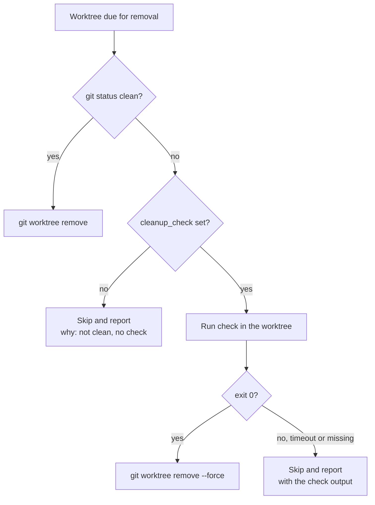

# 17. Module: housekeeping

Part of the [phase 1 design](../phase-1.md#module-map). Build wave: 2. Contracts and acceptance criteria are in this file; shared types are in [section 18](../shared/18-shared-contracts.md). Terms such as run, stage, task, attempt and rework are defined in the [glossary](../phase-1.md#2-glossary).

Everything the factory creates has a defined end of life. `factory gc` shows the plan and `--apply` carries it out. It only ever deletes inside the factory home and the worktree root, and only for runs that have ended.

| Item | Removed when | How |
| --- | --- | --- |
| Task worktrees and task branches | Right after the join merges them, if clean or the repo's `cleanup_check` passes (safety rules below) | `git worktree remove`, `git branch -D` (a task branch never counts as merged, because the join applies its diff) |
| Run worktree and local run branch | Pull request merged or closed; aborted or failed runs after `keep_failed_days` | `git worktree remove`, `git branch -D`; the remote branch is deleted by `--delete-branch` |
| Kit snapshot `$FACTORY_HOME/kits/<hash>/` | No unarchived run uses it | Deleted |
| Run folder `$FACTORY_HOME/runs/<repo key>/<id>/` | `archive_after_days` after the run ends | Zipped to `$FACTORY_HOME/archive/<repo key>/<yyyy-mm>/<id>.zip` (Python `zipfile`) |
| Archive zip | `delete_archive_after_days` | Deleted by `factory gc --apply` |
| `history.jsonl` line | Never; one small line per run | — |
| Processed markdown requests | At intake | Moved to `.factory/inbox/processed/`, archived with the run |
| `worker.log` | Over `worker_log_max_mb` | Oldest part truncated; kept whole in the archive |
| Runs whose repo is missing, and orphan worktrees | After `keep_failed_days`; orphans are only reported | Archived like any ended run; orphans listed by `factory gc` for you to remove |

**Safety rules**

- **Clean worktrees** are removed as the table says.
- **A worktree that is not clean** (uncommitted, untracked or ignored files) is removed only when the repo's `cleanup_check` ([module 3](03-kit-and-configuration.md)) exits 0, run in that worktree. With no `cleanup_check`, or when it exits non-zero, times out or is missing, the worktree stays and `gc` reports it with the check's output. The engine never uses `--force` without a passing check.



A skipped worktree is not an error: its run is still archived, the run's `paths` block keeps the path, and the next `gc` tries again.
- An active or blocked run is never touched.
- `git worktree prune` clears worktree records whose folders are already gone.
- `retention.auto_gc` (default off) runs the plan when an engine starts.

**What ends up in the repo**

Only the deliverables, through the pull request: product code, tests, ADRs in `docs/adr/`, and research reports when the doc sink points inside the repo. Run state, logs and summaries stay in the factory home, and `history.jsonl` keeps one line per run with request, result, pull request, tokens and timestamps.

**Module contract: 17 Housekeeping**

- **Depends on:**
  - 3: `load_config` (the repo settings retention and cleanup_check)
  - 6A: `list_runs`, `read_run`, `history_append`, `lock_status`
  - 7: `remove_worktree`, `delete_branch`
- **Writes:** archives in `$FACTORY_HOME/archive/`; events `archived`. It deletes only paths recorded in a run's `paths` block, inside `$FACTORY_HOME` or the worktree root.
- **CLI it backs:** `gc`.

```python
# housekeeping.py
def plan(home: Path, cfg: Config, *, now: datetime) -> GcPlan          # items, reasons, skipped with why
def apply(plan: GcPlan) -> GcReport                                     # archive, delete
def cleanup_after_join(repo: Path, cfg: Config, run: Run, task_ids: list[str]) -> None   # called by 6B
def cleanup_after_merge(repo: Path, cfg: Config, run: Run) -> None                       # called by 6B or tick
```

- **Choices the code makes where this file is silent:**
  - A run ended when its last event, other than `archived`, was written. Retention and `cleanup_check` are read from each run's own repo.
  - A failed or aborted run keeps its worktrees `keep_failed_days`, and its run folder is archived after `archive_after_days`.
  - `gc` has no pull request state, so a done run's worktree is due with its archive. `cleanup_after_merge` removes it sooner.
  - When the repo is gone, git cannot check or remove a worktree, so it stays and is reported.
  - A joined task whose worktree is still not clean is reported while its run is active, and nothing else of an active run is touched.
- **Run and test:** `pytest factory/engine/tests/housekeeping` with `FakeClock`; `factory gc --json`.
- **Errors:** a worktree that is not clean and fails `cleanup_check` is skipped and reported (`GcReport.skipped` holds the path, the reason and the check output); a failed delete is reported and the rest continues; an archive is verified before the run folder is removed.

Acceptance criteria:

- [x] `plan` lists only ended runs past retention, and never an active or blocked run. (test: factory/engine/tests/housekeeping/test_housekeeping.py::test_only_ended_runs_past_retention_are_planned, ::test_an_active_run_is_never_removed, ::test_a_pending_run_is_left_alone)
- [x] A worktree with uncommitted changes is never removed when `cleanup_check` is unset, exits non-zero, times out or is missing; `gc` reports it with the reason. (test: factory/engine/tests/housekeeping/test_housekeeping.py::test_a_dirty_worktree_with_no_check_is_skipped_by_the_plan, ::test_a_dirty_worktree_whose_check_fails_is_kept_and_reported (the missing-check case is the parametrized command that does not exist), ::test_a_check_that_times_out_keeps_the_dirty_worktree)
- [x] With a `cleanup_check` that exits 0, a worktree that is not clean is removed, and the check ran in that worktree before the removal. (test: factory/engine/tests/housekeeping/test_housekeeping.py::test_a_dirty_worktree_is_removed_when_the_check_exits_zero_in_it)
- [x] A skipped worktree is reported by every later `gc` until it is removed, and its run is still archived. (test: factory/engine/tests/housekeeping/test_housekeeping.py::test_a_skipped_worktree_is_reported_until_removed_and_its_run_is_archived)
- [x] An interrupted archive leaves the run folder intact. (test: factory/engine/tests/housekeeping/test_housekeeping.py::test_an_interrupted_archive_leaves_the_run_folder_intact)
- [x] Clean task worktrees and branches are gone right after their join, and the run worktree right after merge; one that is skipped by the cleanup check stays and is reported. (test: factory/engine/tests/housekeeping/test_housekeeping.py::test_clean_task_worktree_and_branch_are_gone_right_after_the_join, ::test_a_dirty_task_worktree_after_join_stays_and_is_reported_by_gc, ::test_the_run_worktree_and_branch_are_gone_right_after_merge)
- [x] Every archived run keeps one line in `history.jsonl`. (test: factory/engine/tests/housekeeping/test_housekeeping.py::test_every_archived_run_keeps_one_history_line)
- [x] A kit snapshot used by an unarchived run is never deleted; an unused one is. (test: factory/engine/tests/housekeeping/test_housekeeping.py::test_a_kit_used_by_an_unarchived_run_is_kept_and_an_unused_one_is_deleted)
- [x] Orphans are reported both ways: a worktree whose `.factory-run.json` points to no run, and a run whose recorded worktree or repo is gone. (test: factory/engine/tests/housekeeping/test_housekeeping.py::test_a_worktree_marker_that_points_to_no_run_is_an_orphan, ::test_a_run_whose_recorded_worktree_is_gone_is_an_orphan, ::test_a_run_whose_repo_is_gone_is_an_orphan)
- [x] A run whose repo is gone is archived after `keep_failed_days`, and its worktree is removed only if its recorded path still exists. (test: factory/engine/tests/housekeeping/test_housekeeping.py::test_a_run_whose_repo_is_gone_is_archived_after_keep_failed_days, ::test_a_run_whose_repo_is_gone_keeps_its_worktree_on_disk; with the repo gone, git cannot remove the worktree, so the code never removes one in that case)
