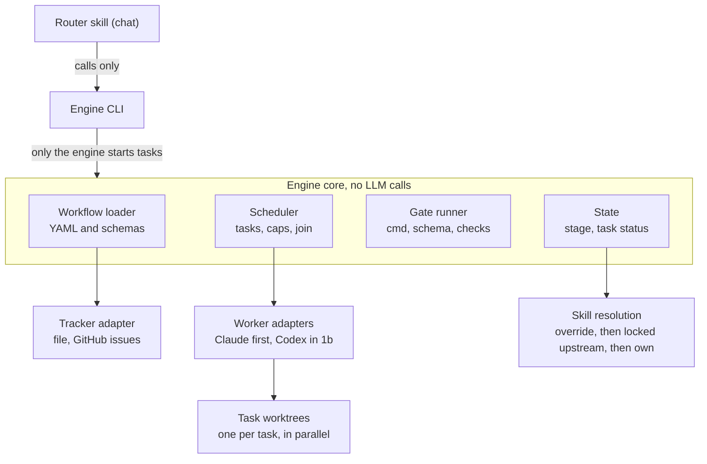
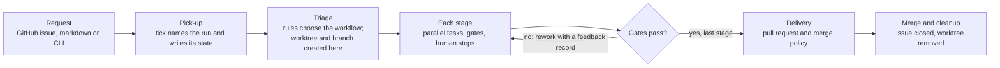
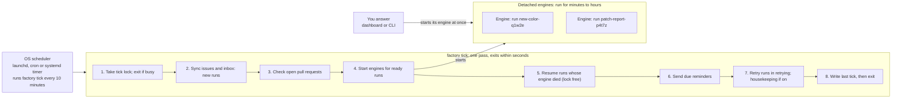
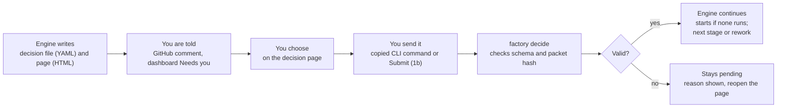

# Software factory phase 1 design

Nov 14, 2026 · @gohleemarble

Phase 1 spec for a reusable software factory, organized by module. Each module states what it owns, its files, its rules, and which parts run without an LLM.

## 1. Overview

The factory is a reusable kit that turns a request into reviewed work through a deterministic Python engine. LLM workers do only the bounded tasks a workflow assigns them.

**Vision**

- Not bound to an OS, an LLM or a harness. Claude first, then Codex. Phase 1 runs on macOS and Linux; Windows follows in phase 2.
- Minimal intrusion: a repo gets the `factory/` kit, the factory skills and a `.factory/` folder. An update replaces `factory/` and the skill shims only.
- Plugin-style workflows: stages adapt to the kind of work (bug fix, feature, new app, chore, research), and tasks inside a stage run in parallel.
- The engine runs outside any LLM harness and decides everything that can be decided by code.

**Principles**

1. The engine decides, the worker does the work. Only the engine starts tasks, moves stages and merges.
2. Every LLM output passes a deterministic gate before anything depends on it.
3. Every human stop is a file, so it can be answered from the dashboard, the CLI, a chat or an editor.
4. State is files: JSON for state, JSON Lines for logs, YAML for files people write.
5. A workflow must pass with helpers off before native helpers are allowed on.

**Module map**

| # | Module | Owns | Uses an LLM |
| --- | --- | --- | --- |
| 3 | Kit and configuration | Layout, settings, worktree root, upgrades | No |
| 4 | Intake and triage | `request.json` from CLI, markdown and GitHub; workflow choice | Only when rules cannot classify |
| 5 | Workflows and plugins | Workflow YAML, stages, gates, plugins | No |
| 6 | Engine core | 6A state store (state files, locks, run scanner); 6B engine loop (scheduler, lifecycle, recovery) | No |
| 7 | Git and GitHub operations | Branches, worktrees, checkpoints, merges, pull requests, issue updates | No |
| 8 | Gates, error handling and rework | Retries, routing back, blocked runs | No |
| 9 | Worker adapters and helpers | Launching Claude and Codex, helper rules, logs, usage | The workers are the LLM |
| 10 | Skills | Stage-to-skill mapping, lockfile, overrides | Skills are worker instructions |
| 11 | Human stops | Decision files, attention items, notifications, resume | No |
| 12 | Live view and steering | Log tail, notes | No |
| 13 | Delivery | Pull request, merge policy, sinks, run summary | No |
| 14 | Token tracking | Usage records and reports | No |
| 15 | Dashboard | Server, run scanner, React UI | No |
| 16 | Drivers | CLI, router skill | The router skill runs inside a chat |
| 17 | Housekeeping | Cleanup, archive, retention | No |

**Phase split**

Phase 1 is delivered in two steps. The wave order in section 20 is the same for both; the split decides what each wave leaves out first.

| Area | Phase 1a (walking skeleton) | Phase 1b |
| --- | --- | --- |
| Harness | Claude, plus `CommandAdapter` and the fakes | Codex |
| Requests | CLI, markdown inbox and GitHub issues | - |
| Workflows | `_triage`, bug-fix, chore | feature, new-app, research |
| Gates, rework, human stops, notes, delivery, tokens, housekeeping | All | - |
| Merge policy | Chores auto-merge, the rest human review | More workflows added to `auto` from `history.jsonl` |
| Plugins | None | Plugins, hooks and `tasks_from` for plugins |
| MCP servers, practice packs | None | Both |
| Toolchains (17A) | Profile loader and the profiles the first target repos need | The other shipped languages |
| Dashboard | Read-only: overview, Needs you, run detail, usage, Show JSON. Answers go through `factory decide` and the other CLI commands | Writes: Submit, notes, retry, goto, skip, abort |
| Operating systems | macOS and Linux | Windows is phase 2 |

*Diagram: Architecture: drivers, engine core, adapters, skills*



*Diagram: Run lifecycle: request to merge, with the rework loop*



Every request follows this path. A stage repeats until its gates pass, and a failed gate sends the run back to an earlier stage with a feedback record. Human stops happen inside stages.

**Decisions made**

| Topic | Decision |
| --- | --- |
| Who owns the loop | Engine plus an interactive driver. Only the engine starts tasks; the router skill only calls the CLI. |
| Overlapping skills | One skill per stage, through `stages.map.yaml`. |
| Subagents | Engine plus native subagents, governed: declared, capped, logged and scope-checked. Claude Code and Codex both have native subagents. |
| Skills | The factory writes its own headless skill for every stage. Upstream skills are reference only; they enter through `skills.lock` (empty by default) for plugins and overrides, with pinned refs and an allowlist. |
| Engine language | Python. |
| Dashboard | React, shipped as a prebuilt bundle and served by the engine. It scans run files in the factory home and re-reads only those that changed. |
| State format | JSON for state, JSON Lines for logs, YAML for files people write. |
| Decision file | One YAML file per human stop, plus a generated HTML decision page that gives the CLI command. |
| Naming | One request is one run, named `<slug>-<5 chars>` with hyphens everywhere, such as `new-color-q1w2e`. |
| Markdown submissions | Several files submitted together form one run. |
| Read-only runs | Detached worktree; a branch only when delivering into the repo. |
| Worktree location | Configurable root, such as `/home/me/dev/worktree/<repo>/<run id>`. |
| Merge policy | Small chores auto-merge when every rule passes; everything else needs human review. |
| Live view | Live log plus notes delivered at checkpoints, by restarting the worker from `progress.md`. Resuming a harness session and takeover come after phase 1. |
| Notifications | Source channel plus the dashboard; chat webhook optional and off by default; answering by GitHub comment in phase 2. |
| Spend control | Budget caps are on hold (KIV). Token use is tracked per attempt instead. |
| Run state | One copy in the factory home, \~/.factory/runs/\<repo key>/\<run id>/, keyed by the repo's remote. Worktrees hold only a link file. |
| Lint and format | The engine formats once, after a task's worker has stopped, and gates on lint at each join. Repo hooks run on the join commit and before push; checkpoints skip them and never format, so files do not change under a running worker. |
| Plugins | Tasks can be skills, commands, scripts or Python functions; plugins are hash-locked when enabled. |
| MCP servers | Defined once per machine, allowed per stage in the repo config. |
| Run ownership | The engine holds an OS file lock for its whole life. A crash releases it, a sleeping machine does not. Heartbeats are for display only. |
| Kit per run | The kit and config are snapshotted from the base branch when a run is created, and the run uses only the snapshot. |
| Dashboard access | Localhost, Host and Origin checks, and a per-session token. |
| Worker isolation | Tool allowlist, scrubbed environment, denied reads of secrets, and the residual risk stated. No OS sandbox in phase 1. |
| Operating systems | macOS and Linux in phase 1. Windows in phase 2. |
| Phases | Phase 1a is a walking skeleton; phase 1b adds the rest (see Phase split). |

## 2. Glossary

One word per idea, used the same way in the engine, the workflows, the CLI, the dashboard and this doc. The words job and card are retired.

| Term | Meaning | Do not call it |
| --- | --- | --- |
| Request | What you submit: CLI text, a GitHub issue, or one or more markdown files. Normalized into `request.json`. | ticket, card, task |
| Run | The execution of one request. One run has one worktree and, when it writes to the repo, one branch, both named `<slug>-<5 chars>`. | job, card |
| Workflow | The YAML definition of the stages for a kind of run, such as bug-fix or research. | pipeline |
| Stage | An ordered step of a workflow. It holds tasks, a join rule, gates and an optional approval. | phase, lane |
| Task | The unit of work inside a stage. Tasks in one stage can run in parallel. | job, step |
| Attempt | One worker session launched for a task. A retry or a restart makes a new attempt. | run |
| Retry | A new attempt of the same task after a worker error. | rework |
| Rework | Routing a run back to an earlier stage after a gate fails, with a feedback record. | retry |
| Feedback record | The failure details handed to the stage a run is routed back to. | error log |
| Blocked | A run status: retries or rework loops ran out and the run waits for a human. | failed (failed is final) |
| Worker | The headless LLM session that carries out an attempt, such as `claude -p` or `codex exec`. | agent |
| Helper | A subagent a worker starts inside its own session, under the helper policy. | worker |
| Engine | The deterministic Python program that owns state, scheduling, gates and merges. It contains no LLM. | orchestrator |
| Adapter | Engine code for one worker (Claude, Codex) or one tracker (file, GitHub). | driver |
| Driver | The way you operate the factory: the CLI or the router skill. | adapter |
| Skill | Instructions a worker follows for a stage, chosen through `stages.map.yaml`. | prompt |
| Plugin | A manifest that adds stages, tasks, gates or hooks to workflows without editing them. Its tasks can be skills, commands, scripts or Python functions. | extension |
| Gate | A deterministic check a stage must pass. | test (a test is one kind of gate) |
| Human stop | Any point where the run waits for you: an approval, a decision, a blocked run, a merge review. | pause |
| Approval | A human stop with the options approve, rework and reject. | review (review is a stage) |
| Decision | Your answer at a human stop, recorded in `decisions/<stage>.<n>.yaml`, where n counts the visits to that stage. | ADR (written after approval) |
| Attention item | The dashboard entry for a human stop. Listed under Needs you. | alert |
| Checkpoint | A safe point with a WIP commit and `progress.md`. Restarts resume from here. | save |
| Note | A steering message you queue for a task, delivered at the next checkpoint. | comment |
| Heartbeat | A timestamp the engine refreshes every 10 seconds while it owns a run. It is for display; it never decides who owns a run. | ping |
| Stale | A run whose status is `running` but whose engine process is gone, so nobody holds its lock. | failed |
| Lock | The file naming the engine process that owns a run. The engine holds an OS file lock on it for as long as the process lives, so a crash releases it and a sleeping machine does not. | — |
| Usage record | One line in `usage.jsonl` per attempt: model, tokens, start, end, repo, branch, worktree. | cost |
| Merge policy | The rules in `merge-policy.yaml` that decide auto-merge or human review. | approval |
| Sink | Where a run's result goes: pull request, document or issue comment. | output |
| Run summary | `summary.md`, the final document every run produces. | report (a research deliverable) |
| Worktree | A separate git working folder for a run or a task. | clone |
| Worktree root | The configured folder that holds worktrees, such as `/home/me/dev/worktree`. | workspace |
| Dashboard | The local web page that shows every run across repos. | console |
| Factory home | `$FACTORY_HOME`, default `~/.factory`: machine config and every run's state, worktrees, archives and logs. Runs sit under `runs/<repo key>/<run id>/`. | registry |

## 3. Module: kit and configuration

The kit lives in `factory/` and is replaced whole on update. Local settings live in `.factory/config/` and are committed. All run state lives outside the repo, in the machine's factory home (`~/.factory`), so a moved or deleted repo never loses its runs.

```text
factory/                    the kit: replaced whole on update, never edited
  AGENTS.md                 shared rules, read by every harness
  workflows/                bug-fix, feature, new-app, chore, research
  stages.map.yaml           stage name to skill reference
  skills.lock               pinned upstream skills and allowlist
  requirements.lock         pinned Python dependencies of the engine
  skills/own/               original skills: verify, critique, gates
  schemas/                  request, run, task, usage, decision, feedback, merge, triage, plugin, packet,
                            stage-report, test-report, source-notes, review-findings
  policies/                 default scope and protected-path rules
  engine/                   Python engine and the factory CLI
  adapters/tracker/         file, github
  adapters/worker/          claude, codex
  dashboard/                prebuilt React bundle, served by the launcher
  shims/                    generators for .claude and .agents skill links (generated into each worktree as `factory-<skill>` folders, git-excluded)

.factory/config/            in the repo, committed: local settings that survive updates
  factory.yaml              base branch, repo key override, notify, retention
  merge-policy.yaml         auto-merge rules
  workflows/                repo copies that win over factory/workflows
  plugins/                  plugin manifests
  overrides/                skill overrides and stages.map additions

.factory/                   in the repo, git-ignored except config/
  .gitignore                "*", "!config/", "!.gitignore"
  inbox/                    markdown requests waiting for intake

~/.factory/                 the factory home ($FACTORY_HOME), one per machine user
  config.yaml               machine settings: harnesses, repos, worktree root, tick
  env                       values for ${...}, readable only by you
  runs/<repo key>/<run id>/ all run state, for every repo on the machine
  worktrees/                default worktree root
  archive/<repo key>/       zipped finished runs
  history.jsonl             one line per finished run
  tick.json                 last tick time and result
  sync/<repo key>.json      last_sync cursor for each repo
  slots/                    one file per running worker, for the machine-wide worker cap
  venvs/<lock hash>/        Python environment for each distinct requirements.lock
  kits/<kit hash>/          snapshot of factory/ and .factory/config/ taken when a run is created
  plugin-hashes.json        reviewed plugin hashes per repo key, never stored in a repo
  logs/                     tick and dashboard logs
```

`.factory/.gitignore` ignores everything except `config/`, so the factory never edits the repo's own `.gitignore`.

**Settings**

```yaml
# .factory/config/factory.yaml   (in the repo, committed)
base_branch: main
tracker: github                  # file | github
harness: claude                  # claude | codex
concurrency: 4                   # parallel workers for this repo; the machine-wide cap is max_workers in the machine file
repo_key: null                   # override, such as github.com/acme/report
notify: {github_mention: author, desktop: true, webhook: null, remind_after_hours: 24}
retention: {archive_after_days: 7, delete_archive_after_days: 90, keep_failed_days: 14}
infra_wait_hours: 6              # how long a run waits for GitHub or the network before it is blocked

# ~/.factory/config.yaml   (factory home, per machine)
repos: [/work/report, /work/payments-api]
worktree_root: /home/me/dev/worktree     # default: ~/.factory/worktrees
worktree_path: "{root}/{repo}/{run_id}"
dashboard_url: http://127.0.0.1:8765
max_workers: 6                   # machine-wide cap on running workers, shared by every engine through slots/
```

Machine settings (worktree root, tool paths, desktop notifications) come from the per-machine file. Repo settings come from `factory.yaml`. Environment variables (`FACTORY_WORKTREE_ROOT`) and CLI flags override both.

Harness, model and API key settings are described in module 9. Run state, worktrees, archives and logs live in the factory home, described next.

**Factory home**

`$FACTORY_HOME` (default `~/.factory`) holds everything the factory writes on a machine. `factory config init` creates it, readable only by the current user.

- **Repo key.** Runs are grouped by the repo's origin remote, without the scheme or `.git`, such as `github.com/acme/report`. Two repos with the same folder name never collide, and a re-cloned repo keeps its history. A repo with no remote uses `local/<folder name>`. `repo_key` in `factory.yaml` overrides it, for example after a remote is renamed.
- **Repo path.** `run.json` records where the repo is (`repo_path`) and the hash of its kit snapshot (`kit_hash`). The run needs the repo to continue, because its worktrees and branches belong to the repo.
- **Repo missing.** If `repo_path` no longer exists, the run stays readable on the dashboard as "repo missing". It cannot be resumed, and housekeeping archives it.
- **One user.** The scheduler, engines and dashboard must run as the same user, because the home belongs to that user. The home must be on a local disk, because OS file locks are not reliable on network shares.

**Links between a run and its folders**

Every run is linked both ways, so you can go from the dashboard to the folders and from any folder back to the run. Housekeeping and troubleshooting both use these links.

| From | To | How |
| --- | --- | --- |
| Run folder | Repo, run worktree, task worktrees, branch, source | The `paths` block in `run.json` |
| Run worktree or task worktree | Run folder | `.factory-run.json` at the worktree root, git-excluded: run id, repo key, run folder path |
| Repo | Its runs | `factory status` in the repo lists every run with that repo key |

```json
"paths": {
  "run_dir": "/home/me/.factory/runs/github.com/acme/report/new-color-q1w2e",
  "repo": "/work/report",
  "worktree": "/home/me/dev/worktree/report/new-color-q1w2e",
  "branch": "new-color-q1w2e",
  "tasks": {"backend": "/home/me/dev/worktree/report/new-color-q1w2e--backend"},
  "source": "https://github.com/acme/report/issues/42"
}
```

- **`factory where <run>`** prints every path. Run with no argument inside a worktree, it reads `.factory-run.json`, so you can find the state of whatever you are looking at. `--json` gives the same for scripts.
- **Dashboard:** the run detail shows each path with a Copy button. `factory open <run> --folder worktree` opens it in the file manager.
- **Housekeeping** removes only paths recorded in `paths`, never a path it has to guess.
- **Orphan check:** `factory gc` also reports orphans both ways:
  - a worktree under the worktree root, or in `git worktree list`, whose `.factory-run.json` points to no run
  - a run whose recorded worktree or repo no longer exists

**One source of truth.** Run state is never written into a worktree. A worktree holds only:

- product code
- the git-excluded skill shims
- `.factory-run.json`

The engine never reads `.factory-run.json` to decide anything. It is a signpost for people and for `factory gc`'s orphan report, so a worker editing it changes nothing.

**Troubleshooting from inside a worktree**

| Command | Shows |
| --- | --- |
| `factory status --here` | The run this worktree belongs to: stage, task statuses, attempts, last gate result, attention item |
| `factory where` | Every path of that run: run folder, repo, worktrees, branch, source |
| `factory logs <task> [--follow]` | The task's `worker.log`, read from the run folder |
| `factory events [--tail 50]` | The run's recent events |

Each command reads `.factory-run.json` to find the run, then reads the run folder in the factory home, so you see exactly what the dashboard sees. With a run id instead of `--here`, the same commands work from any folder.

**Worktree location**

- `worktree_path` is a template with `{root}`, `{repo}`, `{owner}`, `{run_id}` and `{task}`. The default root is `$FACTORY_HOME/worktrees`.
- Example: repo `report`, run `new-color-q1w2e` gives `/home/me/dev/worktree/report/new-color-q1w2e`. Its tasks get `/home/me/dev/worktree/report/new-color-q1w2e--backend`.
- The engine expands `~`, resolves an absolute path and stores it in `run.json` and every usage record.
- It refuses a path inside the repo's working tree (other than `.factory/worktrees`) or a path that already exists. If two repos share a folder name, it stops and suggests `{owner}-{repo}`.

**Run snapshot**

When a run is created, the factory copies `factory/` and `.factory/config/` from the base branch's committed content (`git archive`) into `$FACTORY_HOME/kits/<kit hash>/`. The hash covers the copied files, so runs created from the same content share one folder. From then on the run uses only its snapshot:

- the engine, workflows, plugins, schemas, languages and `requirements.lock` all come from the snapshot, never from the repo's working tree, so a branch switch, a pull or an edit in the main checkout cannot change a running run;
- the launcher finds a run's engine from `kit_hash` in `run.json`, and starts it from the snapshot with the virtual environment for that snapshot's `requirements.lock`;
- plugin hashes are checked against `plugin-hashes.json` when the snapshot is made, so a plugin edited later never changes a run that already started;
- commands that create runs (`add`, `sync`, and the sync step of `tick`) use the repo's committed kit; every later command uses the run's snapshot;
- `factory run --kit working-tree` uses the working tree instead, for developing the kit itself, and records that in `run.json`.

Housekeeping deletes a snapshot when no unarchived run uses it.

**Upgrade**

`factory upgrade <version>` replaces `factory/`, regenerates the skill shims and validates `.factory/config/` against the new schemas. It does not need to wait for active runs: they keep their own snapshots, and new runs use the upgraded kit.

**OS rules**

Phase 1 supports macOS and Linux. Windows (Task Scheduler install, `.bat` and `.ps1` handling, retrying atomic replaces, Windows path rules) is phase 2. The code already uses `pathlib` and argument lists, so nothing blocks it.

Python 3.10 or later, `pathlib` for paths, `subprocess` with argument lists, and no shell scripts in the kit's engine. Commands that workflows call, such as `scripts/repro-fails.sh`, belong to the repo; a repo on Windows supplies its own. The only external tools are `git` and, when the tracker is GitHub, `gh`. Python dependencies (PyYAML, jsonschema) are pinned in `factory/requirements.lock`. The launcher builds one virtual environment per distinct lock hash under `$FACTORY_HOME/venvs/` on first use and runs the repo's engine from it, so repos on different kit versions never share packages.

**Module contract: 3 Kit and configuration**

- **Depends on:** nothing (foundation).
- **Writes:** `factory/`, `.factory/config/*`, `.factory/.gitignore`, `~/.factory/config.yaml`, the env file.
- **CLI it backs:** `init`, `upgrade`, `doctor`, `config init`.

```python
# config.py
def load_config(repo: Path | None, *, env: Mapping[str, str] = os.environ) -> Config
    """Merge defaults, machine file and repo file; machine keys from the machine file,
    repo keys from the repo file; env vars and flags override. Validates against schema."""
def resolve_harness(cfg: Config, harness: str, *, env: Mapping[str, str] = os.environ) -> HarnessConfig
    """command, model, args and the minimal env with ${...} resolved at call time."""
def worktree_path(cfg: Config, repo: Path, run_id: str, task: str | None = None) -> Path
def validate(obj: dict, schema: str) -> None            # raises FactoryError("schema.invalid")
def mask(text: str, secrets: Iterable[str]) -> str
# kit.py
def init_repo(repo: Path) -> InitReport                  # labels are added by drivers (16)
def upgrade(repo: Path, version: str) -> UpgradeReport
def doctor(repo: Path | None, *, as_scheduler: bool = False) -> list[CheckResult]
```

- **Run and test:** `pytest factory/engine/tests/config factory/engine/tests/kit`; `factory doctor --json`.
- **Errors:** invalid YAML, unknown schema version, unset `${VAR:?}`, a literal secret in committed config, or an unsafe worktree path. All fail fast with file, line and fix.

Acceptance criteria:

- [ ] `${VAR}`, `${VAR:-default}` and `${VAR:?message}` resolve; an unset `:?` variable fails with the message.
- [ ] A literal value under `env` in `.factory/config/` is refused; in the machine file it warns when readable by others.
- [ ] Precedence: flag > env var > machine file (machine keys) or repo file (repo keys) > default.
- [ ] `worktree_path` renders the template and refuses a path inside the repo (except `.factory/worktrees`) or an existing path.
- [ ] `init_repo` creates the layout and `.factory/.gitignore`, never edits the root `.gitignore`, and a second run changes nothing.
- [ ] `upgrade` never touches `.factory/config/`, and a run created before it keeps using its own kit snapshot.
- [ ] A run's snapshot is made from the base branch's committed content, shared by runs with the same content, and unchanged when `factory/workflows/` or `.factory/config/` is edited in the main checkout afterwards.
- [ ] `doctor --as-scheduler` runs every check in an empty environment.

## 4. Module: intake and triage

Every source is converted into the same `request.json` at pick-up, before the run is created, because the run's name needs the title. A triage stage then picks the workflow by rules, using an LLM only when the rules fail.

| Source | How it arrives | How it is picked up |
| --- | --- | --- |
| CLI | `factory add "title" --type bug --body file.md` | Immediately |
| Markdown | A file dropped in `.factory/inbox/` | `factory sync` or `factory watch` |
| GitHub issue | An open issue with the `factory` label | `factory sync` or `factory watch`, via `gh issue list` |

```json
{
  "schema_version": 1,
  "request_id": "gh-42",
  "source": {"type": "github", "ref": "owner/payments-api#42", "body_sha": "c91e07", "author": "alice"},
  "repo": "payments-api",
  "title": "Login fails on expired token",
  "body": "Steps to reproduce...",
  "type": null,
  "labels": ["bug"],
  "priority": "high",
  "acceptance": ["Expired token returns 401 with a refresh hint"]
}
```

A markdown request uses front matter for the same fields:

```markdown
---
title: Login fails on expired token
type: bug
priority: high
acceptance:
  - Expired token returns 401 with a refresh hint
---
Steps to reproduce...
```

Every run starts with the shared `_triage` stage from `factory/workflows/_triage.yaml`. `run.json` has `workflow: null` until triage resolves one; the engine then appends the chosen workflow's stages. The run folder exists from pick-up, but the run worktree and branch are created only when triage ends, because the workflow's `policy.write` decides between a branch and a detached worktree. The `classify` task runs in its task folder with no repo access.

```yaml
# factory/workflows/_triage.yaml
stages:
  - id: triage
    tasks:
      - {id: rules, cmd: "factory triage", out: triage.json}             # code only
      - {id: classify, skill: classify, needs: [rules], when: {artifact: triage.json, confidence_below: 0.8},
         out: triage.json}                                              # LLM fallback
    gate: [{check: type-resolved}]
    approval: when-low-confidence
```

**Rules**

- Triage order: explicit type, then label, then front matter, then keyword rules. Only if all fail does an LLM task propose a type with a confidence score. A low score becomes a human stop with the candidate workflows as options.
- Duplicates are caught by source ref plus body hash, so the same issue never starts two runs. The check covers active runs, archived runs and `history.jsonl`. When a run ends, the engine removes the `factory` label from its GitHub issue, so a finished issue is not picked up again.
- If a GitHub issue body changes while its run is active, the engine logs `request_changed` and raises an attention item. It does not restart the run by itself.
- Status goes back to the source at each change: GitHub labels `factory:queued`, `factory:running`, `factory:needs-human`, `factory:blocked`, `factory:done`, `factory:failed` plus a comment at the start, at each human stop and at the end; markdown front matter `factory_status` and `factory_run`; for the CLI, printed output and `factory status`.

**Markdown submissions.** Several files submitted together form one run:

- A folder in the inbox, such as `.factory/inbox/new-color/`, is one submission. Its files are combined into one `request.json`, with the `title` taken from the first file's front matter or heading.
- A single loose file is one submission.
- From the CLI, `factory add --files a.md b.md` is one submission.
- `factory watch` picks up a folder only after it has had no new files for 10 seconds, so a half-copied folder is not split.
- Dedupe uses the folder path plus a hash of all its files.

**Module contract: 4 Intake and triage**

- **Depends on:**
  - 3: `load_config`, `validate`
  - 6A: `factory_home`, `repo_key`, `new_run_id`, `init_run`, `find_by_source`, `append_event`
  - 7: `TrackerAdapter`, `snapshot_kit`
- **Writes:** `request.json` and the initial run folder in the factory home, with its `paths` block; events `run_created`, `request_invalid`, `request_duplicate`, `request_changed`.
- **CLI it backs:** `add`, `sync`, and the internal `triage`.

```python
# intake.py
def read_sources(repo: Path, cfg: Config, tracker: TrackerAdapter,
                 kinds: tuple[str, ...] = ("github", "markdown")) -> list[Source]
def normalize(source: Source, cfg: Config) -> Request         # FactoryError("intake.invalid") with reason
def create_run(repo: Path, cfg: Config, request: Request, tracker: TrackerAdapter) -> RunRef
    """dedupe (runs, archive, history) -> run id -> kit snapshot (7) -> state in the factory home (6A), with the worktree path reserved
    but not created (6B creates it when triage ends) -> status back to source."""
def sync(repo: Path, cfg: Config, tracker: TrackerAdapter) -> SyncReport   # created, invalid, duplicates
def add(repo: Path, cfg: Config, title: str, *, type: str | None = None,
        body: str | None = None, files: list[Path] | None = None) -> RunRef
# triage.py
def triage_rules(request: Request, cfg: Config) -> TriageResult
    """type, workflow, confidence, type_source: explicit | label | front_matter | keyword."""
def check_type_resolved(spec: GateSpec, ctx: GateContext) -> GateResult      # used by 8
```

- **Run and test:** `pytest factory/engine/tests/intake` with `FakeTracker` and a temp git repo; `factory sync --json`.
- **Errors:** an invalid request creates no run and its source gets the reason; `gh` errors use transient retry; a duplicate is skipped; an edit mid-run logs `request_changed`.

Acceptance criteria:

- [ ] An inbox folder with three markdown files gives one run; a loose file gives one run; `add --files` gives one run.
- [ ] A folder still receiving files is not picked up until 10 seconds without new files.
- [ ] The same source ref and body hash never creates a second run.
- [ ] A request with no title gets `factory:invalid` and a comment (GitHub) or `factory_error` (markdown), and no run.
- [ ] The run id is a hyphen slug plus 5 characters and never matches an existing branch or run folder.
- [ ] A created run has request.json, run.json with its reserved paths, a run folder in the factory home and the `factory:queued` label; its worktree, shims and branch appear only after triage.
- [ ] `triage_rules` follows the order explicit, label, front matter, keyword, and records `type_source`.

## 5. Module: workflows and plugins

A workflow is a YAML list of stages; each stage holds parallel tasks, a join rule, gates and what happens on failure or rejection. Plugins insert stages, tasks or gates without editing workflow files.

```yaml
name: bug-fix
type: bug                         # request type that selects this workflow
sink: pull_request                # pull_request | doc | comment
policy:
  write: true                     # false: detached worktree; a branch only at delivery into the repo
  deny_paths: [".github/**"]
defaults:
  retries: 2                      # extra attempts after a worker error
  timeout_minutes: 30
  checkpoint_every_minutes: 10
  max_restarts: 3                 # note-driven restarts per task
stages:
  - id: fix
    needs: [propose]              # stage order
    tasks:
      - id: backend
        skill: fix                # resolved through stages.map.yaml
        scope: ["services/api/**"]
        needs: []                 # task order inside the stage
        helpers: {mode: auto, max: 2, split_hints: [api-code, tests]}   # auto | native | off
        out: backend.json         # must match schemas/stage-report
    join: all                     # all | any | quorum:N
    gate:
      - {cmd: "make build"}
      - {check: scope-diff}
      - {check: helpers-ledger}
    on_fail: {goto: root-cause, max: 2}     # rework with a feedback record
    on_conflict: {goto: fix, max: 1}        # merge conflict at join
    approval: none                # none | human | when-low-confidence
    on_reject: {goto: propose}    # where a rework answer sends the run
```

**Rules the engine enforces**

- Tasks with no `needs` start together, up to the concurrency limit. A task with `cmd` and no `skill` runs without an LLM.
- Gates run in order and stop at the first failure. Prefer a command or schema check; use an LLM rubric only inside a task whose output a schema gate then reads.
- `tasks_from` builds a stage's task list from an earlier artifact at run time. The engine validates the generated tasks against the workflow schema before starting them.
- Lookup order: `.factory/config/workflows/`, then `factory/workflows/`. Built-in workflows: bug-fix, feature, new-app, chore, research.

**Bug-fix workflow**

```yaml
name: bug-fix
type: bug
sink: pull_request
stages:
  - id: reproduce
    tasks: [{id: repro, skill: reproduce, out: repro.json}]
    gate: [{cmd: "scripts/repro-fails.sh"}]          # a failing test must exist
  - id: root-cause
    needs: [reproduce]
    tasks: [{id: cause, skill: root-cause, out: cause.json}]
    gate: [{schema: stage-report}, {check: evidence-cites-code}]
  - id: propose
    needs: [root-cause]
    tasks: [{id: plan, skill: propose, out: plan.json}]
    approval: human
    on_reject: {goto: root-cause}
  - id: fix
    needs: [propose]
    tasks:
      - {id: backend, skill: fix, scope: ["services/api/**"],
         helpers: {mode: auto, max: 2, split_hints: [api-code, tests]}, out: backend.json}
      - {id: frontend, skill: fix, scope: ["web/**"], needs: [backend], out: frontend.json}
    join: all
    gate: [{cmd: "make build"}, {check: scope-diff}, {check: helpers-ledger}]
    on_fail: {goto: root-cause, max: 2}
  - id: verify
    needs: [fix]
    tasks:
      - {id: be-tests, cmd: "make test-api", out: be.junit.xml}
      - {id: fe-tests, cmd: "npm --prefix web test", out: fe.junit.xml}
      - {id: e2e, cmd: "make e2e", needs: [be-tests, fe-tests], out: e2e.junit.xml}
    join: all
    gate: [{cmd: "scripts/repro-now-passes.sh"}, {schema: test-report}]
    on_fail: {goto: fix, max: 2}
  - id: review
    needs: [verify]
    tasks:
      - {id: standards, skill: review-standards, out: standards.json}
      - {id: spec, skill: review-spec, out: spec.json}
    join: all
    gate: [{check: no-blocking-findings}]
    on_fail: {goto: fix, max: 1}
```

The two review tasks replace one skill that would otherwise start two subagents, so the engine sees both. The verify stage has no LLM tasks.

**Research workflow**

```yaml
name: research
type: research
sink: doc
policy: {write: false}
stages:
  - id: scope
    tasks: [{id: questions, skill: scope, out: questions.json}]
    approval: human                     # confirm the sub-questions
  - id: gather
    needs: [scope]
    tasks_from: questions.json          # one task per sub-question, in parallel
    task_template: {skill: gather, helpers: {mode: off}, timeout_minutes: 20}
    join: all
    gate: [{schema: source-notes}]
  - id: synthesize
    needs: [gather]
    tasks: [{id: draft, skill: synthesize, out: report.md}]
  - id: critique
    needs: [synthesize]
    tasks: [{id: red-team, skill: critique, out: critique.json}]
    gate: [{check: every-claim-has-source}]
    on_fail: {goto: synthesize, max: 1}
```

**Plugins**

A plugin is a folder in `.factory/config/plugins/` with one manifest. `factory plugins enable <name>` validates it and prints the merged workflow.

```yaml
# .factory/config/plugins/frontend-review/plugin.yaml
name: frontend-review
version: 0.1.0
requires: {skills: [impeccable]}         # must be in skills.lock
applies_to: [feature, bug-fix, new-app]
when: {changed_paths: ["web/**"]}        # skipped if no UI files changed
insert:
  after: verify
  stage:
    id: frontend-review
    tasks:
      - {id: design-audit, skill: impeccable-audit, scope: ["web/**"], helpers: {mode: off}, out: audit.json}
      - {id: design-critique, skill: impeccable-critique, scope: ["web/**"], helpers: {mode: off}, out: critique.json}
    join: all
    gate: [{schema: review-findings}, {check: no-blocking-findings}]
    on_fail: {goto: fix, max: 2}
```

- Hook points: insert a stage before or after any stage, add a task or a gate to a stage, replace a stage's skill. Limit any of them with `when` (changed paths, labels, workflow type).
- Plugins apply in file order and never edit workflow files. Each added stage records its source, such as `plugin:frontend-review`, in `run.json`.
- The gate reads only the findings JSON, so free-form skill output never decides pass or fail. Impeccable needs a one-time design context per repo, listed as a plugin setup step; check its license and command names before pinning.

**Deterministic plugin tasks, checks and hooks**

A plugin can add work that runs without any LLM: a command, a script file or a Python function it ships. These run under the same rules as built-in tasks: a timeout, a log, an artifact and a gate. They cost no tokens.

| Kind | In the manifest | How it runs |
| --- | --- | --- |
| Command | `cmd: ["npm", "run", "lint"]` | An argument list, no shell, in the worktree |
| Script | `run: {script: scripts/scan_licenses.py, args: [...]}` | `.py` runs with the engine's Python. An executable file runs directly. `.sh` or `.ps1` only on the systems listed in `os:` |
| Python function | `run: {python: checks.licenses:scan}` | Imported from the plugin folder in a separate Python process |
| Skill | `skill: impeccable-audit` | An LLM worker, as before |

```yaml
# .factory/config/plugins/license-check/plugin.yaml
name: license-check
version: 0.1.0
applies_to: [feature, bug-fix, chore]
os: [linux, macos, windows]               # where its scripts may run
insert:
  after: verify
  stage:
    id: license-check
    tasks:
      - id: scan
        run: {script: scripts/scan_licenses.py, args: ["--out", "licenses.json"]}
        out: licenses.json
        timeout_minutes: 5
    gate:
      - {schema: plugin:license-check/report}                 # plugin-shipped JSON Schema
      - {check: plugin:license-check/no-forbidden-licenses}   # function in gates/
    on_fail: {goto: fix, max: 1}
hooks:
  - on: [pr_opened, run_done]
    run: {script: hooks/post_to_teams.py}  # side effect only, never blocks the run
```

**The contract a deterministic task follows**

- **Inputs.** Environment variables `FACTORY_RUN_ID`, `FACTORY_STAGE`, `FACTORY_TASK_ID`, `FACTORY_WORKTREE` and `FACTORY_TASK_DIR`. A Python function also gets the same values as JSON on stdin.
- **Outputs.** Its artifact goes in `FACTORY_TASK_DIR`; stdout and stderr go to `worker.log`. A Python function returns its result as JSON on stdout.
- **Exit codes** depend on the kind of task:
  - **`cmd` tasks** (and gate commands) wrap tools the factory does not control, such as `make`, `npm` and `pytest`, whose exit codes vary. The engine first checks that the binary exists and starts. After that, 0 means passed and any non-zero exit means the check failed, so the stage's `on_fail` rework applies. A missing binary, a timeout or a kill by signal is a task error.
  - **Plugin `script` and `python` tasks** are written to this contract: 0 passed; 1 the check found a problem, so `on_fail` rework applies; 2 or higher the task itself failed, a worker error retried up to `retries`.
  - A task error in a deterministic task defaults to 0 retries, because a rerun gives the same answer
- **Working folder.** The worktree; nothing is written outside it and `FACTORY_TASK_DIR`.
- **Checks.** A plugin check gets the `GateContext` as JSON on stdin and prints a `GateResult` as JSON. It runs in a separate process, so a faulty plugin cannot break the engine.
- **Hooks.** A hook runs after the named event, with the event as JSON on stdin. A failing hook is logged and never stops or changes the run.

**Safety**

- `factory plugins enable` lists every command, script and function the plugin will run, then records a hash of the plugin folder in `$FACTORY_HOME/plugin-hashes.json`, keyed by repo key. The hash is never stored in the repo, so a commit cannot approve its own plugin change.
- If any plugin file changes later, the plugin is switched off until enabled again, so reviewed code is the code that runs.
- Plugins run with your user's rights, so enable only plugins you have read.

**Module contract: 5 Workflows and plugins**

- **Depends on:**
  - 3: `load_config`, `validate`
  - 8: `known_checks`
  - 10: `resolve_skill`, used to fail fast on unknown names
- **Writes:** nothing at run time; `plugins enable` records the reviewed hash in `$FACTORY_HOME/plugin-hashes.json`.
- **CLI it backs:** `plugins enable`, `plugins disable`.

```python
# workflow.py
def load_workflow(repo: Path, cfg: Config, name: str) -> Workflow
    """Lookup .factory/config/workflows, then factory/workflows; apply plugins; validate."""
def validate_workflow(wf: Workflow, cfg: Config) -> list[Problem]
    """schema, needs cycles, overlapping parallel write scopes, unknown skill or check,
    unknown goto target, shared_files owners exist."""
def expand_tasks_from(stage: Stage, artifact: Path) -> list[TaskSpec]   # validated like static tasks
def expand_helpers(task: TaskSpec, subagents: Literal["native", "none"]) -> list[TaskSpec]
    """native: [task]; none or mode off: one sibling task per split hint."""
# plugins.py
def enable_plugin(repo: Path, cfg: Config, name: str) -> Workflow    # returns merged result to show
def disable_plugin(repo: Path, name: str) -> None

# types.py (owned by 18, so 5 and 8 never import each other)
@dataclass
class Workflow: name: str; type: str; sink: str; policy: Policy; defaults: Defaults; stages: list[Stage]
                regenerate_at_join: list[str]; join_cmd: str | None; shared_files: dict[str, str]
@dataclass
class Stage:    id: str; needs: list[str]; tasks: list[TaskSpec]; tasks_from: str | None; join: str
                gate: list[GateSpec]; on_fail: OnFail | None; on_conflict: OnFail | None
                approval: str; on_reject: str | None; sync_base: bool; source: str   # workflow or plugin:<name>
@dataclass
class TaskSpec: id: str; skill: str | None; cmd: list[str] | None; run: RunSpec | None; scope: list[str]; deny: list[str]
                needs: list[str]; helpers: HelperPolicy; out: str | None; timeout_minutes: int
                retries: int; model: str | None; when: dict | None
```

- **Run and test:** `pytest factory/engine/tests/workflow` against the five built-in workflows and broken fixtures; `factory plugins enable frontend-review --json`.
- **Errors:** all fail fast at load or enable; no run starts on an invalid workflow.

Acceptance criteria:

- [ ] All built-in workflows and `_triage` load without problems.
- [ ] A cycle in `needs`, an unknown skill, an unknown check or an unknown `goto` stage are each reported with their path.
- [ ] Two tasks that can run together with overlapping write scopes fail unless one `needs` the other or the file is in `shared_files`.
- [ ] A plugin inserts its stage at the right place, records `plugin:<name>` as source, and never edits a workflow file.
- [ ] `expand_helpers` returns sibling tasks for `none` and the task itself for `native`.
- [ ] Tasks from `tasks_from` failing the schema stop the stage before any worker starts.
- [ ] A plugin task with `cmd`, `script` or `python` runs without an LLM, writes its artifact and log, and follows the exit code rules.
- [ ] A plugin whose files changed after `enable` is switched off with a message naming the changed file.
- [ ] A `.sh` script on a system not listed in `os:` fails the workflow at load, not mid-run.
- [ ] A failing hook is logged and the run carries on unchanged.

## 6. Module: engine core

The engine owns the run lifecycle, the state files, the scheduler, the lock on each run and crash recovery. Nothing in it calls an LLM.

**Run lifecycle**

1. `factory add` or `factory sync` creates the run: run id, branch, worktree, `request.json`, `run.json`, event `run_created`.
2. `factory run` starts an engine process. It takes the lock on each run it drives, schedules tasks, runs gates, joins and moves stages.
3. At a human stop, the run waits as `awaiting_approval` or `blocked`; while GitHub or the network is down it waits as `retrying`. When every run it drives is done or waiting on a human, the engine process exits.
4. An answer (dashboard, CLI, chat or file edit) restarts an engine on that run, which continues where it stopped (module 11).
5. Delivery opens the pull request or writes the sink. The run ends `done`, `failed` or `aborted`, and writes `summary.md`.

**Scheduled ticks**

A scheduler such as cron calls one command, `factory tick`, every N minutes. The command does a short pass that is safe to repeat, then exits. Long work happens in detached engine processes, so a two-hour task never holds up the next tick.

*Diagram: Schedule: one short tick per interval, engines in the background*



The OS scheduler only wakes the factory. Each tick takes seconds and starts one detached engine per run that can move. Those engines do the hours of work and exit when their run is done or waiting for you. An answer from you starts its engine at once, so the interval only sets how long a new issue waits.

```text
# crontab: one entry per machine, every 10 minutes
*/10 * * * *  /usr/local/bin/factory tick --all-repos --env-file ~/.factory/env >> ~/.factory/logs/tick.log 2>&1
```

```yaml
# ~/.factory/config.yaml
repos: [/work/report, /work/payments-api]
tick: {every_minutes: 10, stale_after_ticks: 3}
```

What one tick does, in order:

1. Takes a machine-wide tick lock. If the previous tick is still running, it exits at once and logs `tick_skipped`.
2. For each repo in `repos`, it syncs tagged GitHub issues and the markdown inbox, creating runs for new requests. A `last_sync` cursor in `$FACTORY_HOME/sync/<repo key>.json` limits the GitHub query to recently updated issues.
3. It checks the open pull requests of runs waiting on merge (`watch_pr`):
   - merged: finishes the run and cleans up
   - closed: aborts the run
   - red CI: routes the run back to fix
4. It starts a detached engine for every run that can proceed and has no live lock, including runs whose decision was answered while no engine was running.
5. It resumes runs whose engine has died: status running and no process holding the lock. A sleeping laptop is not a death; its engine still holds the lock and carries on when it wakes.
6. It sends due reminders for open attention items.
7. It runs the housekeeping plan when `retention.auto_gc` is on.
8. It writes `last_tick` and its result to tick.json in the factory home and exits, normally within seconds.

**How a tick finds and judges runs**

A tick keeps no state of its own. It lists every `run.json` under `$FACTORY_HOME/runs/`, the single source of truth for every repo on the machine; `repos` is used only to look for new requests. For each run it reads three things:

- the status in `run.json`
- the `lock` file, through `lock_status`: free, live or stale
- for a waiting run, its decision file or pull request

It then takes one action per run:

| Run status | Lock | What the tick does |
| --- | --- | --- |
| any, but `repo_path` is gone | any | Marks it repo missing and starts no engine |
| pending | free | Starts an engine |
| running | live | Nothing: an engine is working on it, even if the machine slept and the heartbeat is old |
| running | stale (no process holds the lock) | Resumes it: ends any worker left over, closes open attempts as interrupted, starts an engine |
| awaiting\_approval, decision now answered | free | Starts an engine, as a safety net if the answer did not already start one |
| awaiting\_approval, still unanswered | free | Sends a reminder if one is due |
| awaiting\_approval, merge review | free | Checks the pull request: merged, closed or red CI |
| retrying | free | Starts an engine that repeats the failed operation; blocks the run once `infra_wait_hours` have passed |
| blocked | free | Reminder only; it waits for you |
| done, failed or aborted | free | Housekeeping candidate |

Individual tasks are not the tick's concern. The engine that holds a run's lock tracks its tasks in `task.json`. Whether the engine is alive is answered by the OS lock, not by a timestamp.

**Rules**

- A tick never runs a worker itself; it only starts engines.
- Repeating a tick is safe: two ticks with nothing new do nothing, and locks plus dedupe rule out double runs.
- A decision answered on the dashboard or CLI still starts an engine immediately. The tick is the safety net, so the interval only bounds how long a new issue waits.
- `factory watch --every 10m` stays as a foreground loop that calls the same tick, for development or machines without a scheduler.

**The scheduler's environment**

Cron starts with almost no environment: a short PATH, no shell profile and often no access to the desktop keychain. That is the most common way scheduled runs fail.

- Use absolute paths in `harnesses.*.command`.
- Put the `${...}` variables in the `--env-file`, readable only by you.
- Authenticate without a desktop session: `GH_TOKEN` for `gh`, and an API key or a login that works headless for Claude and Codex.
- Check all of this with `factory doctor --as-scheduler`, which runs the checks in an empty, cron-like environment.

| OS | Scheduler | Note |
| --- | --- | --- |
| Linux | cron or a systemd timer | A systemd timer prevents overlapping runs by itself |
| macOS | launchd (`StartInterval`) | Catches up after sleep more reliably than cron |
| Windows (phase 2) | Task Scheduler | Set "Do not start a new instance" |

`factory schedule install --every 10m` writes the right entry for the OS, and `factory schedule remove` deletes it.

The dashboard shows scheduler health, such as "last tick 3 min ago, 2 runs started". It warns when no tick has run for `stale_after_ticks` intervals.

**Statuses**

| Status | Applies to | Meaning |
| --- | --- | --- |
| pending | run, stage, task | Not started |
| waiting | task | Waiting on a `needs` dependency or a free slot |
| running | run, stage, task | In progress |
| restarting | task | Stopped at a checkpoint to deliver a note |
| interrupted | task | Its attempt was cut off by a crash; it resumes as a new attempt |
| awaiting\_approval | run, stage | At a human stop |
| retrying | run | An infrastructure call failed three times; each tick tries it again until `infra_wait_hours` pass, then the run is blocked. No human needed yet |
| blocked | run | Retries or rework loops ran out, or an outage lasted past `infra_wait_hours`; needs a human |
| done | run, stage, task | Finished and gates passed |
| failed | run, task | Finished without success and not recoverable |
| aborted | run | Stopped by a human or a reject answer |

The dashboard derives one more, `stale`, when a run's status is `running` but no process holds its lock.

**Run folder**

```text
~/.factory/runs/github.com/acme/report/new-color-q1w2e/
  request.json     the normalized request (JSON)
  run.json         current state (JSON), with the paths block, rewritten atomically
  events.jsonl     append-only history (JSON Lines)
  lock             pid, host and heartbeat of the owning engine
  decisions/       <stage>.<n>.yaml decision file and <stage>.<n>.html decision page, one pair per visit to a stage
  merge.json       result of the merge policy
  summary.md       the final run summary
  tasks/backend/   engine-owned: the worker never writes here
    task.json      task state (JSON)
    usage.jsonl    one record per attempt
    notes.jsonl    queued and delivered steering notes
    feedback/      failure records sent back to this task
    worker.log     raw worker output (plain text, not state)
    work/          $FACTORY_TASK_DIR: the only folder outside the worktree the worker may write
      artifact, progress.md, helpers ledger
```

**State file rules**

- Every state file has a JSON Schema in `factory/schemas/` and a `schema_version`. The engine validates before each write; readers reject a file that fails or has an unknown major version.
- `run.json` and `task.json` are rewritten through a temporary file in the same folder, then renamed, so a reader never sees half a file.
- `.jsonl` files get one line per write. A reader ignores a cut-off last line.
- Windows (phase 2): an atomic replace fails while another process has the file open. The writer retries the replace for a few seconds before it raises, and readers open files with sharing allowed.
- Only the engine writes state. Workers write only their artifact, `progress.md` and the helpers ledger.
- `worker.log` is raw text. The engine never reads it to make a decision.

```json
{
  "schema_version": 1,
  "run_id": "new-color-q1w2e",
  "repo": "payments-api",
  "request": {"id": "gh-42", "source": "github", "title": "Login fails on expired token"},
  "workflow": "bug-fix",
  "branch": "new-color-q1w2e",
  "worktree": "/home/me/dev/worktree/payments-api/new-color-q1w2e",
  "status": "running",
  "stage": "fix",
  "loops": {"verify->fix": 1},
  "stages": [
    {"id": "propose", "status": "done", "approval": "approved"},
    {"id": "fix", "status": "running", "tasks": [
      {"id": "backend", "status": "running", "attempts": 2, "helpers": {"used": 2, "max": 2}},
      {"id": "frontend", "status": "waiting", "needs": ["backend"]}]},
    {"id": "verify", "status": "pending"}
  ],
  "attention": null,
  "heartbeat": "2026-11-14T10:20:12+08:00"
}
```

**Scheduler**

- Starts tasks whose `needs` are done, up to `concurrency`. A task with a helper maximum of 2 reserves 3 slots.
- Kills a task at its timeout and records the cause. Restarts a task at a checkpoint when a note is queued, up to `max_restarts`.

**Lock and recovery**

- One engine owns a run at a time. It takes a non-blocking OS file lock on the run's `lock` file (`flock` on macOS and Linux) and holds it until the process exits. `lock` also records its pid and host, and its heartbeat, refreshed every 10 seconds, for display.
- Another engine, or a `resume`, that cannot take the lock refuses the run. A crash releases the lock at once; a sleeping or paused process keeps it, so no second engine can start on a run whose first engine is only asleep. `factory resume` continues a run whose lock is free.
- Each worker runs in its own process group, recorded in `task.json`. Before a new attempt starts, any recorded group that is still alive is killed, so a worker left over from a crashed engine cannot keep editing the worktree.
- Write-ahead: an attempt's usage record is written before the worker starts. On takeover, open attempts are closed as `interrupted` and their tasks resume from the last checkpoint as new attempts. Before a new attempt after a crash, timeout or kill, the engine resets the task worktree to the last checkpoint commit (`git reset --hard`, then `git clean -fd` that leaves the git-excluded shims alone), so no half-written edit survives. Edits since the checkpoint are lost, at most `checkpoint_every_minutes` of work; the engine first saves the discarded diff as `tasks/<task>/discarded-<n>.patch` for troubleshooting.

**Event catalogue** (`events.jsonl`)

| Group | Events |
| --- | --- |
| Run | `run_created`, `run_done`, `run_failed`, `run_aborted`, `run_blocked`, `run_resumed`, `request_changed`, `infra_waiting`, `infra_recovered` |
| Stage and task | `stage_started`, `stage_done`, `task_created`, `attempt_started`, `attempt_ended`, `checkpoint`, `task_interrupted` |
| Gates and rework | `gate_passed`, `gate_failed`, `routed_back`, `merge_conflict` |
| Human stops | `attention_requested`, `attention_cleared`, `decision_requested`, `decision_recorded`, `decision_approved`, `decision_rejected`, `decision_invalidated`, `decision_reopened` |
| Steering | `note_queued`, `note_delivered`, `worker_restarted` |
| Delivery and cleanup | `pr_opened`, `merge_evaluated`, `merged`, `sink_written`, `archived` |

Module 6 is built as two parts with separate contracts. 6A, the state store, is a foundation every module uses. 6B, the engine loop, is the integrator that composes the others.

**Module contract: 6A State store**

- **Depends on:** 3: `load_config`, `validate`.
- **Writes:** everything under `$FACTORY_HOME/runs/<repo key>/<run id>/` (`run.json`, `task.json`, `events.jsonl`, `lock`), and `history.jsonl`.
- **CLI it backs:** `recover --rebuild`; reads for `status` and the dashboard.

```python
# state.py
def factory_home(env: Mapping[str, str] = os.environ) -> Path      # $FACTORY_HOME or ~/.factory
def repo_key(repo: Path, cfg: Config) -> str                       # override, origin remote, or local/<folder>
def run_dir(home: Path, key: str, run_id: str) -> Path             # <home>/runs/<key>/<run id>
def new_run_id(title: str, exists: Callable[[str], bool]) -> str   # '<slug>-<5 chars>', unique in the whole home
def init_run(home: Path, repo: Path, key: str, run_id: str, request: Request, *,
             branch: str | None, worktree: Path, kit_hash: str) -> RunRef   # records repo_path and kit_hash
def read_run(run_dir: Path) -> Run
def write_run(run_dir: Path, run: Run, *, lock: Lock) -> None      # atomic, schema-checked; re-reads the lock and refuses if another process now owns it
def read_task(run_dir: Path, task_id: str) -> TaskState
def write_task(run_dir: Path, task: TaskState, *, lock: Lock) -> None
def task_dir(run_dir: Path, task_id: str) -> Path                  # engine-owned; its work/ subfolder is $FACTORY_TASK_DIR
def append_event(run_dir: Path, event: str, **fields) -> None      # any process, short file lock
def read_events(run_dir: Path, *, since: int = 0) -> list[Event]
def acquire_lock(run_dir: Path, owner: str) -> Lock                # non-blocking OS file lock; raises state.locked
def heartbeat(lock: Lock) -> None                                  # display only
def release(lock: Lock) -> None
def lock_status(run_dir: Path) -> LockState                        # live: lock held; free: not held; stale: not held while run.json says running
def rebuild_run(run_dir: Path) -> Run                              # replay events.jsonl; heartbeat and signals left empty
def find_by_source(home: Path, key: str, ref: str, body_sha: str) -> str | None
def find_run(home: Path, run_id: str) -> RunRef | None             # any repo; used by the launcher
def list_runs(home: Path, *, key: str | None = None) -> list[RunRef]

class RunScanner:                                                  # change-aware polling, used by 15 and 16
    def __init__(self, home: Path): ...
    def scan(self) -> ScanResult
        """Runs added, changed and removed since the last scan, judged by file time and size.
        Runs whose repo_path no longer exists are flagged repo_missing."""

def history_append(home: Path, record: HistoryRecord) -> None
```

- **Run and test:** `pytest factory/engine/tests/state`, including a multiprocess test with two writers on events and a scanner test over 500 fixture runs.
- **Errors:** lock held raises `state.locked` (exit 5). A failed write keeps the last good file. An unreadable `run.json` is rebuilt from events. A missing `repo_path` is reported as a flag, never an error.

Acceptance criteria:

- [ ] A crash during `write_run` leaves either the old or the new file, never half of one.
- [ ] A cut-off last line in a `.jsonl` file is ignored on read.
- [ ] Two processes appending events at once produce whole lines only, on Linux and macOS.
- [ ] `acquire_lock` refuses while another process holds the lock, whatever its heartbeat says, and succeeds right after that process is killed.
- [ ] A process stopped with SIGSTOP for longer than the old 60-second limit keeps its lock; `lock_status` reports `live`, and a tick starts no second engine.
- [ ] `rebuild_run` from events gives the same status, stage, stage and task states, loop counters and attention item as the engine wrote. Heartbeat and conflict signals are not events; they are recomputed on the next tick.
- [ ] `repo_key` gives `github.com/acme/report` for both SSH and HTTPS remotes, `local/<folder>` with no remote, and the override when set.
- [ ] Run ids are unique across the whole factory home, not only within one repo.
- [ ] With 500 runs, `RunScanner.scan` re-reads only files whose time or size changed, and flags a deleted repo as `repo_missing`.

**Module contract: 6B Engine loop**

- **Depends on:**
  - 5: `load_workflow`, `expand_tasks_from`, `expand_helpers`
  - 6A: all of it
  - 7: `create_run_worktree` (after triage), `create_task_worktree`, `checkpoint`, `join`, `sync_base`, `conflict_signals`
  - 8: `run_gates`, `classify`, `route`, `build_feedback`, `with_backoff`
  - 9: `WorkerAdapter`, `build_prompt`
  - 10: `generate_shims`, `practice_packs`
  - 11: `request`, `evaluate`, `attention_for`, `notify`
  - 12: `pending_notes`, `delivered_notes`, `mark_delivered`
  - 13: `render_summary`, `write_adr`, `open_pr`, `evaluate_merge`, `merge_or_request_review`, `watch_pr`, `write_sink`
  - 14: `start_attempt`, `finish_attempt`, `close_open_attempts`, `summarize`
  - 17: `cleanup_after_join`, `cleanup_after_merge`
  - 17A: `detect`, `run_step` (format once, after a task's worker has stopped)
- **Writes:** run and task state through 6A; every event in the catalogue above.
- **CLI it backs:** `run`, `resume`, `stop`.

```python
# engine.py
class Engine:
    def __init__(self, repo: Path, cfg: Config, *, workers: dict[str, WorkerAdapter],
                 tracker: TrackerAdapter, prs: PullRequests, clock: Clock = SystemClock(),
                 owner: str | None = None): ...
    def run(self, run_ids: list[str] | None = None, *, poll_seconds: int = 5) -> EngineResult:
        """Drive runs until each is done, failed, aborted, blocked or awaiting a human. Holds each run's lock."""
    def tick(self, run_id: str) -> TickResult:
        """One pass: start ready tasks, collect results, checkpoint, deliver notes, join, gate,
        route or advance, raise attention, deliver. Deterministic given the same inputs."""
    def resume(self, run_id: str, *, force: bool = False) -> None
    def stop(self, run_id: str, *, reason: str) -> None

@dataclass
class EngineResult: runs: dict[str, RunStatus]; exit_code: int
@dataclass
class TickResult:   started: list[str]; finished: list[str]; gates: list[GateResult]
                    routed_to: str | None; attention: AttentionItem | None
```

All collaborators are injected, so 6B is tested end to end with `FakeWorkerAdapter`, `FakeTracker`, `FakePullRequests` and `FakeClock` before the real adapters exist. The engine never spawns itself; drivers (16) start detached engines.

- **Run and test:** `pytest factory/engine/tests/engine` with the fakes; `factory run <run> --json` on a seeded repo.
- **Errors:** worker results are classified by 8. Infrastructure calls go through `with_backoff`. A failed state write stops the engine, and tasks resume as interrupted.

Acceptance criteria:

- [ ] A run starts with `_triage`, then appends the chosen workflow's stages.
- [ ] Tasks with no `needs` start together, up to `concurrency`; a helper maximum of 2 reserves 3 slots.
- [ ] A task over its timeout is killed and recorded; a worker error starts a new attempt from the last checkpoint.
- [ ] Every attempt has a usage record written before the worker starts.
- [ ] A queued note causes a restart at the next checkpoint and is marked delivered; restarts stop at `max_restarts`.
- [ ] A failed gate routes back with a feedback record; at the loop maximum the run is blocked with an attention item.
- [ ] At a human stop the engine releases the lock and exits when no other run can proceed.
- [ ] Kill the engine mid-task, then `resume`: only unfinished tasks run, the cut-off attempt is `interrupted`, and the task worktree is back at its last checkpoint with the discarded diff saved.
- [ ] After each join, conflict signals are written to `run.json`.

## 7. Module: git and GitHub operations

Every git and GitHub action is run by the engine with `git` and `gh` as argument lists, with no LLM involved. Workers edit files only. They never commit, push, merge or touch issues.

| Operation | When | Command (simplified) |
| --- | --- | --- |
| Read GitHub requests | `factory sync`, or every `watch` interval | `gh issue list --label factory --state open --json number,title,body,labels,author,updatedAt` |
| Mark an issue picked up | Run created | `gh issue edit 42 --add-label factory:queued`, then `gh issue comment 42` with the run id and dashboard link |
| Read markdown requests | `factory sync` | Read `.factory/inbox/*.md`, parse front matter |
| Make the run id | Run created | Slug of the title plus 5 random characters, checked against existing branches and worktree paths |
| Create the run worktree and branch | Run created | `git fetch origin`, then `git worktree add -b <run> <path> origin/<base>` |
| Read-only run | `policy.write: false` | `git worktree add --detach <path> origin/<base>`; at delivery, if the doc sink is inside the repo: `git switch -c <run>`, commit the report, push, `gh pr create` |
| Create a task worktree | Task starts | `git worktree add -b <run>--<task> <path> <base>`, where `<base>` is the run branch for a task with no `needs`, the branch of its dependency when it has one, and for several dependencies the first one with the others merged in. The base is recorded in `task.json` as `task_base` |
| Checkpoint | Every `checkpoint_every_minutes`, and at task end | `git add -A`, `git commit -m "wip(<task>): checkpoint <n>"` in the task worktree |
| Scope check | Gate | `git diff --name-only <task-base>...HEAD`, compared with the task's scope and deny globs |
| Join | All tasks in a stage done | apply each task's own change, the diff from its `task_base` to its tip (`git apply --3way --index`), then `git commit`, into the run branch in `needs` order, one commit per task, so a chained task never re-applies its dependency's change; a conflict runs `git reset --hard HEAD` and routes the run |
| Test results | Gate | Parse JUnit XML into pass, fail and failing test names |
| Dependency check | Merge policy | Diff of manifests such as `package.json`, `pom.xml`, `requirements*.txt` |
| Push and open the pull request | Last stage done | `git push -u origin <run>`, then `gh pr create --base <base> --head <run> --body-file summary.md` |
| Status back to the issue | Each status change | `gh issue edit` labels; `gh issue comment` at start, human stops and end |
| Merge | Merge policy says auto | `gh pr merge <n> --auto --squash --delete-branch` |
| Watch the pull request | Until merged or closed | `gh pr view <n> --json state,mergeable,reviewDecision,statusCheckRollup` |
| Clean up | Task joined, run finished | `git worktree remove <path>`, `git branch -D <branch>` (after the join commit is recorded; a task branch is never an ancestor of the run branch, so `-d` always refuses it), `git worktree prune` |

**What still uses an LLM**

Only skill tasks: reproduce, root cause, propose, fix, review, architecture packet, scope, gather, synthesize, critique. Also the triage fallback when rules cannot classify. The pull request body, issue comments and run summary are filled from a template using state and artifacts.

**Rules**

- The engine never force-pushes and never pushes to the base branch.
- GitHub calls retry with backoff on rate limits and network errors (module 8).
- With `tracker: file`, every GitHub row is skipped and status goes to markdown front matter and the CLI. GitLab and other hosts are out of scope for phase 1.

**Avoiding merge conflicts**

The factory keeps its own files out of every branch it merges, and catches overlapping edits before a merge rather than during one.

| Artefact | Where it lives | Conflict risk | Rule |
| --- | --- | --- | --- |
| Run state, logs, summaries, decision files and pages | `$FACTORY_HOME/runs/<repo key>/<id>/`, outside every repo | None | Never inside a worktree, never committed |
| Task artifacts, `progress.md`, helpers ledger | The task's work/ folder in the factory home, passed to the worker as `$FACTORY_TASK_DIR` | High if written into the worktree: every task would write `progress.md` at the root | Workers write outside the worktree, so checkpoint commits contain product files only |
| WIP checkpoint commits | Task branch | Noisy history | Joined as one commit per task, `task(<task>): <summary>` |
| Skill shims (`.claude/skills`, `.agents/skills`) | Generated into each worktree | High if committed and regenerated on upgrade | Generated by the engine as `factory-<skill>` folders. Two patterns in the repo's `.git/info/exclude` (shared by every worktree) hide them; never committed |
| Lockfiles and generated code (`package-lock.json`, `poetry.lock`, codegen output) | Product repo | High when two tasks add dependencies | Listed in `regenerate_at_join`. Task edits to them are dropped and `join_cmd` rebuilds them once |
| Shared registries (route tables, changelog, migration numbers) | Product repo | Medium | Each is owned by one task in `shared_files`; other tasks run after it |
| ADRs | `docs/adr/<date>-<run id>.md` | High with sequence numbers | Named by date and run id, never by a counter |
| Research reports | `docs/research/<run id>.md`, or outside the repo | Low | Run id in the file name |
| `factory/`, `.factory/config/` | Committed | Medium | Default deny paths for every worker; changed only by a human |

```yaml
# workflow additions
regenerate_at_join: ["package-lock.json", "poetry.lock"]
join_cmd: "npm install --package-lock-only"
shared_files: {"web/src/routes.ts": frontend}   # file: owning task
stages:
  - id: verify
    sync_base: true                            # merge origin/<base> before this stage
```

1. **Disjoint scopes.** When a workflow loads, the engine checks that tasks able to run at the same time have non-overlapping write scopes. Overlap is an error unless one task `needs` the other or the file is in `shared_files`.
2. **Base sync.** At a stage with `sync_base: true` (verify by default), and again before the pull request, the engine merges `origin/<base>` into the run branch, so tests run on current code. A conflict routes the run to fix, with the conflicting files in the feedback record.
3. **Cross-run overlap.** After each join, the engine compares the changed files of every active run in the repo. An overlap raises a warning on both runs. With `serialize_overlapping_runs: true`, the later run waits at its next stage until the earlier one merges.
4. **Clean failure.** A join that conflicts resets the run worktree to its last good commit before routing, so the run branch never holds a half-finished merge.

Dashboard impact: the run detail shows conflict signals, such as "base: 14 commits behind" and "overlaps refund-endpoint-k3m9x on services/api/auth.py". The overview counts runs with warnings.

**Module contract: 7 Git and GitHub operations**

- **Depends on:** 3: `load_config`, `worktree_path`.
- **Writes:** git worktrees, branches and commits; GitHub labels, comments and pull requests.
- **CLI it backs:** none directly; it is used by 4, 6B, 13, 16 and 17.

```python
# gitops.py
def create_run_worktree(repo: Path, cfg: Config, run_id: str, *, base: str, detached: bool) -> Path
def create_task_worktree(repo: Path, cfg: Config, run_id: str, task_id: str, *,
                         base_branches: list[str] | None = None) -> Path   # branch <run>--<task>, from its dependencies' branches
def create_delivery_branch(worktree: Path, run_id: str) -> None                     # read-only runs
def checkpoint(worktree: Path, task_id: str, n: int) -> str | None   # sha, or None if no change; commits with --no-verify and never formats
def changed_files(worktree: Path, base_ref: str) -> list[str]
def join(run_worktree: Path, tasks: list[TaskBranch], *, regenerate: list[str],   # TaskBranch: branch, task_base, in needs order
         join_cmd: str | None) -> JoinResult                 # ok, or conflict with files; worktree reset on conflict;
                                                            # repo hooks run on each task commit, failure -> hook_failed
def sync_base(run_worktree: Path, base: str) -> SyncResult  # ok, or conflict with files
def push(worktree: Path, branch: str) -> None                      # runs pre-push hooks; failure raises git.hook_failed
def snapshot_kit(repo: Path, base_ref: str, home: Path) -> str     # git archive of factory/ and .factory/config/ into kits/<hash>; returns the hash
def remove_worktree(path: Path, *, force: bool = False) -> None
def delete_branch(repo: Path, name: str, *, remote: bool = False) -> None
def conflict_signals(repo: Path, run: Run, others: list[Run], base: str) -> Signals   # behind_base, overlaps
def check_scope_diff(spec: GateSpec, ctx: GateContext) -> GateResult                 # used by 8
# adapters/tracker/base.py
class TrackerAdapter(Protocol):
    def list_new(self, since: str | None) -> list[Source]
    def fetch(self, ref: str) -> Source
    def set_status(self, ref: str, status: str, *, comment: str | None = None, link: str | None = None) -> None
    def ensure_labels(self, labels: list[str]) -> None
# prs.py
class PullRequests(Protocol):
    def create(self, worktree: Path, *, base: str, head: str, title: str, body_file: Path,
               labels: list[str]) -> PrRef
    def state(self, pr: PrRef) -> PrState            # open | merged | closed, ci: green | red | pending, checks output
    def merge(self, pr: PrRef, *, method: str = "squash", auto: bool = True, delete_branch: bool = True) -> None
    def request_reviewers(self, pr: PrRef, users: list[str]) -> None
```

Implementations: `FileTracker`, `GitHubTracker` (`gh`), `GitHubPullRequests` (`gh`), plus `FakeTracker` and `FakePullRequests` for other modules' tests.

- **Run and test:** `pytest factory/engine/tests/gitops` against temp repos with a local bare remote; GitHub adapters against a recorded `gh` stub.
- **Errors:** `index.lock` and network errors are transient. A rejected push gets a base sync and one retry, then needs a human. Expired auth needs a human, with `gh auth login` as the hint. An existing path fails fast. A conflict is returned, not raised.

Acceptance criteria:

- [ ] Worktrees are created at `worktree_path`; read-only runs are detached and get a branch only through `create_delivery_branch`.
- [ ] `checkpoint` commits product files only, never anything from `$FACTORY_TASK_DIR` or shims.
- [ ] `join` commits each task's own change once, in `needs` order; two tasks adding dependencies end with one regenerated lockfile.
- [ ] A task with `needs` inside its stage starts from its dependency's branch and sees that dependency's changes; after the join the run branch holds one commit per task and no change twice.
- [ ] When a task is reworked, tasks that need it are reset and recreated from its new branch.
- [ ] Chained task branches are deleted after the join, dependents first.
- [ ] A conflicting join leaves the run branch at its last good commit and returns the files.
- [ ] The engine never force-pushes and never pushes to the base branch.
- [ ] `check_scope_diff` fails on any file outside scope or inside task-level deny paths, including deny paths added by notes.
- [ ] With the file tracker, no GitHub call is made.
- [ ] Every worktree it creates contains `.factory-run.json` pointing to the run folder, excluded from git, and no other factory file except the shims.
- [ ] Checkpoint commits skip repo hooks; the task commits at join and the push run them.
- [ ] A hook that edits files is retried once with its changes staged; a second failure is returned as `hook_failed`.
- [ ] Task branches are never pushed.

## 8. Module: gates, error handling and rework

The engine sorts every failure into one class, and each class has a fixed response. A failed gate routes the run back to an earlier stage with a feedback record. When retries or loops run out, the run is blocked and shown under Needs you.

| Class | Examples | Engine response | Limit |
| --- | --- | --- | --- |
| Worker error | Crash, non-zero exit, timeout, no artifact, artifact fails its schema | Retry the same task from its last checkpoint as a new attempt | `retries` per task (default 2) |
| Infrastructure error | Git lock file, network, GitHub rate limit, disk full | Retry the operation with backoff (5 s, 30 s, 2 min). The worker never sees it | 3 tries, then the run waits as `retrying` and each tick tries again until `infra_wait_hours` (default 6) pass, then blocked |
| Gate failure | Tests fail (a `cmd` task exits non-zero), scope violation, blocking review finding | Rework: route to `on_fail.goto` with a feedback record | `on_fail.max` loops per edge |
| Merge conflict at join | Two task branches change the same lines | Abort the merge, route to `on_conflict.goto` | `on_conflict.max` |
| Human rework | You answer rework at an approval | Route to `on_reject.goto` with your notes as feedback | None |
| Human reject | You answer reject | Run aborted | None |
| Engine crash | Process killed, machine asleep | On the next start, open attempts become interrupted and resume | Does not use retries; `max_interruptions` per task (default 3), then the task is failed |

**Rework, step by step** (verify fails in a bug-fix run)

1. Task `be-tests` (`make test-api`) exits non-zero. For a `cmd` task that is a check failure, so the stage's `on_fail` applies. The engine logs `gate_failed`.
2. It writes a feedback record into the fix stage's task folders and logs `routed_back` with `verify->fix` loop 1 of 2.
3. Stages from fix onward reset to pending. Earlier stages stay done. The run branch keeps its commits, so fix continues from the current code rather than starting over.
4. The fix worker's prompt includes the feedback record. It fixes the failing test, then verify runs again.
5. If verify fails a second time, the loop maximum is reached. The run becomes blocked, raises an attention item and notifies you.

```json
{
  "schema_version": 1,
  "from_stage": "verify", "to_stage": "fix", "loop": 1, "max": 2,
  "gate": "cmd: make test-api", "exit_code": 1,
  "failed_tests": ["test_refresh_token_expired"],
  "output_tail": "last 200 lines of the gate output",
  "changed_files": ["services/api/auth.py"],
  "at": "2026-11-14T10:20:00+08:00"
}
```

Every field is extracted by code: the gate's exit code and output, JUnit XML for test names, `git diff --name-only` for changed files.

**When a run is blocked**, its decision file offers these options, also available as commands:

- `factory retry <run> [--stage <s>] [--note "..."]` runs the stage again once more, with your note added to the feedback.
- `factory goto <run> <stage>` routes the run to any earlier stage.
- `factory skip <run> --gate <id> --reason "..."` passes a gate marked `skippable: true`. It is logged, and the run can no longer be auto-merged.
- `factory abort <run>` stops the run, and housekeeping cleans it up.

**On the dashboard**

- The run row turns amber while reworking and red when blocked or failed.
- The stage strip draws the loop back, such as `verify → fix 1/2`.
- The run detail shows a failure panel with the gate, exit code, failing tests, output tail and a link to the feedback record.
- Blocked runs count toward Needs you.

**Module contract: 8 Gates, error handling and rework**

- **Depends on:**
  - 3: `validate`
  - 18: `Stage`, `GateSpec`, `OnFail` (in `types.py`)
  - 6A: `task_dir`, `append_event`
  - check providers resolved by name: 4 (`type-resolved`), 7 (`scope-diff`), 9 (`helpers-ledger`), 11 (`decision-approved`, `packet-hash-matches`)
- **Writes:** feedback records in `tasks/<task>/feedback/`; events `gate_passed`, `gate_failed`, `routed_back`, `run_blocked`.
- **CLI it backs:** none directly; used by 6B.

```python
# gates.py
def run_gates(gates: list[GateSpec], ctx: GateContext) -> list[GateResult]   # in order, stop at first failure
def known_checks() -> set[str]                                               # names only, no imports
def parse_junit(paths: list[Path]) -> TestReport
# checks.py: name -> "module:function", imported lazily when a gate runs
CHECKS = {"scope-diff": "gitops:check_scope_diff", "helpers-ledger": "prompt:check_helpers_ledger",
          "type-resolved": "triage:check_type_resolved", "decision-approved": "decisions:check_approved",
          "packet-hash-matches": "decisions:check_packet_hash", "no-blocking-findings": "gates:check_findings",
          "evidence-cites-code": "gates:check_evidence", "every-claim-has-source": "gates:check_sources",
          "lint-clean": "toolchains:check_lint_clean", "build-matches-stack": "decisions:check_build_stack"}
# rework.py
def classify(failure: FactoryError | AttemptResult | GateResult | JoinResult) -> ErrorKind
def with_backoff(fn: Callable[[], T], *, delays: tuple[int, ...] = (5, 30, 120), clock: Clock) -> T
def build_feedback(run_dir: Path, *, from_stage: str, to_stage: str, result: GateResult | JoinResult,
                   loop: int, max_loops: int, task_ids: list[str]) -> Path
def route(run: Run, wf: Workflow, stage: Stage, failure: ErrorKind | Outcome) -> Routing
    """retry task | goto stage (with stages to reset) | wait (retrying) | blocked | aborted."""
```

Plugins can add checks by placing a function in their `gates/` folder; the name is registered as plugin:\<name>/\<check> when the plugin is enabled, and the function runs in a separate Python process that gets the GateContext as JSON and returns a GateResult.

- **Run and test:** `pytest factory/engine/tests/gates factory/engine/tests/rework` with recorded gate outputs.
- **Errors:** a routing loop is bounded by persisted counters; at the maximum the run is blocked.

Acceptance criteria:

- [ ] Each failure type in the class table maps to exactly one handling type.
- [ ] Gates stop at the first failure and return the output tail.
- [ ] A feedback record holds the gate, exit code, failing test names and changed files, all taken from command output.
- [ ] `route` resets the target stage and every later stage, and leaves earlier stages done.
- [ ] Loop counters survive an engine restart.
- [ ] A rate-limit error is retried by `with_backoff` and never counts against task retries.
- [ ] Three failed tries put the run in `retrying` with the operation and start time in `run.json`; the next tick tries again and clears the state on success; after `infra_wait_hours` the run is blocked with an attention item.
- [ ] A repo hook failing on the join commit or push is classified as rework, with the hook output in the feedback record; a hook failing on a network or missing-tool error is classified as transient.

## 9. Module: worker adapters and governed helpers

Every worker adapter implements one contract, so adding Codex after Claude changes no workflow file. Both harnesses have native subagents, and the engine governs them the same way.

```text
run(task) -> {status, artifact_path, usage}
  input:  task id, skill reference, scope and deny paths, timeout, helper policy,
          worktree path, feedback records, delivered notes, progress (on resume)
  rules:  cwd is the task worktree; the engine owns timeout and kill;
          the worker writes its artifact, progress.md and the helpers ledger to
          $FACTORY_TASK_DIR, never into the worktree
capabilities: {subagents: native | none, usage: yes | no}
```

|  | Claude adapter (first) | Codex adapter (second) |
| --- | --- | --- |
| Headless run | `claude -p` with the task prompt, JSON output | `codex exec` with the task prompt, JSON events |
| Skills location | `.claude/skills`, generated by the shim | `.agents/skills`, linked by the shim |
| Rules file | `AGENTS.md`, imported by `CLAUDE.md` | `AGENTS.md` |
| Native helpers | native (Claude Code subagents) | native (Codex subagents, on by default; spawned only when the prompt, `AGENTS.md` or a skill asks) |
| Usage data | From the JSON result | From the event stream |
| Live log | Parsed into plain-text `worker.log` | Parsed into plain-text `worker.log` |

Check each CLI with `--help` on the installed version before relying on a flag, because options change between releases. The adapter is the only place that knows them.

**Connecting to the LLMs**

The factory never calls a model API itself. It launches the harness CLI, which authenticates the way it normally does: a login session, or a key in its environment. The factory's job is to say which CLI, which model and which environment variables each worker gets.

```yaml
# ~/.factory/config.yaml   (per machine: secrets may be referenced here)
harnesses:
  claude:
    command: claude                         # or an absolute path
    model: claude-opus-5-5
    args: ["--output-format", "json"]
    env:
      ANTHROPIC_API_KEY: ${ANTHROPIC_API_KEY}             # omit to use the CLI's own login
  codex:
    command: codex
    model: ${FACTORY_CODEX_MODEL:-gpt-5-codex}
    env:
      OPENAI_API_KEY: ${OPENAI_API_KEY:?set OPENAI_API_KEY or run codex login}

# .factory/config/factory.yaml   (committed: no secrets, only routing)
routing:
  default: claude
  stages:
    review-standards: {harness: codex}
    gather: {harness: claude, model: claude-sonnet-5-5}
```

- **Interpolation** supports `${VAR}`, `${VAR:-default}`, and `${VAR:?message}`, which stops with that message when VAR is unset. Values are resolved when an attempt starts, so a rotated key is picked up without a restart.
- **No secrets in committed config.** A literal value under `env` in `.factory/config/` is refused at load, where a literal means anything that is not a `${...}` reference. In the per-machine file a literal is allowed, but the engine warns if the file can be read by other users.
- **Model choice,** first match wins:
  1. the task's `model`
  2. the stage routing entry
  3. the harness default
- **Worker environment:** each worker gets a minimal base (PATH, HOME, locale, `FACTORY_TASK_DIR`) plus only the variables declared for its harness, never the engine's whole environment.
- **Secret masking:** resolved secret values are masked as `***` in `worker.log`, `events.jsonl` and feedback records.
- **Other providers:** cloud setups such as Bedrock or Vertex are configured through the CLI's own environment variables, declared under `env` the same way. Confirm the variable names with each CLI's documentation.
- **`factory doctor`** checks each harness before a run: the binary exists, the version, the variables resolve, and the auth status. It also checks `git` and `gh auth status`.

**MCP servers**

Workers can use MCP servers, such as Context7 for current library documentation and Tavily for web search. Servers are defined once per machine and allowed per stage, so each worker sees only the tools its task needs. Each enabled server adds its tool descriptions to the worker's context, which is the main reason not to enable everything everywhere.

```yaml
# ~/.factory/config.yaml   (machine: where each server is and its secrets)
mcp_servers:
  context7:
    url: https://mcp.context7.com/mcp
    headers: {CONTEXT7_API_KEY: ${CONTEXT7_API_KEY}}
    # local: {command: npx, args: [-y, "@upstash/context7-mcp"], env: {CONTEXT7_API_KEY: ${CONTEXT7_API_KEY}}}
  tavily:
    url: https://mcp.tavily.com/mcp/
    headers: {Authorization: "Bearer ${TAVILY_API_KEY}"}
    # local: {command: npx, args: [-y, tavily-mcp@latest], env: {TAVILY_API_KEY: ${TAVILY_API_KEY}}}

# .factory/config/factory.yaml   (repo, committed: which stages may use which server)
mcp:
  default: []
  stages:
    fix: [context7]
    implement: [context7]
    review-standards: [context7]
    scope: [tavily]
    gather: [tavily, context7]
```

- **Narrowing only.** A task may narrow its stage's list (`mcp: [context7]`) but never add a server its stage does not allow. Deterministic tasks never get MCP servers.
- **Per-attempt config.** At each attempt the adapter writes the selected servers into the harness's own format in a private folder outside the run folder (mode 0600, under `$FACTORY_HOME/tmp/`), deletes it when the attempt ends, and never archives it, because it holds resolved keys:
  - Claude gets a JSON MCP config.
  - Codex gets `mcp_servers` entries as config overrides.
  - Only that config is loaded, not your personal servers.
  - Confirm the option names for each installed CLI version.
- **Secrets.** Keys come from `${...}` in the machine file and are masked in logs.
- **Remote or local.** Remote URL servers are preferred because they need no local install. A local `npx` server needs Node.js 18 or later, which `factory doctor` checks along with whether each enabled server answers.
- **Cost.** Tool results count toward the attempt's tokens in the usage record. Tavily searches also use Tavily API credits, so the usage record lists which servers an attempt used.

**Prompt assembly** is a fixed template filled by code: the skill reference, a request summary, scope and deny paths, the helper policy in plain words, feedback records, delivered notes, `progress.md` and the required output schema. Stating the helper policy explicitly matters for Codex, which delegates only when asked.

**Governed helpers**

| Control | What it does | Enforced by |
| --- | --- | --- |
| 1. Declare | Each task sets mode (auto, native, off), a maximum count, split hints and a timeout | Workflow YAML, validated at load |
| 2. Ledger | The worker appends every helper it starts to a ledger file. The gate fails if files changed but the ledger is missing, or the count exceeds the maximum | Gate `helpers-ledger` |
| 3. Scope check | The engine diffs the task worktree against its scope, whoever wrote the change | Gate `scope-diff` |
| 4. Checkpoints | WIP commits and `progress.md` at intervals, so a restart resumes instead of starting over | Engine, at each interval |
| 5. Capability flag | Native harness: the worker may split. Harness without helpers, or `mode: off`: the engine expands split hints into sibling tasks | Adapter manifest plus scheduler |
| 6. Hard caps | Timeout kill; a helper maximum of 2 reserves 3 concurrency slots | Scheduler |

A workflow must pass with helpers off before native helpers are switched on, so sibling tasks are always the fallback.

Worked example, the backend task of the fix stage, with helpers set to auto, a maximum of 2, and split hints api-code and tests:

- **Claude or Codex:** the worker may start two helpers, logs both in the ledger and checkpoints at milestones.
- **Helpers off:** the engine runs two sibling tasks, backend-api-code and backend-tests, in their own worktrees.

The gate evidence has the same shape either way.

**Residual risk.** The ledger is self-reported, so the engine cannot prove what happened inside a session. It cross-checks the ledger against the diff, the timeout and reported token usage. A helper that changed no files could still go unseen.

**Module contract: 9 Worker adapters and governed helpers**

- **Depends on:**
  - 3: `resolve_harness`, `mask`
  - 10: `resolve_skill`, which supplies the skill reference in the prompt
- **Writes:** `worker.log` only. Workers write their artifact, `progress.md` and the ledger into `$FACTORY_TASK_DIR`. The adapter returns token counts; 6B records them through 14.
- **CLI it backs:** the harness checks in `doctor`.

```python
# adapters/worker/base.py
class WorkerAdapter(Protocol):
    name: str                                     # "claude" | "codex"
    capabilities: Capabilities                    # subagents: native | none; usage: bool
    def check(self, conf: HarnessConfig) -> CheckResult           # binary, version, auth
    def start(self, ctx: TaskContext, conf: HarnessConfig, log: Path) -> WorkerHandle
    def wait(self, handle: WorkerHandle, timeout_s: int) -> AttemptResult
    def stop(self, handle: WorkerHandle) -> None

@dataclass
class TaskContext:
    run_id: str; task_id: str; stage: str; attempt: int
    skill: SkillRef; request: Request
    worktree: Path; task_dir: Path               # $FACTORY_TASK_DIR = tasks/<task>/work/
    scope: list[str]; deny: list[str]; helpers: HelperPolicy
    feedback: list[Path]                          # records from 8, newest last
    notes: list[str]                              # every delivered note from 12
    progress: Path | None                         # progress.md when resuming
    output_schema: str | None; model: str
    mcp: list[McpServer]                          # stage list, narrowed by the task
    practices: list[SkillRef]                     # practice packs from 10, as pointers

@dataclass
class AttemptResult:
    exit: Literal["ok", "failed", "timeout", "killed"]; exit_code: int | None
    artifact: Path | None; input_tokens: int | None; output_tokens: int | None
    error_kind: Literal["auth", "rate_limit", "binary_missing", "model_not_found", "crash"] | None

# prompt.py
def build_prompt(ctx: TaskContext) -> str             # fixed template, no LLM
def check_helpers_ledger(spec: GateSpec, ctx: GateContext) -> GateResult     # used by 8
# adapters/worker/claude.py, codex.py, fake.py
class ClaudeAdapter(WorkerAdapter): ...
class CodexAdapter(WorkerAdapter): ...
class FakeWorkerAdapter(WorkerAdapter):        # scripted results for other modules' tests
    def __init__(self, script: dict[str, list[AttemptResult]], *, writes: dict[str, dict[str, str]] = {}): ...
```

**Write boundary.** Where the harness supports it, the adapter limits the worker's writes to its worktree and `$FACTORY_TASK_DIR`: Claude through its permission settings, Codex through its workspace-write sandbox with that folder as an extra writable root. Confirm the option names for each installed version. The engine reads back only three things from `work/`: the artifact (schema-checked), `progress.md` and the helpers ledger. Everything else the worker writes there is ignored.

**Threat model and isolation**

A worker reads text the factory does not control (issue bodies, repo files, web results) and has a shell. A prompt injection in that text could try to read your files or send them out. Phase 1 reduces this and says plainly what remains.

- **Limited tools.** The adapter runs the harness headless with an explicit allowlist of tools and commands for the task and no interactive prompts, so anything outside the list is denied instead of waiting for an answer. Codex runs in its workspace-write sandbox.
- **Denied reads.** Where the harness supports it, the adapter denies reads of the factory home (`env`, `config.yaml`, `dashboard.json`, `tmp/`, `plugin-hashes.json`, other runs' folders) and of `~/.ssh`, `~/.aws`, `~/.config/gh` and the harness's own credential folders.
- **No GitHub or tracker credentials.** Workers get no `GH_TOKEN`. The engine does every GitHub call.
- **Scrubbed environment.** Described under worker environment above.
- **Residual risk.** This is not a sandbox. A shell command can read anything your user can read unless the harness enforces the deny rules, and a successful injection could send readable files over the network. For repos that matter, use a separate machine or user account. OS-level sandboxes and containers are later options.
- **Doctor.** `factory doctor` reports which controls each installed harness actually enforces.

**Isolation from your own setup**

Your own CLAUDE.md, plugins, hooks and MCP servers must not leak into workers: in a personal setup they run session-start hooks and send notifications once per worker.

- The adapter starts each harness with flags that load only the factory's per-attempt MCP config, only project-level settings, and no user-level plugins or hooks. The repo's `AGENTS.md` is the only instruction file. Check the flag names with `--help` on the installed version. Verified on Claude Code 2.1.325: `--setting-sources <user,project,local>`, `--strict-mcp-config` with `--mcp-config`, `--no-session-persistence`, `--allowedTools`, `--disallowedTools`, `--tools` and `--permission-mode` all exist. A headless run with no flags received the global `CLAUDE.md` (it quoted the Telegram notify rule); a run with `--setting-sources project --strict-mcp-config --mcp-config '{"mcpServers":{}}'` did not.
- Login: `--setting-sources project` does not touch credentials, so a login session should carry over. This is not yet verified on a machine that uses a login session; the check on 2026-11-14 ran with a gateway token. `--bare` is not used, because its help says it reads only `ANTHROPIC_API_KEY` or `apiKeyHelper` and never OAuth or the keychain.
- `factory doctor` starts a probe worker that lists the instructions, MCP servers and hooks it loaded, and fails if any personal one appears. If flags prove leaky for a harness, the fallback is a factory-owned config folder for it (`CLAUDE_CONFIG_DIR`, `CODEX_HOME`) with its own login or API key.

**Deterministic tasks** (`cmd`, `script`, `python`) use `CommandAdapter`, which implements the same `WorkerAdapter` interface with `capabilities: {subagents: none, usage: false}`. 6B therefore schedules, times out, logs and retries every task the same way. `CommandAdapter` writes no usage record, since no tokens are spent.

```python
# adapters/worker/command.py
class CommandAdapter(WorkerAdapter):
    name = "command"
    def start(self, ctx: TaskContext, conf: HarnessConfig, log: Path) -> WorkerHandle
        """cmd: argument list; script: by extension and os rules; python: plugin_runner subprocess."""
# plugin_runner.py: `python -m factory_engine.plugin_runner <plugin dir> <module:function>`
def main() -> int     # JSON in on stdin, JSON out on stdout, exit codes 0, 1, 2
```

- **Run and test:** `pytest factory/engine/tests/workers`, with each real adapter tested against a stub binary that replays recorded JSON output; a live smoke test runs only when `FACTORY_LIVE=1`.
- **Errors:** a missing binary, failed auth or unknown model need a human at once. A rate limit is transient and does not count as a task retry. A timeout, crash or bad artifact is a task retry. A ledger violation is rework.

Acceptance criteria:

- [ ] Both adapters run headless in the task worktree, with only the declared environment plus `FACTORY_TASK_DIR`.
- [ ] The prompt contains the skill reference, scope and deny paths, the helper policy in plain words, feedback records, delivered notes and the output schema.
- [ ] Token counts are parsed from each CLI's output, and are `null` when not reported.
- [ ] Secret values never appear in `worker.log`.
- [ ] `stop` ends the worker and any helper sessions it started.
- [ ] The same request on Claude and Codex gives gate evidence of the same shape, with helpers off and on.
- [ ] `FakeWorkerAdapter` can script success, failure, timeout and artifact contents per task.
- [ ] A worker that tries to write `task.json`, `notes.jsonl` or anything in the run folder outside `work/` is blocked by the harness sandbox where supported, and the engine never reads such a change.
- [ ] A worker starts with exactly the MCP servers its stage and task allow, and none of the user's personal servers.
- [ ] The prompt lists practice packs as paths with one-line descriptions, never their full text.
- [ ] A worker gets no `GH_TOKEN`, and where the harness supports it a read of the factory home or `~/.ssh` is denied.
- [ ] The `doctor` probe worker loads none of your personal instructions, plugins, hooks or MCP servers, and the check fails when one appears.
- [ ] `CommandAdapter` runs a command, a script and a plugin Python function and kills each at its timeout. For a command, exit 0 is passed, any other exit is check failed, and a missing binary is a task error. For a script or function, exit 0, 1 and 2 map to passed, check failed and task error.

## 10. Module: skills

Each stage resolves to one skill in a fixed order: a local override in `.factory/config/overrides/`, then the locked upstream skill, then the factory's own fallback in `factory/skills/own/`.

```yaml
# factory/stages.map.yaml   (additions go in .factory/config/overrides/stages.map.yaml)
classify:          {skill: own:classify}
reproduce:         {skill: own:reproduce}
root-cause:        {skill: own:root-cause}
propose:           {skill: own:propose}
architect:         {skill: own:architect}
implement:         {skill: own:implement}
fix:               {skill: own:fix}
review-standards:  {skill: own:review-standards}
review-spec:       {skill: own:review-spec}
scope:             {skill: own:scope}
gather:            {skill: own:gather}
synthesize:        {skill: own:synthesize}
critique:          {skill: own:critique}
```

The factory ships its own skill for every stage. Upstream skills such as `diagnosing-bugs`, `tdd`, `code-review`, `grill-me` and `research` are reference material for writing them, not dependencies: the installed versions are interactive (they ask a person questions, start their own subagents or write into the repo), so a gate cannot rely on their output.

**The headless rule.** An own skill never asks a person a question. Where a human is needed, the skill writes a decision packet and the engine raises the human stop. A skill reads its inputs from the prompt, writes one artifact to `$FACTORY_TASK_DIR` that matches the task's output schema, and starts no subagents except as the helper policy allows.

```yaml
# factory/skills.lock   (ships empty; used only by plugins and overrides that name an upstream skill)
sources: {}
allow: {}
deny: {}
# example entry:
#   sources: {example: {repo: owner/skills, ref: <pinned-commit>}}
#   allow:   {example: [skill-name]}
```

- An upstream skill enters only through `skills.lock` with a pinned ref and an allowlist, for a plugin or a local override. Check each license yourself; this is not legal advice.
- The parts that decide pass or fail (verify, ledger check, scope check, critique, the architecture packet schema) are the factory's own, so upstream changes never move a gate.
- Each source is installed by one method only, so no skill exists twice.

**Programming practice packs**

Good practices for each language live in small skill folders, given to a worker only when its task touches that language. They cost context only when they matter.

```text
factory/skills/own/practices/
  java/
    SKILL.md         short core rules: design, errors, naming intent
    testing.md       read only when tests are in scope
    review.md        the checklist for review stages
    spring.md        read only when Spring is detected
  typescript/  python/  go/  csharp/
.factory/config/overrides/practices/java/   the team's own rules, merged over the shipped ones
```

How they stay small:

1. **Tools first.** Any rule a formatter or linter can check lives in the linter configuration (17A), not in prose. Packs hold only what tools cannot check, such as design, error handling and testing approach.
2. **Chosen by code.** 17A's `detect` and the task's scope decide which packs apply. A task scoped to `services/api/**` in a Java repo gets the Java pack; a frontend-only task never sees it.
3. **Pointers, not text.** The prompt lists each pack's path and one-line description. The worker opens `SKILL.md`, and the topic files it points to, only when needed, the same progressive loading skills already use in Claude Code and Codex.
4. **A size limit.** Each `SKILL.md` has a line limit (`practices.max_lines`, default 150), and `factory doctor` reports packs over it.
5. **Fit to the stage.** Review stages get `review.md`; fix and implement stages get the core rules.

```python
# skills.py (addition)
def practice_packs(languages: list[str], stage: str, repo: Path, cfg: Config) -> list[SkillRef]
```

- [ ] A Java-only task gets only the Java pack; a task touching Java and TypeScript gets both.
- [ ] A team override in `.factory/config/overrides/practices/` is used in place of, or merged with, the shipped pack.
- [ ] A pack over `max_lines` is reported by `factory doctor`.

**Module contract: 10 Skills**

- **Depends on:** 3: `load_config`.
- **Writes:** fetched skills in a machine cache, and shims inside each worktree as `factory-<skill>` folders, hidden by patterns in the repo's shared `.git/info/exclude`.
- **CLI it backs:** `upgrade` (shims), `doctor` (lock check).

```python
# skills.py
def resolve_skill(name: str, repo: Path, cfg: Config) -> SkillRef
    """override -> locked upstream -> own fallback. FactoryError("skills.unknown") if none."""
def install_locked(repo: Path, cfg: Config) -> LockReport        # fetch pinned refs, apply allow and deny
def verify_lock(repo: Path) -> list[Problem]                     # refs present, hashes match
# shims.py
def generate_shims(worktree: Path, harnesses: list[str], skills: list[SkillRef]) -> list[Path]
    """.claude/skills/factory-* and .agents/skills/factory-* links; ensures the exclude patterns exist once per repo."""

@dataclass
class SkillRef: name: str; source: Literal["override", "locked", "own"]; path: Path; args: dict
```

- **Run and test:** `pytest factory/engine/tests/skills` against a local fixture repo standing in for upstream.
- **Errors:** a missing locked skill or an invalid override falls back to `own` with a warning event. With no fallback, it fails fast at workflow load.

Acceptance criteria:

- [ ] Resolution order is override, then locked, then own.
- [ ] A skill not in the allowlist is never fetched; denied entries are never installed.
- [ ] Shims appear in a new worktree and never show in `git status`.
- [ ] A changed upstream ref is reported by `verify_lock`.
- [ ] With an empty `skills.lock`, every stage of every built-in workflow resolves to an `own` skill.
- [ ] Each own skill asks no question: run against `FakeWorkerAdapter` fixtures, it writes an artifact that passes its schema or a decision packet.

## 11. Module: human stops

Every point where a run waits for you works the same way. The engine writes a YAML decision file, raises one attention item, and notifies you through the request's source and the dashboard. Your answer, from any route, goes through one check, and the run resumes where it stopped.

**Kinds of human stop**

| Kind | Packet written by | Options |
| --- | --- | --- |
| Approval (propose, review, research scope) | Engine, from a template | approve, rework, reject |
| Architecture decision | Architect skill, schema-checked | One set of options per gated choice |
| Triage confirm | Engine | The candidate workflows |
| Blocked run | Engine | retry, goto a stage, skip a skippable gate, abort |
| Merge review | GitHub pull request review | Approve or request changes on GitHub; the engine watches the result |

The architecture stage runs after triage and before plan. It always runs in new-app, and in feature only when a rule fires: an architecture label, a new language, framework, datastore or service, or more than a set number of modules touched. Gated choices are language and framework per tier, datastore, hosting, authentication and any major new dependency. A worker may recommend, but only an approved decision unlocks the next stage. After approval, an ADR is written to `docs/adr/` as part of the pull request, named \<date>-\<run id>.md so parallel runs never collide on a number, and a build-file gate checks `pom.xml` or `package.json` against the chosen stack.

**The decision file** (`decisions/<stage>.<n>.yaml`), shaped to match the decision-picker format

```yaml
packet:                               # written by the engine or skill, hashed
  stage: architecture
  decisions:
    - id: D1
      title: Frontend stack
      question: Which frontend stack should the reports app use?
      context:
        what: The request asks for an internal reports UI with filters and charts.
        example: Finance filters 12 months of patch data by environment.
        terms: {SPA: "single-page app rendered in the browser"}
      compare: {a: opt-a, b: opt-b, rows: [["Interactivity", "High", "Low"]],
                choose_a_if: "Users filter and drill down", choose_b_if: "Mostly static tables"}
      recommend: opt-a
      why: Matches the filter-heavy use and the team's React skills.
      options:
        - id: opt-a
          name: React + Vite
          flow: ["human:Request", "llm:Plan", "code:Build", "artifact:SPA bundle"]
          pros: [Team knows it, Rich filtering]
          cons: [Build tooling to maintain]
        - id: opt-b
          name: Server-rendered pages
          flow: ["human:Request", "code:Render on server", "artifact:HTML pages"]
          pros: [Simple to run]
          cons: [Less interactive]
  sha: 661cb74d
decision:                             # written by you, through any route
  status: pending                     # pending | question | approved
  choices: {}                         # D1: opt-a
  questions: {}                       # D1: "Can option B add charts later?"
  notes: ""
  by: null
  channel: null                       # dashboard | cli | chat | file
  at: null
```

| Picker element | YAML field |
| --- | --- |
| Context: problem, example, terms | `packet.decisions[].context` |
| Often confused pair and comparison | `packet.decisions[].compare` |
| Option card with flow, pros and cons | `packet.decisions[].options[]` |
| Recommended badge and reason | `recommend`, `why` |
| Chosen option | `decision.choices` |
| Not sure plus a question | `decision.questions` |
| Notes | `decision.notes` |
| Review and submit | `decision.status`, `by`, `channel`, `at` |

The packet schema requires every field the picker shows, so an architect skill that leaves out context or flows fails its gate. Engine-written approvals use a short template packet with three options.

**Four ways to answer, one check**

1. **Dashboard:** the Needs you item opens the decision page (below). Opened through the dashboard it can submit; opened as a file it gives you the CLI command.
2. **CLI:** `factory decide <run> D1=opt-a --notes "..."`.
3. **Chat:** the router skill `/factory decide <run>` reads the file, shows the picker in the chat and calls `factory decide`. It never writes the file itself.
4. **Editor:** fill in the `decision` block by hand.

*Diagram: Human stop: from decision file to the engine continuing*



Whichever way you answer, the answer goes through `factory decide`. A valid answer starts or wakes the engine; an invalid or stale one stays pending with the reason.

**Decision page (HTML)**

For every human stop, the engine renders `decisions/<stage>.<n>.html` next to the YAML file. It fills a fixed template with the packet, with no LLM involved. The page follows the decision-picker layout:

- context
- the often-confused pair
- option cards with flows, pros and cons
- the recommendation preselected
- Not sure, with a question box
- a review step
- **The command to run.** The review step shows the exact command, with a Copy button, built from your picks:

```text
factory decide new-color-q1w2e --packet 661cb74d D1=opt-a D2=opt-b --notes "Keep it simple"
factory decide new-color-q1w2e --packet 661cb74d --question D2="Can option B add charts later?"
```

- **Stale pages are refused.** `--packet` carries the hash of the packet the page was built from. If the packet has changed since, the command is refused and tells you to reopen the page, so an old page can never answer new options.
- **File or dashboard.** Opened from the dashboard, the page also has a Submit button that posts the same answer. Opened straight from disk, it shows only the command, because no server is there.
- **Opens anywhere.** The page is self-contained, with inline CSS and script and no network calls, so it opens from disk on any OS. `factory open <run>` opens it in the default browser.
- **Always current.** It is regenerated whenever the packet hash changes, and archived with the run.
- **Safe to render.** All packet text is HTML-escaped and the page sets a strict content security policy. Packet text comes from an LLM, and the dashboard it runs beside accepts only requests that carry its session token and a matching Origin.
- **Where to find it:**
  - the dashboard Needs you item, with Open page and Copy path buttons
  - GitHub comments and markdown front matter, which carry both the dashboard link and the file path
  - `factory inbox`, which prints the path

Every route ends in the engine's `evaluate()`:

- It loads the file with a safe YAML loader, validates the schema and checks the packet hash.
- It checks that every decision has a valid choice.
- It logs the outcome once per distinct file content.

The hash covers only the packet, so your answers never break it. An approved decision is locked until `factory reopen`. A run routed back to a stage starts a new visit with a new file, so earlier answers stay as history and no unlock is needed. The latest visit is the open one, and `--stage` on `decide`, `open` and `check` defaults to it.

**Not sure**

Submitting with `status: question` routes the run back to the packet task with your questions as feedback. The skill answers them in the packet, so the hash changes and `decision_requested` fires again. You are notified with the revised options.

| Event | When |
| --- | --- |
| `decision_requested` | A packet is written |
| `decision_recorded` | An answer is written by any route |
| `decision_approved` | All checks pass; the run can continue |
| `decision_rejected` | A check fails: bad YAML, schema, edited packet, missing or unknown choice |
| `decision_invalidated` | The packet changed after an answer was recorded |
| `decision_reopened` | You unlocked an approved decision |

**Resume**

- If an engine is still alive for other runs, it re-checks its waiting runs every 5 seconds and continues on its own. An engine whose runs are all done or waiting has already exited, so it never polls.
- If no engine holds the lock, `factory decide` and the dashboard's Submit start one in the background (`factory run <run> --detach`). The same applies to `retry`, `goto` and `skip`.
- The engine continues from the waiting stage. Approve moves on, rework follows `on_reject`, and reject aborts. Finished tasks never run again.

**Notifications**

| Request source | Where you are told | How you answer |
| --- | --- | --- |
| GitHub issue | A comment mentioning the author or assignee, and the label `factory:needs-human`, with the dashboard link and the CLI command | Dashboard, CLI or chat. Answering by issue comment is phase 2 |
| Markdown file | Front matter `factory_status: needs-human` and `factory_attention: <summary>` | Dashboard, CLI, chat, or edit the decision file |
| CLI | The foreground command prints it and exits with code 3; optional desktop notification | Dashboard, CLI or chat |
| Any source | Dashboard Needs you list and a count in the tab title; optional webhook such as Slack or Teams |  |

- **One place to check:** the dashboard's Needs you list holds every attention item across all repos, oldest first, each with one action button. Every other channel links to it.
- **Terminal:** `factory inbox` prints the same list.
- **Reminders:** an item still open after `remind_after_hours` is notified again.
- **Merge reviews:** these also appear on GitHub as a review request.

**Module contract: 11 Human stops**

- **Depends on:**
  - 3: `load_config` (notify, `dashboard_url`), `validate`
  - 6A: `append_event`, `read_run`
  - 7: `TrackerAdapter.set_status`
- **Writes:** `decisions/<stage>.<n>.yaml` and `.html`; events `decision_*`, `attention_requested`, `attention_cleared`. It returns an `Outcome`; 6B decides the routing through 8, so this module never routes or starts an engine.
- **CLI it backs:** `decide`, `check`, `reopen`, `open`, `inbox`.

```python
# decisions.py
def request(run_dir: Path, stage: str, visit: int, *, kind: StopKind, packet: Packet | None = None) -> str
    """Write the decision file (template packet for approval, triage and blocked kinds); return packet sha."""
def record(run_dir: Path, stage: str, visit: int, *, packet_sha: str, choices: dict[str, str] | None = None,
           questions: dict[str, str] | None = None, notes: str = "", by: str, channel: Channel) -> Outcome
def evaluate(run_dir: Path, stage: str, visit: int) -> Outcome
    """approved | rework | reject | question | pending | rejected(code); logs once per file content."""
def reopen(run_dir: Path, stage: str, visit: int, *, by: str) -> None
def check_approved(spec: GateSpec, ctx: GateContext) -> GateResult        # used by 8
def check_packet_hash(spec: GateSpec, ctx: GateContext) -> GateResult     # used by 8
def check_build_stack(spec: GateSpec, ctx: GateContext) -> GateResult     # used by 8: pom.xml or package.json match the approved stack
# page.py
def render_page(run_dir: Path, stage: str, visit: int, *, cli: str = "factory", submit_url: str | None = None) -> Path
# notify.py
def attention_for(run: Run, *, now: str) -> AttentionItem | None
def notify(item: AttentionItem, cfg: Config, tracker: TrackerAdapter) -> NotifyReport   # retries, never raises
def due_reminders(items: list[AttentionItem], cfg: Config, *, now: str) -> list[AttentionItem]

@dataclass
class Outcome: status: str; choices: dict[str, str]; questions: dict[str, str]; notes: str
               code: str | None; message: str | None
```

- **Run and test:** `pytest factory/engine/tests/decisions`, with packet fixtures that include HTML in option text; a browser test opens the page from disk and checks the copied command.
- **Errors:** invalid YAML, a stale `--packet` or an unknown choice give `decision_rejected` with the reason, and the stop stays pending. A failed render leaves the YAML usable. Failed notifications retry and never block the run.

Acceptance criteria:

- [ ] Every stop kind writes a valid decision file; approval packets have approve, rework and reject.
- [ ] An architect packet missing context, options, flows or a recommendation fails `validate`.
- [ ] `record` with a stale packet sha is refused with a reopen hint.
- [ ] Editing the packet after an answer gives `decision_invalidated`.
- [ ] When fix routes back to root-cause, propose gets a new `propose.2.yaml` that needs a fresh approval, and `propose.1.yaml` is unchanged.
- [ ] The page renders all picker parts, escapes all packet text, works offline, and its copied command matches its picks.
- [ ] A `question` answer returns `Outcome(status="question")` with the questions.
- [ ] GitHub requests get the `factory:needs-human` label and a comment with the dashboard link and file path; markdown requests get `factory_status` and `factory_attention`.
- [ ] Reminders fire after `remind_after_hours`, and a failed webhook never stops the run.

## 12. Module: live view and steering

You watch any running task through its live log and steer it with notes, which the engine delivers at the next checkpoint. Workers stay headless, so results stay repeatable.

1. The adapter writes the worker's output to `tasks/<id>/worker.log`. The dashboard shows the last 200 lines for each running task.
2. You send a note with `factory note <run>/<task> "text"` or the Add note box. The engine appends it to `notes.jsonl` as queued.
3. At the next checkpoint, the engine stops the worker and starts a new attempt. The new prompt carries `progress.md`, every delivered note and the scope reminder. Each restart counts toward `max_restarts`.
4. For a hard rule, add a deny path: `factory note <run>/<task> --deny "auth/**" "text"`. The scope check then fails any edit there, whether or not the worker follows the note.

- A restart ends any helper sessions, so helpers are started again from the ledger.
- A note restarts the worker with `progress.md`, the same path as crash recovery. Resuming the harness's own session with the note appended is not used in phase 1; an adapter can add it later without changing how notes are stored or delivered.
- Before a restart that delivers a note, the engine formats the task's files and makes a final WIP commit, so the restart loses no work.
- Notes are kept with the task artifacts for audit.
- A run where notes were used is never auto-merged (module 13).
- A note waits for the next checkpoint, so set `checkpoint_every_minutes` short for risky tasks. Takeover on demand (pause, attach, hand back) is planned for later and needs no change to checkpoints.

**Module contract: 12 Live view and steering**

- **Depends on:** 6A: `task_dir`, `read_task`, `append_event`.
- **Writes:** `notes.jsonl`; events `note_queued`, `note_delivered`. A note's deny paths are stored with the note and applied to the task by 6B, so 7's scope check reads them from the task state. The restart itself is done by 6B.
- **CLI it backs:** `note`; the log tail for the dashboard.

```python
# notes.py
def queue_note(run_dir: Path, task_id: str, text: str, *, deny: list[str] | None = None,
               by: str) -> NoteRef                     # refuses a finished task: notes.task_finished
def pending_notes(run_dir: Path, task_id: str) -> list[Note]
def mark_delivered(run_dir: Path, task_id: str, note_ids: list[int], *, attempt: int) -> None
def delivered_notes(run_dir: Path, task_id: str) -> list[str]     # for the prompt, oldest first
def tail_log(path: Path, lines: int = 200) -> str
```

- **Run and test:** `pytest factory/engine/tests/notes`; `factory note <run>/<task> "text" --json`.
- **Errors:** a note for a finished task is refused. When the restart cap is reached, the note stays queued and 6B raises an attention item. A log parser failure keeps the raw output.

Acceptance criteria:

- [ ] A queued note is pending until `mark_delivered`, then appears in every later prompt.
- [ ] A note with `--deny` makes the scope check fail on a later edit in that path.
- [ ] A note for a done task is refused with a clear message.
- [ ] `tail_log` returns the last lines without reading the whole file into memory.

## 13. Module: delivery

A run delivers through its sink. Code runs open a pull request, and the merge policy decides deterministically whether it can be auto-merged or needs a human. Every run ends with a run summary.

**Two kinds of merge**

- **Task branches into the run branch, at each join:** always automatic. A conflict routes the run back (module 8) and is never resolved silently.
- **The run branch into the base branch, through the pull request:** decided by `merge-policy.yaml`.

```yaml
# .factory/config/merge-policy.yaml
default: human                      # every PR needs a human unless all auto rules pass
auto:
  workflows: [chore]       # phase 1: only small chores
  type_source: [explicit, label, front_matter]   # never a type guessed by the triage LLM
  require:
    gates: all_passed               # none skipped
    ci: green                       # GitHub checks on the PR
    max_files: 10
    max_lines: 300
never_auto_if:
  paths: ["**/migrations/**", "auth/**", "infra/**", ".github/**", "factory/**", ".factory/config/**"]
  dependency_manifests_changed: true
  architecture_decision: true
  review_findings_at_or_above: medium
  notes_used: true                  # a human steered the run
  rework_loops_used_at_least: 2
```

- The engine checks every rule and writes `merge.json` with each rule's result. It posts the outcome on the pull request, such as "Auto-merge: no, touched auth/\*\*", and shows it on the dashboard.
- **Auto:** `gh pr merge --auto --squash --delete-branch`. GitHub branch protection and required checks still apply, and the factory never bypasses them.
- **Human:** the engine requests reviewers (CODEOWNERS or configured) and raises a merge-review attention item. It watches the pull request until it is merged (run done) or closed (run aborted).
- Phase 1 start: small chores whose type was set explicitly auto-merge when every rule passes, and every other workflow needs human review. Add more workflows to `auto` once their history in `history.jsonl` shows they can be trusted.

- **CI red on the pull request:** treated as a gate failure. The run is routed back to fix with the failing check output as feedback, up to the fix stage's loop maximum.

**Sinks**

| Sink | Used by | Result |
| --- | --- | --- |
| `pull_request` | bug-fix, feature, new-app, chore | Pull request with `summary.md` as its body; `Closes #42` for GitHub requests |
| `doc` | research | `report.md` written to a configured path, such as `docs/research/<run id>.md` through a pull request, or a folder outside the repo |
| `comment` | small answers | Posted on the source issue; markdown requests get it in the file |

**The run summary**

Every run writes `summary.md` from a template, filled by code from state and artifacts. It is the pull request body, the final issue comment and the record kept in the archive.

```markdown
# new-color-q1w2e: Login fails on expired token
Request: payments-api#42 · Workflow: bug-fix · Result: done · PR #118

## What changed
services/api/auth.py, services/api/tests/test_auth.py (2 files, +48 -6)

## Stages
reproduce done · root-cause done · propose approved by you · fix done (1 rework from verify) · verify done · review done

## Evidence
Tests 214 passed, 0 failed · Scope check passed · Review findings: 0 blocking, 2 low

## Decisions and notes
None

## Usage
claude-opus-5-5: 6 attempts, 412,880 tokens, 38 min

## Merge
Human review: bug-fix is not in the auto workflows
```

**Module contract: 13 Delivery**

- **Depends on:**
  - 3: `load_config` (merge policy, sinks)
  - 6A: `read_run`, `append_event`, `history_append`
  - 7: `push`, `create_delivery_branch`, `PullRequests`, `TrackerAdapter`
  - 14: `summarize`
- **Writes:** `summary.md`, `merge.json`, the ADR and report files in the worktree; events `pr_opened`, `merge_evaluated`, `merged`, `sink_written`. It returns the pull request's state; 6B routes on red CI through 8, and the merge-review attention item is raised by 6B through 11.
- **CLI it backs:** none directly; used by 6B and by `tick` to watch open pull requests.

```python
# summary.py
def render_summary(run_dir: Path, usage: UsageReport) -> Path
# delivery.py
def write_adr(run_dir: Path, worktree: Path) -> Path | None        # docs/adr/<date>-<run id>.md
def open_pr(run_dir: Path, cfg: Config, prs: PullRequests) -> PrRef
def evaluate_merge(run_dir: Path, cfg: Config, *, changed: list[str], ci: str) -> MergeDecision
    """Every rule with its result; auto only when all pass. Writes merge.json."""
def merge_or_request_review(pr: PrRef, decision: MergeDecision, prs: PullRequests,
                            reviewers: list[str]) -> None
def watch_pr(run_dir: Path, prs: PullRequests) -> PrState         # open | merged | closed, ci, checks output
def write_sink(run_dir: Path, cfg: Config, *, tracker: TrackerAdapter, prs: PullRequests) -> SinkResult

@dataclass
class MergeDecision: auto: bool; rules: list[RuleResult]; reason: str
```

- **Run and test:** `pytest factory/engine/tests/delivery` with `FakePullRequests` and policy fixtures.
- **Errors:** a failed PR creation is transient. Red CI is returned for rework. A merge blocked by branch protection needs a human. A closed PR aborts the run.

Acceptance criteria:

- [ ] The summary contains request, stages, evidence, decisions, notes, usage and merge result, all from state.
- [ ] A small chore with an explicit type and green CI gives `auto: true`; the same change typed by the triage LLM gives `auto: false`.
- [ ] Any protected path, dependency change, used note, architecture decision or skipped gate gives `auto: false` with that rule named.
- [ ] Auto-merge uses GitHub's auto-merge, so branch protection still applies.
- [ ] A read-only run with an in-repo doc sink creates its branch only at delivery and opens a PR.
- [ ] ADR and report names contain the run id, never a counter.

## 14. Module: token tracking

Budget caps are on hold (KIV) because they need reliable token counts in the middle of a run. Instead, every attempt is tracked, so the data exists when caps are added. Timeouts, helper maximums and restart caps still apply, because they are counts and timers, not spend.

| Field in `tasks/<task>/usage.jsonl` | Meaning |
| --- | --- |
| `model`, `harness` | The model used, such as `claude-opus-5-5` or a GPT model, and the CLI that ran it |
| `input_tokens`, `output_tokens`, `total_tokens` | Tokens used; `null` when the harness did not report them, never 0 |
| `start`, `end`, `exit` | Timestamps, and `ok`, `failed` or `interrupted` |
| `repo`, `branch`, `worktree` | Where the work happened; the branch is the run id |
| `run_id`, `task_id`, `stage`, `attempt` | Which attempt of which task |

- **Durable:** the record is written as `started` before the worker launches, then a full `ended` line is appended, and the last line for an attempt wins. An attempt cut off by a crash is closed as `interrupted`, with no token count.
- **Reports:** `factory usage [run] [--repo] [--since]` prints totals per model: attempts, tokens, attempts with no count, minutes. The dashboard and the run summary show the same totals.
- Token counts come from what each CLI reports. Whether Codex reports usage in a readable form must be confirmed when its adapter is built.

**Module contract: 14 Token tracking**

- **Depends on:** 6A: `task_dir`, `append_event`.
- **Writes:** `usage.jsonl`; events `attempt_started`, `attempt_ended`.
- **CLI it backs:** `usage`.

```python
# usage.py
def start_attempt(run_dir: Path, run: Run, task_id: str, *, stage: str, model: str, harness: str) -> int
def finish_attempt(run_dir: Path, task_id: str, attempt: int, *, exit: str,
                   input_tokens: int | None, output_tokens: int | None) -> None
def close_open_attempts(run_dir: Path) -> list[tuple[str, int]]   # mark interrupted after a crash
def read_usage(run_dir: Path, task_id: str) -> list[UsageRecord]
def summarize(run_dirs: list[Path], *, since: date | None = None) -> UsageReport   # per model, repo, day
```

- **Run and test:** `pytest factory/engine/tests/usage`; `factory usage --json`.
- **Errors:** missing or unreadable usage is recorded as `null` with a warning, and never blocks.

Acceptance criteria:

- [ ] A started record exists before the worker launches; the ended record holds model, tokens, start, end, repo, branch and worktree.
- [ ] Unknown tokens are `null`, never 0, and are counted separately in reports.
- [ ] `close_open_attempts` marks every open attempt `interrupted`.
- [ ] Reports group by model, repo and day.

## 15. Module: dashboard

One local Python server, started with `factory dashboard`, serves the prebuilt React bundle. It reads every run's files in the factory home directly and refreshes every 5 seconds. Its writes go through the same engine functions the CLI uses.

**How the dashboard finds runs**

All run state is in the factory home, so the dashboard needs no registration and no call from the engine. It watches one folder: `$FACTORY_HOME/runs/<repo key>/<run id>/`.

1. Every 5 seconds the server's `RunScanner` (6A) lists the `run.json` files under `runs/`. It remembers each file's modification time and size, and re-reads only files that changed, so a refresh stays cheap with hundreds of runs.
2. A new run folder appears on the next refresh, and a folder archived by housekeeping disappears. There is nothing to register or clean up.
3. Each run shows its repo key and the paths from `run.json` (repo, worktree, task worktrees, branch, source), each with a Copy button. The server never reads repos or worktrees.
4. A run whose repo is gone shows as "repo missing": still readable, but it can't be resumed, and housekeeping archives it.
5. Scheduler health comes from `tick.json` in the factory home.

An OS file watcher could replace polling later, but polling stays the default because it behaves the same on every OS.

**Views**

- **Overview:** counters (running, Needs you, blocked, conflict warnings, done today) and runs grouped by repo.
- **Needs you:** every attention item across repos, oldest first. A decision item has Open page and Copy path buttons; a blocked run has its action buttons.
- **Run detail:** the stage strip with rework loops, tasks with status and attempts, log tail, notes, failure panel, decisions, usage, merge result and conflict signals.
- **Decision page:** the generated HTML file, served as is (module 11).
- **Usage:** token totals by model, repo and day.
- **Show JSON:** the exact document the page is rendering.

**API**

| Method and path | Does |
| --- | --- |
| `GET /api/state.json` | Every run in the factory home, with attention items, conflict signals and the last tick |
| `GET /api/runs/<id>` | One run: request, run, paths, tasks, decisions, merge result, summary |
| `GET /api/runs/<id>/tasks/<task>/log` | Last 200 lines of `worker.log` |
| `GET /runs/<id>/decisions/<stage>.<n>.html` | The decision page, with a content security policy header |
| `POST /api/runs/<id>/decide` | Records an answer with its packet hash through the launcher, which starts an engine if none holds the lock |
| `POST /api/runs/<id>/note` | Queues a note |
| `POST /api/runs/<id>/retry`, `goto`, `skip`, `abort` | Blocked-run actions |

**Rules**

- The server binds to localhost and rejects any request whose `Host` is not the configured dashboard address, and any `POST` whose `Origin` is not the dashboard itself, so a web page in your browser cannot send commands to it.
- **Session token.** At start the server makes a random token, stores it with its pid and port in `$FACTORY_HOME/dashboard.json` (mode 0600; workers run as the same user, so the factory-home deny-read rule in module 9 is what keeps them out, and the residual risk there applies), and `factory dashboard` prints and opens `http://127.0.0.1:8765/?token=...`. The page keeps the token in memory and sends it on every API call; the server refuses any `/api` or decision-page request without it. A new token is made at each start, so an old bookmark stops working.
- A decision page served by the dashboard gets the token injected when it is served, never saved in the file on disk. Opened from disk, the page still shows the command and cannot submit.
- It has no user accounts. Do not expose it beyond your machine without an authenticating proxy.
- It reads only these files under `$FACTORY_HOME/runs/`: `request.json`, `run.json`, `task.json`, `events.jsonl`, `usage.jsonl`, `decisions/*.yaml`, `decisions/*.html`, `merge.json`, `summary.md` and `worker.log`. JSON and YAML are validated against their schemas and rejected if invalid.
- It never reads repos or worktrees.
- A run is stale when `lock_status` reports stale, the same rule the tick uses. A heartbeat older than 2 minutes on a live lock shows as "not responding", for display only.
- Finished runs older than `show_finished_days` (default 7) are hidden from the overview until housekeeping archives them.
- In phase 1 the server and all repos are on one machine.
- The browser tab title shows the Needs you count, and an optional browser notification fires when it rises while the page is open.

The wireframe below shows the overview layout. Visual design comes later.

*Overview layout (wireframe, text form)*

| Repo | Task | Stage | Status | Updated |
| --- | --- | --- | --- | --- |
| payments-api | Expired token login bug | fix | running | now |
| payments-api | Refund endpoint | architecture | awaiting approval | 3 min |
| web-portal | SSO options research | gather | running | now |
| infra-tools | Patch report | build | stale | 95 min |

Counters above the table: Running, Needs you, Blocked, Conflict warnings, Done today. Buttons: Show JSON. The page reads the same JSON that Show JSON displays (`GET /api/state.json`); runs are found by `RunScanner` under `$FACTORY_HOME/runs/`.

**Module contract: 15 Dashboard**

- **Depends on:**
  - 6A: `factory_home`, `RunScanner`, `find_run`, `read_run`, `read_events`, `lock_status`
  - 11: the decision page files
  - 12: `tail_log`
  - 14: `summarize`
  - 16: the launcher, called as `factory <command> --json` for every write
- **Writes:** nothing; every change goes through the launcher.
- **CLI it backs:** `dashboard [--port 8765] [--detach]`.

The server is part of the machine launcher, not a repo's kit. It reads files directly, accepting schema major versions N and N-1, so repos on older kits still show. For writes it calls the launcher, so each repo's own engine version applies the change, and it returns the CLI's JSON result to the page.

| Endpoint | Calls | Returns |
| --- | --- | --- |
| `GET /api/state.json` | `RunScanner.scan`, then `read_run` for changed runs | All runs, attention items, signals, last tick |
| `GET /api/runs/<id>` | `find_run`, `read_run`, decision files, `merge.json`, `summary.md` | One run, with its paths |
| `GET /api/runs/<id>/tasks/<task>/log` | `tail_log` | Text |
| `GET /runs/<id>/decisions/<stage>.<n>.html` | The file | The page, with a content security policy header |
| `POST /api/runs/<id>/decide` | `factory decide <id> --packet ... --json` | CLI JSON |
| `POST /api/runs/<id>/note` | `factory note <id>/<task> ... --json` | CLI JSON |
| `POST /api/runs/<id>/retry` (`goto`, `skip`, `abort`) | `factory retry <id> --json` and so on | CLI JSON |

- **Run and test:** API tests `pytest factory/launcher/tests/server` against fixture run folders; UI tests with Playwright against the same fixtures; `factory dashboard --port 8765`.
- **Errors:** a missing or invalid file shows as an unreadable row. Bad API input gets HTTP 400 with the reason. A port already in use fails fast. A failed CLI call returns its JSON error to the page.

Acceptance criteria:

- [ ] Runs from two repos with different kit versions show on one page.
- [ ] A new run appears within one refresh with no API call; an archived run disappears.
- [ ] With 500 runs, a refresh re-reads only the run files that changed.
- [ ] A run whose repo was deleted shows as repo missing and can still be opened.
- [ ] Run detail shows repo, worktree, task worktrees, branch and source paths, each copyable.
- [ ] Needs you lists every attention item across repos, with Open page and Copy path for decisions.
- [ ] (1b) Submit on a decision page records the answer through the launcher and the run resumes. In 1a the page shows the command only.
- [ ] The page refreshes every 5 seconds without a manual click; Show JSON displays the document in use.
- [ ] A request with no token, a wrong token, a foreign `Host` or a foreign `Origin` is refused with HTTP 403 and changes nothing.
- [ ] Scheduler health shows the last tick from `tick.json`, and warns after `stale_after_ticks` intervals without one.

## 16. Module: drivers

The CLI is the primary driver and the only path that changes state. The router skill is a chat front end that calls the CLI and never starts tasks.

| Command | Does |
| --- | --- |
| `factory init` | Creates `.factory/` with its `.gitignore`, a starter `config/` and the shim excludes |
| `factory upgrade <version>` | Replaces `factory/`, regenerates shims, validates config |
| `factory doctor [--as-scheduler]` | Checks git, gh, harness binaries, variables and auth; optionally in a cron-like environment |
| `factory tick [--all-repos] [--env-file]` | One scheduled pass: sync, start and resume engines, reminders, housekeeping |
| `factory schedule install --every 10m` / `remove` | Adds or removes the OS scheduler entry for `tick` |
| `factory add "title" [--type] [--body] [--files]` | Creates a run from CLI text or files |
| `factory sync` / `factory watch [--every 10m]` | Reads issues and the inbox once / runs `tick` in a foreground loop |
| `factory run [<run> \| --all] [--detach]` | Starts an engine on runs that can proceed |
| `factory resume <run>` | Continues a run whose engine has died (lock free) |
| `factory recover <run> [--rebuild]` | Closes open attempts; `--rebuild` replays `events.jsonl` into `run.json` |
| `factory status [<run>]` | Runs and stages in this repo; --here inside a worktree shows that run. Related: factory where, factory logs \<task>, factory events |
| `factory inbox` | Attention items across all repos, with decision page paths |
| `factory open <run> [--stage <s>]` | Opens the decision page in the default browser |
| `factory decide <run> --packet <sha> D1=opt-a [--notes] [--question D1="..."]` | Answers a human stop; refused if the packet changed |
| `factory check <run>` / `factory reopen <run>` | Re-evaluates a decision file / unlocks an approved one |
| `factory note <run>/<task> "text" [--deny glob]` | Queues a note |
| `factory retry`, `goto`, `skip`, `abort <run>` | Blocked-run actions |
| `factory usage [<run>]` | Token totals per model |
| `factory gc [--apply]` | Shows, then applies, the housekeeping plan |
| `factory plugins enable\|disable <name>` | Manages plugins |
| `factory dashboard [--port 8765] [--detach]` | Starts the dashboard server |

Internal commands used by workflow stages: `factory intake normalize`, `factory triage`, `factory sink <kind>`.

**Router skill** (`/factory` in Claude Code or Codex)

- It maps phrases such as "run bug-fix on issue 42" to CLI commands and reports status.
- For a human stop, it shows the decision in the picker format and answers through `factory decide`.
- It never writes state files or starts workers. If the chat ends, the run continues, because the engine and the state belong to the CLI.
- Every acceptance test runs through the CLI, so the router skill adds no extra execution path.

**Module contract: 16 Drivers**

- **Depends on:** every module. Drivers are the only place modules are composed: the repo engine's `api.py` and `cli.py`, the machine launcher, `tick`, `schedule` and the router skill.
- **Writes:** OS scheduler entries, `~/.factory/logs/` and `~/.factory/tick.json`.
- **CLI it backs:** every command in the table above.

```python
# api.py (repo engine): one function per command, each composing modules
def add(repo, title, *, type=None, body=None, files=None) -> RunRef          # 4
def sync(repo) -> SyncReport                                                 # 4, 7
def run(repo, run_ids=None) -> EngineResult                                  # 6B with real adapters
def decide(repo, run_id, stage, *, packet_sha, choices=None, questions=None,
           notes="", by, channel) -> Outcome                                 # 11, then spawn_engine
def note(repo, run_id, task_id, text, *, deny=None) -> NoteRef               # 12
def retry(repo, run_id, *, stage=None, note=None) -> None                    # 8 counters, then spawn_engine
def goto(repo, run_id, stage) -> None; def skip(repo, run_id, gate, *, reason) -> None
def abort(repo, run_id, *, reason) -> None                                   # takes the lock briefly
def recover(repo, run_id, *, rebuild=False) -> None                          # 6A, 14
def usage(repo, run_id=None, since=None) -> UsageReport                      # 14
def gc(repo, *, apply=False) -> GcPlan                                       # 17
def spawn_engine(repo, run_id) -> int | None
    """Start `factory run <run_id> --detach` unless a live lock exists; return pid."""
# launcher (machine): dispatch and machine commands
def dispatch(argv: list[str]) -> int        # find repo by cwd, --repo, or the run's repo path; exec its engine
def tick(cfg: MachineConfig, *, repos: list[Path]) -> TickReport
def schedule_install(every: str, *, dashboard: bool = False) -> None
```

**Run commands in detail**

| Command | Parameters | Behavior | Exit codes |
| --- | --- | --- | --- |
| `factory run` | `[<run> ...] \| --all`, `--detach`, `--poll 5`, `--json` | Takes each run's lock and drives it until done, failed, aborted, blocked or waiting. `--detach` starts the engine in the background and returns its pid | 0, 1, 3, 4, 5 |
| `factory tick` | `--all-repos \| --repo <path>`, `--env-file <path>`, `--json` | The scheduled pass in module 6. Never runs a worker, and returns within seconds | 0, 1, 2 |
| `factory decide` | `<run> [--stage <s>] --packet <sha> D1=opt-a ... [--notes] [--question D1="..."] [--by] [--json]` | Records the answer, then starts an engine if none holds the lock | 0, 2 (stale packet or bad choice) |
| `factory add` | `"title" [--type] [--body file] [--files a.md b.md] [--repo]` | Creates the run and prints its id; starts an engine unless `--no-run` | 0, 2 |
| `factory sync` | `[--repo] [--json]` | Reads sources once and creates runs without starting engines | 0, 1 |

The launcher finds the repo from the current folder, `--repo`, or, for a run id, the repo path recorded in its run.json. So `factory decide <run>` works from any folder.

The **router skill** maps chat phrases to these same commands and shows decision packets in the picker format. It never writes state.

- **Run and test:** `pytest factory/engine/tests/api factory/launcher/tests`, plus an end-to-end test that runs the bug-fix workflow on a seeded repo with `FakeWorkerAdapter` and `FakePullRequests`, driven only through the CLI.
- **Errors:** CLI misuse exits with code 2. Every command supports `--json` with the shared error shape. The router skill shows CLI messages as they are.

Acceptance criteria:

- [ ] Every command documented above exists, supports `--json` and uses the shared exit codes.
- [ ] Two repos on different kit versions are driven by their own engine through one launcher.
- [ ] `decide`, `retry`, `goto` and `skip` start an engine only when no live lock exists.
- [ ] Two ticks fired together: the second exits at once and no run starts twice.
- [ ] `tick` polls open pull requests, routes red CI back to fix, and finishes runs whose PR merged.
- [ ] `schedule install` writes a working entry on Linux and macOS (launchd, cron or a systemd timer); `remove` deletes it. Windows is phase 2.
- [ ] `init --github` composes `init_repo` (3) with `ensure_labels` (7).

## 17. Module: housekeeping

Everything the factory creates has a defined end of life. `factory gc` shows the plan and `--apply` carries it out. It only ever deletes inside the factory home and the worktree root, and only for runs that have ended.

| Item | Removed when | How |
| --- | --- | --- |
| Task worktrees and task branches | Right after the join merges them | `git worktree remove`, `git branch -D` (a task branch never counts as merged, because the join applies its diff) |
| Run worktree and local run branch | Pull request merged or closed; aborted or failed runs after `keep_failed_days` | `git worktree remove`, `git branch -D`; the remote branch is deleted by `--delete-branch` |
| Kit snapshot `$FACTORY_HOME/kits/<hash>/` | No unarchived run uses it | Deleted |
| Run folder `$FACTORY_HOME/runs/<repo key>/<id>/` | `archive_after_days` after the run ends | Zipped to `$FACTORY_HOME/archive/<repo key>/<yyyy-mm>/<id>.zip` (Python `zipfile`) |
| Archive zip | `delete_archive_after_days` | Deleted by `factory gc --apply` |
| `history.jsonl` line | Never; one small line per run | — |
| Processed markdown requests | At intake | Moved to `.factory/inbox/processed/`, archived with the run |
| `worker.log` | Over `worker_log_max_mb` | Oldest part truncated; kept whole in the archive |
| Runs whose repo is missing, and orphan worktrees | After `keep_failed_days`; orphans are only reported | Archived like any ended run; orphans listed by `factory gc` for you to remove |

**Safety rules**

- A worktree with uncommitted changes is never removed. `gc` reports it instead.
- An active or blocked run is never touched.
- `git worktree prune` clears worktree records whose folders are already gone.
- `retention.auto_gc` (default off) runs the plan when an engine starts.

**What ends up in the repo**

Only the deliverables, through the pull request: product code, tests, ADRs in `docs/adr/`, and research reports when the doc sink points inside the repo. Run state, logs and summaries stay in the factory home, and `history.jsonl` keeps one line per run with request, result, pull request, tokens and timestamps.

**Module contract: 17 Housekeeping**

- **Depends on:**
  - 3: `load_config` (retention)
  - 6A: `list_runs`, `read_run`, `history_append`, `lock_status`
  - 7: `remove_worktree`, `delete_branch`
- **Writes:** archives in `$FACTORY_HOME/archive/`; events `archived`. It deletes only paths recorded in a run's `paths` block, inside `$FACTORY_HOME` or the worktree root.
- **CLI it backs:** `gc`.

```python
# housekeeping.py
def plan(home: Path, cfg: Config, *, now: datetime) -> GcPlan          # items, reasons, skipped with why
def apply(plan: GcPlan) -> GcReport                                     # archive, delete
def cleanup_after_join(repo: Path, run: Run, task_ids: list[str]) -> None   # called by 6B
def cleanup_after_merge(repo: Path, run: Run) -> None                       # called by 6B or tick
```

- **Run and test:** `pytest factory/engine/tests/housekeeping` with `FakeClock`; `factory gc --json`.
- **Errors:** a dirty worktree is skipped and reported; a failed delete is reported and the rest continues; an archive is verified before the run folder is removed.

Acceptance criteria:

- [ ] `plan` lists only ended runs past retention, and never an active or blocked run.
- [ ] A worktree with uncommitted changes is never removed.
- [ ] An interrupted archive leaves the run folder intact.
- [ ] Task worktrees and branches are gone right after their join; the run worktree right after merge.
- [ ] Every archived run keeps one line in `history.jsonl`.
- [ ] A kit snapshot used by an unarchived run is never deleted; an unused one is.
- [ ] Orphans are reported both ways: a worktree whose `.factory-run.json` points to no run, and a run whose recorded worktree or repo is gone.
- [ ] A run whose repo is gone is archived after `keep_failed_days`, and its worktree is removed only if its recorded path still exists.

## 17A. Module: language toolchains, lint and format

Each language in a repo has a toolchain profile: how to detect it, and the deterministic commands to format, lint, test and build it. The engine formats each task's files once, after its worker has stopped, and gates on a clean lint, so joined code is formatted whatever the worker produced, in any supported language. Mid-attempt checkpoints never format, because a formatter would rewrite files the worker is still editing.

```yaml
# factory/languages/java.yaml   (shipped; repo overrides in .factory/config/languages/java.yaml)
name: java
detect: {any_file: [pom.xml, build.gradle, build.gradle.kts]}
files: ["**/*.java"]
practices: own:practices/java
variants:
  maven:
    when: {file: pom.xml}
    format:       [mvn, -q, spotless:apply]
    format_check: [mvn, -q, spotless:check]
    lint:         [mvn, -q, checkstyle:check]
    test:         [mvn, -q, test]
    build:        [mvn, -q, -DskipTests, package]
  gradle:
    when: {any_file: [build.gradle, build.gradle.kts]}
    format:       [gradlew, spotlessApply]       # gradlew or gradlew.bat, chosen per OS
    format_check: [gradlew, spotlessCheck]
    lint:         [gradlew, checkstyleMain]
    test:         [gradlew, test]
    build:        [gradlew, assemble]
```

| Language | Detected by | Format | Lint | Test |
| --- | --- | --- | --- | --- |
| Java | `pom.xml`, `build.gradle` | Spotless (google-java-format) | Checkstyle or PMD | Maven or Gradle test |
| TypeScript, JavaScript | `package.json` | Prettier | ESLint | `npm test` |
| Python | `pyproject.toml` | `ruff format` | `ruff check` | `pytest` |
| Go | `go.mod` | `gofmt` | `golangci-lint` | `go test ./...` |
| C# | `*.csproj` | `dotnet format` | `dotnet format --verify-no-changes` | `dotnet test` |

These are defaults. A repo whose build lacks a tool (such as the Spotless plugin in `pom.xml`) gets a `factory doctor` warning with the fix. The factory never edits build files outside a run.

**Where lint and format run (decided: engine steps, plus repo hooks at join and push)**

1. **When a worker has stopped:** at the end of an attempt, and before a restart that delivers a note, the engine runs `format` on the task's changed files, then makes the final WIP commit. Checkpoints taken while the worker runs commit as they are.
2. **At each code stage's join:** the `lint-clean` gate runs `format_check` and `lint` on changed files. Findings route back for rework, with file, line and rule in the feedback record.
3. **In verify:** `tasks_from: languages` makes one `test` task per detected language, run in parallel.
4. **The repo's own git hooks** (pre-commit, husky, lefthook) run on each task commit at join and before push. A failing hook is a gate failure. WIP checkpoint commits skip hooks, so a slow hook never blocks a checkpoint.
5. **For people committing by hand:** `factory hooks install` (optional, off by default) writes a local git hook that runs `factory lint --staged`, so they get the same rules. Nothing is committed to the repo for this.

**Rules for repo hooks**

- **Task branches are never pushed.** Checkpoint commits that skipped hooks stay local. Only the run branch, built from join commits that passed the hooks, is pushed.
- **A hook that edits files** (an auto-formatting pre-commit hook, for example) aborts the commit. The engine stages the hook's changes and retries the commit once; a second failure is rework.
- **Hook timeout.** Hooks get `hook_timeout_minutes` (default 10). A pre-push hook that runs the whole test suite can be slow, and a timeout is reported as a hook failure, not a hang.
- **Hook tools are checked early.** `factory doctor` runs the repo's hooks once in dry-run mode where the framework supports it, so a hook needing a tool that isn't installed is found before a run, not at its join.
- **What counts as a failure.** A hook failure is rework: the hook's output goes into the feedback record for the stage that produced the commit. A hook that fails for reasons outside the change (network, missing tool) is reported as an infrastructure error and retried with backoff, then blocked.

In a repo with several languages, each changed file is matched to a profile by its `files` globs, and each profile's commands run for its own files.

**Module contract: 17A Language toolchains**

- **Depends on:** 3: `load_config`.
- **Writes:** nothing itself; its commands change files in the worktree, and 6B commits them.
- **CLI it backs:** `lint [--staged] [--fix]`, `hooks install`, `hooks remove`, toolchain checks in `doctor`.

```python
# toolchains.py
def detect(worktree: Path, cfg: Config) -> list[Toolchain]          # profiles that apply, variant chosen
def run_step(tc: Toolchain, step: Literal["format", "format_check", "lint", "test", "build"],
             worktree: Path, *, files: list[str] | None = None, log: Path) -> StepResult
def check_lint_clean(spec: GateSpec, ctx: GateContext) -> GateResult   # used by 8
def language_tasks(worktree: Path, cfg: Config, step: str) -> list[TaskSpec]   # for tasks_from: languages
def parse_findings(tc: Toolchain, output: str) -> list[Finding]        # file, line, rule, message
```

- **Run and test:** `pytest factory/engine/tests/toolchains` with fixture repos for each shipped language and stub tools; `factory lint --json`.
- **Errors:** a missing tool or build plugin fails fast before the stage, with a hint. A formatter that exits non-zero is a task error. Lint findings are rework.

Acceptance criteria:

- [ ] Maven and Gradle Java, TypeScript, Python and Go fixtures are detected with the right variant.
- [ ] After a worker leaves unformatted Java, the task's final commit contains formatted code; a checkpoint taken while the worker runs does not run the formatter.
- [ ] A lint violation fails `lint-clean`, and the feedback record lists file, line and rule.
- [ ] Repo hooks run on the join commit and before push, and a failing hook routes to rework; checkpoint commits skip hooks.
- [ ] A repo with Java and TypeScript gets one verify test task per language, run in parallel.
- [ ] `factory doctor` reports a missing tool before any run starts.

## 18. Shared contracts

These are the types, conventions and package layout every module codes against. Freeze them first; each module can then be built and tested in parallel against fakes of its upstream modules. Each module's own interface is in its **Module contract** block.

**Package layout and ownership**

| File or folder | Module |
| --- | --- |
| `types.py` (the shared types below, plus `Workflow`, `Stage`, `TaskSpec`, `GateSpec`, `OnFail`), `errors.py` | 18 Shared contracts |
| `config.py`, `kit.py` | 3 Kit and configuration |
| `intake.py`, `triage.py` | 4 Intake and triage |
| `workflow.py`, `plugins.py` | 5 Workflows and plugins |
| `state.py` | 6A State store |
| `engine.py` | 6B Engine loop |
| `gitops.py`, `adapters/tracker/`, `prs.py` | 7 Git and GitHub |
| `gates.py`, `rework.py`, `checks.py` | 8 Gates, error handling and rework |
| `adapters/worker/`, `prompt.py` | 9 Worker adapters |
| `skills.py`, `shims.py` | 10 Skills |
| `decisions.py`, `page.py`, `notify.py` | 11 Human stops |
| `notes.py` | 12 Live view and steering |
| `delivery.py`, `summary.py` | 13 Delivery |
| `usage.py` | 14 Token tracking |
| `server.py`, `dashboard/` | 15 Dashboard |
| `api.py`, `cli.py`, `launcher/`, `tick.py` | 16 Drivers |
| `housekeeping.py` | 17 Housekeeping |

**Shared types** (`types.py`)

```python
RunStatus  = Literal["pending", "running", "retrying", "awaiting_approval", "blocked", "done", "failed", "aborted"]
TaskStatus = Literal["pending", "waiting", "running", "restarting", "interrupted", "done", "failed"]
Channel    = Literal["cli", "dashboard", "chat", "file"]

@dataclass(frozen=True)
class RunRef:      repo: Path; repo_key: str; run_id: str; run_dir: Path

@dataclass
class Source:      type: Literal["cli", "markdown", "github"]; ref: str; title: str; body: str
                   labels: list[str]; author: str | None; files: list[Path]

@dataclass
class Request:     request_id: str; source: Source; body_sha: str; repo: str; title: str
                   type: str | None; type_source: str | None; priority: str | None; acceptance: list[str]

@dataclass
class Run:         run_id: str; repo: str; repo_key: str; repo_path: Path; request: Request; workflow: str | None
                   branch: str | None; worktree: Path; status: RunStatus; stage: str | None
                   stages: list[StageState]; loops: dict[str, int]; attention: AttentionItem | None
                   pr: PrRef | None; signals: Signals | None; heartbeat: str
                   kit_hash: str; infra_wait: InfraWait | None

@dataclass
class AttentionItem: kind: Literal["approval", "decision", "triage", "blocked", "merge_review", "request_changed"]
                   run_id: str; stage: str | None; since: str; summary: str
                   page: Path | None; command: str | None

@dataclass
class GateResult:  passed: bool; gate: str; code: str; output_tail: str; details: dict

class FactoryError(Exception):
    code: str       # "<module>.<reason>", such as "config.missing_env", "git.push_rejected"
    message: str    # what happened
    hint: str       # what to do
    kind: Literal["fail_fast", "transient", "task_retry", "rework", "human"]
```

The JSON Schemas in `factory/schemas/` are the source of truth for every file; the dataclasses mirror them, and a test checks that both stay in step.

**Conventions**

- Functions take paths and `Config` explicitly, and modules do not read globals or the current folder.
- No module imports `engine.py` or `api.py`. Only drivers (16) compose modules; only the engine loop (6B) runs the scheduling.
- **Writing run state:** only the process holding a run's lock writes `run.json` and `task.json`. Any process may append to `events.jsonl` through `state.append_event`, which takes a short file lock.
- **Errors and events:** every function that changes state emits an event. Failures raise `FactoryError` with a namespaced code, never a bare exception.
- **Fakes for parallel work:** each module that others call ships a fake, so downstream modules can be tested before it exists. The fakes are `FakeWorkerAdapter` (9), `FakeTracker` and `FakePullRequests` (7), and `FakeClock` (18).
- **Two install layers:**
  - The machine-level launcher (`factory`) handles the machine commands: `tick`, `dashboard`, `inbox`, `config init`, `doctor`, `schedule`.
  - It hands every command about a run to that run's own engine, `python -m factory_engine` from the run's kit snapshot, and every command that creates a run to the repo's committed kit, so repos and runs on different kit versions coexist.
  - The dashboard makes its writes by calling the launcher with `--json`, which puts each write through the right engine version.

**CLI exit codes** (all commands)

| Code | Meaning |
| --- | --- |
| 0 | Success, or the run is done |
| 1 | Failed or unexpected error |
| 2 | Invalid input or config (`fail_fast`) |
| 3 | Waiting on a human |
| 4 | Run blocked |
| 5 | Run locked by another engine |

With `--json`, every command prints one JSON object: `{"ok": bool, "code": str, "message": str, "hint": str, "data": {...}}`.

## 19. Error handling types

Every error falls into one of five handling types, and each module maps its failures onto them. A run never fails silently: each error writes an event, and anything a person must act on becomes an attention item.

| Type | Handling | Example |
| --- | --- | --- |
| Fail fast | Stop before any work, name the file, line and fix; exit 2 | A missing `${OPENAI_API_KEY}` |
| Transient retry | Retry with backoff (5 s, 30 s, 2 min), then wait and retry on each tick for `infra_wait_hours`, then block | GitHub rate limit |
| Task retry | New attempt from the last checkpoint, up to `retries` | Worker crash |
| Rework | Route to an earlier stage with a feedback record | Tests fail |
| Human | Raise an attention item and wait | Loop maximum reached |

Each module's own failures, and which type handles each, are listed in its **Module contract** under Errors. A module raises `FactoryError` with the matching `kind`, and 8's `classify` turns it into the handling type.

## 20. Dependencies, interface check and implementation plan

Modules are built in five waves (0 to 4) after the shared contracts are frozen, and every module in a wave can be built at the same time against fakes of its upstream modules. The interface check below found 17 gaps; all are fixed in the module contracts above.

*Diagram: Implementation waves, 0 to 4: which modules can be built together*

```mermaid
flowchart LR
  subgraph w0["Wave 0: freeze first"]
    a0["18 Contracts"]
    b0["18 Fakes"]
  end
  subgraph w1["Wave 1: foundations"]
    m3["3 Kit, config"]
    m6a["6A State store"]
    m7["7 Git, GitHub"]
    m10["10 Skills"]
    m14["14 Tokens"]
    m17a["17A Toolchains"]
  end
  subgraph w2["Wave 2: on wave 1"]
    m4["4 Intake"]
    m5["5 Workflows"]
    m8["8 Gates, rework"]
    m9["9 Workers"]
    m11["11 Human stops"]
    m12["12 Live view"]
    m17["17 Housekeeping"]
  end
  subgraph w3["Wave 3: integrators"]
    m13["13 Delivery"]
    m6b["6B Engine loop"]
    m15["15 Dashboard"]
  end
  subgraph w4["Wave 4: compose, test"]
    m16["16 Drivers"]
    e2e["E2E tests"]
  end
  w0 --> w1 --> w2 --> w3 --> w4
```



A module depends on earlier waves, or on a module in its own wave through that module's fake (14 on 6A, 10 on 17A). The dashboard (15) reaches 16 only by calling the launcher as a separate process, so it has no code dependency on it. The fakes from wave 0 let a team start before its upstream modules are finished. The table below gives every module's exact dependencies.

**Dependency map**

| Module | Depends on | Used by | Wave |
| --- | --- | --- | --- |
| 18 Shared contracts | — | all | 0 |
| 3 Kit and configuration | 18 | all | 1 |
| 6A State store | 3 | 4, 6B, 8, 11, 12, 13, 14, 15, 17 | 1 |
| 7 Git and GitHub | 3 | 4, 6B, 8 (scope check), 11, 13, 16, 17 | 1 |
| 10 Skills | 3, 17A | 4, 5, 6B, 9 | 1 |
| 14 Token tracking | 6A | 6B, 13, 15, 16 | 1 |
| 4 Intake and triage | 3, 6A, 7, 10 | 6B, 8 (check), 16 | 2 |
| 5 Workflows and plugins | 3, 8 (check names), 10, 17A | 6B, 16 | 2 |
| 8 Gates, errors, rework | 3, 18, 6A; checks by name from 4, 7, 9, 11, 17A | 6B | 2 |
| 9 Worker adapters | 3, 10 | 6B, 8 (check), 16 | 2 |
| 11 Human stops | 3, 6A, 7 | 6B, 8 (checks), 15, 16 | 2 |
| 12 Live view and steering | 6A | 6B, 15, 16 | 2 |
| 17 Housekeeping | 3, 6A, 7 | 6B, 16 | 2 |
| 13 Delivery | 3, 6A, 7, 14 | 6B, 16 | 3 |
| 6B Engine loop | 5, 6A, 7, 8, 9, 10, 11, 12, 13, 14, 17 | 16 | 3 |
| 15 Dashboard | 6A, 11, 12, 14; 16 for writes | — | 3 |
| 16 Drivers | all | — | 4, with the CLI skeleton started in wave 1 |
| 17A Language toolchains | 3 | 5, 6B, 8 (lint check), 10, 16 | 1 |

There are no import cycles:

- 5 uses only check names from 8. 8 imports check functions lazily by name.
- 11 returns outcomes instead of routing or starting engines.
- 15 calls the launcher as a separate process instead of importing it.

**Interface check: what each downstream module needs**

| # | Downstream needs | From | Finding | Fix in the contracts |
| --- | --- | --- | --- | --- |
| 1 | The request title to name the run before it exists | 4 → 6B | Gap: intake was a workflow stage that ran after the run was named | Normalization moved to pick-up; runs start at `_triage` |
| 2 | A workflow to run before triage has chosen one | 6B → 5 | Gap | `_triage.yaml` runs first with `workflow: null`; the chosen workflow is appended |
| 3 | Skill and check names to validate a workflow at load | 5 → 10, 8 | Gap: no lookup existed | `resolve_skill` (10) and `known_checks` (8, names only) |
| 4 | Skill shims in every worktree | 4, 6B → 10 | Gap: nobody generated them | `generate_shims` called by 6B when it creates the run worktree (after triage) and each task worktree |
| 5 | An engine started after a human answers | 11 → 6B | Gap: would create a cycle | 11 returns `Outcome`; `api.decide` calls `spawn_engine` (16) |
| 6 | Writes that respect each repo's kit version | 15 → 16 | Gap: the server imported the engine API | Server calls the launcher with `--json`; reads accept schema N and N-1 |
| 7 | Pull request state while no engine is alive | 16 → 13 | Gap | `tick` polls `watch_pr` (step 3) |
| 8 | An owner for each gate check | 8 → 4, 7, 9, 11 | Gap | Registry by name in 8; functions in the owning modules |
| 9 | Feedback, notes, progress and output schema in the prompt | 9 → 8, 12 | Gap: `TaskContext` lacked them | Fields added to `TaskContext` |
| 10 | Who writes usage records | 6B → 14 | Unclear | Adapters return tokens; 6B calls `start_attempt` and `finish_attempt` |
| 11 | Detecting stale runs from the scheduler | 16 → 6A | Gap | `lock_status` |
| 12 | Safe concurrent writes from the engine and the CLI | 16, 11 → 6A | Conflict with "only the engine writes state" | Lock holder writes `run.json`; any process appends events under a short lock; `abort` takes the lock briefly |
| 13 | Deny paths added by notes, in the scope check | 7 → 12 | Gap | Stored with the note, applied to task state by 6B, read by `check_scope_diff` |
| 14 | Data for conflict signals | 15, 6B → 7 | Gap | `conflict_signals`, written to `run.json` after each join |
| 15 | GitHub labels at `init` without making 3 depend on 7 | 3 → 7 | Layering problem | Moved to drivers: `init --github` composes 3 and 7 |
| 16 | Cleanup after join and merge | 6B → 17 | Gap | `cleanup_after_join`, `cleanup_after_merge` |
| 17 | A pull request reference on the run | 13, 17 → 6A | Gap | `Run.pr` added to the shared types |

**Re-check after moving run state to the factory home**

- **Removed:**
  - the registry and its functions (`registry_add`, `registry_remove`, `registry_list`)
  - the endpoints `POST` and `DELETE /api/register` and `POST /api/cleanup`
  - `factory dashboard --scan`
  - 4 and 16 no longer register runs
- **Added in 6A:** `factory_home`, `repo_key`, `find_run`, `list_runs`, `RunScanner`.
- **Added to the shared types:** `Run.repo_key`, `Run.repo_path`, and the `paths` block.
- **Added elsewhere:**
  - 7 writes `.factory-run.json` into each worktree it creates
  - 16 adds `factory where` and writes `tick.json`
- **Consumers checked:**
  - 4 needs `repo_key` and `init_run(home, ...)`
  - 15 needs `RunScanner` and `find_run`
  - 16 needs `list_runs`, `find_run` and `lock_status`
  - 17 needs `list_runs` and `paths`

  6A now provides all of these, and no new import cycle appears.
- **Breaks:**
  - A run can only continue while its repo exists, because its worktrees and branches belong to the repo; otherwise it is "repo missing".
  - Run ids must now be unique across the whole home.
  - Renaming a remote starts a new repo key unless `repo_key` is set in `factory.yaml`.

**Re-check after adding deterministic plugin tasks**

- 5 adds `RunSpec`, `os`, hooks and the plugin hash.
- 9 adds `CommandAdapter` and `plugin_runner`.
- 8 runs plugin checks in a separate process.
- 6B is unchanged, because every task still goes through `WorkerAdapter`.
- 6B gains one duty: running hooks after events, which it does through `CommandAdapter`.

No new dependency or import cycle appears.

**Re-check after adding toolchains, MCP servers and practice packs**

- **17A Language toolchains** is a new wave 1 module that depends only on 3. It is used by:
  - 5, for `tasks_from: languages`
  - 6B, for format after a worker stops and repo hooks at join
  - 8, for the `lint-clean` check
  - 10, which uses `detect` to choose practice packs
  - 16, for `lint` and `hooks`
- **9** gains `mcp` and `practices` in `TaskContext`, and renders MCP config per harness. It reads MCP settings from 3, and the servers allowed for each stage from the repo config.
- **10** gains `practice_packs`, which needs 17A's `detect`. Both are wave 1, so 10 codes against a fake `detect` until 17A lands.

No import cycle appears. The dependency table and the waves drawing include 17A.

Every other consumed interface matches its provider's contract. Open risks that are not interface gaps:

- The Codex usage output format must be confirmed (9).
- Impeccable's command names must be confirmed before pinning (5).
- CLI flags can change between releases, so the adapters check `--help` (9).

**Re-check after the review decisions**

- **6A** takes the OS file lock (`acquire_lock` loses `stale_after_s`; heartbeats are display only), records `kit_hash` and `infra_wait` in `Run`, and `RunStatus` gains `retrying`.
- **7** gains `snapshot_kit`, task branches that start from their dependencies, and a join that applies each task's own change. It needs nothing new from 3.
- **4** calls `snapshot_kit` in `create_run`, and the worktree, branch and shims now wait for the end of triage.
- **11** keys decision files by stage and visit; `request`, `record`, `evaluate`, `reopen` and `render_page` gain `visit`.
- **8** classifies a non-zero `cmd` exit as a check failure, and `route` can return a wait.
- **9** gains the threat model and the isolation from your own setup, and `doctor` gains a probe worker.
- **10** has no upstream dependency in the built-in stage map.
- **15** requires a session token; the 1a dashboard is read-only.
- **16** starts a run's engine from its kit snapshot, and `tick` handles `retrying`.
- **17** deletes unused kit snapshots.

No new dependency and no import cycle appear. `snapshot_kit` sits in 7, which 4 already depends on, so 3 stays free of git.

**Implementation plan**

- **Phases.** Build each wave for phase 1a first, then add the phase 1b items from the Phase split table in section 1.
- **Wave 0.** Freeze section 18: shared types, JSON Schemas, error codes, exit codes, and the fakes `FakeWorkerAdapter`, `FakeTracker`, `FakePullRequests` and `FakeClock`.
- **Waves 1 to 3.** Each team builds one module to its contract and passes its own acceptance criteria against upstream fakes. A module is done when its criteria pass and its public functions match the contract signatures, which a contract test in `tests/contracts` checks.
- **Wave 4.** Drivers compose everything, then the integration tests below run.

**Integration tests** (owned by 16, run after wave 4)

- [ ] Bug-fix end to end with fakes, driven only through the CLI: issue, run, triage, approval through `factory decide`, one rework from verify, PR, human merge, cleanup.
- [ ] A small chore end to end with an explicit type auto-merges; the same chore typed by the triage LLM goes to human review.
- [ ] Research end to end: read-only run, a branch only at delivery, report PR (1b).
- [ ] Kill the engine mid-fix, then let the next tick resume it: only unfinished tasks run.
- [ ] Two overlapping ticks: the second exits and no run starts twice.
- [ ] Two repos on different kit versions on one dashboard (1a); a decision submitted on the page resumes the right run (1b).
- [ ] A live smoke test on Claude (1a), then Codex (1b), with `FACTORY_LIVE=1`: the same seeded request gives gate evidence of the same shape.
- [ ] Stop an engine with SIGSTOP past the old 60-second limit while ticks run: no second engine starts. Kill it with SIGKILL: the next tick resumes it and any left-over worker is ended.
- [ ] Edit `factory/workflows/` in the main checkout while a run is active: the run keeps using its snapshot.
- [ ] Fail the GitHub stub for longer than one tick: the run is `retrying`, recovers when the stub does, and is blocked only after `infra_wait_hours`.

## 21. Phase 1 decisions and sources

All seven open questions are decided, and the modules they affect have been updated. Three interactions between choices need a rule; they are listed under the table.

| # | Question | Decision | Modules updated |
| --- | --- | --- | --- |
| 1 | Several markdown files at once | One run for all files in one submission | 4 Intake |
| 2 | Branches for read-only workflows | Detached worktree while working; a branch only at delivery, when the doc sink writes into the repo | 2 Glossary, 5 Workflows, 7 Git, 13 Delivery |
| 3 | Merge policy at the start | Small chores auto-merge when every rule passes; everything else needs human review | 13 Delivery |
| 4 | Run id separator | Hyphen everywhere: `new-color-q1w2e` for branch, worktree and run folder | 3 Kit |
| 5 | Answering by GitHub comment | Phase 2 | 11 Human stops |
| 6 | Chat webhook | Optional, off by default (`notify.webhook: null`) | 3 Kit, 11 Human stops |
| 7 | Takeover for live steering | After phase 1 | 12 Live view |

**Interactions between choices**

- **Auto-merge for chores (3) and triage (module 4).** If the LLM fallback guesses "chore", a mislabeled request could auto-merge. Rule: auto-merge needs the type to come from an explicit type, label or front matter, never the LLM fallback (`require.type_source: [explicit, label, front_matter]`).
- **One run per submission (1) and chore limits (3).** Bundling several files makes a run larger. The `max_files` and `max_lines` limits still apply, so a bundled chore over the limits falls back to human review instead of auto-merging.
- **Phone access with webhook (6) and comment answers in phase 2 (5).** Webhook and GitHub messages link to the local dashboard and file paths, which only open on the machine running the factory. In phase 1, you can be told on your phone but must answer at that machine. Comment commands in phase 2 close this gap.

The read-only choice (2) also resolves an earlier contradiction: the doc sink can deliver a report through a pull request, which needs a branch.

**Sources**

- [Codex subagents](https://developers.openai.com/codex/subagents): enabled by default in current releases; spawned only when asked directly or by AGENTS.md or skill instructions.
- [Codex subagent concepts](https://developers.openai.com/codex/concepts/subagents)

## Appendix A. Operator walkthrough

This is the sequence from a clean machine to a merged fix, using a repo called `report` and GitHub issue #42. Steps 1 to 4 are done once per machine, steps 5 to 7 once per repo, and steps 8 to 15 every time.

**Once per machine**

1. **Prerequisites.** Python 3.10+, `git`, `gh` (for GitHub requests), and the `claude` CLI; add `codex` later. Log each CLI in, or prepare its API key.
2. **Install the factory CLI.** Install it once with `pipx install factory-cli`. This launcher finds the kit in each repo's `factory/` folder and runs that repo's engine version, so repos upgrade independently. It also carries the dashboard, since one dashboard serves every repo.
3. **Machine config.** Run `factory config init`, which creates `~/.factory/config.yaml` and an env file. Then fill in:
   - `harnesses` (command paths, models, `${...}` keys)
   - `worktree_root: /home/me/dev/worktree`
   - `tick.every_minutes`
   - the keys in the env file, readable only by you
4. **Check.** Run `factory doctor --as-scheduler`. It must pass before scheduling, because cron starts with an empty environment.

**Once per repo**

5. **Add the kit.** In `/work/report`, run `factory init --github`. It:
   - copies the kit into `factory/`
   - writes `.factory/config/` (`factory.yaml`, `merge-policy.yaml`) and `.factory/.gitignore`
   - creates the GitHub labels (`factory`, `factory:queued`, `factory:needs-human`, and the rest)
   - adds the repo to `repos` in the machine config
6. **Review the settings** in `.factory/config/`: base branch, routing, merge policy, workflows, plugins.
7. **Commit.** Commit `factory/` and `.factory/config/` through a normal pull request. Nothing else from the factory is ever committed.

**Start the services** (once per machine, after the first repo)

8. **Dashboard.** Run `factory dashboard --detach`, then open http://127.0.0.1:8765. `factory schedule install --dashboard` starts it at login.
9. **Scheduler.** Run `factory tick --all-repos` once by hand and check its output, then run `factory schedule install --every 10m`. The dashboard now shows "last tick".

**Every request**

10. **Submit.** Use one of these:
    - label issue #42 `factory` plus a type label such as `bug`
    - drop a folder of markdown files into `.factory/inbox/`
    - run `factory add "Login fails on expired token" --type bug` in the repo
11. **Pick-up.** Within one interval, a tick creates run `login-fails-on-expired-k3m9x`:
    - a branch of that name
    - a worktree at `/home/me/dev/worktree/report/login-fails-on-expired-k3m9x`
    - state at `~/.factory/runs/github.com/acme/report/login-fails-on-expired-k3m9x/`
    - the label `factory:queued` and a comment on the issue

    The run appears on the dashboard at the next refresh. A CLI request skips the wait and starts at once.
12. **Watch.** The dashboard shows stages, tasks, the log tail and token use. To steer a task, add a note on the dashboard, or run `factory note <run>/<task> "..."`.
13. **Answer human stops.**
    - **Where you see it:** the issue gets `factory:needs-human` and a comment, and the run appears under Needs you.
    - **How you answer:** open the decision page, choose, then either copy the command it shows (`factory decide login-fails-on-expired-k3m9x --packet 661cb74d D1=approve`) or press Submit on the dashboard.
    - **Where to run the command:** from any folder, because each run's folder in the factory home records its repo. `factory where <run>` shows every folder of a run.
    - **What happens next:** the engine resumes at once.
14. **Failures.** A failed gate routes the run back automatically, and you see the loop on the stage strip. Only a blocked run needs you; answer its decision page with retry, goto, skip or abort.
15. **Delivery and cleanup.**
    - **Pull request:** opened with `summary.md` as its body and `Closes #42`.
    - **Merge:** a small chore with an explicit type auto-merges. Anything else waits for your review on GitHub.
    - **After merge:** the run is done, the issue is closed and labelled `factory:done`, and the worktree and branches are removed.
    - **Later:** `factory gc` archives the run folder after the retention period.

Useful checks at any time: `factory status`, `factory inbox`, `factory usage`.
