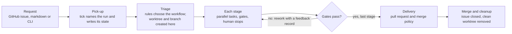

# Software factory phase 1 design

Nov 14, 2026 · @gohleemarble

Phase 1 spec for a reusable software factory, organized by module. Each module states what it owns, its files, its rules, and which parts run without an LLM.

This file is the overview: the vision, principles, decisions made, the glossary and the module map. Every module has its own file under `modules/`, and the cross-cutting sections are under `shared/`. Items moved out of phase 1 are in [phase-2.md](phase-2.md).

## 1. Overview

The factory is a reusable kit that turns a request into reviewed work through a deterministic Python engine. LLM workers do only the bounded tasks a workflow assigns them.

**Vision**

- Not bound to an OS, an LLM or a harness. Phase 1 runs Claude on macOS and Linux. Codex and Windows follow in phase 2 (`docs/design/phase-2.md`).
- Minimal intrusion: a repo gets the `factory/` kit, the factory skills and a `.factory/` folder. An update replaces `factory/` and the skill shims only.
- Plugin-style workflows: stages adapt to the kind of work (bug fix, feature, new app, chore, research), and tasks inside a stage run in parallel.
- The engine runs outside any LLM harness and decides everything that can be decided by code.

**Principles**

1. The engine decides, the worker does the work. Only the engine starts tasks, moves stages and merges.
2. Every LLM output passes a deterministic gate before anything depends on it.
3. Every human stop is a file, so it can be answered from the dashboard, the CLI, a chat or an editor.
4. State is files: JSON for state, JSON Lines for logs, YAML for files people write.
5. A workflow must pass with helpers off before native helpers are allowed on.

### Module map

| # | Module | Owns | Uses an LLM |
| --- | --- | --- | --- |
| 3 | [Kit and configuration](modules/03-kit-and-configuration.md) | Layout, settings, worktree root, upgrades | No |
| 4 | [Intake and triage](modules/04-intake-and-triage.md) | `request.json` from CLI, markdown and GitHub; workflow choice | Only when rules cannot classify |
| 5 | [Workflows and plugins](modules/05-workflows-and-plugins.md) | Workflow YAML, stages, gates, plugins | No |
| 6 | [Engine core](modules/06-engine-core.md) | 6A state store (state files, locks, run scanner); 6B engine loop (scheduler, lifecycle, recovery) | No |
| 7 | [Git and GitHub operations](modules/07-git-and-github-operations.md) | Branches, worktrees, checkpoints, merges, pull requests, issue updates | No |
| 8 | [Gates, error handling and rework](modules/08-gates-error-handling-and-rework.md) | Retries, routing back, blocked runs | No |
| 9 | [Worker adapters and helpers](modules/09-worker-adapters-and-governed-helpers.md) | Launching Claude, helper rules, logs, usage | The workers are the LLM |
| 10 | [Skills](modules/10-skills.md) | Stage-to-skill mapping, lockfile, overrides | Skills are worker instructions |
| 11 | [Human stops](modules/11-human-stops.md) | Decision files, attention items, notifications, resume | No |
| 12 | [Live view and steering](modules/12-live-view-and-steering.md) | Log tail, notes | No |
| 13 | [Delivery](modules/13-delivery.md) | Pull request, merge policy, sinks, run summary | No |
| 14 | [Token tracking](modules/14-token-tracking.md) | Usage records and reports | No |
| 15 | [Dashboard](modules/15-dashboard.md) | Server, run scanner, React UI | No |
| 16 | [Drivers](modules/16-drivers.md) | CLI, router skill | The router skill runs inside a chat |
| 17 | [Housekeeping](modules/17-housekeeping.md) | Cleanup, archive, retention | No |
| 17A | [Language toolchains, lint and format](modules/17a-language-toolchains.md) | Toolchain profiles per language, detection, format and lint steps | No |

### Phase split

Phase 1 is delivered in two steps. The wave order in [section 20](shared/20-dependencies-and-plan.md) is the same for both; the split decides what each wave leaves out first.

| Area | Phase 1a (walking skeleton) | Phase 1b |
| --- | --- | --- |
| Harness | Claude, plus `CommandAdapter` and the fakes | - (Codex is phase 2) |
| Requests | CLI, markdown inbox and GitHub issues | - |
| Workflows | `_triage`, bug-fix, chore | feature, new-app, research |
| Gates, rework, human stops, notes, delivery, tokens, housekeeping | All | - |
| Merge policy | Chores auto-merge, the rest human review | More workflows added to `auto` from `history.jsonl` |
| Plugins | None | Plugins, hooks and `tasks_from` for plugins |
| MCP servers, practice packs | None | Both |
| Toolchains (17A) | Profile loader and the profiles the first target repos need | The other shipped languages |
| Dashboard | Read-only: overview, Needs you, run detail, usage, Show JSON. Answers go through `factory decide` and the other CLI commands | Writes: Submit, notes, retry, goto, skip, abort |
| Operating systems | macOS and Linux | Windows is phase 2 |
| Pilot repo | One `factory`-labelled chore or bug-fix issue in `plaktoz/test-adapters`, human merge | Feature work, once the feature workflow lands |

*Diagram: Architecture: drivers, engine core, adapters, skills*

*Diagram: Run lifecycle: request to merge, with the rework loop*

Every request follows this path. A stage repeats until its gates pass, and a failed gate sends the run back to an earlier stage with a feedback record. Human stops happen inside stages.

**Decisions made**

| Topic | Decision |
| --- | --- |
| Who owns the loop | Engine plus an interactive driver. Only the engine starts tasks; the router skill only calls the CLI. |
| Overlapping skills | One skill per stage, through `stages.map.yaml`. |
| Subagents | Engine plus native subagents, governed: declared, capped, logged and scope-checked. Claude Code has native subagents. |
| Skills | The factory writes its own headless skill for every stage. Upstream skills are reference only; they enter through `skills.lock` (empty by default) for plugins and overrides, with pinned refs and an allowlist. |
| Engine language | Python. |
| Dashboard | React, shipped as a prebuilt bundle and served by the engine. It scans run files in the factory home and re-reads only those that changed. |
| State format | JSON for state, JSON Lines for logs, YAML for files people write. |
| Decision file | One YAML file per human stop, plus a generated HTML decision page that gives the CLI command. |
| Naming | One request is one run, named `<slug>-<5 chars>` with hyphens everywhere, such as `new-color-q1w2e`. |
| Markdown submissions | Several files submitted together form one run. |
| Read-only runs | Detached worktree; a branch only when delivering into the repo. |
| Worktree location | Configurable root, such as `/home/me/dev/worktree/<repo>/<run id>`. |
| Merge policy | Small chores auto-merge when every rule passes; everything else needs human review. |
| Live view | Live log plus notes delivered at checkpoints, by restarting the worker from `progress.md`. Resuming a harness session and takeover come after phase 1. |
| Notifications | Source channel plus the dashboard; chat webhook optional and off by default; answering by GitHub comment in phase 2. |
| Spend control | Budget caps are on hold (KIV). Token use is tracked per attempt instead. |
| Run state | One copy in the factory home, \~/.factory/runs/\<repo key>/\<run id>/, keyed by the repo's remote. Worktrees hold only a link file. |
| Lint and format | The engine formats once, after a task's worker has stopped, and gates on lint at each join. Repo hooks run on the join commit and before push; checkpoints skip them and never format, so files do not change under a running worker. |
| Plugins | Tasks can be skills, commands, scripts or Python functions; plugins are hash-locked when enabled. |
| MCP servers | Defined once per machine, allowed per stage in the repo config. |
| Run ownership | The engine holds an OS file lock for its whole life. A crash releases it, a sleeping machine does not. Heartbeats are for display only. |
| Kit per run | The kit and config are snapshotted from the base branch when a run is created, and the run uses only the snapshot. |
| Dashboard access | Localhost, Host and Origin checks, and a per-session token. |
| Worker isolation | Tool allowlist, scrubbed environment, no GitHub token, and Claude Code's own sandbox on for every worker: reads of secrets denied, writes allowed only to the worktree and `$FACTORY_TASK_DIR`. `doctor` runs a canary each time. The factory writes no sandbox wrapper of its own. Residual risk stated in [module 9](modules/09-worker-adapters-and-governed-helpers.md). |
| Operating systems | macOS and Linux in phase 1. Windows in phase 2. |
| Harnesses | Claude only in phase 1. Codex is phase 2, and the adapter contract stays harness-neutral so it adds no workflow change. |
| Phases | Phase 1a is a walking skeleton; phase 1b adds the rest (see Phase split). |

### Shared sections

| # | Section | Holds |
| --- | --- | --- |
| 18 | [Shared contracts](shared/18-shared-contracts.md) | Package layout and ownership, shared types, conventions, CLI exit codes |
| 19 | [Error handling types](shared/19-error-handling-types.md) | The five handling types every module maps its failures onto |
| 20 | [Dependencies and plan](shared/20-dependencies-and-plan.md) | Dependency map, interface check, waves and integration tests |
| 21 | [Decisions and sources](shared/21-decisions-and-sources.md) | The phase 1 decisions and their interactions |
| A | [Operator walkthrough](shared/appendix-a-operator-walkthrough.md) | From a clean machine to a merged fix |

## 2. Glossary

One word per idea, used the same way in the engine, the workflows, the CLI, the dashboard and this doc. The words job and card are retired.

| Term | Meaning | Do not call it |
| --- | --- | --- |
| Request | What you submit: CLI text, a GitHub issue, or one or more markdown files. Normalized into `request.json`. | ticket, card, task |
| Run | The execution of one request. One run has one worktree and, when it writes to the repo, one branch, both named `<slug>-<5 chars>`. | job, card |
| Workflow | The YAML definition of the stages for a kind of run, such as bug-fix or research. | pipeline |
| Stage | An ordered step of a workflow. It holds tasks, a join rule, gates and an optional approval. | phase, lane |
| Task | The unit of work inside a stage. Tasks in one stage can run in parallel. | job, step |
| Attempt | One worker session launched for a task. A retry or a restart makes a new attempt. | run |
| Retry | A new attempt of the same task after a worker error. | rework |
| Rework | Routing a run back to an earlier stage after a gate fails, with a feedback record. | retry |
| Feedback record | The failure details handed to the stage a run is routed back to. | error log |
| Blocked | A run status: retries or rework loops ran out and the run waits for a human. | failed (failed is final) |
| Worker | The headless LLM session that carries out an attempt, such as `claude -p`. | agent |
| Helper | A subagent a worker starts inside its own session, under the helper policy. | worker |
| Engine | The deterministic Python program that owns state, scheduling, gates and merges. It contains no LLM. | orchestrator |
| Adapter | Engine code for one worker (Claude, commands, fakes) or one tracker (file, GitHub). | driver |
| Driver | The way you operate the factory: the CLI or the router skill. | adapter |
| Skill | Instructions a worker follows for a stage, chosen through `stages.map.yaml`. | prompt |
| Plugin | A manifest that adds stages, tasks, gates or hooks to workflows without editing them. Its tasks can be skills, commands, scripts or Python functions. | extension |
| Gate | A deterministic check a stage must pass. | test (a test is one kind of gate) |
| Human stop | Any point where the run waits for you: an approval, a decision, a blocked run, a merge review. | pause |
| Approval | A human stop with the options approve, rework and reject. | review (review is a stage) |
| Decision | Your answer at a human stop, recorded in `decisions/<stage>.<n>.yaml`, where n counts the visits to that stage. | ADR (written after approval) |
| Attention item | The dashboard entry for a human stop. Listed under Needs you. | alert |
| Checkpoint | A safe point with a WIP commit and `progress.md`. Restarts resume from here. | save |
| Note | A steering message you queue for a task, delivered at the next checkpoint. | comment |
| Heartbeat | A timestamp the engine refreshes every 10 seconds while it owns a run. It is for display; it never decides who owns a run. | ping |
| Stale | A run whose status is `running` but whose engine process is gone, so nobody holds its lock. | failed |
| Lock | The file naming the engine process that owns a run. The engine holds an OS file lock on it for as long as the process lives, so a crash releases it and a sleeping machine does not. | — |
| Usage record | One line in `usage.jsonl` per attempt: requested and observed model, tokens, start, end, repo, branch, worktree. | cost |
| Merge policy | The rules in `merge-policy.yaml` that decide auto-merge or human review. | approval |
| Sink | Where a run's result goes: pull request, document or issue comment. | output |
| Run summary | `summary.md`, the final document every run produces. | report (a research deliverable) |
| Worktree | A separate git working folder for a run or a task. | clone |
| Worktree root | The configured folder that holds worktrees, such as `/home/me/dev/worktree`. | workspace |
| Dashboard | The local web page that shows every run across repos. | console |
| Factory home | `$FACTORY_HOME`, default `~/.factory`: machine config and every run's state, worktrees, archives and logs. Runs sit under `runs/<repo key>/<run id>/`. | registry |
