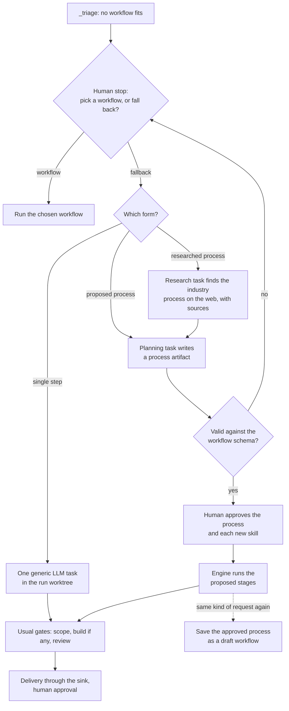

# Software factory phase 2 backlog

Items moved out of phase 1, with the design that was already written for them, so nothing has to be rediscovered. Each item says what phase 1 keeps so the item can be added later without a redesign.

| # | Item | Moved on | Phase 1 keeps |
| --- | --- | --- | --- |
| P2-1 | Codex worker adapter | 2026-11-14 | The `WorkerAdapter` contract, `capabilities`, `harness` and `routing` config keys, the `harnesses` map |
| P2-2 | Windows support | 2026-11-14 (D6) | `pathlib`, argument lists, no shell scripts in the engine |
| P2-3 | Answering a human stop by GitHub comment | Before review | Decision files, `factory decide` as the one check |
| P2-4 | Pilot repo: plaktoz/test-adapters | 2026-11-14 | Moved into phase 1a (P3); kept here as a pointer |
| P2-5 | Java application support | 2026-11-14 | The 17A toolchain profile format, with a Java profile (Maven and Gradle variants); the practice-pack mechanism of module 10 |
| P2-6 | React application support | 2026-11-14 | The 17A toolchain profile format, with a TypeScript and JavaScript profile detected by `package.json`; the practice-pack mechanism of module 10 |
| P2-7 | Python application support | 2026-11-14 | The 17A toolchain profile format, with a Python profile detected by `pyproject.toml`; the practice-pack mechanism of module 10 |
| P2-8 | Browser testing with Playwright, and UI diff | 2026-11-14 | The gate shape (`GateSpec`, `check`), the `run` step for the target app (P2-5 to P2-7), and the dashboard's Playwright tests in module 15 |
| P2-9 | Explore evals for workers, skills and workflows | 2026-11-14 | Fake adapters and recorded results for every module; the `helpers off` fallback that gives the same gate evidence; token and model records in `usage.jsonl` |
| P2-10 | A fallback for requests no workflow handles, including work that is not software (a wireframe, a customer slide deck) | 2026-11-14 | `tasks_from` and the check that generated tasks match the workflow schema (module 5); the `research` workflow; MCP web search per stage (module 9); `skills.lock` (module 10); the `sink` key; the `_triage` human stop with candidate workflows (module 4); gates, scope and the sandbox for every task |
| P2-11 | Architecture review: assess whether more deterministic layers are needed | 2026-11-15 | The engine as a deterministic driver; gates (`GateSpec`, `check`), the sandbox and scope rules, schema-checked state files, human stops, fakes for every module |

Phase 1b items (Codex used to be one) are in the [Phase split](phase-1.md#phase-split) table of the main spec. Phase 2 is after phase 1b.

## P2-1 Codex worker adapter

**Why it moved.** Phase 1 proves the core loop on one harness. A second harness doubles the adapter tests, the isolation checks (D7, D8) and the live smoke tests before the loop itself is proven. Its usage output was also never confirmed.

**What phase 1 keeps so Codex is cheap to add.**

- `WorkerAdapter` ([module 9](modules/09-worker-adapters-and-governed-helpers.md)) is harness-neutral. A Codex adapter implements `check`, `start`, `wait` and `stop` and declares `capabilities`.
- `harness:` in `factory.yaml`, `routing:` per stage and the `harnesses:` map in the machine file stay. Phase 1 accepts only `claude` and fails fast on any other value with "Codex is phase 2".
- Workflows never name a harness, so adding one changes no workflow file.
- The helper policy is stated in plain words in every prompt ([module 9](modules/09-worker-adapters-and-governed-helpers.md)), which Codex needs because it delegates only when asked.
- `generate_shims` takes a list of harnesses; phase 1 passes `["claude"]`.

**Design already written** (moved from [phase 1 module 9](modules/09-worker-adapters-and-governed-helpers.md) unless noted)

|  | Claude adapter (phase 1) | Codex adapter (phase 2) |
| --- | --- | --- |
| Headless run | `claude -p` with the task prompt, JSON output | `codex exec` with the task prompt, JSON events |
| Skills location | `.claude/skills/factory-*`, generated by the shim | `.agents/skills/factory-*`, linked by the shim |
| Rules file | `AGENTS.md`, imported by `CLAUDE.md` | `AGENTS.md` |
| Native helpers | Claude Code subagents | Codex subagents, on by default; spawned only when the prompt, `AGENTS.md` or a skill asks |
| Usage data | From the JSON result | From the event stream (to confirm) |
| Live log | Parsed into plain-text `worker.log` | Parsed into plain-text `worker.log` |
| Write boundary | Claude Code's sandbox settings (`sandbox.filesystem.allowWrite`, D7) | Workspace-write sandbox, with `$FACTORY_TASK_DIR` as an extra writable root |
| MCP config | JSON MCP config per attempt | `mcp_servers` entries as `-c` config overrides per attempt |
| Isolation from your setup | `--setting-sources project --strict-mcp-config` (verified) | A `-p` profile or a factory-owned `CODEX_HOME` (to verify) |

```yaml
# ~/.factory/config.yaml   (machine file)
harnesses:
  codex:
    command: codex
    model: ${FACTORY_CODEX_MODEL:-gpt-5-codex}
    env:
      OPENAI_API_KEY: ${OPENAI_API_KEY:?set OPENAI_API_KEY or run codex login}

# .factory/config/factory.yaml   (repo, routing only)
routing:
  stages:
    review-standards: {harness: codex}
```

```python
# adapters/worker/codex.py
class CodexAdapter(WorkerAdapter): ...           # name = "codex"
```

**What is known** (checked 2026-11-14 on codex-cli 0.164.0): `codex exec` has `-c key=value` config overrides, `-s` sandbox, `-p` profile, `-m` model and `--strict-config`.

**To confirm before building**

- [x] Where `codex exec --json` reports input and output tokens, and in what shape ([module 14](modules/14-token-tracking.md) records `null` until then). Verified: the last `turn.completed` event's `usage` holds `input_tokens` and `output_tokens`, with `cached_input_tokens` and `reasoning_output_tokens` beside them, and the event stream names no model. Test: `tests/workers/test_codex_adapter.py::test_tokens_come_from_the_last_turn_completed_usage`.
- [ ] Which flags keep your own `~/.codex` config, MCP servers and instructions out of a worker. Prove it with the `doctor` probe worker ([module 9](modules/09-worker-adapters-and-governed-helpers.md)). Partly answered, not ticked: `--ignore-user-config` drops the user's provider and `CODEX_HOME` is an empty folder, so no login or config is read. No test shows that a user's MCP servers stay out of a worker, and the `doctor` probe is Claude-only, so no Codex probe exists yet.
- [x] Whether the sandbox enforces the deny-read rules from D7. Verified for `srt`: a sandboxed `cat` and `python3` fail to read a file in the factory home and a `~/.codex/auth.json`, and a write outside the worktree and task folder is refused. Test: `tests/workers/test_codex_adapter.py::test_the_codex_settings_block_reads_of_the_factory_home_and_the_codex_key_file`. Codex's own sandbox is off, so `srt` is the only layer.

**Acceptance criteria to add back to phase 1 modules**

- [x] (9) Both adapters run headless in the task worktree, with only the declared environment plus `FACTORY_TASK_DIR`. Codex: `tests/workers/test_codex_adapter.py::test_the_worker_runs_headless_in_the_task_worktree`, `::test_the_child_gets_only_the_declared_variables_and_the_folders_the_adapter_sets`. Claude: `test_claude_adapter.py` of the same name. Both run against stubs, not the live CLI.
- [ ] (9) The same request on Claude and Codex gives gate evidence of the same shape, with helpers off and on.
- [ ] (20) A live smoke test on Claude, then Codex, with `FACTORY_LIVE=1`: the same seeded request gives gate evidence of the same shape.
- [ ] (16) The router skill works from Codex as well as Claude Code.

**Sources**

- [Codex subagents](https://developers.openai.com/codex/subagents): enabled by default in current releases; spawned only when asked directly or by `AGENTS.md` or skill instructions.
- [Codex subagent concepts](https://developers.openai.com/codex/concepts/subagents)

## P2-2 Windows support

Decided in D6. Phase 1 marks each Windows-only rule "(phase 2)" in place: Task Scheduler install, `.bat` and `.ps1` handling, retrying atomic replaces, `msvcrt` locking in place of `flock`, `%USERPROFILE%` paths.

## P2-3 Answering a human stop by GitHub comment

Decided before the review ([phase 1 decisions](shared/21-decisions-and-sources.md), question 5). Phase 1 links GitHub comments to the local dashboard and the CLI command; answering by comment closes the gap for phone access.

## P2-4 Pilot repo: plaktoz/test-adapters

Moved into phase 1 on 2026-11-14. The pilot starts in phase 1a with one `factory`-labelled chore or bug-fix issue and a human merge (decision P3); feature work follows in 1b. Nothing here is built in phase 2. The decisions are in [phase 1 decisions](../reviews/phase-1-decisions.md#pilot-repo-decisions-p1-to-p4).

Repo: https://github.com/plaktoz/test-adapters. Python, standard library only at runtime, GitHub Issues as the tracker, one check command (`scripts/check`). Its open tasks (T13 to T20) are jest feature work, which needs the phase 1b feature workflow.

| Repo rule | Where the spec meets it |
| --- | --- |
| No model override | [Module 9](modules/09-worker-adapters-and-governed-helpers.md) and [module 14](modules/14-token-tracking.md): no model flag unless config sets one; observed models recorded |
| Owner approves each task | [Module 13](modules/13-delivery.md): `auto.workflows: []` in the repo's `merge-policy.yaml` |
| No commit without a request | [Module 7](modules/07-git-and-github-operations.md): local checkpoints, only the join commit is pushed |
| Worktree comparison before removal | [Module 17](modules/17-housekeeping.md): `cleanup_check` |

The live pilot test is in the [integration tests](shared/20-dependencies-and-plan.md).

## Stack support: P2-5 to P2-7

The factory is meant to build and change Java, React and Python applications. Each of the three entries below covers the whole process for its stack: **lint, build and run**. Each also lists one **principles file** under `factory/stacks/` as a deliverable. The engine loads that file as context while it develops code for that stack, so generated code follows good design for the stack.

Rules that apply to all three entries:

- **No reference to `docs/`.** `factory/` is the kit that is copied into other repos, so nothing in it may reference this repo's `docs/` (rule in `AGENTS.md`). Each principles file must be self-contained and must not link or point into `docs/`. The links on this page are fine because this page is in `docs/`.
- **Principles files are not drafted here.** This backlog lists them as deliverables only. Filenames are Unspecified; one file per stack, for example one each for Java, React and Python.
- **Loading is Unspecified.** How the engine loads a principles file (by prompt pointer, by inclusion in the worker context, or by stage) is to be decided. Whether `factory/stacks/` is separate from the practice packs of [module 10](modules/10-skills.md) or replaces them is also to be decided (see the open question below).
- **Tool names come from 17A or are Unspecified.** The commands named below are the defaults already written in [module 17A](modules/17a-language-toolchains.md). Anything that module does not state is marked Unspecified.
- **"Run" is new.** The 17A profile has `format`, `format_check`, `lint`, `test` and `build` steps and no `run` step. `run_step` in the 17A contract accepts only those five. A run step, and what "run" means for each stack (start a server, a dev server or a CLI), is to be decided.
- **"Lint, build and run" is the engine's process.** That means the engine can detect the stack, run lint on changed files, build, and run the result in the task worktree, with the evidence recorded as gate evidence. The workflow and gate shapes for build and run are Unspecified.

**Open question for the owner (applies to P2-5 to P2-7).** [Module 10](modules/10-skills.md) already specifies per-language practice packs under `factory/skills/own/practices/` (`java/`, `typescript/`, `python/`, and others), chosen by 17A's `detect`, loaded by pointer, with a size limit, in phase 1b. `factory/stacks/` could be that same mechanism under a new name, a layer on top of it, or a replacement. Decide before building so there is one place for per-language guidance. Adding `factory/stacks/` to the layout table in `AGENTS.md` is part of the work, and is not done here.

### P2-5 Java application support

**Why it moved.** Phase 1 proves the core loop with the profiles the first target repos need (the pilot repo is Python). Java is a shipped profile but is not part of the first walking skeleton ([phase split](phase-1.md#phase-split), "Toolchains (17A)").

**What phase 1 keeps so Java is cheap to add.**

- The 17A profile format and loader, including the Java profile with Maven and Gradle variants (`pom.xml`, `build.gradle`, `build.gradle.kts`).
- The default tools in 17A: Spotless (google-java-format) to format, Checkstyle or PMD to lint, Maven or Gradle to test. `build` is `mvn -q -DskipTests package` for Maven and `gradlew assemble` for Gradle.
- The module 10 practice-pack mechanism, with `java/` named as an example pack.

**Process to cover.**

| Step | Source |
| --- | --- |
| Lint | 17A: `lint-clean` gate runs `format_check` and `lint` on changed files; findings route to rework |
| Build | 17A: `build` step of each variant |
| Run | Unspecified (for example, how to start a Spring or plain Java application, and how to stop it) |

**Deliverables.**

- [ ] The Java profile is verified end to end (lint, build, run) on a fixture repo for Maven and for Gradle.
- [ ] A run step for Java, with its command per variant. Unspecified.
- [ ] A Java principles file under `factory/stacks/` (name Unspecified): good design and principles for Java, loaded as engine context during development. Self-contained; no reference to `docs/`.
- [ ] `factory doctor` reports a missing Java tool or build plugin (such as Spotless) before a run, as 17A already requires.

**To decide.** Framework coverage (module 10 names a `spring.md` topic file read only when Spring is detected). Java and JDK version policy. Both Unspecified.

### P2-6 React application support

**Why it moved.** Phase 1 ships a TypeScript and JavaScript profile, but nothing in the spec is specific to React as an application stack.

**What phase 1 keeps so React is cheap to add.**

- The 17A profile format and the TypeScript and JavaScript profile, detected by `package.json`. Default tools in 17A: Prettier to format, ESLint to lint, `npm test` to test.
- The module 10 practice-pack mechanism, with `typescript/` named as an example pack.
- The factory's own dashboard is a React bundle, but it is shipped prebuilt and is not a target application.

**Process to cover.**

| Step | Source |
| --- | --- |
| Lint | 17A: ESLint and Prettier check on changed files, through the `lint-clean` gate |
| Build | Unspecified. The 17A table gives no build command for TypeScript or JavaScript. The bundler and build script are to be decided |
| Run | Unspecified (for example, a dev server for a running check, or serving the built output) |

**Deliverables.**

- [ ] A way to tell a React application from other `package.json` projects. Unspecified; the phase 1 profile detects `package.json` only, so React needs its own detection rule or a variant of the existing profile.
- [ ] A build step and a run step for React, with commands. Unspecified.
- [ ] Lint, build and run verified end to end on a fixture React repo.
- [ ] A React principles file under `factory/stacks/` (name Unspecified): good design and principles for React, loaded as engine context during development. Self-contained; no reference to `docs/`.
- [ ] `factory doctor` reports a missing tool before a run.

**To decide.** Whether React builds on the TypeScript profile or has its own. Package manager, test runner beyond `npm test`, and browser-level checks are Unspecified.

### P2-7 Python application support

**Why it moved.** The engine itself and the pilot repo are Python, but the pilot repo uses its own `scripts/check` ([P2-4](#p2-4-pilot-repo-plaktoztest-adapters)). Supporting Python as a target application stack, with the shipped profile, is a separate piece of work.

**What phase 1 keeps so Python is cheap to add.**

- The 17A profile format and the Python profile, detected by `pyproject.toml`. Default tools in 17A: `ruff format` to format, `ruff check` to lint, `pytest` to test.
- The module 10 practice-pack mechanism, with `python/` named as an example pack.

**Process to cover.**

| Step | Source |
| --- | --- |
| Lint | 17A: `ruff format` check and `ruff check` on changed files, through the `lint-clean` gate |
| Build | Unspecified. The 17A table gives no build command for Python (and a pure script project may have none) |
| Run | Unspecified (for example, a console entry point, a module, or a web server) |

**Deliverables.**

- [ ] Detection beyond `pyproject.toml`, if needed (for example, repos with no `pyproject.toml`). Unspecified.
- [ ] A build step and a run step for Python, with commands. Unspecified.
- [ ] Lint, build and run verified end to end on a fixture Python repo.
- [ ] A Python principles file under `factory/stacks/` (name Unspecified): good design and principles for Python, loaded as engine context during development. Self-contained; no reference to `docs/`.
- [ ] `factory doctor` reports a missing tool before a run.

**To decide.** Environment and dependency tooling for the target app (virtual environment, lock file, installer). Python version policy. Both Unspecified. The factory engine's own pinned environment ([module 3](modules/03-kit-and-configuration.md)) is separate and must not be reused for target apps.

## Browser testing: P2-8

### P2-8 Playwright browser tests and UI diff

**Why it moved.** Phase 1 checks a target app with its own commands (lint, build, tests). It cannot see what the app looks like in a browser, so a change that breaks a page can pass every gate. Module 15 already uses Playwright for the factory's own dashboard. This item extends the same tool to the target app, and adds a diff of the page against an approved picture.

**What phase 1 keeps so this is cheap to add.**

- A gate is a `GateSpec` with a `check` or a `cmd` ([section 18](shared/18-shared-contracts.md)). A UI diff is a check that reads a result file, so it needs no new gate kind.
- The `run` step that starts the target app ([P2-5](#p2-5-java-application-support) to [P2-7](#p2-7-python-application-support)) is where the app is served for the browser to open.
- Module 15's "UI tests with Playwright against the same fixtures" shows the tool is already part of the plan.
- Browser binaries are installed by a command, not by the engine. Phase 1 does not install them.

**What is known** (checked 2026-11-14 on `@playwright/test` 1.65.1, node 26.13.0):

- `expect(page).toHaveScreenshot()` compares a screenshot with a stored baseline. Its options include `maxDiffPixels` and `maxDiffPixelRatio` (tolerance for anti-aliasing and small rendering changes).
- The Chromium build the package expects is cached on this machine (`chromium-1243`). Other browsers are not checked.
- The package's `engines` field is `node >=20`, which is below the factory's Node 26.

**Process to cover.**

| Step | Source |
| --- | --- |
| Start the app | `run` step of the target's profile (P2-5 to P2-7). Unspecified for each stack |
| Browser flows | Playwright tests the target repo already has, or the factory's own flow files. Unspecified which |
| Screenshot compare (UI diff) | `toHaveScreenshot` against baselines committed in the repo |
| Report | A diff image and a JSON summary per page, written to `$FACTORY_TASK_DIR`, read by a gate (see Deliverables) |
| Review of a change | A human approves the changed baselines in the PR, as with any other change to the repo |

**Deliverables.**

- [ ] A check, `ui-diff`, that reads the Playwright JSON report and fails when a page differs by more than its tolerance. Its result goes through `GateResult` like the other checks.
- [ ] A rule for where baselines live (in the target repo, next to its tests) and who updates them. Unspecified.
- [ ] Browser install step in the target's `run` or setup, with the version pinned. Unspecified.
- [ ] A screenshot of each changed page is attached to the PR and shown on the dashboard. Unspecified how the dashboard shows it.
- [ ] Lint, build, run and the UI diff verified end to end on a fixture web app (one React, one plain HTML) with a planted visual change that the gate must fail.

**To decide.**

- Whether the UI diff is a gate that blocks, or a report that asks for review. Unspecified.
- The tolerance default (`maxDiffPixelRatio`) and whether it differs per page. Unspecified.
- Which browsers to cover. Only Chromium is checked on this machine. Unspecified for Firefox and WebKit.
- Whether baselines are regenerated by the factory or only by a person. Unspecified.
- Whether Playwright is a required dependency of the kit, or only of a target app that uses it. Unspecified; the engine itself does not depend on it.

**Sources**

- [Playwright visual comparisons](https://playwright.dev/docs/test-snapshots): `toHaveScreenshot`, `maxDiffPixels` and `maxDiffPixelRatio`.

## Evals: P2-9

### P2-9 Explore the use of evals

**What this is.** An exploration, not a build. The question is whether evals (a set of cases, each with a prompt and graders that score what a worker or skill produced) would tell the factory something its gates and tests cannot: how well an LLM worker does a task, and whether a change to a skill, a prompt or a model makes it better or worse. Phase 1 tests the engine with fakes and checks each run with gates. Neither measures worker quality over many runs.

**Two meanings of "eval", kept apart.**

| Meaning | In scope for this item | Why |
| --- | --- | --- |
| Evals as scored tests of LLM behavior (cases, graders, scores) | Yes | This is the exploration |
| `eval()`, running a string as code | No, and the factory must not use it | The spec uses argument lists with no shell (module 3), a safe YAML loader (module 3) and checks that run in a separate process (module 5). Dynamic code from a request, an issue body or a worker would bypass all three |

**What phase 1 keeps so this is cheap to add.**

- Every worker adapter has a fake with scripted results ([module 9](modules/09-worker-adapters-and-governed-helpers.md)), so the engine can be tested without a model. Evals test the model side only.
- `usage.jsonl` records the observed model, tokens and exit of each attempt ([module 14](modules/14-token-tracking.md)), so a score can be tied to a model and a cost.
- A workflow must pass with helpers off before native helpers are switched on ([module 9](modules/09-worker-adapters-and-governed-helpers.md)), which gives a baseline to compare against.
- Gate evidence has one shape per stage (`GateResult`), so a grader can read it like a gate does.

**What is known** (checked 2026-11-14 on Claude Code 2.1.325):

- Claude Code has `claude plugin eval`. It runs `case.yaml` files (or a `prompt.md` with `graders/*.md`) from an `evals/` folder against a plugin, and reports scored results.
- It can run a no-plugin baseline arm and report the score difference (`--ablation with-without`), repeat each case (`--runs`, default 3), cap spend (`--max-cost-usd`) and write JSON (`--json`) or an HTML report (`--report`).
- Grader model defaults to Haiku (`--judge-model`). Every run is a full `claude` child on your own credential, so runs share one rate limit.
- By default it also publishes the HTML report to claude.ai when the account supports it. A factory use must switch that off (`--no-publish`), because a report holds prompts and outputs from a private repo.
- It runs author-supplied scaffold scripts and real MCP servers only when asked (`--scaffold`, `--allow-real-servers`). They run as the user, outside the OS sandbox that confines shell tools.
- Whether `claude plugin eval` can score the factory's own skills (`factory/skills/own/`) is Unspecified: the factory's skills are not packaged as a Claude Code plugin.

**Proposed use, by impact.** This is a recommendation from reading the stages in modules 4, 5, 8, 9 and 14. No eval has been run yet, so the order is a judgment, and the trial below is how to test it. Each target is ranked on three things: how bad it is if the model is wrong and nothing catches it, how much a deterministic gate already covers it, and how cheaply it can be graded. An eval is worth its cost only where a gate cannot see the error.

| # | Target | Why it ranks here | Case and grader |
| --- | --- | --- | --- |
| 1 | Reviewers (`review-standards`, `review-spec`) | They are the last LLM check before a human merge, and a repo can allow auto-merge ([module 13](modules/13-delivery.md)). The `no-blocking-findings` gate trusts the findings JSON, so a reviewer that misses a defect passes silently | A diff with a planted defect (a bug, a scope escape, a missed spec line), plus clean diffs. A code grader checks that a finding cites the planted file and line. It measures recall and false alarms and needs no LLM judge |
| 2 | Model drift: a regression suite run on a schedule | A repo can set no model override (see [P2-4](#p2-4-pilot-repo-plaktoztest-adapters)), so the model changes when the harness default changes. [Module 14](modules/14-token-tracking.md) records the observed model, but nothing checks that quality held | The cases of targets 1, 3 and 4, run on a schedule and after any new model name appears in `usage.jsonl`. Compare each score with the last run |
| 3 | `root-cause` | `evidence-cites-code` checks that the cited code exists, not that it is the cause. A wrong cause sends the run through `fix` and back, up to the loop limit | A fixture repo with a known planted bug. A code grader checks that the named file and function match |
| 4 | `triage` classify | A confident wrong type runs the whole wrong workflow. The human stop catches only a score under 0.8 ([module 4](modules/04-intake-and-triage.md)) | Requests with a known type. A code grader checks the exact match, and checks that confidence is low when the answer is wrong. This is the cheapest suite |
| 5 | Resistance to planted instructions | The sandbox and `scope-diff` are the main defense. The eval tests the model side. It matters more if [P2-10](#p2-10-a-fallback-for-requests-no-workflow-handles) feeds web text into plans | An issue body or page with a planted instruction. A code grader checks that a canary file was not written and that the plan has no new task |
| 6 | `fix` and `feature` workers | Build, test and scope gates already catch failures, so an eval adds the first-pass rate and the cost per run, not hidden errors | The pilot repo's issues. Score from `GateResult` and `usage.jsonl` |
| 7 | Research claims | `every-claim-has-source` checks that a source exists, not that it supports the claim. Grading support needs an LLM judge, which adds its own error | A rubric judge. Do this last |

**Not worth an eval.** `scope-diff`, `lint-clean`, schema checks and the helpers ledger are deterministic, so ordinary tests cover them. An eval on them costs tokens and adds nothing.

**Where an eval answers what the existing checks cannot.**

- **A change to a skill or a prompt.** Run the suite on the old and the new version. Do not ship the change if the score drops.
- **Helpers on and off.** [Module 9](modules/09-worker-adapters-and-governed-helpers.md) already requires the same gate evidence in both modes. An eval shows whether quality and cost also match.
- **A model for each stage.** With `routing:` a cheaper model can go on a stage only if its score holds.

**Proposed runner (a recommendation; the tool question below stays open).** The factory's skills are not packaged as a Claude Code plugin, so `claude plugin eval` may not score them. A thin factory runner would call the real worker adapter in a fixture worktree. It would keep the sandbox, write `usage.jsonl` for the cost, and work unchanged for a Codex adapter ([P2-1](#p2-1-codex-worker-adapter)). Results are stored locally and are not committed.

**Questions to answer.**

- [ ] What would a case be? A seeded request plus its expected gate result, or an artifact checked against a schema, or a rubric on a report. Unspecified. Proposed: a fixture repo and a request, graded by code (see the table above).
- [ ] Which workers and stages need scores first (for example `triage` classification, `root-cause`, `review-standards`)? Unspecified. Proposed order: the table above, reviewers first.
- [ ] Are code-based graders (a schema check, a test that must pass) enough, or is an LLM judge needed? An LLM judge adds its own error and cost. Unspecified.
- [ ] How to score a change: run the same cases with the old and the new skill, prompt or model, and compare. Where the baseline lives. Unspecified.
- [ ] What it costs: `usage.jsonl` gives tokens per attempt, so a suite's cost can be estimated before it runs. Budget and cap. Unspecified.
- [ ] Where results are stored, and whether they are committed. Results can contain private prompts, so the default is not to publish and not to commit. Unspecified.
- [ ] Whether an eval runs in CI, on a schedule, or only on request. Unspecified.
- [ ] Whether the existing tool (`claude plugin eval`) is enough, or the factory needs its own runner so evals also cover a future Codex adapter ([P2-1](#p2-1-codex-worker-adapter)). Unspecified.
- [ ] How evals relate to the live smoke test (`FACTORY_LIVE=1`) and the pilot in [section 20](shared/20-dependencies-and-plan.md). Unspecified.

**Deliverable.**

- [ ] A short written finding, with a small trial: one case set for one stage, run through the chosen tool, with the score, the cost and a decision on whether to build evals into the factory. The trial must use `--no-publish` and sandboxed tools only.
- [ ] Proposed trial: the reviewers (target 1). Ten to twenty cases, half with a planted defect and half clean, graded by code. The finding reports recall, false alarms and the cost from `usage.jsonl`.
- [ ] If the trial is useful: a decision on a scheduled run of the regression suite (target 2), with its budget cap.

**Not decided here.** The format of a case, the graders, the runner and the storage. Nothing in phase 1 changes.

## Fallback workflow: P2-10

### P2-10 A fallback for requests no workflow handles

**Why.** Phase 1 has five built-in workflows (bug-fix, feature, new-app, chore, research) and the plugins a repo enables ([module 5](modules/05-workflows-and-plugins.md)). A request that fits none of them has no path today: triage cannot resolve a type, and the run stops at a human with the candidate workflows as options ([module 4](modules/04-intake-and-triage.md)). The factory should still be able to take on future kinds of work that no workflow was written for.

**Scope: work that is not software.** The fallback is also how the factory covers work outside software development. Two examples: a design task that needs a wireframe, and a customer slide deck. No built-in workflow covers either. The factory researches the industry process for that kind of work, proposes a workflow, and a human approves it. The approved workflow can then be saved and reused. Widening the factory from software work to any work is a change of scope, so it needs a new ADR before it is built (see Questions). Until that ADR exists, nothing here is built.

**What phase 1 keeps so this is cheap to add.**

- `tasks_from` builds a stage's task list from an earlier artifact at run time, and the engine checks the generated tasks against the workflow schema before any worker starts ([module 5](modules/05-workflows-and-plugins.md)). A proposed process is the same kind of generated list.
- The built-in `research` workflow (scope, gather, synthesize, critique, with an `every-claim-has-source` gate) is the base of the research step. MCP servers such as Tavily are allowed per stage and work with the sandbox on ([module 9](modules/09-worker-adapters-and-governed-helpers.md)), so a planning task can search the web with no new network rule.
- `skills.lock` is the one way an upstream skill enters, with a pinned ref and an allowlist ([module 10](modules/10-skills.md)). Skills that make a wireframe or a slide deck enter the same way.
- Workflows are looked up in `.factory/config/workflows/` before `factory/workflows/` ([module 5](modules/05-workflows-and-plugins.md)), so an approved process saved there is found by the next triage with no engine change.
- The workflow `sink` key has the values `pull_request`, `doc` and `comment`. A new value is a small addition.
- Every task, however it was made, runs with its scope, deny paths, gates and the sandbox ([module 9](modules/09-worker-adapters-and-governed-helpers.md)). A proposed process gets no exception.
- The `_triage` stage already ends at a human stop when it is unsure ([module 4](modules/04-intake-and-triage.md)). That stop is where the fallback starts.

**Three forms, to choose between or to offer together.**

| Form | What happens | Good for | Cost |
| --- | --- | --- | --- |
| Single LLM step | One task with one generic skill does the whole request in the run worktree, then the usual gates run (scope, build if any, review) | Small, one-off work | Least structure: one long attempt, one artifact |
| Proposed process | A planning task writes a process (stages, tasks, scopes, gates) as an artifact. The engine checks it against the workflow schema, a human approves it, then the run continues with those stages | Larger or repeated work in a kind of work the factory already has skills for | A planning step and an approval before any change |
| Researched process | The planning task first researches the industry process for this kind of work on the web, with sources. It writes a process artifact and lists any skill it needs that is not yet in `skills.lock`. A human approves the process and each new skill, then the run continues. The approved process can be saved as a workflow | Work the factory has no workflow or skill for, such as a wireframe or a customer slide deck | A research step, an approval, and a review of each new skill before any change |



**The wireframe and slide deck examples.** The research step can find a process such as discover, define, sketch, review and deliver. The workflow only puts skills in order. No skill in phase 1 makes a wireframe or a `.pptx` file, so these requests need three things that a software workflow does not:

- **Skills for the output.** A skill that writes the file. It enters through `skills.lock` with a human approval of the pinned ref. Check each license yourself. Unspecified which upstream skills to use.
- **Gates that fit the output.** Scope-diff, build and tests mean little for a slide deck. Candidate gates: a schema check on the plan, a check that the file opens and renders to images, and a human review of the rendered pages. The rendering step may share work with [P2-8](#p2-8-playwright-browser-tests-and-ui-diff). Unspecified.
- **A place to deliver to.** A customer slide deck usually does not belong in the code repo. Phase 1 has the sinks `pull_request`, `doc` and `comment`. A new sink, for example a folder outside the repo or an upload to a drive, is Unspecified.

**Rules any fallback must keep.**

- The fallback starts only from the human stop, never by itself. A request that a workflow can handle never takes the fallback.
- A proposed process is data, not code. It is a list of stages and tasks in the workflow format, checked by the same schema and `validate_workflow` rules. It cannot add a check, a script or a plugin that is not already enabled.
- A proposed process may name a skill that is not in `skills.lock`, but only as a request. The skill is not used until a human approves its pinned ref and allowlist, in the same way as any other upstream skill ([module 10](modules/10-skills.md)). A process cannot carry its own skill text or script.
- Every proposed task has a scope. A task with no scope is refused.
- The run always ends with a human approval. A fallback run never auto-merges ([module 13](modules/13-delivery.md)). For a sink that is not a pull request, the human approves the delivery itself.
- The process a human approved is stored with the run, so the run can be replayed and audited.

**Rules for the research step.** Web pages are untrusted input. A page can contain text that tells the worker what to do, and the result feeds a plan that the engine then runs.

- The research and planning tasks have no write access outside `$FACTORY_TASK_DIR`. They search through MCP only. The sandbox network rules of [module 9](modules/09-worker-adapters-and-governed-helpers.md) stay as they are.
- The plan is data, checked against the schema, so a page cannot add a script or a check through it.
- Every step of the plan lists its sources. The `every-claim-has-source` gate of the `research` workflow applies, and the approval screen shows the sources next to the plan.
- A human approves the plan before any stage that writes starts. This approval is not optional for this form.

**Turning a fallback into a workflow.** When the same kind of request takes the fallback more than once, the approved process is a draft for a new workflow or plugin. The draft is saved to `.factory/config/workflows/` only after a human approves it, with its sources and the date of the research stored beside it. A saved workflow is found by triage on the next request of the same kind, and a source can go out of date, so the draft records when it was researched. Who promotes a draft from one repo into the shipped `factory/workflows/`, and when, is Unspecified.

**Questions to answer.**

- [ ] Whether the factory takes on work that is not software at all. This changes the stated purpose of the factory ("a reusable software factory" in `AGENTS.md`), so it needs a new ADR in [phase 1 decisions](../reviews/phase-1-decisions.md) before any of this is built. The ADR should say which kinds of non-software work are in scope (wireframes and design work, customer slide decks, other documents) and which are not. Unspecified.
- [ ] Which upstream skills make a wireframe or a slide deck, their licenses, and whether the factory ships its own instead. Unspecified.
- [ ] The gates for output that is not code (a plan schema, a render check, a human review of the rendered pages), and which of them block. Unspecified.
- [ ] The sink for output that does not go in the code repo, and where the file is stored. Unspecified.
- [ ] Which search tools the research step may use, how many sources it needs for each step, and how it ranks them. Unspecified.
- [ ] Whether to build one form, two, or all three, and how a human chooses at the stop. Unspecified.
- [ ] The generic skill for the single step: its instructions, its output schema and its gates. Unspecified.
- [ ] The planning skill for the proposed process, and the schema of its artifact. Whether it is the workflow schema itself or a subset. Unspecified.
- [ ] Which gates are always added to a fallback run, whatever the plan says (for example scope-diff and a review stage). Unspecified.
- [ ] Limits: the most stages and tasks a proposed process may have, and its timeout and token budget. Unspecified.
- [ ] How the fallback appears on the dashboard and in the run summary. Unspecified.

**Deliverables.**

- [ ] A fallback path from the `_triage` human stop, with the chosen form or forms.
- [ ] Tests that a request no workflow handles reaches the fallback only through the human stop, that a proposed process failing the schema returns to the stop, and that a fallback run never auto-merges.
- [ ] If the researched process is built: a test that text planted in a fetched page cannot add a task, a skill, a check or a script to the plan, and that a plan naming a skill that is not in `skills.lock` waits for approval.
- [ ] If the researched process is built: a saved draft workflow is found by triage on a second request of the same kind and runs without the fallback.
- [ ] A trial on one non-software request (a wireframe, then a short customer slide deck) that ends with a rendered output, its sources and a human approval, with the cost from `usage.jsonl`.
- [ ] A new ADR for the wider scope, written before the build starts.

## Architecture review: P2-11

### P2-11 Review the architecture for more deterministic layers

**What this is.** A review and an assessment, not a build. The factory's premise is a deterministic engine with LLM workers doing bounded tasks. The question is whether the design leaves places where a worker's output is trusted without a deterministic check, or where a worker does a job that code could do. For each place found, the review decides whether to add a deterministic layer. Nothing in phase 1 changes while this item is open.

**Why it is a backlog item.** Phase 1 was built to prove the core loop. Its deterministic parts are already in the spec: schema-checked state files, scope and deny rules, the sandbox, gates such as `scope-diff`, `lint-clean`, `no-blocking-findings`, `every-claim-has-source` and `evidence-cites-code` ([module 8](modules/08-gates-error-handling-and-rework.md)), and checks that run in a separate process ([module 5](modules/05-workflows-and-plugins.md)). Nobody has yet looked across all modules for what is still left to a worker's judgment. The review is better done after phase 1 runs on the pilot repo, because real runs show where a worker's output was wrong and no gate saw it.

**What phase 1 keeps so this is cheap to add.**

- A gate is a `GateSpec` with a `check` or a `cmd` ([section 18](shared/18-shared-contracts.md)), so a new deterministic check needs no new gate kind.
- Every module has a fake, so a new layer can be tested without a model.
- The decision log in [phase 1 decisions](../reviews/phase-1-decisions.md) records why each rule exists, so the review does not reopen a settled decision without a new ADR.

**Where to look (candidates, not findings).** This list is a starting point from reading the module titles. It has not been assessed, and some items may already be covered.

| Area | Question for the review |
| --- | --- |
| Worker output, trusted as written | Which artifacts does the engine accept after a schema check only? Is a check of meaning also possible by code (for example, a cited file and line exists in the diff)? |
| Jobs a worker does that code could do | Which stages use an LLM for a step with a rule that decides it (a type, a label, a branch name, a PR body from fields)? Module 4 already uses keyword rules before the `classify` task; are there others? |
| Checks before a worker starts | Is the request, the scope and the toolchain checked by code before tokens are spent? |
| Checks after a worker stops | Beyond scope and lint, is there a check for a change with no test, a changed dependency file, a secret in the diff, a generated file, or an edit to the factory's own files? |
| Review stages | A reviewer's findings feed the `no-blocking-findings` gate. Can a deterministic cross-check catch a reviewer that reports nothing on a diff that the checks flag? |
| Loops and limits | Are retry counts, timeouts, cost caps and rework limits all enforced by the engine and not left to a worker? |
| State and recovery | Does every state change pass through the one lock holder and a schema? Is there a check that run state and git state agree after a crash? |
| Human stops | Is each stop opened by a rule, and is the reason always one the engine can state? |

**Method.**

1. Read the module contracts and the acceptance criteria. For each LLM task, write down its input, its output and what the engine does with the output.
2. Mark each output as *checked by code*, *checked by schema only* or *not checked*.
3. Use the `usage.jsonl` and gate records from pilot runs ([P2-4](#p2-4-pilot-repo-plaktoztest-adapters)) to find real cases where a bad output passed. Weigh a proposed layer by those cases, not by what could go wrong.
4. For each proposed layer, state what it catches, what it costs (code, run time, false alarms) and whether it blocks or only reports.
5. Check the proposals against [P2-9](#p2-9-explore-the-use-of-evals). A layer code can check belongs here; a quality question that needs scored cases belongs there.

**Deliverables.**

- [ ] A short written finding that lists each LLM task, how its output is checked today, and the gap if there is one.
- [ ] A ranked list of proposed deterministic layers, each with what it catches, its cost, and blocks or reports.
- [ ] A decision for each proposal: build in phase 1b, build later, or reject with a reason. A proposal that changes a settled decision needs a new ADR first.
- [ ] For each layer chosen: the module file change and the acceptance criterion that tests it, written as for any other module.

**To decide.**

- Whether the review runs once, or on a schedule as the workflows grow. Unspecified.
- Who owns the finding (the owner, or a review agent with the owner's decision on each proposal). Unspecified.
- Whether a layer that blocks is allowed to be switched off per repo. Unspecified; D12 shows the cost of that kind of switch.
