# 20. Dependencies, interface check and implementation plan

Part of the [phase 1 design](../phase-1.md#shared-sections).

Modules are built in five waves (0 to 4) after the shared contracts are frozen, and every module in a wave can be built at the same time against fakes of its upstream modules. The interface check below found 17 gaps; all are fixed in the module contracts above.

*Diagram: Implementation waves, 0 to 4: which modules can be built together*

```mermaid
flowchart LR
  subgraph w0["Wave 0: freeze first"]
    a0["18 Contracts"]
    b0["18 Fakes"]
  end
  subgraph w1["Wave 1: foundations"]
    m3["3 Kit, config"]
    m6a["6A State store"]
    m7["7 Git, GitHub"]
    m10["10 Skills"]
    m14["14 Tokens"]
    m17a["17A Toolchains"]
  end
  subgraph w2["Wave 2: on wave 1"]
    m4["4 Intake"]
    m5["5 Workflows"]
    m8["8 Gates, rework"]
    m9["9 Workers"]
    m11["11 Human stops"]
    m12["12 Live view"]
    m17["17 Housekeeping"]
  end
  subgraph w3["Wave 3: integrators"]
    m13["13 Delivery"]
    m6b["6B Engine loop"]
    m15["15 Dashboard"]
  end
  subgraph w4["Wave 4: compose, test"]
    m16["16 Drivers"]
    e2e["E2E tests"]
  end
  w0 --> w1 --> w2 --> w3 --> w4
```

A module depends on earlier waves, or on a module in its own wave through that module's fake (14 on 6A, 10 on 17A). The dashboard (15) reaches 16 only by calling the launcher as a separate process, so it has no code dependency on it. The fakes from wave 0 let a team start before its upstream modules are finished. The table below gives every module's exact dependencies.

**Dependency map**

| Module | Depends on | Used by | Wave |
| --- | --- | --- | --- |
| 18 Shared contracts | — | all | 0 |
| 3 Kit and configuration | 18 | all | 1 |
| 6A State store | 3 | 4, 6B, 8, 11, 12, 13, 14, 15, 17 | 1 |
| 7 Git and GitHub | 3 | 4, 6B, 8 (scope check), 11, 13, 16, 17 | 1 |
| 10 Skills | 3, 17A | 4, 5, 6B, 9 | 1 |
| 14 Token tracking | 6A | 6B, 13, 15, 16 | 1 |
| 4 Intake and triage | 3, 6A, 7, 10 | 6B, 8 (check), 16 | 2 |
| 5 Workflows and plugins | 3, 8 (check names), 10, 17A | 6B, 16 | 2 |
| 8 Gates, errors, rework | 3, 18, 6A; checks by name from 4, 7, 9, 11, 17A | 6B | 2 |
| 9 Worker adapters | 3, 10 | 6B, 8 (check), 16 | 2 |
| 11 Human stops | 3, 6A, 7 | 6B, 8 (checks), 15, 16 | 2 |
| 12 Live view and steering | 6A | 6B, 15, 16 | 2 |
| 17 Housekeeping | 3, 6A, 7 | 6B, 16 | 2 |
| 13 Delivery | 3, 6A, 7, 14 | 6B, 16 | 3 |
| 6B Engine loop | 5, 6A, 7, 8, 9, 10, 11, 12, 13, 14, 17 | 16 | 3 |
| 15 Dashboard | 6A, 11, 12, 14; 16 for writes | — | 3 |
| 16 Drivers | all | — | 4, with the CLI skeleton started in wave 1 |
| 17A Language toolchains | 3 | 5, 6B, 8 (lint check), 10, 16 | 1 |

There are no import cycles:

- 5 uses only check names from 8. 8 imports check functions lazily by name.
- 11 returns outcomes instead of routing or starting engines.
- 15 calls the launcher as a separate process instead of importing it.

**Interface check: what each downstream module needs**

| # | Downstream needs | From | Finding | Fix in the contracts |
| --- | --- | --- | --- | --- |
| 1 | The request title to name the run before it exists | 4 → 6B | Gap: intake was a workflow stage that ran after the run was named | Normalization moved to pick-up; runs start at `_triage` |
| 2 | A workflow to run before triage has chosen one | 6B → 5 | Gap | `_triage.yaml` runs first with `workflow: null`; the chosen workflow is appended |
| 3 | Skill and check names to validate a workflow at load | 5 → 10, 8 | Gap: no lookup existed | `resolve_skill` (10) and `known_checks` (8, names only) |
| 4 | Skill shims in every worktree | 4, 6B → 10 | Gap: nobody generated them | `generate_shims` called by 6B when it creates the run worktree (after triage) and each task worktree |
| 5 | An engine started after a human answers | 11 → 6B | Gap: would create a cycle | 11 returns `Outcome`; `api.decide` calls `spawn_engine` (16) |
| 6 | Writes that respect each repo's kit version | 15 → 16 | Gap: the server imported the engine API | Server calls the launcher with `--json`; reads accept schema N and N-1 |
| 7 | Pull request state while no engine is alive | 16 → 13 | Gap | `tick` polls `watch_pr` (step 3) |
| 8 | An owner for each gate check | 8 → 4, 7, 9, 11 | Gap | Registry by name in 8; functions in the owning modules |
| 9 | Feedback, notes, progress and output schema in the prompt | 9 → 8, 12 | Gap: `TaskContext` lacked them | Fields added to `TaskContext` |
| 10 | Who writes usage records | 6B → 14 | Unclear | Adapters return tokens; 6B calls `start_attempt` and `finish_attempt` |
| 11 | Detecting stale runs from the scheduler | 16 → 6A | Gap | `lock_status` |
| 12 | Safe concurrent writes from the engine and the CLI | 16, 11 → 6A | Conflict with "only the engine writes state" | Lock holder writes `run.json`; any process appends events under a short lock; `abort` takes the lock briefly |
| 13 | Deny paths added by notes, in the scope check | 7 → 12 | Gap | Stored with the note, applied to task state by 6B, read by `check_scope_diff` |
| 14 | Data for conflict signals | 15, 6B → 7 | Gap | `conflict_signals`, written to `run.json` after each join |
| 15 | GitHub labels at `init` without making 3 depend on 7 | 3 → 7 | Layering problem | Moved to drivers: `init --github` composes 3 and 7 |
| 16 | Cleanup after join and merge | 6B → 17 | Gap | `cleanup_after_join`, `cleanup_after_merge` |
| 17 | A pull request reference on the run | 13, 17 → 6A | Gap | `Run.pr` added to the shared types |

**Re-check after moving run state to the factory home**

- **Removed:**
  - the registry and its functions (`registry_add`, `registry_remove`, `registry_list`)
  - the endpoints `POST` and `DELETE /api/register` and `POST /api/cleanup`
  - `factory dashboard --scan`
  - 4 and 16 no longer register runs
- **Added in 6A:** `factory_home`, `repo_key`, `find_run`, `list_runs`, `RunScanner`.
- **Added to the shared types:** `Run.repo_key`, `Run.repo_path`, and the `paths` block.
- **Added elsewhere:**
  - 7 writes `.factory-run.json` into each worktree it creates
  - 16 adds `factory where` and writes `tick.json`
- **Consumers checked:**
  - 4 needs `repo_key` and `init_run(home, ...)`
  - 15 needs `find_run`; it keeps its own run index instead of `RunScanner` (module 15, "How the dashboard finds runs")
  - 16 needs `list_runs`, `find_run` and `lock_status`
  - 17 needs `list_runs` and `paths`

  6A now provides all of these, and no new import cycle appears.
- **Breaks:**
  - A run can only continue while its repo exists, because its worktrees and branches belong to the repo; otherwise it is "repo missing".
  - Run ids must now be unique across the whole home.
  - Renaming a remote starts a new repo key unless `repo_key` is set in `factory.yaml`.

**Re-check after adding deterministic plugin tasks**

- 5 adds `RunSpec`, `os`, hooks and the plugin hash.
- 9 adds `CommandAdapter` and `plugin_runner`.
- 8 runs plugin checks in a separate process.
- 6B is unchanged, because every task still goes through `WorkerAdapter`.
- 6B gains one duty: running hooks after events, which it does through `CommandAdapter`.

No new dependency or import cycle appears.

**Re-check after adding toolchains, MCP servers and practice packs**

- **17A Language toolchains** is a new wave 1 module that depends only on 3. It is used by:
  - 5, for `tasks_from: languages`
  - 6B, for format after a worker stops and repo hooks at join
  - 8, for the `lint-clean` check
  - 10, which uses `detect` to choose practice packs
  - 16, for `lint` and `hooks`
- **9** gains `mcp` and `practices` in `TaskContext`, and renders MCP config per harness. It reads MCP settings from 3, and the servers allowed for each stage from the repo config.
- **10** gains `practice_packs`, which needs 17A's `detect`. Both are wave 1, so 10 codes against a fake `detect` until 17A lands.

No import cycle appears. The dependency table and the waves drawing include 17A.

Every other consumed interface matches its provider's contract. Open risks that are not interface gaps:

- Impeccable's command names must be confirmed before pinning (5).
- CLI flags can change between releases, so the adapters check `--help` (9).

**Re-check after the review decisions**

- **6A** takes the OS file lock (`acquire_lock` loses `stale_after_s`; heartbeats are display only), records `kit_hash` and `infra_wait` in `Run`, and `RunStatus` gains `retrying`.
- **7** gains `snapshot_kit`, task branches that start from their dependencies, and a join that applies each task's own change. It needs nothing new from 3.
- **4** calls `snapshot_kit` in `create_run`, and the worktree, branch and shims now wait for the end of triage.
- **11** keys decision files by stage and visit; `request`, `record`, `evaluate`, `reopen` and `render_page` gain `visit`.
- **8** classifies a non-zero `cmd` exit as a check failure, and `route` can return a wait.
- **9** gains the threat model and the isolation from your own setup, and `doctor` gains a probe worker.
- **10** has no upstream dependency in the built-in stage map.
- **15** requires a session token; the 1a dashboard is read-only.
- **16** starts a run's engine from its kit snapshot, and `tick` handles `retrying`.
- **17** deletes unused kit snapshots.

No new dependency and no import cycle appear. `snapshot_kit` sits in 7, which 4 already depends on, so 3 stays free of git.

**Implementation plan**

- **Phases.** Build each wave for phase 1a first, then add the phase 1b items from the Phase split table in [section 1](../phase-1.md#1-overview).
- **Wave 0.** Freeze [section 18](18-shared-contracts.md): shared types, JSON Schemas, error codes, exit codes, and the fakes `FakeWorkerAdapter`, `FakeTracker`, `FakePullRequests` and `FakeClock`.
- **Waves 1 to 3.** Each team builds one module to its contract and passes its own acceptance criteria against upstream fakes. A module is done when its criteria pass and its public functions match the contract signatures, which a contract test in `tests/contracts` checks.
- **Wave 4.** Drivers compose everything, then the integration tests below run.

The pilot starts in phase 1a with one chore or bug-fix issue and a human merge. Feature work follows in 1b.

**Integration tests** (owned by 16, run after wave 4)

- [ ] Bug-fix end to end with fakes, driven only through the CLI: issue, run, triage, approval through `factory decide`, one rework from verify, PR, human merge, cleanup. Cleanup means that after the merge the run is `done`, its run worktree is gone from disk and the `run_done` event is written.
- [ ] A small chore end to end with an explicit type auto-merges; the same chore typed by the triage LLM goes to human review.
- [ ] Research end to end: read-only run, a branch only at delivery, report PR (1b). (not ticked: phase 1b; no research workflow is built in 1a)
- [x] Kill the engine mid-fix, then let the next tick resume it: only unfinished tasks run. (test: factory/engine/tests/engine/test_kill_and_resume.py::test_the_engine_a_tick_spawns_after_a_kill_finishes_the_run; a real engine child is SIGKILLed mid-worker, then a fresh engine process runs as the tick's spawn does; the tick's `spawn` is the subprocess here, not `tick` itself)
- [x] Two overlapping ticks: the second exits and no run starts twice. (test: factory/launcher/tests/test_tick_processes.py::test_a_tick_that_overlaps_a_running_tick_exits_at_once_and_the_run_starts_once, real processes: a first tick is held inside its spawn and holds the tick lock, the second returns `skipped_tick` and starts nothing; factory/launcher/tests/test_tick.py::test_two_ticks_in_a_row_do_not_start_a_run_twice)
- [ ] Two repos on different kit versions on one dashboard (1a); a decision submitted on the page resumes the right run (1b). (not ticked: the 1a half is proven by factory/launcher/tests/server/test_api_state.py::test_runs_from_two_repos_on_different_kits_show_on_one_page; the 1b half, a decision submitted on the page resumes the run, is phase 1b)
- [ ] A live smoke test on Claude with `FACTORY_LIVE=1`: a seeded request passes every gate. The gates are those of the shipped `bug-fix` workflow, `factory/workflows/bug-fix.yaml`: the `type-resolved` check of `_triage.yaml`, then in `bug-fix.yaml` the commands `scripts/repro-fails.sh`, `make build` and `scripts/repro-now-passes.sh`, the checks `evidence-cites-code`, `scope-diff`, `helpers-ledger` and `no-blocking-findings`, and the schemas `stage-report` and `test-report`.
- [ ] Pilot (1a): a live run on one small `factory`-labelled chore issue that the owner writes and approves (owner decision 2026-11-24) in `plaktoz/test-adapters` ends with `scripts/check` exit 0 and waits at human merge review. In that run no model flag is sent, the attempt records the observed model, no `wip(...)` commit or task branch reaches the remote, and a worktree that is not clean is kept unless `cleanup_check` passes. (not ticked: a live run on a real repo, which the owner runs and approves; item 55, D2)
- [ ] Stop an engine with SIGSTOP past the old 60-second limit while ticks run: no second engine starts. Kill it with SIGKILL: the next tick resumes it and any left-over worker is ended. (not ticked: the SIGSTOP half is proven by factory/launcher/tests/test_tick_processes.py::test_a_tick_starts_no_second_engine_for_a_stopped_engine_and_resumes_it_once_it_is_killed; the left-over-worker half is built (item 63: `worker_pgid`, `Engine._recover`) and proven by factory/engine/tests/engine/test_kill_and_resume.py::test_a_worker_the_killed_engine_left_behind_is_ended_before_a_new_attempt, but no one test runs the SIGSTOP, the SIGKILL and the left-over worker together, so the line stays unticked)
- [x] Edit `factory/workflows/` in the main checkout while a run is active: the run keeps using its snapshot. (test: factory/engine/tests/engine/test_run_keeps_its_kit_snapshot.py::test_a_run_keeps_using_its_kit_snapshot_when_the_checkout_workflow_changes_mid_run; the `change` worker breaks the checkout's `chore.yaml` mid-run, and the run still reaches `awaiting_approval`; pointing the engine at the checkout instead fails it with a parse error)
- [ ] Fail the GitHub stub for longer than one tick: the run is `retrying`, recovers when the stub does, and is blocked only after `infra_wait_hours`.

## Decisions

A row changes only through a new `proposed` ADR in `docs/adr/`. To read a folded ADR in full, see `docs/adr/README.md`; the Id cell is the file name without `.md`.

| Rule | Why | Not chosen | Id |
| --- | --- | --- | --- |
| Build phase 1a, the walking skeleton, first. Phase 1b adds the rest. | The owner's reason is not recorded. | No other option is recorded. | `2026-11-14-phase-1a-walking-skeleton-first` (D10) |
| The pilot starts in phase 1a with one chore or bug-fix issue and a human merge. Feature work follows in 1b. | The riskiest assumptions are the repo constraints, and a chore tests them cheaply. | `after-1b`: wait for phase 1b and start with a feature task. | `2026-11-14-pilot-starts-in-phase-1a` (P3) |
