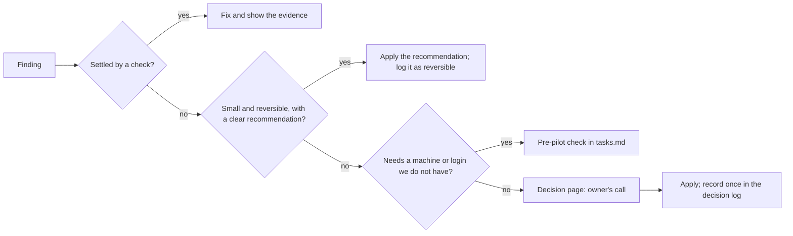

# What slows the design phase

Diagnosis made on 2026-11-14 from the six session transcripts of this project (04:00 to 14:40 UTC) and the files in `docs/`. Scripts: `/tmp/diag/*.py` (scratch, not kept).

## The constraint: the decision round-trip

Each decision goes to the owner as a decision page, even when the owner takes the recommendation. A round has nine steps: triage, facts, JSON, render, browser check, wait, paste, apply and record. Then a `/clear` and a handoff prompt start the next round, and the next session has to orient again.

**Hypothesis check: writing and revising spec docs is not the constraint.** Producing the 51 spec edits took about 0.08 h, which is 4% of the model's active time. Docs checks took under a minute in total.

## Evidence

| Measure | Value |
| --- | --- |
| Decisions asked, in 4 rounds (D1 to D14, P1 to P4, R1 to R3 with D7, Q1 to Q5) | 27 |
| Decisions where the owner took the recommended option | 26 of 27. The other is Q5, marked NOT SURE with a question, not a different choice |
| Model time producing Edit or Write calls on spec files | 0.08 h (4%) |
| Model time producing prose (replies, explanations, pages) | 1.66 h (83%) |
| Model time producing other tool calls (probes, canaries, checks) | 0.26 h (13%) |
| Owner reply time, excluding the 401 min overnight gap and a 67 min break | 0.2 to 10 min |
| Time from handoff prompt to first doc edit | 5, 3 and 25 min (21, 5 and 39 tool calls) |
| Edits to `docs/design/` per file, top three | module 9: 10, module 3: 9, module 7: 8 |

What the evidence also shows:

- **Wave 0 is not blocked.** `tasks.md` says "Next: W0.1", and Q5 "does not block wave 0". The latest handoff prompt said wave 0 was still blocked on R1 to R3, D7 and Q1 to Q5. That restated an old state.
- **The owner already asked for this fix.** At 13:57 the owner wrote: "remove the need for keep asking for my decision. either frontload the decision or for small impact decision go ahead with recommendation." The session then built another page with five cards, and four of them took the recommendation. The pending request also ends with another `/decision-page`.
- **One choice is recorded in up to five places:** the page JSON and HTML, `open-decisions.md`, `phase-1-decisions.md` and the `tasks.md` log.
- **Handoffs lose facts.** The owner's "both 2 and 3" criteria and the options they refer to are in no file and no transcript.
- **Some items wait for a machine, not the owner.** Linux, an OAuth login and `failIfUnavailable` on a machine without a sandbox were sent to the owner as questions. A test on the right machine settles each one.

## Fixes

1. **Decide at the recommendation by default.** Ask the owner only when a choice reopens D1 to D14 or an ADR, changes scope or phase, costs a lot to reverse, or has no option that is clearly better. Everything else is applied and logged as "decided at recommendation, reversible". Done here: step 1 of `.claude/skills/decision-page/SKILL.md`.
2. **Record each choice once.** The decision log (`phase-1-decisions.md`) holds the choice. `open-decisions.md` and the `tasks.md` log link to it and do not repeat it. Proposed, not applied.
3. **Make machine-bound items pre-pilot checks.** Linux under `bwrap` and `srt`, and `failIfUnavailable` on a machine without a sandbox, become tasks in `tasks.md` and leave the decision pages. Proposed in the pending request (item 1).
4. **Make "Resume here" the whole handoff.** After `/clear`, the prompt is "Read `docs/tasks.md`, Resume here, and continue". State lives in the file and is not restated. A restated prompt can go stale, as it did on 2026-11-14. Done here: "Resume here" is updated.
5. **Start W0.1.** Nothing blocks it. Waits for the owner's go-ahead, because the owner gave the rule "do not start W0.1 to W0.7 unless the owner asks".

## Unspecified

- **The owner's "fixed" criteria, "both 2 and 3".** The text of the options is not in any project file or transcript. The owner needs to restate them.
- **Node version (pending item 3).** Closed: the owner chose Node 26 (LTS "Lithium", v26.13.0 on this machine). See `open-decisions.md`, Round 3.
