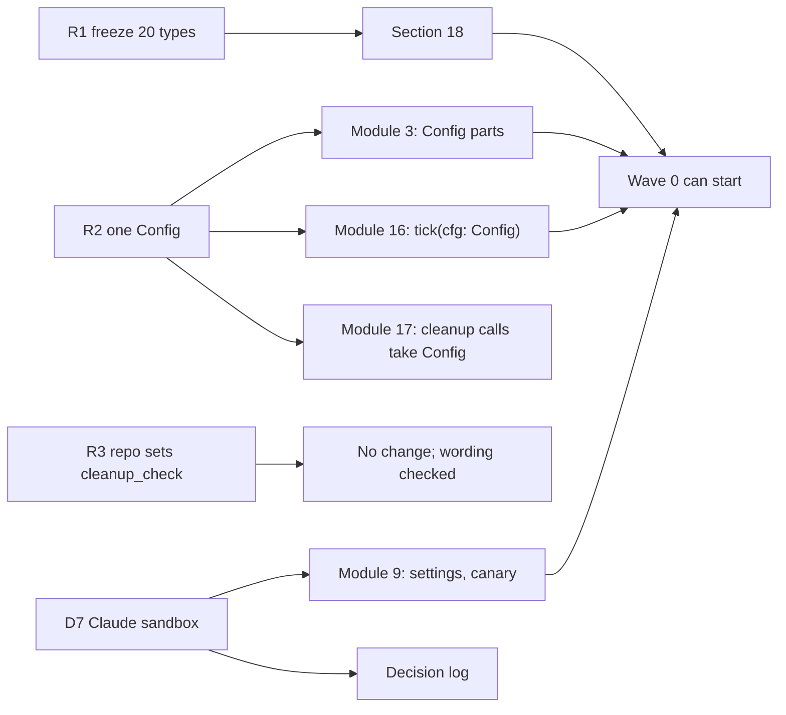

# Decisions before wave 0

Made on 2026-11-14 from `open-decisions.html` (source `open-decisions.json`). The owner took the recommended option on all four. None held an open question. Each is applied in the phase 1 spec.

| # | Decision | Chosen | Applied in |
| --- | --- | --- | --- |

## What each decision changed

**R1.** Section 18 gains the 20 shapes (`ErrorKind` beside `FactoryError`, 19 more in a new block), a table of who uses each, and the schema names for the three that are written to files (`task`, `usage`, `event`). The package table no longer says that section 18 owns `GateSpec` and `OnFail` without defining them.

**R2.** `Config` is described once, in section 18 and module 3. Module 16's `tick` takes `Config`, and no `MachineConfig` type remains. Module 3 gains the `factory-config` and `merge-policy` schema names (gap G8) and two criteria. One consequence beyond the literal text: `tick` has no repo part, but housekeeping needs the repo's `retention` and `cleanup_check`. So `tick` calls `load_config(repo)` for each repo, and module 17's `cleanup_after_join` and `cleanup_after_merge` take a `Config` argument.

**R3.** No spec change. `cleanup_check` stays an optional list of strings in module 3, and module 17 keeps skipping and reporting a worktree that is not clean when it is unset. The pilot repo has no comparison script yet, so the pilot skips every worktree that is not clean until it adds one. That work is in the pilot repo, which the owner owns.

**D7.** Module 9 replaces "no OS sandbox" with a per-attempt settings file that turns on `sandbox.enabled`, `failIfUnavailable`, `denyRead`, `allowRead` for the task's own folder and `allowWrite`. It adds a `doctor` canary with three read routes and three writes, a flow diagram, four criteria and the residual risk. Phase 1's decision table and the D7 row of the decision log carry the new wording.

## Tests run for D7

Claude Code 2.1.325, macOS, gateway token, a planted file outside the worktree. Scratch files were removed afterwards.

| Test | Result |
| --- | --- |
| `python3` read, no sandbox | Read the file |
| `python3` read, sandbox on with `denyRead` | `Operation not permitted` |
| Writes with `python3`, sandbox on | Allowed in the worktree and the task folder, refused outside both |
| Read tool with a deny rule, sandbox on | Blocked, with the `/` form and the `//` form |
| `cat`, sandbox on | Refused by the permission layer before it ran |
| `git status`, `git diff`, `git add` in a worktree, sandbox on | Worked |
| `allowRead` on a child of a denied parent | Child readable, sibling not |
| Bash request to `example.com`, sandbox on | Blocked |

## Round 2: open items (2026-11-14)

Decided on `open-items.html` (source `open-items.json`). Q1 to Q4 took the recommended option. Q5 was marked NOT SURE with a question, so it is answered below and **not applied**.

| # | Decision | Chosen | Applied in |
| --- | --- | --- | --- |
| Q1 | Sandbox for gate commands and `cmd` tasks | `srt-wrap`: run every `cmd` task and gate command under `srt` with the workers' read and write rules | [9](../design/modules/09-worker-adapters-and-governed-helpers.md), [8](../design/modules/08-gates-error-handling-and-rework.md) |
| Q2 | Build caches under the write boundary | `cache-in-task-dir`: the adapter points each tool's cache into the task's `work/` folder | [9](../design/modules/09-worker-adapters-and-governed-helpers.md) |
| Q3 | String commands | `lists-only`: nine examples rewritten as lists; a string fails at load with `config.invalid` | [5](../design/modules/05-workflows-and-plugins.md), [4](../design/modules/04-intake-and-triage.md), [7](../design/modules/07-git-and-github-operations.md), [8](../design/modules/08-gates-error-handling-and-rework.md), [18](../design/shared/18-shared-contracts.md) |
| Q4 | `RunSpec` shape | `script-or-python`: `script`, `python`, `args`; exactly one of the first two | [18](../design/shared/18-shared-contracts.md) |
| Q5 | When to test Linux and OAuth | NOT SURE, then answered in round 3 (below): OAuth dropped, Linux a pre-pilot check | [9](../design/modules/09-worker-adapters-and-governed-helpers.md) |

**Tested this round** (macOS, Claude Code 2.1.325, `srt` 0.0.83). Every result was run, not recalled.

| Test | Result |
| --- | --- |
| `cat` under the sandbox alone, file inside the worktree | `Operation not permitted`; the control read it |
| Local stdio and remote HTTP MCP servers, sandbox on | Both answered a tool call |
| The real Tavily server, key from `TAVILY_API_KEY`, sandbox on | Returned search results; the key was not in the output |
| A worker's Bash reading the file that holds the resolved key | `Operation not permitted` |
| `allowedDomains: [example.com]` | `example.com` returned 200; `example.org` was denied |
| Sandbox that cannot be applied (nested `sandbox-exec`) | The command failed with exit 71 and did not run unsandboxed |
| Write to `~/.npm` with the sandbox on | `Operation not permitted` |
| `srt`: read of a denied file, write outside, write inside | Refused, refused, allowed |
| `srt`: `allowRead` for a child of a denied folder | Child readable, sibling refused |
| `srt`: exit codes 0, 3 and a missing binary | 0, 3 and 127 |
| `srt`: network by default | Denied (`host is not on the allow list`) |
| `shlex.quote` of `a b`, `c;touch X`, `$(touch Y)`, `it's` into `srt -c` | Each stayed one argument; no file created |
| Cache variables | `npm_config_cache`, `MAVEN_OPTS=-Dmaven.repo.local`, `GOMODCACHE`, `GOCACHE`, `PIP_CACHE_DIR` worked. `npm_cache` does nothing |

## Held back, and not settled

- **Q5, Linux and OAuth.** Closed in round 3: OAuth is dropped and Linux is a pre-pilot check.
- **Gradle, NuGet, ruff cache variables.** These tools are not installed on this machine, so `GRADLE_USER_HOME` and the others are listed as unverified in module 9.
- **`srt` on Linux.** Not tested. `srt` 0.0.83 needs Node 22.12 or later, which is stricter than the Node 18 that module 9 names for local MCP servers.
- **`failIfUnavailable` on a machine with no working sandbox.** The nested `sandbox-exec` test showed the command fails, but it did not run Claude's own setting on such a machine, so no error code is chosen.
- **`sandbox-exec`** is marked DEPRECATED on macOS, so a future macOS can break both sandboxes.
- **Gap G2** (27 module-local types), **G3** (the error-code catalogue) and **G9** (Python floor) were not part of these decisions. They are decided in round 3 below.

## Round 3: pending items 2 and 3 (2026-11-14)

Owner's answer to "help me go through 2 and 3": item 2 is the `sandbox-exec` question; item 3 is the Node version. Owner decided Node 26.

**Item 2: drop `sandbox-exec` only if no alternative exists and it is not a project requirement. Result: not dropped.** Both conditions are checked, and the first fails.

| Check | Result |
| --- | --- |
| `srt` 0.0.83 uses `sandbox-exec` on macOS | Yes. Its README and `dist/sandbox/macos-sandbox-utils.js` |
| Claude Code 2.1.325 binary uses it | Yes. `sandbox-exec` appears 7 times and `bwrap` 75 times in `claude.exe` |
| A macOS mechanism with the same boundary, other than `sandbox-exec` | None tested. Docker, Colima, Lima and OrbStack are absent. Podman is running (a Linux VM), which is an alternative in principle: every worker would run in a Linux VM. Not tested, and it would change D6's model |
| Is the boundary a project requirement? | Yes: D7 requires reads of secrets denied and writes limited to the worktree and task folder. The mechanism is not named as a requirement, but dropping it drops D7 |
| Decision | Keep `sandbox-exec`. Module 9 records the decision and the fail-closed rule for when a future macOS breaks it |

**Item 3: Node 26.** `node -v` is v26.13.0, which Node reports as LTS "Lithium". `srt` 0.0.83 was run on Node 26.13.0 with a settings file that validates. The file needs `network.deniedDomains` and `filesystem.denyWrite`, which the README example omits, or `srt` refuses to run.

| Test (`srt` 0.0.83, Node 26.13.0, factory's rules) | Result |
| --- | --- |
| Read of a file in `denyRead` | Refused: `Operation not permitted`, exit 1 |
| Write inside `allowWrite` | Allowed, `ok`, exit 0 |
| Write outside `allowWrite` | Refused: `Operation not permitted`, exit 1 |
| `curl` to `example.com` with no allowed domains | Refused: CONNECT tunnel failed, 403, exit 56 |
| Same read outside the sandbox (control) | Read the file |

Node 25 is not used. The spec's floor for `srt` stays at Node 22.12 (its `engines` field). Module 9 records Node 26 as the tested version. Node 26 issues beyond these tests are not assessed.

## Round 3, items 1, 4 and 5 (2026-11-14)

**Item 1: OAuth dropped, Linux a pre-pilot check.** Phase 1 supports `ANTHROPIC_API_KEY`, or `ANTHROPIC_AUTH_TOKEN` with `ANTHROPIC_BASE_URL` for a gateway. A login session is out of scope. Module 9 (Login), module 6 (cron) and the module 9 intro now say so. Linux moves to a pre-pilot check in module 9. D6 stands. Not done: an OAuth test, because the owner dropped it.

**Item 4: `failIfUnavailable` error codes.** Tested with Claude Code 2.1.325, `--settings` and a sandbox the OS refuses to start (an outer `sandbox-exec`):

| Failure | Observed | Code (section 18) |
| --- | --- | --- |
| Sandbox cannot start | exit 71, `sandbox_apply: Operation not permitted`, the command did not run | `sandbox.unavailable` |
| Settings field of the wrong type | exit 1, "sandbox required but unavailable... failed validation" | `sandbox.settings_invalid` |
| Settings file missing | exit 1, "Settings file not found" | `sandbox.settings_unreadable` |
| Settings file not JSON | **exit 0, ran with no sandbox**: `cat` of a denied file returned the secret | `sandbox.settings_unparseable`, parsed by the adapter before the start |
| Unknown key | accepted and ignored | none (not a failure) |

The table also lists `sandbox.srt_missing`, `sandbox.node_old` and `sandbox.canary_open`, which module 9 already requires but the tests did not run. `config.no_credentials` covers the missing key. Not shown: what `failIfUnavailable` changes on a machine that cannot start the sandbox. The control with the flag off also failed, so the test cannot separate the two.

**Model from `ANTHROPIC_MODEL` (owner's correction, 2026-11-14).** With no model in config, Claude takes the model from `ANTHROPIC_MODEL`. Tested on Claude Code 2.1.325 through this gateway, with a scrubbed environment (only PATH, HOME, base URL and token):

| Environment | `--model` flag | Result |
| --- | --- | --- |
| `ANTHROPIC_MODEL` set to the gateway's model | none | Worked; `modelUsage` key `claude-advantage-assist` |
| `ANTHROPIC_MODEL` unset | none | **Failed:** `400 E003: Model not available for Coding Agents` |
| `ANTHROPIC_MODEL` empty | none | Failed the same way, so empty counts as unset |
| `ANTHROPIC_MODEL` bogus | real model | Worked: the flag wins |
| `ANTHROPIC_MODEL` real | bogus model | Failed: the flag wins |

The spec said "no model flag" and a scrubbed worker environment, which together drop the variable. Module 9 now passes `ANTHROPIC_MODEL` through, says the flag wins, and has two new criteria. The config uses `${ANTHROPIC_MODEL:-}`, because module 3 defines only the `:-` and `:?` forms.

**`ANTHROPIC_BASE_URL` from the environment (owner's correction, 2026-11-14).** Same test, with PATH, HOME, the token and the model passed and the base URL varied (the script built the environment and printed none of it):

| `ANTHROPIC_BASE_URL` | Result |
| --- | --- |
| Passed | Worked; model `claude-advantage-assist` |
| Not passed | Failed: `Not logged in · Please run /login` |
| Empty | Failed the same way |

Module 9 declares it under the harness `env` as `${ANTHROPIC_BASE_URL:-}`, names the three Claude variables in the worker-environment rule, and has a new criterion. Not tested: a token issued by Anthropic with no base URL (Unspecified).

**Secret exposure.** My first test command printed the shell's environment in its error output, which included `ANTHROPIC_AUTH_TOKEN`. The token was in this session's output and in the transcript. It was not written to any project file. **Rotate the gateway token.**

**Item 5: G2, G3, G9.**
- **G3** closed: section 18 has the catalogue.
- **G9** closed as a decision: 3.10 is the floor, and the tests run on 3.10 and 3.15. The W0.1 test run is the check.
- **G2** not closed in the spec, and its fix is not a choice. Each module defines its own types in its wave, and the W0.6 contract test checks them. My scan of the signature blocks in modules 3 to 17A found 28 names that no block defines: `Capabilities`, `Config`, `Defaults`, `GcPlan`, `GcReport`, `HarnessConfig`, `HistoryRecord`, `InitReport`, `Lock`, `LockReport`, `LockState`, `NoteRef`, `NotifyReport`, `Packet`, `Policy`, `Routing`, `ScanResult`, `SinkResult`, `StepResult`, `StopKind`, `SyncReport`, `TestReport`, `TickReport`, `Toolchain`, `TriageResult`, `UpgradeReport`, `UsageReport`, `WorkerHandle`. `Config` is defined in section 18's prose, so 27 are local. The scan is a one-off, not a script in `scripts/docs-check/`, and W0.6 needs one.
- **G9 wording.** Only `python -c` ran on 3.10.22 (`uv run --python 3.10`). No test suite exists yet, so no test has run on either version. The W0.1 test run is the check.
