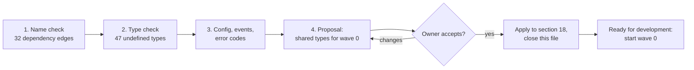

# Ready for development: gap review of the phase 1 contracts

**Status: closed on 2026-11-14.** The owner accepted O1 (R1) and O2 (R2) on the decision page, and the shapes are in [section 18](../design/shared/18-shared-contracts.md). O3 and O4 were settled by checks, as the decision page's introduction records (the 50 MB default; Python 3.10 ran under `uv`). G8 is applied in module 3. What is still open (G2, G3, `RunSpec`, the `GateSpec.cmd` string form) is listed in [open decisions](open-decisions.md). The D7 note under "Still unverified" is superseded by the D7 change in the [decision log](phase-1-decisions.md#d7-changed-2026-11-14).

Date: 2026-11-14. Scope: every module contract in `docs/design/modules/` and the shared sections, after the pilot decisions P1 to P4 were applied. Phase 1 only.

The question this review answers: can wave 0 freeze the shared contracts, so that every wave 1 to 3 module can be built against them and against fakes, without a contract change later?

**Verdict: not yet.** The dependency names agree, but 47 names used in signatures are defined nowhere. Of those, 15 cross a module boundary; 5 more shared types appear only in field lists. These 20 must be frozen in wave 0. The proposal below gives each one a shape taken from what its callers already say. When the owner accepts it, the shapes go into [section 18](../design/shared/18-shared-contracts.md) and this file is closed.



## How it was checked

Each check is a script run against the spec. Each script was first shown to catch a planted fault, so a clean result means something.

| # | Check | Result | Proof the check works |
| --- | --- | --- | --- |
| 1 | Each name in a module's **Depends on** is defined in the upstream module's contract | 32 edges, 0 gaps (one hit, `dashboard_url`, is a config key in parentheses, not a function) | A planted `no_such_fn` in module 17 was reported |
| 2 | Each type in a signature is defined in some code block | 47 undefined: 15 shared, about 28 local to one module, 4 not types (`JSON`, `LLM`, `OS`, `Callable`) | Known-defined types (`Run`, `SkillRef`, `AttemptResult`) were not reported |
| 3 | Events named in **Writes** are in the module 6 event catalogue | 2 missing: `request_invalid`, `request_duplicate`. **Fixed** | — |
| 4 | Config keys used in modules are defined in module 3 | 3 missing: `worker_log_max_mb`, `auto_gc`, `serialize_overlapping_runs`. **Fixed** (see open item O3) | Keys owned by workflows (`checkpoint_every_minutes`, `max_restarts`) are correctly in module 5 |
| 5 | Error codes have one catalogue | None exists; codes appear only as examples (`config.invalid`, `state.locked`, `notes.task_finished`, `git.hook_failed`) | — |

## Gaps

| # | Gap | Who is blocked | Proposed fix |
| --- | --- | --- | --- |
| G1 | 20 shared types undefined: 15 from signatures and 5 from field lists (table below) | Every module, and the wave 0 fakes | Freeze the shapes below in section 18 |
| G2 | About 28 module-local types undefined, such as `GcPlan`, `TickReport`, `Toolchain` | Only the owning module | Each module defines its own in its wave; the contract tests (W0.6) check they exist by then |
| G3 | No error-code catalogue | 8 (`classify`), 16 (`--json` output), 15 | **Closed 2026-11-14:** section 18 has the catalogue (`config.invalid`, `state.locked`, `git.hook_failed`, `notes.task_finished`, and the `sandbox.*` and `config.no_credentials` rows). Each module adds its rows in its wave; the contract test (W0.6) fails on a code used but not listed |
| G4 | `Config` and the machine config are one name in 3 (`load_config -> Config`) but 16 uses `MachineConfig` | 3, 16 | One `Config` with `.machine` and `.repo` parts; `tick` takes `Config` loaded with `repo=None`. Change module 16's signature |
| G5 | `Clock` is used by 6 and 8, `FakeClock` is a wave 0 fake, but `Clock` has no interface | 6, 8, 11, 17 and every test | `Clock` protocol: `now() -> datetime`, `sleep(seconds: float) -> None`; `SystemClock` and `FakeClock` implement it |
| G6 | `GateSpec` is listed as owned by section 18 but has no fields; seven modules take it | 4, 5, 7, 8, 9, 11, 17A | Shape below, from the workflow YAML |
| G7 | `OnFail`, `HelperPolicy`, `McpServer`, `StageState`, `InfraWait`, `RunSpec` appear in field lists but are never defined | 5, 6, 9 | Shapes below |
| G8 | JSON Schema list in module 3 has no `factory.yaml` and no `merge-policy.yaml` schema, though both are validated at load | 3, 13 | Add `factory-config` and `merge-policy` to the schema list |
| G9 | The minimum Python version: spec says 3.10+; this machine has 3.15 | W0.1 | **Closed 2026-11-14:** 3.10 is the floor, and the tests run on 3.10 and on 3.15. This machine has 3.10.22 under `uv`; `python -c` ran on it, and no test suite exists yet. The check is the W0.1 test run on both |

## Proposal: shared types for wave 0 (G1, G5 to G7)

Each shape comes from the comments and field lists the callers already use. The "Used by" column is the list of modules the type must satisfy.

```python
# types.py additions
class Clock(Protocol):
    def now(self) -> datetime: ...
    def sleep(self, seconds: float) -> None: ...

@dataclass
class GateSpec:       kind: Literal["cmd", "check", "schema"]; cmd: list[str] | None
                      check: str | None; schema: str | None; args: dict
@dataclass
class GateContext:    run: Run; stage: str; task_id: str | None; worktree: Path
                      task_dir: Path | None; artifact: Path | None; task_base: str | None
                      scope: list[str]; deny: list[str]; cfg: Config
@dataclass
class OnFail:         goto: str; max: int
@dataclass
class HelperPolicy:   mode: Literal["auto", "native", "off"]; max: int
                      split_hints: list[str]; timeout_minutes: int | None
@dataclass
class McpServer:      name: str; url: str | None; command: list[str] | None
                      headers: dict[str, str]; env: dict[str, str]
@dataclass
class StageState:     id: str; visit: int; status: Literal["pending", "running", "awaiting_approval", "done", "failed", "skipped"]
                      tasks: list[str]; started: str | None; ended: str | None
@dataclass
class InfraWait:      since: str; tries: int; last_error: str
@dataclass
class PrRef:          number: int; url: str; head: str; base: str
@dataclass
class PrState:        state: Literal["open", "merged", "closed"]; ci: Literal["green", "red", "pending"]
                      checks_output: str; review_decision: str | None
@dataclass
class Signals:        behind_base: int; overlaps: list[tuple[str, list[str]]]   # (other run id, files)
@dataclass
class TaskBranch:     task_id: str; branch: str; task_base: str
@dataclass
class JoinResult:     ok: bool; conflict_files: list[str]; hook_failed: bool; commits: list[str]
@dataclass
class SyncResult:     ok: bool; conflict_files: list[str]
@dataclass
class TaskState:      task_id: str; stage: str; status: TaskStatus; attempt: int; restarts: int
                      task_base: str | None; worktree: Path | None; checkpoints: int
@dataclass
class Event:          seq: int; ts: str; type: str; run_id: str; data: dict
@dataclass
class CheckResult:    name: str; ok: bool; detail: str; hint: str
@dataclass
class Problem:        file: str; line: int | None; message: str; hint: str
@dataclass
class UsageRecord:    run_id: str; task_id: str; stage: str; attempt: int; harness: str
                      model_requested: str | None; models: list[str]
                      input_tokens: int | None; output_tokens: int | None; total_tokens: int | None
                      start: str; end: str | None; exit: Literal["started", "ok", "failed", "interrupted"]
                      repo: str; branch: str | None; worktree: Path
ErrorKind = Literal["fail_fast", "transient", "task_retry", "rework", "human"]   # same set as FactoryError.kind
```

| Type | Used by | Source of the shape |
| --- | --- | --- |
| `Clock` | 6, 8, 11, 17, all tests | G5 |
| `GateSpec`, `GateContext` | 4, 5, 7, 8, 9, 11, 17A | Workflow YAML `gate:` entries (5), the `check_*` functions, plugin checks get it as JSON (5) |
| `OnFail` | 5, 8 | `on_fail: {goto, max}` in the workflow YAML |
| `HelperPolicy` | 5, 9 | `helpers: {mode, max, split_hints}` and the "Declare" control in 9 |
| `McpServer` | 3, 9 | `mcp_servers:` in the machine file (9) |
| `StageState`, `InfraWait` | 6, 15 | `Run` fields in section 18; D4 visits; D13 outages |
| `PrRef`, `PrState` | 7, 13, 6 | Comments on `PullRequests.state` and `watch_pr` |
| `Signals` | 7, 6, 15 | "behind_base, overlaps" comment in 7, dashboard text in 7 |
| `TaskBranch`, `JoinResult`, `SyncResult` | 7, 8, 6 | Comments on `join` and `sync_base` |
| `TaskState` | 6, 8, 12 | `task.json`, `TaskStatus`, D12 and the restart cap |
| `Event` | 6, 12, 15 | `events.jsonl` catalogue in 6 |
| `CheckResult`, `Problem` | 3, 5, 9, 10, 16 | `doctor`, `validate_workflow`, `verify_lock` |
| `UsageRecord` | 14, 13, 15, 16 | The `usage.jsonl` table in 14, with P4 |
| `ErrorKind` | 8, 19 | The five handling types in section 19 |

Each dataclass gets a JSON Schema in `factory/schemas/` where it is written to a file (`TaskState` as `task`, `UsageRecord` as `usage`, `Event` as `event`), and the W0.4 test checks they agree.

## Open items for the owner

These are choices the spec does not make. Each has a default that wave 0 will use unless the owner says otherwise.

| # | Item | Default used |
| --- | --- | --- |
| O1 | Accept the shared type shapes above | Use them as written |
| O2 | G4: one `Config` with machine and repo parts, so module 16's `tick` takes `Config` | Yes |
| O3 | `worker_log_max_mb` had no default in the spec; this review set 50 | 50 |
| O4 | G9: Python 3.10 floor, tested on 3.15 only on this machine | Keep 3.10, say 3.10 is not run |

## Still unverified (do not claim)

- Both items below were open when this review was written. OAuth login is now out of scope, and D7 was decided as `claude-sandbox`; see [open decisions](open-decisions.md).
